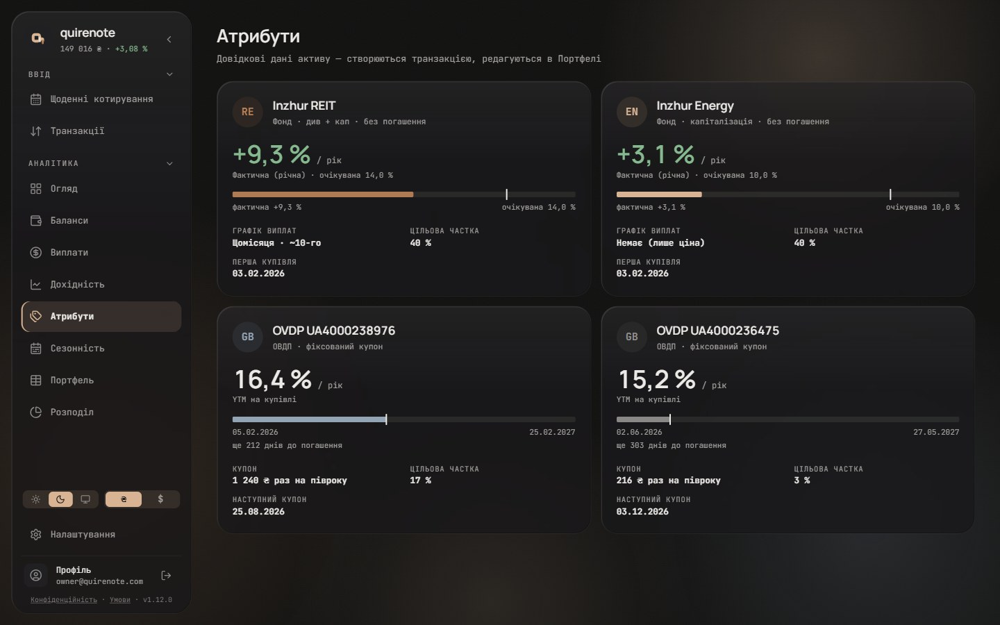
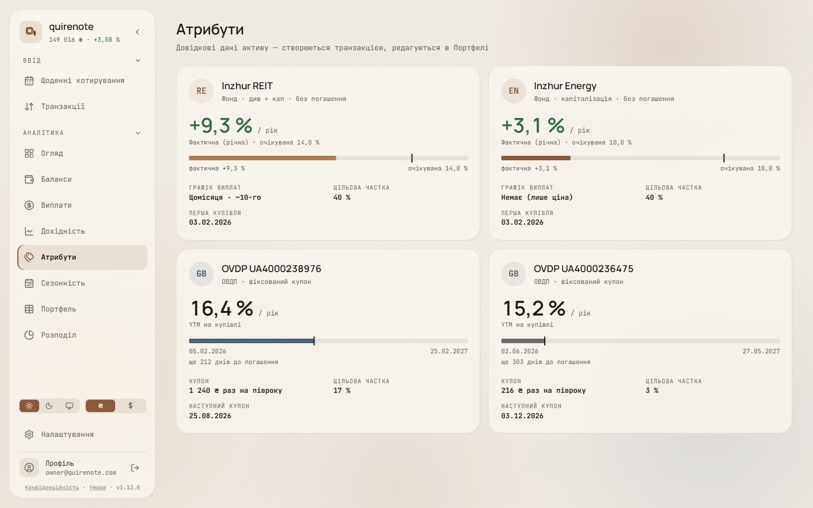
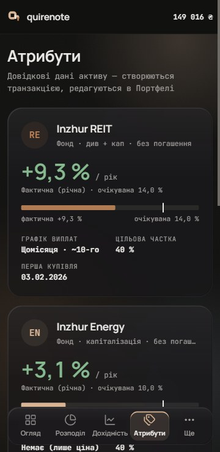
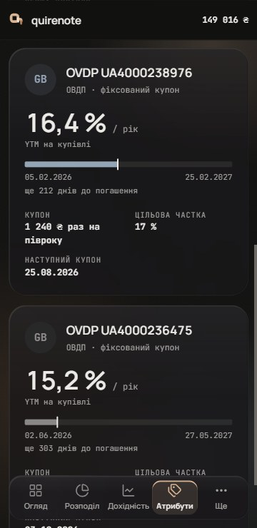
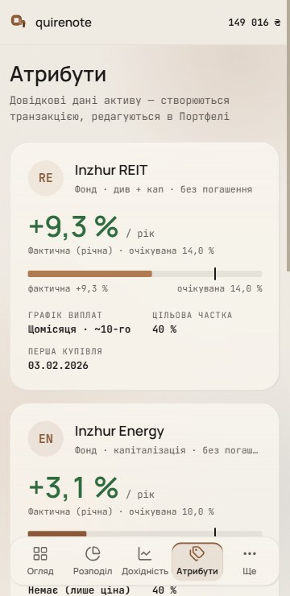
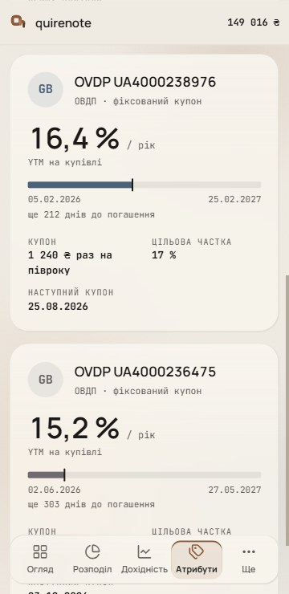
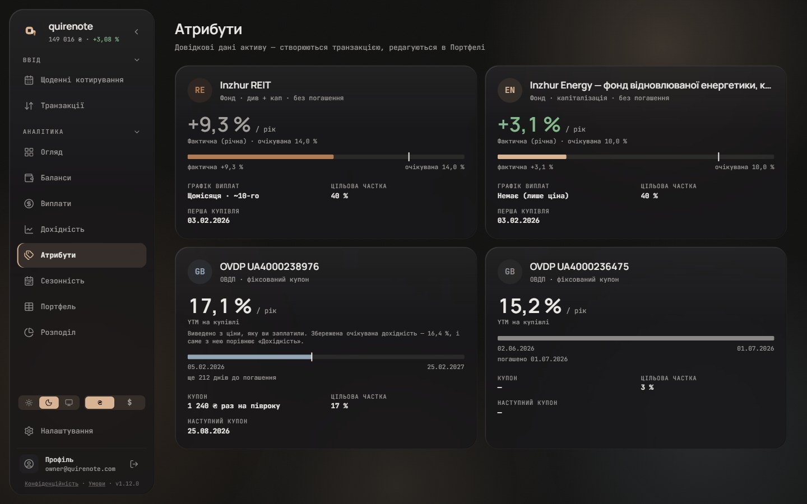

# The «Атрибути» asset item (wave 7)

Today every asset on «Атрибути» is the shared record card: the name, then five or six small uppercase labels over bold values, all at the same weight, so nothing leads. This wave gives Атрибути its own item. `RecordCard` stays as it is for Портфель, Баланси, Виплати and Дохідність, and the record’s "The record card IS the Attributes asset card" is rewritten for this page. Every figure is the served value, and a new phrase is marked as new copy.

## Renders

1440, dark and light: the four seed assets in the 2-column grid.

360, dark and light, at the top and scrolled: one column.

The edge states, one per card:

- REIT: a short basis, so the actual return reads grey.
- Energy: a long name, which truncates.
- …8976: a YTM derived from the price paid rather than the stored one, which brings the app's own disclosure line under the hero.
- …6475: a closed bond. The bar is full, the caption reads «погашено {date}», and the coupon and next coupon read «—».

## Signed

- **Card.** Glass, r24, 22 px padding, in the same 2-column grid (1 column below md).
- **Header (I3).**
  - A 44 px avatar: the code on the asset tint, the one round shape.
  - The name in Manrope 17/600, truncating.
  - Under it, a `muted` 11.5 px "what is it" line that wraps: «Фонд · {yield type} · без погашення» or «ОВДП · {yield type}», for example «Фонд · див + кап · без погашення» and «ОВДП · фіксований купон». New copy.
  - The tag goes; its text lives in that line.
- **Hero (H1).** One figure in Manrope 36/600 with «/ рік» beside it, then an 11 px `muted` caption.
  - *Left open by wave 18: 36 / 600 fits no role in its table ([type.md](type.md#left-open)).*
  - *Answered by wave 25: hero 36 joins the display row ([open-values-charts-type.md](open-values-charts-type.md#signed)).*
  - Fund: the actual annual return, coloured as today (`pos` / `neg`, `muted` on a short basis), with the caption «Фактична (річна) · очікувана {expected} %», the asset's stored expected return.
  - Bond: the YTM at purchase, with the caption «YTM на купівлі». When the YTM is derived, the app's `ytmDerived` line sits under the caption.
- **Progress bar (V1).** One visual between the hero and the facts. 8 px at r2 on an `ink` 8 % track, the fill in the asset hue (identity, not gain or loss), and a 2 px `ink` tick, 16 px tall, for the reference.
  - *Answered by wave 26: with no value or no range (a negative or missing fund return, a bond with no maturity) no bar is drawn ([open-values-shell-controls.md](open-values-shell-controls.md#signed)).*
  - Bond: first purchase → maturity with today ticked, the two dates at the ends, and «ще N днів до погашення» under it. A matured bond shows a full bar, no tick, and «погашено {date}».
  - Fund: the actual return against the expected tick, on a scale of max(actual, expected) × 1.25, with «фактична … / очікувана …» at the ends.
  - The captions are new copy. «днів» must follow Ukrainian plural rules (1 день, 2–4 дні).
- **Facts (F1).** A 2-column label/value grid (10.5 px uppercase `muted` over 12.5 px bold), in a fixed order. A fact the hero or the bar already shows is not repeated.
  - *Overturned by wave 18: the labels take the label role (11 / 14), and 12.5 px maps to 13 ([type.md](type.md#signed)).*
  - Fund: Графік виплат, Цільова частка, Перша купівля.
  - Bond: Купон, Цільова частка, Наступний купон.
- **Contrast.** The tick and the fills aim at 3 : 1 against the track; the bar's values are always printed in its caption, so the fill is never the only carrier, which covers a hue that falls short.
- **Loading placeholder** follows the new geometry: the avatar circle, two text bars, one 36 px hero block and one 8 px bar.

## Rejected

- **H2, three equal figures in a row** (20 px, with small captions): nothing is louder than the rest of the strip.
- **H3, one plain sentence** with its keywords bold: new copy for the sentence frames; it wraps, and its figures don't line up between items.
- **V2, the share against its target:** it repeats what Розподіл already shows for the whole portfolio.
- **V3, a payout month strip** with the next payout: new copy, and no product that could be verified draws coupons as a month strip.
- **I1, today's header** (the 34 px avatar, the 17 px name, the yield-type tag on the right): its cost was none; I3 was picked instead.
- **I2, a header band in the asset's tint:** four tinted bands on one screen spend more of the 10 % colour ration, and …8976's and …6475's greys sit close together.
- **F2, one quiet fact line:** it wraps mid-fact, the values don't line up between items, and it reads as prose again.
- **F3, a «Деталі» disclosure:** the next coupon and the payout schedule, which people check, cost a click; and it is new copy.
- **A 1–7 risk scale:** the app stores no risk class.

## Settled by research

- **Fixed order:** funds and bonds share one skeleton (UCITS KIID 583/2010 Art. 4: "presented in the order as set out").
- **Lead figure:** large, with its label small after it (Ghostfolio's value component: the value at h2, a `<small>` label below). Readers hunting a page look for "digits" (NN/g). One large value first follows Ghostfolio's holding detail.
- **Visuals:** a quantity is shown by length or position, never colour alone. NN/g: "2D position and length are the two preattentive attributes".
- **Words:** plain and short (UCITS Art. 5: "clear, succinct and comprehensible").
- **No risk scale:** the app stores no risk class, so the PRIIPs 1–7 strip is out.
- **The "what is it" line** follows PRIIPs Art. 2: "What is this product?", with the maturity "or an indication that there is no maturity date".
- **The progress bar** follows PRIIPs Art. 2 (maturity is a key fact) and NN/g (length is read before text).
- **The facts grid** follows GOV.UK Summary list, "a list of key facts", and the app's record anatomy.

## Implementation checks

- Атрибути gets its own item; `RecordCard` stays for Портфель, Баланси, Виплати and Дохідність.
- The derived YTM reuses the app's `ytmDerived` line and keeps its copy.
- Tests an implementation re-points:
  - `attributes-next-coupon.test.ts`: the Next coupon fact stays, now in the 3-fact grid;
  - `attributes-ytm.test.tsx`: the YTM text moves into the hero; the derived line keeps its copy;
  - the golden seed > attributes, if the view gains fields;
  - `placeholders.test.tsx`.
