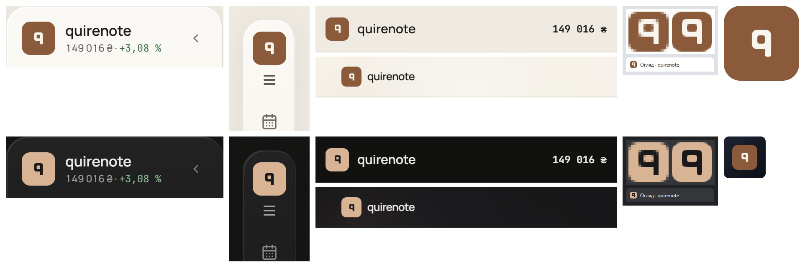

# The logo (wave 24)

The mark is redrawn in the refresh's style, its form as well as its material. The old mark, the 5h from `parchment-5h`, is three copper strokes (loop, shaft, head) with no fill, and at 16 px its three tones blur into one (issue #103). The new logo is a solid «q» knocked into a plate, with a separate drawing for the browser tab and one for the home-screen icon. It is still drawn in four places, all changing together.

It overturns wave 1's `panel` logo tile at r12 ([shell.md](shell.md#signed)) and the bare mark in the 360 bar ([mobile-bar-and-sheet.md](mobile-bar-and-sheet.md#signed)) and in the signed-out header ([signed-out.md](signed-out.md#signed)), and wave 20's `logo-pill-a` ([palette.md](palette.md#signed)).

## Renders

Every pick in its place: the sidebar, the rail, the 360 bar, the signed-out header, the tab at 16 and 32 px, and the home-screen icon. Light is on top, dark below, all at 2×.

## Signed

- **The form (F2), a solid «q», in a 120 box.**
  - A bowl: a rounded rect at x32 y21, 56 × 56, r15.
  - A counter cut out of it: x48 y37, 22 × 24, r6.
  - A stem joined to the bowl: x70 y49, 18 × 50, r5.
  - It is all fill, one colour, with nothing baked in (no sheen, bevel, blur or shadow).
- **The material (M4), a solid plate.** The «q» sits knocked into a solid plate, at 22/40 of the plate's side everywhere. The counter shows the plate. The plate's corner is round(side × 0.26), by the shape system.
- **The tokens: two per theme.** The three part tokens become two.

  | Token | Light | Dark |
  | --- | --- | --- |
  | the plate, today's `logo-outline` | `#8a5a3a` | `#d8b494` |
  | the «q», `card` | `#f8f5ef` | `#19181a` |

  `logo-pill-a` and `logo-pill-b` retire. On the glass sidebar the plate and the «q» keep these values; the glass does not change them.
- **The lockup (K1), one tile in two sizes.**

  | Site | Plate | Corner | «q» | Wordmark «quirenote» |
  | --- | --- | --- | --- | --- |
  | the sidebar and the collapsed rail | 40 | r10 | 22 | 17 / 600 (sidebar) |
  | the 56 px bars: the 360 bar and the signed-out header | 28 | r7 | 15 | 15 / 600 |

  In the rail the plate stands over the 14 × 12 burger, so the rail head grows by 18 px. Wave 21's O3 fit point (670) moves to about 688, to be measured at implementation ([rail-and-account-foot.md](rail-and-account-foot.md#signed)).
- **The tab (T3), a separate drawing on the 16 grid.**
  - A 16 × 16 plate at r4.
  - The bowl `M6 3 H10 A2 2 0 0 1 12 5 V8 A2 2 0 0 1 10 10 H6 A2 2 0 0 1 4 8 V5 A2 2 0 0 1 6 3 Z` with the counter `M7 5 H9 A1 1 0 0 1 10 6 V7 A1 1 0 0 1 9 8 H7 A1 1 0 0 1 6 7 V6 A1 1 0 0 1 7 5 Z` (even-odd).
  - The stem `M10 6 H12 V12 A1 1 0 0 1 11 13 A1 1 0 0 1 10 12 Z`.
  - The light pair is the default, since Safari ignores the query; `prefers-color-scheme: dark` flips it to the dark pair. 32 px is the same drawing doubled.
- **The home-screen icon (I1), the copper plate.** A 180 px opaque square, full-bleed `#8a5a3a`, with the «q» in `#f8f5ef` at 22/40 (a 99 px box) centred on its paint. It is unmasked, since iOS applies the mask. One PNG serves every iOS appearance.
- **Brand invariant.** The logo is still drawn in four places, all changing together: `Sidebar.tsx`'s `Mark`, `favicon.svg` (now its own 16-grid drawing), `build-touch-icon.mjs` and the PNG it writes. `mark.test.ts` and `palette-mirror.test.ts` are rewritten to pin the new values. The box is still never cropped to the ink.
- **Records superseded.**
  - The *Brand* decision's "the 5h mark, all stroke and no fill" and its three per-theme parts.
  - `parchment-5h`'s logo row and its `logo-mono` rule.
  - Wave 1's `panel` logo tile at r12 (now solid, at r10).
  - Issue #103's open question, answered as a two-colour plate redrawn for 16 px rather than a one-colour cut.

## Rejected

- **F1, the 5h refined** (one stroke weight, the head as the bay's leg): still all stroke, and at 16 px the loop and bay smear into one shape.
- **F3, the quire** (three overlapping sheets): close to the common "copy" and "documents" glyphs.
- **F4, the «q» alone in stroke:** beside F2 it is the same letter in outline.
- **M1, one colour on wave 1's `panel` tile:** in dark the tile all but vanishes on the glass sidebar.
- **M2, two tones on wave 1's tile:** at 22 px the seam reads as a smudge.
- **M3, one colour on a glass tile** (wave 17's knob recipe): the logo becomes a control look-alike, a raised knob that does nothing when pressed.
- **T1, the M4 plate scaled to 16 px:** the «q» becomes a smear.
- **T2, the bare «q» in one colour** (#103's `logo-mono` answer): the tab no longer matches the plate-and-mark, and the counter fills in at 16 px.
- **I2, the sand plate:** the brightest icon on a dark home screen. **I3, today's dark plate with a sand «q»:** the inverse of M4, so it breaks the plate-and-mark match, and on a dark wallpaper the plate's edge is lost.
- **K2, one 32 tile everywhere:** in the sidebar the tile no longer matches the two-line block beside it. **K3, the tile only where there is room:** two forms of the logo in the app.

## Settled by research

- **Filled shapes, few of them.** Apple: "Consider basing your icon design around filled, overlapping shapes"; "express it in a simple, unique way with a minimal number of shapes". Liquid Glass is not applied "to smaller, more complex elements in an icon like text and thin lines". Material 1: "Don't use delicate, thin stroke weights".
- **Nothing baked in.** Apple: "there's no need to include specular highlights, drop shadows between layers, beveled edges, blurs, glows, and other effects". Fluent: "Color gradients, overlays of varying opacity, and tints of color should be kept to a minimum". Where glass appears, it belongs to the plate, not the glyph.
- **Corners match the grid.** Fluent: "The corners of these shapes should match the rounded corners in the icon grid".
- **A separate small drawing.** Primer: "Always design two versions of each icon: a 16px version and a 24px version"; "Align the outer edge of shapes to pixel boundaries when possible". Evil Martians: "a special version of the logo that's tailored to fit small pixel grids".
- **The plate is the opaque backing** Apple's Materials page describes, and it matches the app-icon pattern of a mark on a plate. Its cost is Apple's "branding always defers to content": a solid block of brand colour at the top of the sidebar.

## Settled by rule

- The plate's corner follows the shape system, round(size × 0.26): r10 at 40, r8 at 32, r7 at 28. Wave 1's r12 tile was `panel` on `panel` and barely visible; now that the tile is solid, its corner shows, so it takes the rule.
- The «q» is 22/40 of its plate on every site.
- The wordmark is held: «quirenote» at 17 / 600 in the sidebar and 15 / 600 in the bars.
