# Charts (wave 3)

Wave 3 sets the charts on the five chart screens: /balances, /yield, /payouts, /seasonality and /allocation. Each chart is drawn from the app's own served data (/view/balances, /view/series) inside the signed shell and glass. Everything around a chart (headers, tables, insight cards, controls) is the app's own screen. The fixed asset palette was never chosen as a categorical palette, and every series mark keeps 3 : 1 against the card. So colour can never be the only key, and in this app a dash already means "expected / proposed", so dashes can't carry identity either.

## Renders

The tooltip is shown open at a fixed date, so the hover layer can be judged. The 1440 /seasonality frames predate a 3 px label-offset fix that the 360 check needed.

### 1440, dark

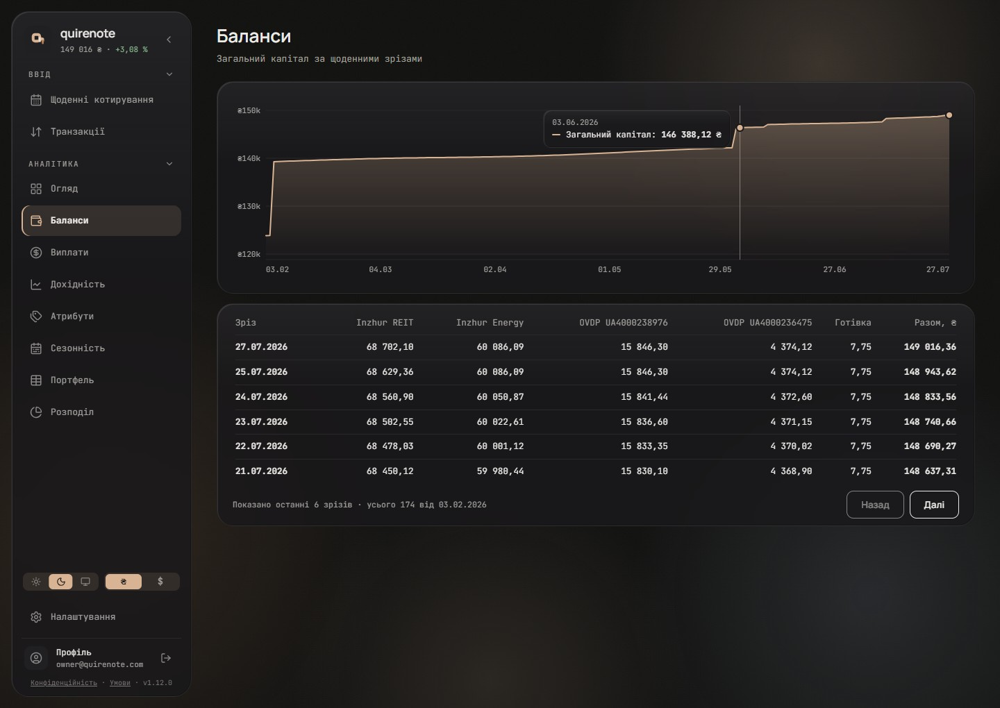

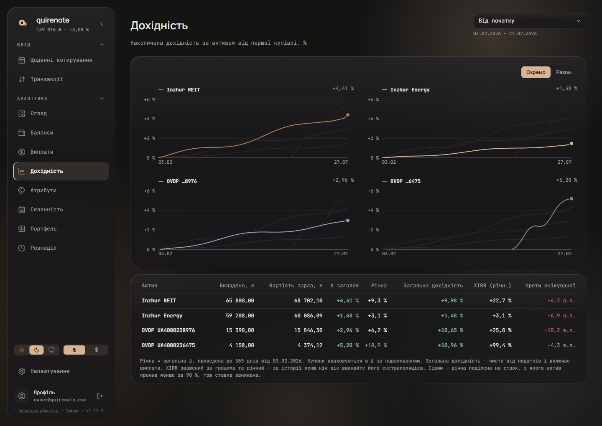

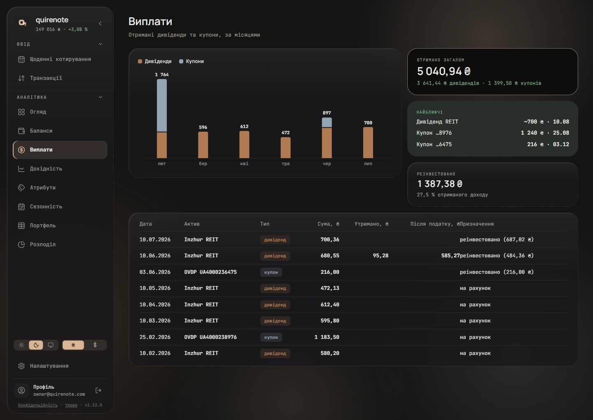

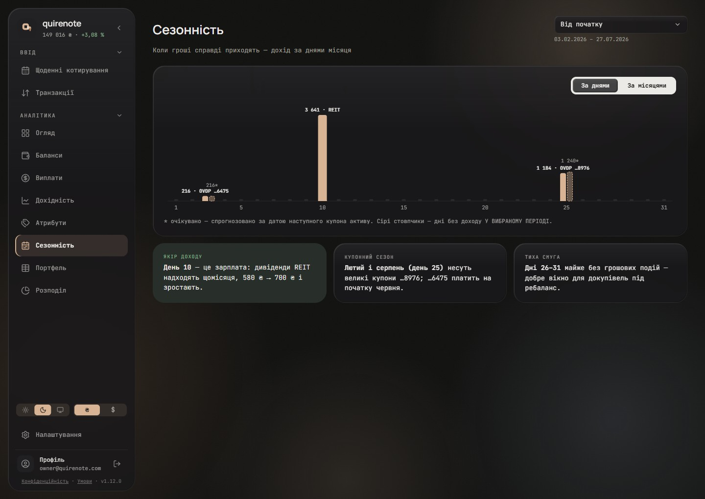

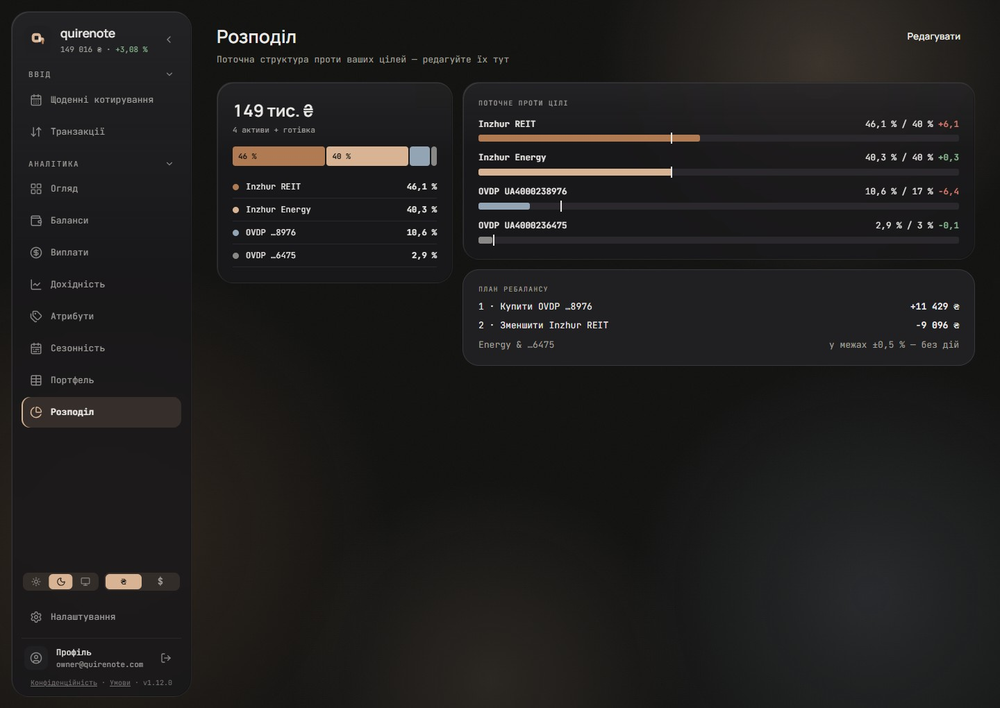

### 1440, light

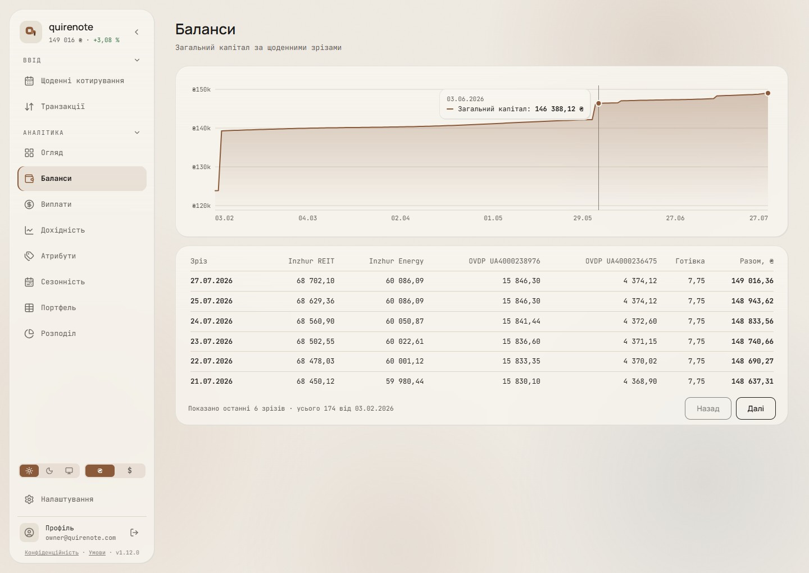

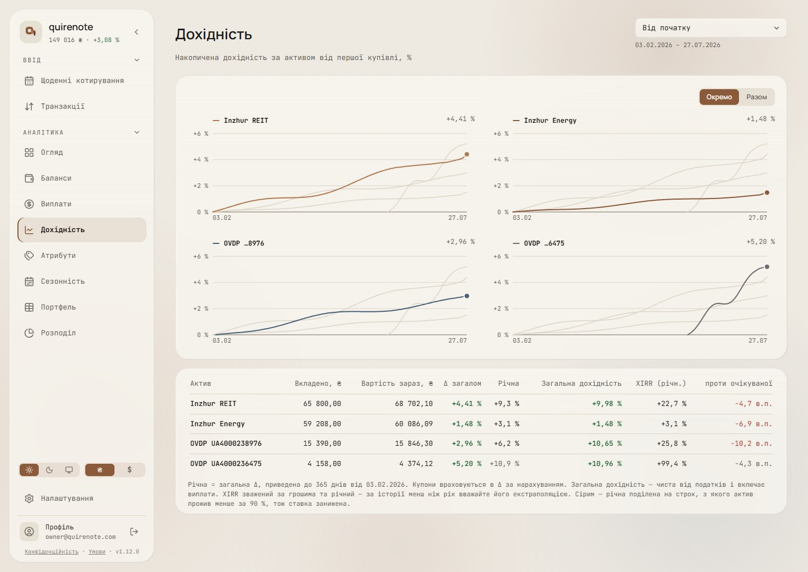

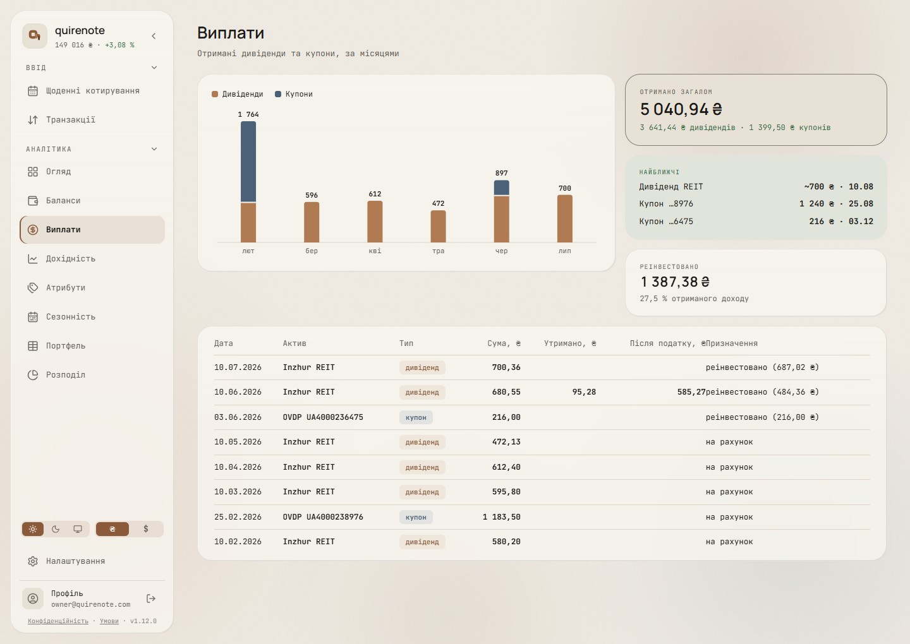

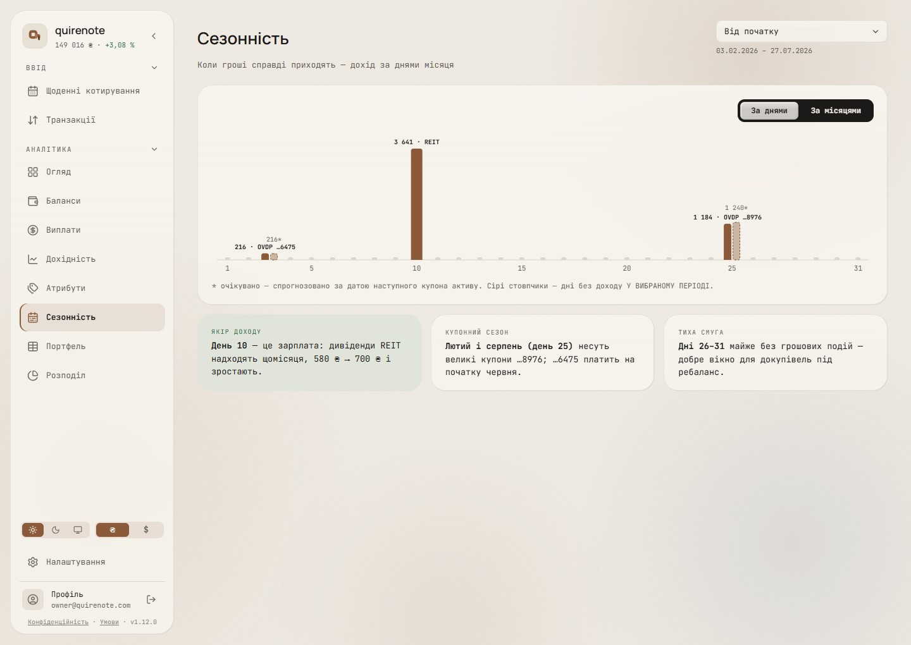

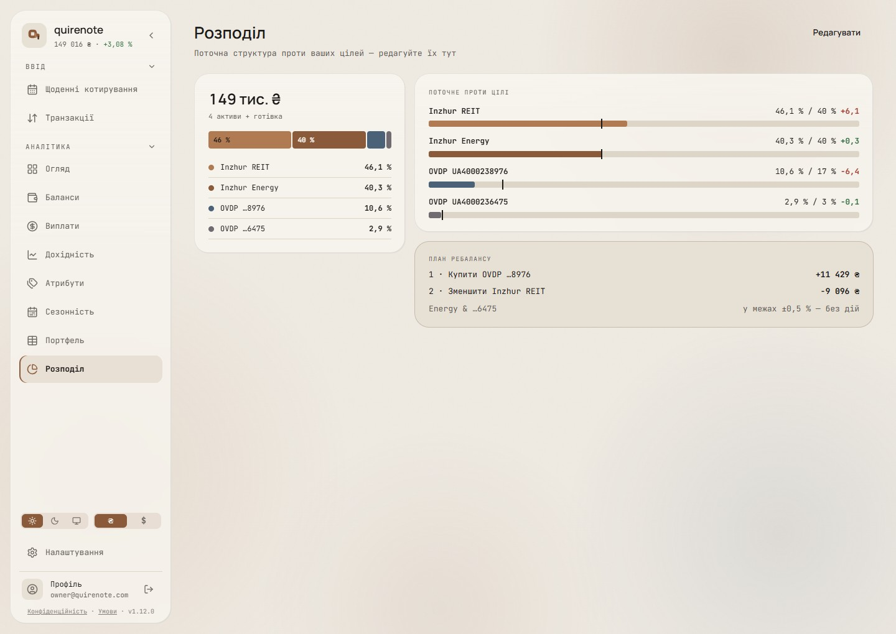

### 360, dark (Баланси · Дохідність · Виплати · Сезонність · Розподіл), then Дохідність light

/yield is also drawn at 360 in light.

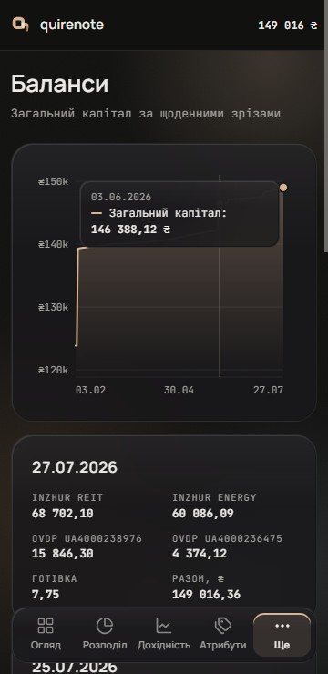

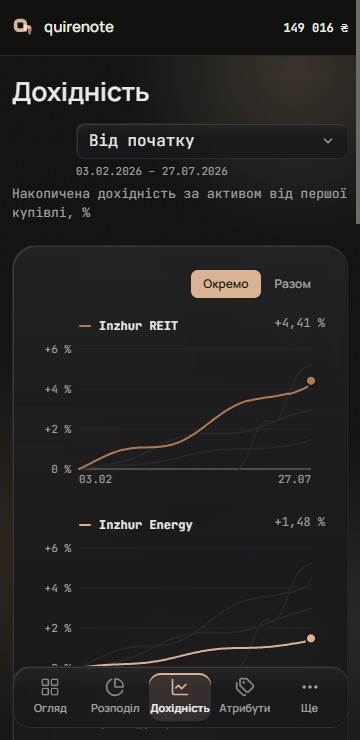

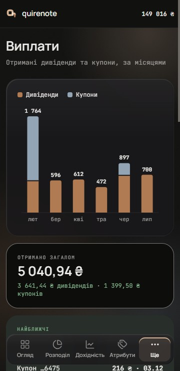

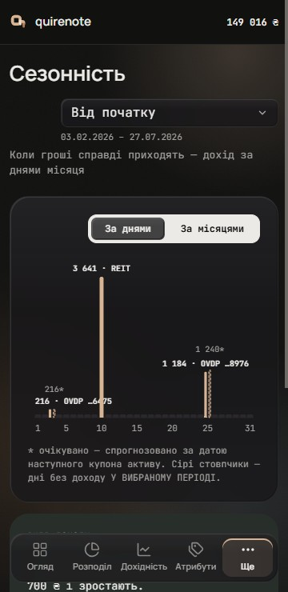

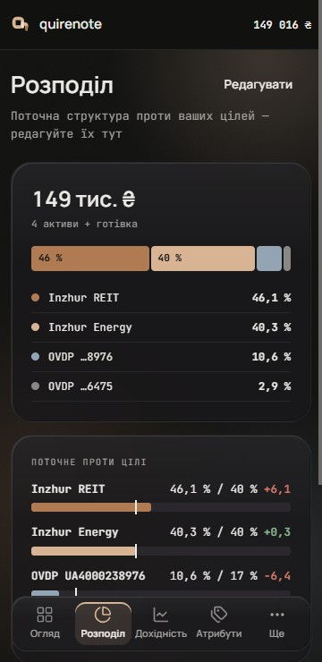

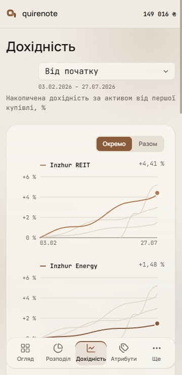

## Signed

- **Picks.** Step 1: C2, with the capital area cropped and filled. Step 2: Y4 by default, with a toggle to Y1. Step 3: A3. Step 4: B1, and seasonality in one colour with the asset named on the bar.

### Anatomy (C2), every chart

- **Grid.** Horizontal only, at ~5 clean ticks (1-2-2.5-5 steps), 1 px hairline, solid. No vertical grid, no y axis line, no tick marks. The x baseline is a 1 px hairline.
- **Tick labels.** 11 px JetBrains Mono `muted`, horizontal. y: ₴Nk / signed whole %. x: dd.MM, 7 evenly spaced on wide plots, first/middle/last when narrow.
  - *Wave 23 adds: a 12-month axis keeps twelve labels at 360 ([loading-and-compositions.md](loading-and-compositions.md#settled-by-the-brief)).*
- **Lines.** 2 px, round join and cap, no dots on daily data. The end marker is r4 in the series colour on an r6 disc in `card` (the 2 px ring).
- **Area.** A gradient of the series colour from 32 % to 0, under the line. The capital area keeps today's cropped domain (data min − 5 000 … max + 2 000) with the fill, by the owner's ruling against Carbon's from-zero rule.
- **0 % line.** On cumulative-return charts, a 1 px `field-border` line at 0.
- **Crosshair.** On hover anywhere on the plot (≥ 768) or on tap (below), as `useTooltipTrigger` does today. A full-height 1 px `field-border` line, plus ringed markers on each series at that x.
- **Tooltip.** Glass (the signed material, r12), padding 9/12, 12 px. The date in `muted` 11 px, then one row per series: a 12×2 colour key, the name, the value in 700, sorted by value. It sits right of the crosshair, left of it past mid-plot, and inside the plot's left edge on plots under 500 px wide (wrapping), so it never leaves the card.
- **Motion.** Entry and update 400 ms on `ease-soft`. Recharts' `isAnimationActive: 'auto'` keeps honouring reduced motion.
- **Contrast.** Every series mark is ≥ 3 : 1 against the card in both themes. Text is in text tokens only.
  - *Overturned by wave 20: in dark, three asset slots sit under the non-text floor and take the relief rule ([palette.md](palette.md#signed)).*

### Identity

- **Rule.** Colour is never the only key: names, labels or facets carry identity. Dashes stay reserved for expected/proposed.
- **/yield (Y4, toggle to Y1).** Small multiples by default: one panel per asset on a shared scale, the others as hairline context lines, and the panel title as the name + the final value. Two columns at ≥ 600 px, one below. A «Окремо / Разом» segmented toggle (selected = `accent`, the app's existing segment pattern) switches to the combined chart with today's legend row.
- **Recorded.** The combined view relies on hue along the lines. It is accepted only because it isn't the default and the tooltip names each asset. Adding direct end labels (Y2) to it would close the gap.
- **/seasonality.** One colour (`accent`) for every bar; the asset is named on the bar, after the value (for example «3 641 · REIT»). Labels are clamped inside the plot.

### Forms

- **Allocation (A3).** A tall segmented bar: 28 px, parts at 4 px corners with 2 px gaps, widths by share. A share is printed inside at 11/700 only when it fits, in near-black or white by the fill's luminance. A legend list below, in block order, with name + share. The total figure sits above. The neighbouring target card stays as is.
- **Payouts (B1).** Stacked columns ≤ 24 px: dividends at the bottom, coupons on top with a 2 px gap. Square at the baseline, 4 px round at the data end (the top part only). The month total on the cap at 11/700 `ink`. A legend row of two keys.
- **Seasonality.** Columns ≤ 18 px (12 when paired with an expected bar). Expected bars stay outlined and dashed at 40 % with a «*» label. Empty days get an 8×4 hairline stub.
- **Capital.** The C2 area, cropped as above, with a single series and no legend.

## Rejected

- **C1, today's anatomy** (grid on every tick, a 2.5 px line, a flat tint under the area, a dot only at the end, a hairline cursor, the panel tooltip at r16 with name: value): C2 was picked.
- **C3, minimal (Ghostfolio reading)** (grid only at the extremes and 0 %, y labels inside the plot at the right, no x baseline, three date labels): fewer reference values on screen.
- **C2z, the capital area from zero:** the growth flattens into the top quarter of the plot.
- **The capital as a line without fill:** the owner's ruling kept the crop with the fill.
- **Y1 as the default, the legend row alone:** colour is the only key along each line. It stays as the «Разом» view.
- **Y2, direct end labels:** 168 px of right gutter, and mid-plot crossings still rely on hue.
- **Y3, end labels + a shape per asset:** one more identity rule app-wide, and the lines between the ends are still hue-only where they cross.
  - *Overturned by wave 14: «Разом» gives each line a shape ([yield-series-shapes.md](yield-series-shapes.md#signed)).*
- **A1, the donut with gaps:** angle reads worse than length (Heer & Bostock; Few), and the smallest share is a sliver.
- **A2, sorted horizontal bars:** it duplicates the neighbouring card, which draws the same four bars and adds the targets.
- **B2, grouped:** the month total disappears, and empty coupon months leave gaps.
- **B3, two rows, one per kind:** each row is on its own scale, with no monthly total.
- **Seasonality coloured by asset (today):** it colours each day by its dominant asset, which is colour-only identity.
- **Gauges, dashed identity, dual axes:** ruled out (Few; dashes mean expected; dataviz).

## Settled by research

- **Motion** becomes 400 ms on the app's `ease-soft` curve (today it's 900 ms; Carbon 300, G2 300, Recharts' bar default 400). Reduced motion is honoured by Recharts' `isAnimationActive: 'auto'` (installed JavascriptAnimate.js:39).
- **C2's anatomy** follows Carbon `_grid.scss`/`_axis.scss`, Highcharts AxisDefaults, Ghostfolio's line chart, Apple HIG's "scrub" crosshair and dataviz marks (2 px, ring).
- **Carbon's from-zero rule** ("Always start numerical axes at zero for … area chart") was weighed and overruled for the capital area.
- **Small multiples on /yield** follow dataviz check 4 ("a normal-vision floor below 15 … cut series or facet instead"), dataviz labels ("past ~4 converging series, small multiples") and Datawrapper small multiples.
- **The tall segmented bar** follows dataviz Figures (the tall segmented bar for part-to-whole ≤ 6 parts) and Apple separators. The target card next to it already draws one horizontal bar per asset with a target tick, a bullet graph in all but name, so A3 complements it rather than repeats it.
- **Stacked payouts** follow Datawrapper stacked columns ("compare the totals and one part") with dividends at the bottom, the steady kind (Datawrapper: "bring the most important value to the bottom"), and the dataviz surface gap and Apple separators for the 2 px gap.

## Implementation checks

- `accent-wiring.test.ts`: Balances pins `fillOpacity` 1 and today's accent counts; the gradient changes both.
- `tooltip-rows.test.ts` forbids a custom `content=`. The glass tooltip with key marks needs one, or the rule changes.
- `seasonality-tooltip.test.ts`: the series names; the colouring changes.
- Recharts defaults to override: 1 px lines, dots on, a white active-dot ring, a #ccc cursor, the vertical grid on, tick lines on, 1500 ms motion (installed source).
- Small multiples are four `LineChart`s sharing one y domain.
- In the new shell, with its narrower content, the payout log's «Після податку, ₴» and «Призначення» headers touch at 1440.
- Recorded for a future palette brief, not decided here: the four asset hues were never chosen as a categorical palette. This wave works around that with facets and names; a palette brief could fix it at the source.
  - *Answered by wave 20: eight slots in a fixed order ([palette.md](palette.md#signed)).*

## Not drawn

- Light at 360 for /balances, /payouts, /seasonality and /allocation.

## Перенесено

Rules of the charts that no code, test or decision records.

- **A second tap on the same point releases a pinned tooltip,** as a tap outside the chart and Escape do.
