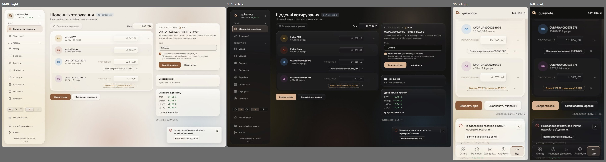
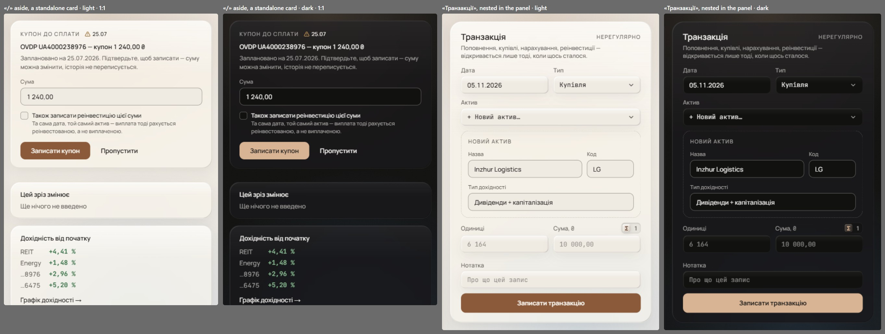

# Controls and overlays the refresh never drew (wave 22)

The coverage audit found glass controls that wave 17 never drew: the secondary containers, the checkbox, the quote row's offer and the toast's action. Nine smaller items were settled by rules already signed (listed below). Four steps remained: containers, the checkbox, the quote offer, and the toast's action.

It overturns the toast's `field-border` edge ([forms-and-dialogs.md](forms-and-dialogs.md#signed), [notices-and-toasts.md](notices-and-toasts.md#signed)); toasts take wave 15's glass edge.

## Renders

Every pick together on «Щоденні котирування»: the overdue coupon card (S1, with K2 checked), the offers (O1, one stale), and the failure toast (A3), at 1440 in both themes and at 360.

The nested container (S1): the quick-create inside «Транзакція», standalone and nested, in both themes at 1:1.

## Signed

- **Secondary containers (S1, the dashed `faint` edge, as shipped).**
  - The coupon-due card, the import diff panel, the quick-create sub-form and the passkey cards keep a 1 px dashed `faint` edge.
  - Standalone (the coupon card), it is the glass card with the dashed edge in place of the solid one, r20.
  - Nested (the quick-create, the diff panel, the passkeys), it is transparent with the dashed edge alone, r16, so no `panel` fill sits on glass.
  - The dash is decoration, not a control's boundary, so WCAG 1.4.11 does not bind it.
  - The coupon card's overdue date is wave 11's C2: a 12 px `warn` TriangleAlert + «25.07» in `ink`; the `warn-tint` pill goes.
- **Checkbox (K2), `accent` fill.**
  - 16 px at r5, left of its label; the label is the hit area.
  - Off: a 1 px `field-border` edge on `page`. On: an `accent` fill and edge with a 10 px `accent-fg` check (stroke 3.5).
  - Focus: wave 17's F2 ring; Space toggles; the box and the check each hold 3:1.
  - Used by the coupon card's reinvest and the import opt-in.
- **The quote row's offer (O1, the dashed pill).**
  - 11 px `ink` in a 1 px dashed `field-border` pill, r7, padding 4 / 12, with `TAP_44`; hover: the dash `ink` over `page`.
  - Stale: the dash and the words in `warn` («Взяти 4 377,67 (станом на 25.07)?»).
  - The ✕ «keep my value» in a real 44 px box, as today.
- **The toast's action (A3), under the sentence.**
  - Wave 8's glass error toast: the `neg` circle-alert 18, 13 / 1.45 text, the 28 px r7 close top-right.
  - The one action is a 28 px r7 B4 knob (12 / 600 `ink`) under the sentence, left-aligned to the text, 10 px below it.
  - An actionable toast stays until it is used or closed (`duration: Infinity`); using it dismisses it.
  - The toast's edge is wave 15's glass (`ink` 6 / 8 %), and the `field-border` toast edge retires.
- **Tokens.** `warn-tint` / `warn-tint-text` leave the coupon pill and the stale lines; `panel-border` leaves the checkbox and the done state; `field-border` leaves the toast. The implementation confirms each is unused before retiring it.
- **Records superseded.**
  - `daily-quotes-live` (the flash colour, the toast action's place, the coupon pill).
  - `switch-border` and `settings` (outlineMuted, the checkbox edge).
  - `import-dialog` (the checkbox, toast placement).
  - `rows-ahead-mark` (the asking row); `mobile` S4 (the delta chip, the keyboard bar).
  - `own-account` (the passkey card's fill); `admin-users` (the stale line); `floating-edges` (the toast's edge, the date sheet).
  - `field-border`'s "dashed containers keep faint" is kept.

## Rejected

- **S2, a recessed well** (`ink` 4 % at r20 / r16): in the aside it sits flatter than its glass neighbours, so the coupon reads as quieter, not louder.
- **S3, a card like the others:** nothing marks the card as a pending suggestion, and nested it adds a frame inside a frame.
- **K1, the `ink` fill as shipped:** the one control whose "on" is `ink` while the switch and the segmented control say "on" in `accent`.
- **K3, wave 17's switch instead:** a switch takes effect at once by convention, and here nothing happens until «Записати купон».
- **O2, a small ghost button with a glyph:** it wraps at 360 and reads as a command, not a suggestion.
- **O3, an `accent` text link:** a link that fills a field rather than going somewhere.
- **A1, a B4 knob at the end of the row, and A2, a ghost text button there:** the sentence is squeezed into a narrow column of 5–7 lines.

## Settled by research

- **Dashed borders.** The only documented use in the systems read is a file drop zone (Carbon's file uploader); none uses dashes for a suggestion or a sub-form. The import dialog's drop zone keeps its dash.
- **The checkbox.** Space toggles (WAI-ARIA APG); the box's edge and the check each hold 3:1 (WCAG 1.4.11); the box sits left of its label; the whole label is the hit area.
- **The toast's action.** Carbon: "Actionable toast notifications can include a tertiary button at the end of their body content", and "Only one action is allowed for each notification".

## Settled by the brief

- **The fetch flash:** `ink`, the 13 px check and «Оновлено 13:05» for about 2.5 s, with no `pos`.
- **«Backup done»:** a disabled B4 knob with a check, crossfading 220 ms.
- **The asking row:** an `ink` question with a `warn` TriangleAlert, «Видалити» in B4 `outlineDanger`, «Ні» ghost.
- **The delta chip and the stale and failed lines** in C2: glyph + `ink` words, no fill, the delta's figure in `pos` / `neg`.
- **Below md, the date picker** is the M2 sheet.
- **Below md, toasts sit at the top** while any M2 sheet is open.
- **Below md, the keyboard-open action bar** is the 360 bar's glass, riding the keyboard.
- **The glass toast edge** (signed above).
- **One action per toast,** and an actionable toast stays until it is used or closed, instead of Sonner's 4 s default, because the cache offer must not vanish unread.

## Not drawn

- Loading shapes, compositions and the sweep: wave 23 ([loading-and-compositions.md](loading-and-compositions.md)).
