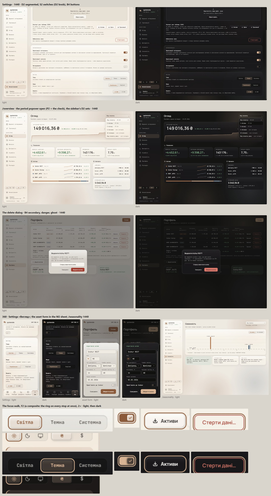
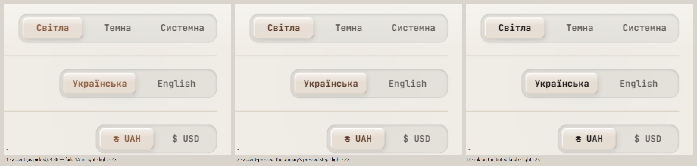

# Interactive controls (wave 17)

Buttons, segmented toggles, selects and dropdowns, and switches, in the owner's order: "unify the families, then fit the glass, then the states". Today there are two segmented families (six copies of an `ink` track with a `card` thumb, and the sidebar's `accent` thumb), a switch with an `ink` on-fill, an outlined secondary button and solid popovers. Segmented toggles and switches could be fully reworked where best practice supports it. The result is one glass knob shared by the segmented control, the switch and the secondary button, glass popovers with a check, a two-tone focus ring and an `ink` overlay for hover.

It overturns the sidebar's `accent` segmented chip and the `ink` switch track, and it gives the secondary button of wave 8's held button set ([forms-and-dialogs.md](forms-and-dialogs.md#signed)) a glass surface.

## Renders

Every pick together on the signed glass (wave 15's light values included), at 1440 and 360, light and dark: Settings, /overview's period popover, the delete dialog, 360 Settings and the asset form, /seasonality, and the focus walk. No frame scrolls sideways. The 360 dialogs' button rows are drawn as the code has them; wave 16's W1 applies unchanged.

The selected segment's label, three ways, in light at 2×: T1 `accent`, T2 `accent-pressed` (signed), T3 `ink`.

## Signed

- **The glass knob,** one object shared by the segmented control, the switch and the B4 button.
  - Sheen: white 62 % → transparent at 40 % (light); `ink` 6 % → transparent at 40 % (dark).
  - Fill: `card` 72 % in light, 82 % in dark (the button 92 %).
  - Edge: 1 px `ink` 6 %.
  - Bevel in light: `inset 1px 1px 0 #fff`, `inset -1px -1px 0` `ink` 16 %, and a `0 2px 6px` `ink` 12 % drop.
  - Bevel in dark: `inset 1px 1px 0` `ink` 12 %, `inset -1px -1px 0` `page` 60 %, and a `0 2px 6px` `page` 80 % drop.
  - The white is wave 15's `glass-rim` light value.
- **The segmented control (D2),** one shared component for Settings (theme, language, currency), the sidebar (theme, currency), Seasonality's axis, the Repairs source, PriceMode and the /yield «Окремо / Разом».
  - The well: `ink` 6 % in light or `page` 55 % in dark, a 1 px `ink` 8 % edge, and an inset shadow (`0 1px 2px` `ink` 14 % light; `0 1px 3px` `page` 90 % dark).
  - The selected segment: the glass knob tinted, `accent` 16 % light / 22 % dark mixed into `card` at 88 % / 92 %, with the sheen and bevel.
  - Its label is 700: `accent-pressed` in light, `accent` in dark (T2, picked at sign-off). Unselected labels are `muted` 600.
  - The state cue is the raised tinted knob and its coloured bold label. The knob has no 3:1 boundary against the well, which falls short of the brief's WCAG 1.4.11 goal; the owner accepted that cost of D2.
  - Radii come from the shape system, the segment round(h × .26) and the track concentric: 28 → 7 / 12; the sidebar's 22 → 6 / 9; PriceMode's 16 → 4 / 7.
    - *Overturned by wave 26: PriceMode's segments are 24 px, so 24 → 6 / 9 ([open-values-shell-controls.md](open-values-shell-controls.md#signed)).*
  - Motion: the knob slides in 300 ms on `ease-soft`, with a press of .97.
  - Semantics: a radiogroup with arrow keys. PriceMode alone stays a single `aria-pressed` toggle, and gains `TAP_44`.
    - *Overturned by wave 26: PriceMode joins the radiogroup, with 24 px segments and no `TAP_44` ([open-values-shell-controls.md](open-values-shell-controls.md#signed)).*
- **The switch (S2 with D2's knob).**
  - 40 × 22 r6, padding 2, the knob 16 r4, travel 18.
  - On: an `accent` fill and edge, and a 10 px `accent` check in the knob.
  - Off: the well, a 1 px `field-border` edge and the inset shadow.
  - The knob is the glass knob tinted: `accent` 16 % light / 22 % dark mixed into `card`, at 94 %, with a `0 1px 4px` drop. The off knob takes the tint too.
- **Buttons (B4).** The secondary (today's `outline`) becomes the glass knob at button scale with `ink` text. Held: the primary `accent` fill, ghost, `outlineDanger`, `danger`, the sizes (md 40 / r10, 44 / r11 below md) and wave 16's stacking. The hand-rolled buttons are each mapped against this set, or the reason is recorded: TransactionPanel's delete-confirm and cancel, QuoteRow's dashed pill, `GoogleButton`'s 1 px edge.
- **The popover (P2).** The Select list and the DatePicker take the dialogs' glass.
  - *Answered by wave 26: the popover keeps `card` 70 % / 80 %; the thicker fill is the dialogs' alone ([open-values-shell-controls.md](open-values-shell-controls.md#signed)).*
  - `card` 70 % light / 80 % dark, `blur(30px) saturate(180%)`.
  - The sheen and bevel as above, with a `0 8px 24px` drop.
  - The `field-border` edge, r14 for the select and r16 for the date picker.
  - The chosen item carries a 14 px `accent` check at the row's end. The highlight stays the `page` fill, and the chosen day keeps its `ink` cell.
  - The trigger is wave 8's field (36 / r9, `page` fill).
- **Focus (F2).** On `:focus-visible`, a 2 px `accent` outline at offset 2, plus `0 0 0 2px` `card` appended to the control's own shadows, so the ring always has `card` inside it, even on an `accent` track or a `neg` fill. It appears at once: `outline-color` leaves the transition, which ends today's fade from `currentColor`. The `[data-filled-track]` `page`-ring override retires with the `ink` tracks. `docs/DECISIONS.md` gains a focus-ring entry, since it has none today.
- **Hover (H2).** Neutral controls (ghost, B4, unselected segments, list rows) take an `ink` 5 % overlay; the primary steps to `accent-hover`.
- **Disabled and busy.** Disabled is 50 % and busy 70 %, now also on the Select and the Switch.
- **Records superseded.** `appearance-language` and `settings` (the `panel` track), `parchment-sidebar` (the sidebar's `accent` chip), `switch-border` (the `ink` on-fill).
- **New copy.** None.

## Rejected

- **Round G, none picked** ("not good enough"; the next round should "belong to the glass"): G1, a raised neutral thumb on a recessed track; G2, an outlined group with a tonal selected segment and a check; G3, an `accent` thumb on a tinted track everywhere; G4, a Select in the Settings list and G1 elsewhere.
- **D1, a neutral glass knob:** no cue beyond the object.
- **D3, the neutral knob with the nav's 2 px `accent` indicator:** the bar's curved ends anti-alias, and it reads partly as an underline.
- **D4, a proud knob with a `field-border` ring:** it breaks the shape system's concentric rule by 3 px, and the sidebar row grows.
- **T1, `accent` for the selected label in light:** under AA for 12 px text on the tinted knob. **T3, `ink`:** the label loses its colour cue.
- **S1, the `accent` track alone:** on and off differ by colour and the knob's side only. **S3, today's `ink` track:** the heaviest mark on a card. **S4, the 52 × 32 M3 size:** each Settings row grows by 10 px.
- **B1, today's 1.5 px `ink` outline:** the darkest line on a glass card. **B2, tonal:** spends a little accent on every secondary. **B3, neutral filled:** flat beside the glass knobs.
- **P1, a solid card with the check:** the one solid floating surface among glass dialogs and toasts. **P3 and P4, a tonal chosen row:** two marks for one state.
- **F1, today's single ring:** on an `accent` or `neg` fill only the 2 px of backdrop separates ring from fill. **F3, 3 px:** heavy on small controls.
- **H1, opacity .85:** a fade reads as "less available", the opposite of a hover.

## Settled by research

- **Every segmented set is a radio group with arrow keys.** APG: "A radio group is a set of checkable buttons … where no more than one of the buttons can be checked at a time". Today's `aria-pressed` sets (Settings currency, sidebar currency, Seasonality) change.
- **A menu marks its selected item with a check** (Apple, Fluent, shadcn).
- **One accent-filled primary per view** (Carbon; Apple "one or two").
- **Controls on glass carry their own near-opaque fill; glass is not stacked on glass** (Apple Materials).
- **Every state reaches 3:1 and is never shown by colour alone** (WCAG 1.4.11; Apple), the goal D2's knob falls short of, as recorded above.
- **A button needs no boundary when it has visible text.** WCAG 1.4.11's Understanding: "This success criterion does not require that controls have a visual boundary indicating the hit area"; it calls delineating "a best practice". That allows B4.
- **The switch's accent track** follows M3 `SwitchTokens` (on track `Primary`), Fluent and shadcn; **its check** follows M3's optional handle icons and Apple ("Avoid relying solely on different colors to communicate state").
- **The glass popover** follows Apple ("Use the regular variant … such as alerts, sidebars, or popovers").
- **The two-tone ring** follows GOV.UK's two-tone focus, Fluent's paired strokes and WCAG 2.4.11's note on overlays and blur; WCAG 2.4.13 asks for "a solid 2 CSS pixel thick perimeter".
- **The hover overlay** is the sidebar's own `sb-item-hover-bg` (`ink` 5 %).

## Implementation checks

- `filled-track.test.ts` (`bg-ink` ⇔ `data-filled-track`) retires.
- `floating-edges.test.ts` holds: the popover keeps `field-border`.
- New tests: radiogroup roles and arrow keys on every set; the Select's check on the chosen item; disabled on the Select and the Switch.
- The check on the tinted switch knob was not checked for contrast.
- A merged drawing is immutable, so the supersessions above are recorded in `docs/DECISIONS.md`.

## Перенесено

Rules of the scroll surface that no code, test or decision records.

- **The rail's inset from a rounded corner is the exception to concentric nesting:** never `R − r` or `R − 2r`, because concentricity is invisible on a shape this thin and a bar that leaves its edge by that much reads as floating in the gutter.
- **The Select's list is the one exception to *Scrolling*:** Radix owns its viewport and will not nest a ScrollArea, so it keeps the platform's bar, dressed from the page's tokens.
- **Nothing in a `Scroller`'s viewport sizes against its height:** Radix wraps the content in an auto-height `display: table` box, so `min-h-full` resolves against nothing and `mt-auto` gets no free space.
