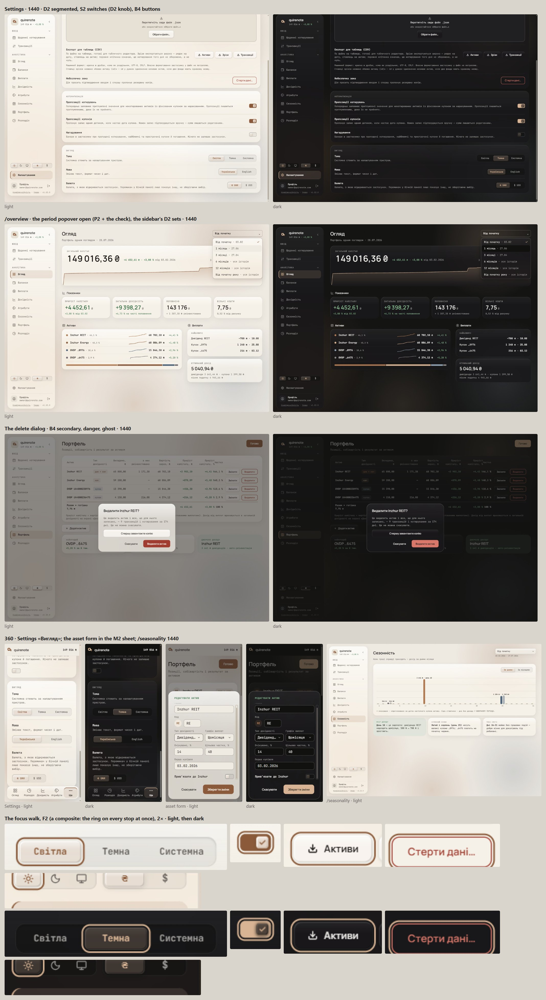
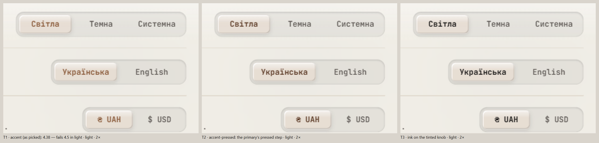
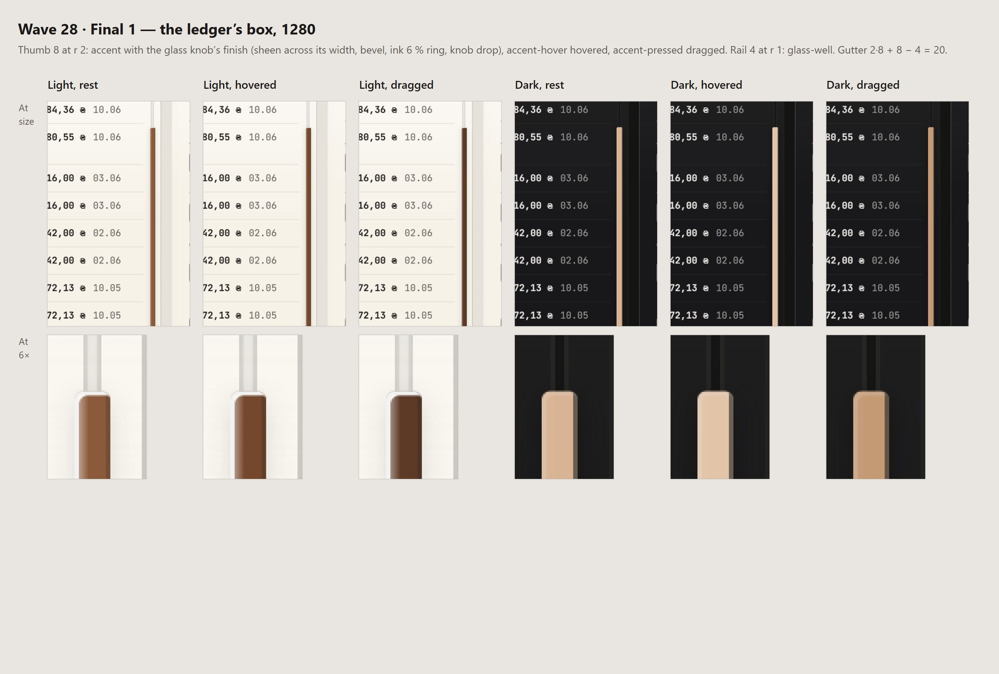
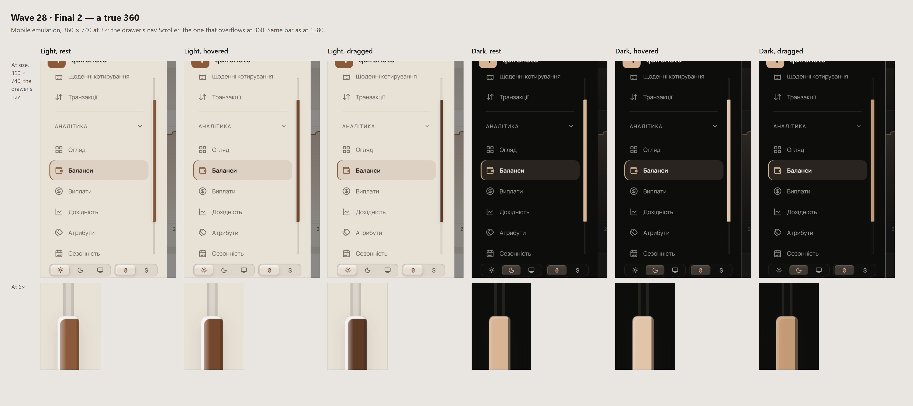
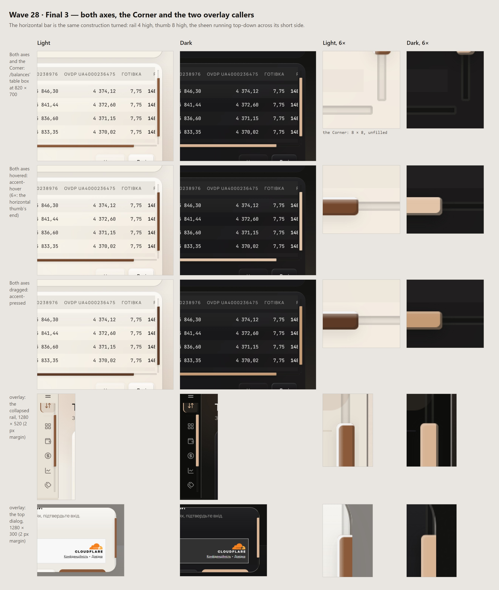
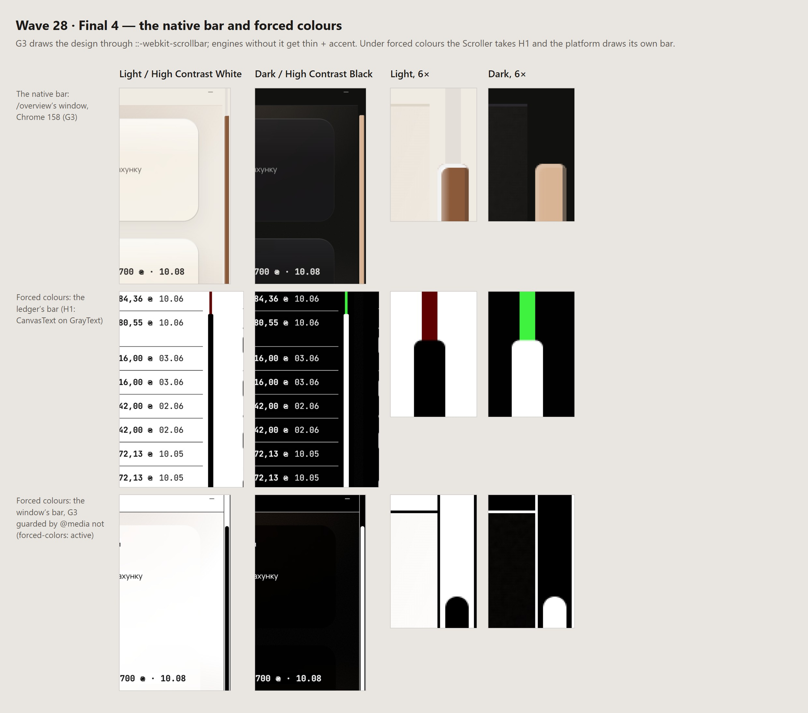

# Interactive controls (wave 17)

Buttons, segmented toggles, selects and dropdowns, and switches, in the owner's order: "unify the families, then fit the glass, then the states". Today there are two segmented families (six copies of an `ink` track with a `card` thumb, and the sidebar's `accent` thumb), a switch with an `ink` on-fill, an outlined secondary button and solid popovers. Segmented toggles and switches could be fully reworked where best practice supports it. The result is one glass knob shared by the segmented control, the switch and the secondary button, glass popovers with a check, a two-tone focus ring and an `ink` overlay for hover.

It overturns the sidebar's `accent` segmented chip and the `ink` switch track, and it gives the secondary button of wave 8's held button set ([forms-and-dialogs.md](forms-and-dialogs.md#signed)) a glass surface.

## Renders

Every pick together on the signed glass (wave 15's light values included), at 1440 and 360, light and dark: Settings, /overview's period popover, the delete dialog, 360 Settings and the asset form, /seasonality, and the focus walk. No frame scrolls sideways. The 360 dialogs' button rows are drawn as the code has them; wave 16's W1 applies unchanged.

The selected segment's label, three ways, in light at 2×: T1 `accent`, T2 `accent-pressed` (signed), T3 `ink`.

## Signed

- **The glass knob,** one object shared by the segmented control, the switch and the B4 button.
  - Sheen: white 62 % → transparent at 40 % (light); `ink` 6 % → transparent at 40 % (dark).
  - Fill: `card` 72 % in light, 82 % in dark (the button 92 %).
  - Edge: 1 px `ink` 6 %.
  - Bevel in light: `inset 1px 1px 0 #fff`, `inset -1px -1px 0` `ink` 16 %, and a `0 2px 6px` `ink` 12 % drop.
  - Bevel in dark: `inset 1px 1px 0` `ink` 12 %, `inset -1px -1px 0` `page` 60 %, and a `0 2px 6px` `page` 80 % drop.
  - The white is wave 15's `glass-rim` light value.
- **The segmented control (D2),** one shared component for Settings (theme, language, currency), the sidebar (theme, currency), Seasonality's axis, the Repairs source, PriceMode and the /yield «Окремо / Разом».
  - The well: `ink` 6 % in light or `page` 55 % in dark, a 1 px `ink` 8 % edge, and an inset shadow (`0 1px 2px` `ink` 14 % light; `0 1px 3px` `page` 90 % dark).
  - The selected segment: the glass knob tinted, `accent` 16 % light / 22 % dark mixed into `card` at 88 % / 92 %, with the sheen and bevel.
  - Its label is 700: `accent-pressed` in light, `accent` in dark (T2, picked at sign-off). Unselected labels are `muted` 600.
  - The state cue is the raised tinted knob and its coloured bold label. The knob has no 3:1 boundary against the well, which falls short of the brief's WCAG 1.4.11 goal; the owner accepted that cost of D2.
  - Radii come from the shape system, the segment round(h × .26) and the track concentric: 28 → 7 / 12; the sidebar's 22 → 6 / 9; PriceMode's 16 → 4 / 7.
    - *Overturned by wave 26: PriceMode's segments are 24 px, so 24 → 6 / 9 ([open-values-shell-controls.md](open-values-shell-controls.md#signed)).*
  - Motion: the knob slides in 300 ms on `ease-soft`, with a press of .97.
  - Semantics: a radiogroup with arrow keys. PriceMode alone stays a single `aria-pressed` toggle, and gains `TAP_44`.
    - *Overturned by wave 26: PriceMode joins the radiogroup, with 24 px segments and no `TAP_44` ([open-values-shell-controls.md](open-values-shell-controls.md#signed)).*
- **The switch (S2 with D2's knob).**
  - 40 × 22 r6, padding 2, the knob 16 r4, travel 18.
  - On: an `accent` fill and edge, and a 10 px `accent` check in the knob.
  - Off: the well, a 1 px `field-border` edge and the inset shadow.
  - The knob is the glass knob tinted: `accent` 16 % light / 22 % dark mixed into `card`, at 94 %, with a `0 1px 4px` drop. The off knob takes the tint too.
- **Buttons (B4).** The secondary (today's `outline`) becomes the glass knob at button scale with `ink` text. Held: the primary `accent` fill, ghost, `outlineDanger`, `danger`, the sizes (md 40 / r10, 44 / r11 below md) and wave 16's stacking. The hand-rolled buttons are each mapped against this set, or the reason is recorded: TransactionPanel's delete-confirm and cancel, QuoteRow's dashed pill, `GoogleButton`'s 1 px edge.
- **The popover (P2).** The Select list and the DatePicker take the dialogs' glass.
  - *Answered by wave 26: the popover keeps `card` 70 % / 80 %; the thicker fill is the dialogs' alone ([open-values-shell-controls.md](open-values-shell-controls.md#signed)).*
  - `card` 70 % light / 80 % dark, `blur(30px) saturate(180%)`.
  - The sheen and bevel as above, with a `0 8px 24px` drop.
  - The `field-border` edge, r14 for the select and r16 for the date picker.
  - The chosen item carries a 14 px `accent` check at the row's end. The highlight stays the `page` fill, and the chosen day keeps its `ink` cell.
    - *Overturned by the owner's ruling on #704: the highlighted row takes the `ink` 5 % veil, pointer and keyboard alike (`docs/DECISIONS.md` § Interaction rules).*
  - The trigger is wave 8's field (36 / r9, `page` fill).
- **Focus (F2).** On `:focus-visible`, a 2 px `accent` outline at offset 2, plus `0 0 0 2px` `card` appended to the control's own shadows, so the ring always has `card` inside it, even on an `accent` track or a `neg` fill. It appears at once: `outline-color` leaves the transition, which ends today's fade from `currentColor`. The `[data-filled-track]` `page`-ring override retires with the `ink` tracks. `docs/DECISIONS.md` gains a focus-ring entry, since it has none today.
- **Hover (H2).** Neutral controls (ghost, B4, unselected segments, list rows) take an `ink` 5 % overlay; the primary steps to `accent-hover`.
- **Disabled and busy.** Disabled is 50 % and busy 70 %, now also on the Select and the Switch.
- **Records superseded.** `appearance-language` and `settings` (the `panel` track), `parchment-sidebar` (the sidebar's `accent` chip), `switch-border` (the `ink` on-fill).
- **New copy.** None.

## Rejected

- **Round G, none picked** ("not good enough"; the next round should "belong to the glass"): G1, a raised neutral thumb on a recessed track; G2, an outlined group with a tonal selected segment and a check; G3, an `accent` thumb on a tinted track everywhere; G4, a Select in the Settings list and G1 elsewhere.
- **D1, a neutral glass knob:** no cue beyond the object.
- **D3, the neutral knob with the nav's 2 px `accent` indicator:** the bar's curved ends anti-alias, and it reads partly as an underline.
- **D4, a proud knob with a `field-border` ring:** it breaks the shape system's concentric rule by 3 px, and the sidebar row grows.
- **T1, `accent` for the selected label in light:** under AA for 12 px text on the tinted knob. **T3, `ink`:** the label loses its colour cue.
- **S1, the `accent` track alone:** on and off differ by colour and the knob's side only. **S3, today's `ink` track:** the heaviest mark on a card. **S4, the 52 × 32 M3 size:** each Settings row grows by 10 px.
- **B1, today's 1.5 px `ink` outline:** the darkest line on a glass card. **B2, tonal:** spends a little accent on every secondary. **B3, neutral filled:** flat beside the glass knobs.
- **P1, a solid card with the check:** the one solid floating surface among glass dialogs and toasts. **P3 and P4, a tonal chosen row:** two marks for one state.
- **F1, today's single ring:** on an `accent` or `neg` fill only the 2 px of backdrop separates ring from fill. **F3, 3 px:** heavy on small controls.
- **H1, opacity .85:** a fade reads as "less available", the opposite of a hover.

## Settled by research

- **Every segmented set is a radio group with arrow keys.** APG: "A radio group is a set of checkable buttons … where no more than one of the buttons can be checked at a time". Today's `aria-pressed` sets (Settings currency, sidebar currency, Seasonality) change.
- **A menu marks its selected item with a check** (Apple, Fluent, shadcn).
- **One accent-filled primary per view** (Carbon; Apple "one or two").
- **Controls on glass carry their own near-opaque fill; glass is not stacked on glass** (Apple Materials).
- **Every state reaches 3:1 and is never shown by colour alone** (WCAG 1.4.11; Apple), the goal D2's knob falls short of, as recorded above.
- **A button needs no boundary when it has visible text.** WCAG 1.4.11's Understanding: "This success criterion does not require that controls have a visual boundary indicating the hit area"; it calls delineating "a best practice". That allows B4.
- **The switch's accent track** follows M3 `SwitchTokens` (on track `Primary`), Fluent and shadcn; **its check** follows M3's optional handle icons and Apple ("Avoid relying solely on different colors to communicate state").
- **The glass popover** follows Apple ("Use the regular variant … such as alerts, sidebars, or popovers").
- **The two-tone ring** follows GOV.UK's two-tone focus, Fluent's paired strokes and WCAG 2.4.11's note on overlays and blur; WCAG 2.4.13 asks for "a solid 2 CSS pixel thick perimeter".
- **The hover overlay** is the sidebar's own `sb-item-hover-bg` (`ink` 5 %).

## Implementation checks

- `filled-track.test.ts` (`bg-ink` ⇔ `data-filled-track`) retires.
- `floating-edges.test.ts` holds: the popover keeps `field-border`.
- New tests: radiogroup roles and arrow keys on every set; the Select's check on the chosen item; disabled on the Select and the Switch.
- The check on the tinted switch knob was not checked for contrast.
- A merged drawing is immutable, so the supersessions above are recorded in `docs/DECISIONS.md`.

## Wave 28: the scroll surface

Brief #526. The owner's look: a filled rail running the full length, and a filled thumb twice the rail's width laid over it, centred on its axis. Neither has a border, nothing behind them is filled, and the rail's radius is a quarter of its width. Five steps settled the rest, with every bar on the live app restyled in place over the shipped fake API and seed. Each step took one round, except step 3, which took three: the owner asked for a glass thumb after round 1, then for the colour schema of Settings' language switch after round 2.

It overturns today's rail (`2+2+4+2+2` with a `panel-border` stroke, thumb r1, rail r5) and the overlay thumb in [rail-and-account-foot.md](rail-and-account-foot.md#signed), which points here. It holds the rail's inset from a rounded corner and the § Перенесено rules below, the gutter on the root and the reserve-versus-`overlay` rule.

### Renders

The rounds: [step 1, the thumb's width](renders/w28s1.jpeg); [step 2, its radius](renders/w28s2.jpeg); step 3, the colours, in [round 1](renders/w28s3a.jpeg), [round 2, a glass thumb](renders/w28s3b.jpeg) and [round 3, the language switch's colours](renders/w28s3c.jpeg); [step 4, the native bar](renders/w28s4.jpeg); [step 5, forced colours](renders/w28s5.jpeg).

### Signed

- **Geometry (steps 1 and 2).**
  - The thumb is 8 wide, r2: *Shape system*'s `round(8 × 0.26)`, which the owner's quarter ratio also gives.
  - The rail is 4 wide (half the thumb), r1 (a quarter of the rail), centred on the thumb's axis.
  - The Scrollbar box is the thumb's width with no padding, so the thumb runs the rail's full length. The rail is a pseudo-element or an absolutely positioned layer inside it, never in the flow, where it would push the thumb.
  - The margin stays 8 on all four sides, `overlay`'s 2. The reserve is `2 × 8 + 8 − 4 = 20`, the 4 being the ring allowance.
  - The hit area is the Scrollbar box, so it narrows from today's 12 to 8. A reserving bar keeps 8 on either side, the band WCAG 2.5.8's spacing rule asks of a modified bar. `overlay`'s 2 px margin falls short of that band, as it does today.
  - The horizontal bar is the same construction turned. The `Corner` is 8 × 8 and unfilled.
- **The thumb (step 3, round 3, F3).**
  - Fill `accent`; hovered `accent-hover`; dragged `accent-pressed`. It is the accent the language switch's knob is tinted with, as the toggle switch's on track fills with it, stepping as the primary does.
  - The glass knob's finish: `glass-knob-sheen` to transparent at 40 % across the thumb's short side (from the left on a vertical bar, from the top on a horizontal one), the `ink` 6 % inset ring, the bevel (`glass-bevel-top`, `glass-bevel-bottom`) and `shadow-glass-knob`.
- **The rail.** `glass-well`: its fill, its `ink` 8 % inset ring and `shadow-glass-well`.
- **No border.** The rail, the thumb and the Scrollbar take `border-width` 0, and the Scrollbar no background. The glass's 1 px inset edges are drawn by `box-shadow`, so the thumb and the rail carry the knob's and the well's edges.
- **Contrast.**
  - At rest the thumb's body holds 3 : 1 against its rail and against the card in both themes. Hovered it holds more. Dragged it holds more in light and less in dark, where `accent-pressed` is the darker step, but still above 3 : 1.
  - RECORDED SHORTFALL: in light the thumb's lit edge, the white bevel and the start of the sheen, falls under 3 : 1 against the card for its first 2 px. The body clears it.
  - The rail is decorative and falls under 3 : 1 against glass, so on a card it reads as a faint groove.
  - The readings are on the review page, for #527's tests to pin.
- **Motion.** The colour changes at `transition-control-colors` 200 ms, instantly under reduced motion. Nothing changes width on hover.
- **The native bar (step 4, G3).**
  - `::-webkit-scrollbar` draws the same bar: 12 px; the track takes a 4 px transparent border, `background-clip: padding-box` and radius 5, which leaves a 4 px r1 rail.
  - The thumb takes a 2 px transparent border and radius 4, which leaves 8 px r2, with the finish's bevel, ring and sheen. The knob's outer drop is left out, as the platform clips the bar to its box.
  - The track and the thumb both take `background-clip: padding-box`. `:hover` sets only `background-color` to `accent-hover` and `:active` to `accent-pressed`, so the clip holds; the `background` shorthand would reset it.
  - The sheen follows the orientation through `::-webkit-scrollbar-thumb:vertical` and `:horizontal`.
  - The standard pair, `scrollbar-width: thin` and `scrollbar-color: accent transparent`, applies only under `@supports not selector(::-webkit-scrollbar)`.
- **Forced colours (step 5, H1).**
  - Under `forced-colors: active` the thumb is `CanvasText` and the rail `GrayText`.
  - The webkit rules sit inside `@media not (forced-colors: active)`, so the platform draws its own forced bar there.

### Rejected

- **Step 1.** A thumb of 4: its visible thumb is no wider than today's, and its 2 px rail is lost on glass. A thumb of 12: three times today's, and a fifth of the 64 px rail's column.
- **Step 2.** r1, the rail's radius repeated: the ends read square at size. r4, a capsule: it overturns *Shape system*'s "nothing is a capsule".
- **Step 3, round 1.**
  - A, today's tokens: on the new filled rail the resting `faint` thumb all but vanishes against `panel-border` in light.
  - B, a `muted` thumb, `ink` on hover, on `panel-border`: plain where the owner asked for glass.
  - C, an `ink` thumb on `faint`: the heaviest mark on the page.
  - D, `ink` at 12 / 40 / 60 / 70 %: the translucent thumb shows the rail through it.
- **Step 3, round 2.**
  - The glass knob as it ships (E1, E3 without rings) and the tinted knob (E2) vanish on a glass card. The knob reads in a segmented control because it sits in a darker well, while this thumb's sides lie on the card.
  - The knob's finish on `muted` (E4), and at 88 % in the well (E5): neutral where the owner asked for the language switch's colours.
- **Step 3, round 3.**
  - F1, the switch's own tinted knob in its well: as faint as that knob, with no word to carry it.
  - F2, the selected word's `segment-label`: in light it is already the darkest step, so its hover veil barely moves it.
- **Step 4.**
  - Today's pair: grey beside copper Scroller thumbs, with a webkit block that never paints in Chrome.
  - The standard pair alone, on a clear or a `glass-well` track: no rail half the thumb's width, and Chrome's thin thumb is fully round.
- **Step 5.**
  - No rule: the bar is forced to `Canvas` and disappears.
  - `ButtonText` on `ButtonBorder`: the two are one colour in both palettes.
  - The thumb only: High Contrast loses the rail.

### Settled by research

- **A thumb wider than its track.** Android's Holo fast scroller is built this way. `FastScroller.java` centres the track on the thumb, `(thumb.getWidth() - trackWidth) / 2`: a 6 dp thumb on a 1 dp line. WinUI, VS Code, Radix Themes, Mantine, shadcn/ui, IntelliJ and libadwaita keep the thumb inside its track.
- **The width.** Shipped bars sit at 6–8: the Radix demo 6, shadcn/ui about 7, libadwaita's `$_slider_width: 8px`, Material 8. WCAG 2.2's Understanding 2.5.8: "If a scrollbar's dimensions have been modified by the author then there must be a passing amount of spacing between the scrollbar and the content of the page."
- **Contrast.** Understanding 1.4.11 asks 3 : 1 of "visual information required to identify a state, such as the check in a checkbox or the thumb of a slider". Its user-agent exception covers only a component "not modified by the author", which a restyled bar is. Adrian Roselli reads thumb, track and page as adjacent, needing "at least a 3:1 contrast ratio with each other".
- **The native bar.** MDN `::-webkit-scrollbar`: a non-`auto` `scrollbar-color` or `scrollbar-width` "will override ::-webkit-scrollbar-* styling". Reproduced in the shipped Chrome: under today's `thin` on `*` the webkit rules never apply, and they apply once both properties are `auto`. Firefox has only the standard pair. Safari added `scrollbar-color` in 26.2.
- **Forced colours.** CSS Color Adjust 1 forces `background-color` "using CanvasText as the opposite of Canvas", but "its alpha channel is taken from the original background-color value", and leaves author system colours alone. No library checked (Radix Themes, OverlayScrollbars, SimpleBar, Fluent UI) ships a rule for its custom bar.
- **Radix.** The installed `react-scroll-area` 1.2.18 captures the pointer on the Scrollbar, and the thumb is its child, so the bar's hit area is the Scrollbar box. It floors the thumb's length at 18.

### Implementation checks

- #527:
  - One source of the thumb's width, the rail and its radius derived from it, pinned by a test. The rail is a centred layer inside a thumb-wide Scrollbar, never a Scrollbar narrower than the thumb, which would shrink the hit area further.
  - Rail, thumb and Scrollbar at `border-width` 0, and the Scrollbar unfilled, in both orientations.
  - The sheen's direction follows the orientation.
  - `Scroller.tsx`'s header and `field-border.test.ts`'s `faint` pin lose the resting-thumb argument: the thumb is `accent` now, and `faint` no longer paints it.
  - *Scrolling* in `docs/DECISIONS.md` is rewritten to this construction, the 20 reserve included.
  - Contrast pinned: the thumb body's 3 : 1 against the rail and the card at rest, in both themes, and the light edge's shortfall recorded beside it.
  - The forced-colours block and the `@media not (forced-colors: active)` guard on the webkit rules.
- The Select's list draws no bar. Radix injects `scrollbar-width: none` and `::-webkit-scrollbar { display: none }` on its viewport, unlayered, so they outrank the app's base-layer rules, and step 4's native bar never reaches it. Measured in the shipped Chrome: the list's viewport scrolls and computes `scrollbar-width: none`.

## Перенесено

Rules of the scroll surface that no code, test or decision records.

- **The rail's inset from a rounded corner is the exception to concentric nesting:** never `R − r` or `R − 2r`, because concentricity is invisible on a shape this thin and a bar that leaves its edge by that much reads as floating in the gutter.
- **The Select's list is the one exception to *Scrolling*:** Radix owns its viewport and will not nest a ScrollArea, so it keeps the platform's bar, dressed from the page's tokens.
  - *Corrected by wave 28: the list draws no bar at all, because Radix hides it ([Wave 28](#wave-28-the-scroll-surface), Implementation checks).*
- **Nothing in a `Scroller`'s viewport sizes against its height:** Radix wraps the content in an auto-height `display: table` box, so `min-h-full` resolves against nothing and `mt-auto` gets no free space.
