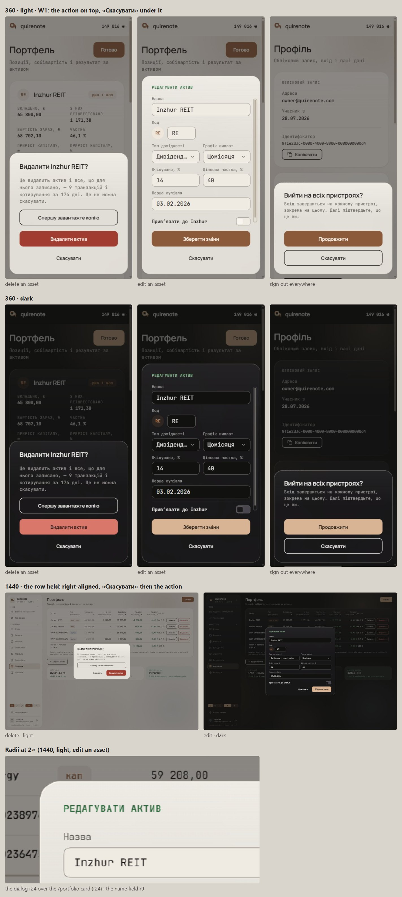

# Dialog buttons, dialog and field radii (wave 16)

Wave 8 left three record conflicts open ([forms-and-dialogs.md](forms-and-dialogs.md#left-open)): the stacked button order below md, the dialog's r24 against the record's r20, and the field's r9 against the asset form's r10. Today the code does three different things below md: five dialogs keep a right-aligned row, import stacks «Скасувати» first, and re-authentication and deletion stack the action first. This wave settles all three by research and the house rules, confirmed with the brief. The one question it asked was when the buttons stack below md, and the pick was W1, always.

## Renders

The three live dialogs at 360 (delete an asset, edit an asset, sign out everywhere) in light and dark, the md+ row unchanged at 1440, and the dialog and field radii at 2×. The page does not scroll sideways, no label clips, and the focus order is the drawn order.

## Signed

- **Below md (the M2 sheet, `useIsDesktop()` false), in every dialog (W1).**
  - *Answered by wave 26: re-authentication stays top-anchored below md; this button rule holds for it too ([open-values-shell-controls.md](open-values-shell-controls.md#signed)).*
  - The button row is a column with a 10 px gap (`gap-2.5`).
  - Each button is full width, 44 high and r11 (the size is held).
  - The action is first, «Скасувати» last, destructive or not.
  - With more than one action, they keep their order above «Скасувати» (deletion: «Видалити одразу», «Видалити через 30 днів», «Скасувати»).
  - In the discard dialog, «Відхилити» stands above «Продовжити редагування», which plays the dismissive role.
- **md and up: held.** A right-aligned row: «Скасувати» (or the dismissive button) leading, then the action. Deletion stays stacked at every width, as its record rules.
- **Focus order = drawn order.** The elements swap in the DOM, as `Reauthentication.tsx`'s `Row` already does. Never `flex-col-reverse` or `order`.
- **One breakpoint: md,** not `ImportDialog`'s 420-px container query (*Two shells, one breakpoint*).
- **Dialogs that change.**
  - `AssetForm.tsx`, `AssetDialogs.tsx`, `DangerZone.tsx`, `Repairs.tsx` and `EditActions.tsx`: today a wrapping row at 360, now stacked.
  - `ImportDialog.tsx`: the order flips («Скасувати» was first) and the breakpoint becomes md.
  - Unchanged: `Reauthentication.tsx`'s `Row` and `DeleteAccount.tsx`.
- **Dialog radius 24.** `Dialog.tsx`'s `rounded-3xl` and the Scroller at 24 are unchanged; the 360 sheet is also r24 (wave 8). It reads above the r20 glass cards, as dialogs do above cards in Material 3, Atlassian and Fluent.
- **Field radius 9:** round(36 × 0.26), unchanged in code.
- **Records superseded.** `import-dialog`'s "the destructive one LAST"; `floating-edges`' "Dialog · over its overlay, r20", a 250-px plate about edges; `asset-form`'s "radius 10", a superseded Phase 2 value.
- **Cost.** A taller sheet below md; five dialogs change from today's row.
- **New copy.** None.

## Rejected

- **W2, a row while the pair fits, stacked when it doesn't** (Material 1's side-by-side rule): the layout depends on the label, and «Замінити всі дані» is 2 px from flipping at 360. A narrower phone or a larger text size flips such pairs.
- **W3, equal halves while each fits:** only the two re-authentication pairs fit, so delete, edit and import stack anyway and W3 behaves as W1 almost everywhere.
- **«Скасувати» on top:** no source does it.
- **r20 for dialogs, r10 for fields:** each is the minority record and off the shape rule.

## Settled by research

- **The action on top, «Скасувати» under it, destructive or not.** Material 1, 2 and 3, Apple, GOV.UK and Fluent agree, and none puts Cancel on top. Material: "Affirmative actions are stacked above dismissive actions" and "Affirmative actions may be destructive". Apple: "Always place the default button on the trailing side of a row or at the top of a stack".
- **Stacked on a phone.** GOV.UK sets a button group as a column on mobile; Fluent stacks at 480 and below.
- **Focus order is the drawn order** (CSS Flexbox; WCAG 2.4.3).
- **Dialogs sit above cards in radius:** Material 3 (28 / 12), Atlassian (12 / 8) and Fluent (8 / 4).

## Implementation checks

- `profile.test.tsx` pins the md+ order «Скасувати», «Продовжити» and stays.
- Each changed dialog needs an order test at both widths, like that one, plus a no-`-reverse` check.
- A merged drawing is immutable, so the supersessions above are recorded in `docs/DECISIONS.md`, not in the old sheets.
