# Empty, loading and error (wave 12)

The app's states without data. The record already rules most of them. Loading holds the boxes after 300 ms, with «—» in `faint`, aria-busy and one status line, and no spinner. Failures and not found are one card with a muted glyph, no code and no red. Empty had no drawing at all, and loading and failure were only ever drawn on solid cards. This wave draws all of them on the glass, and adds a first look for a new account.

## Renders

Each state is the live app on an empty account: loading, a new account's /overview, an empty /payouts, a failed read and not found (/nope). Nothing scrolls sideways in any frame.

At 1440:

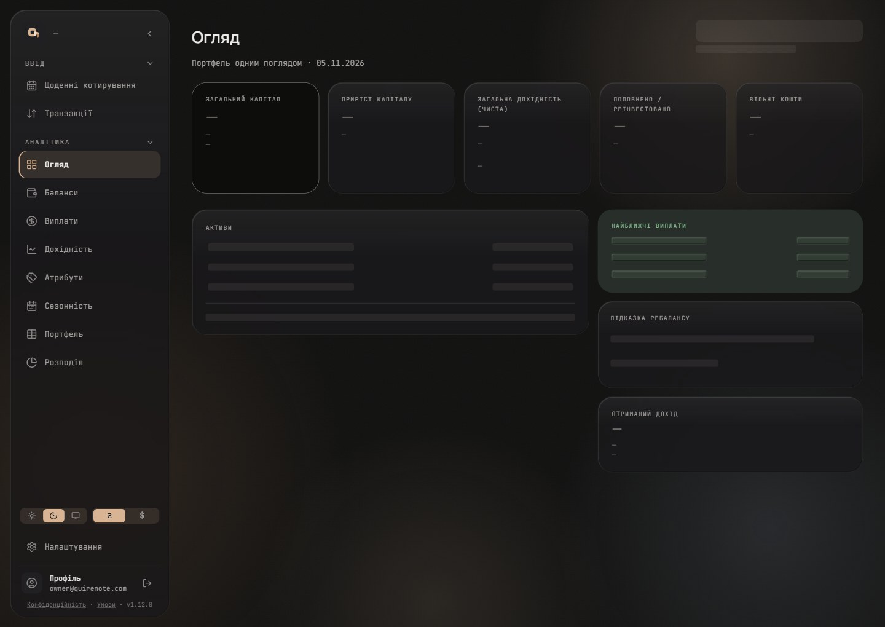

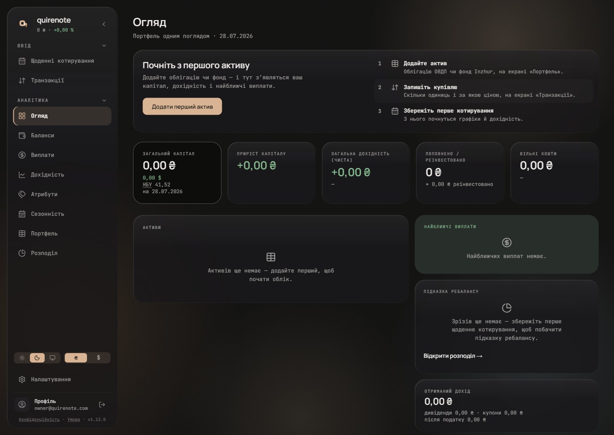

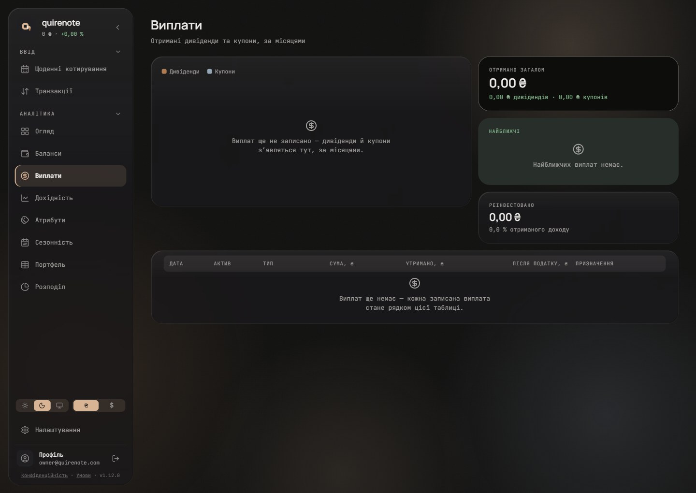

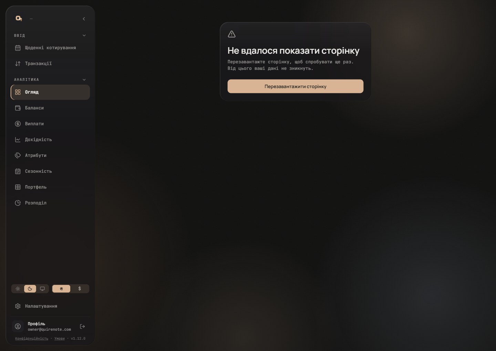

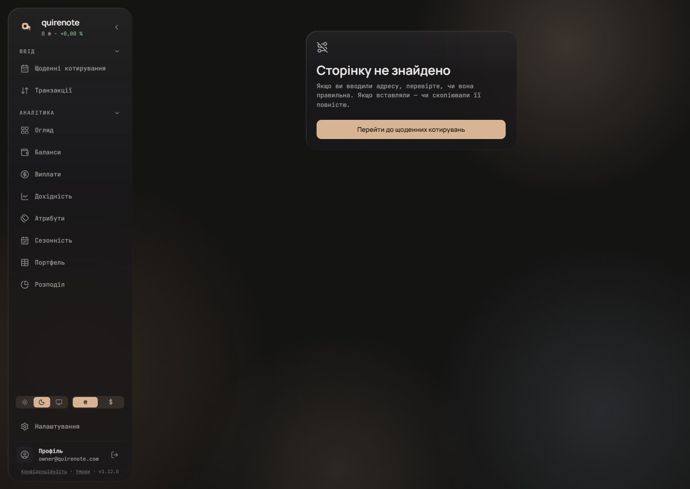

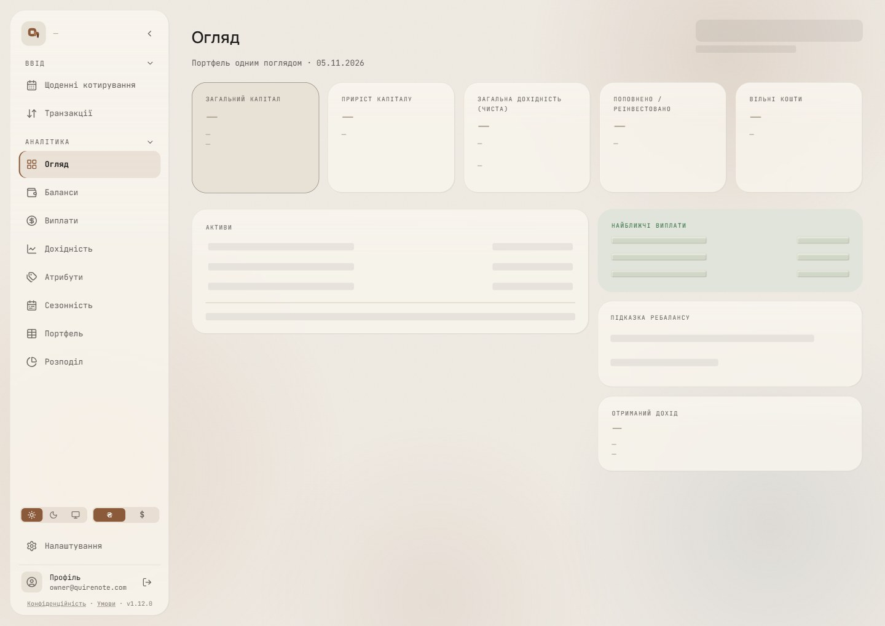

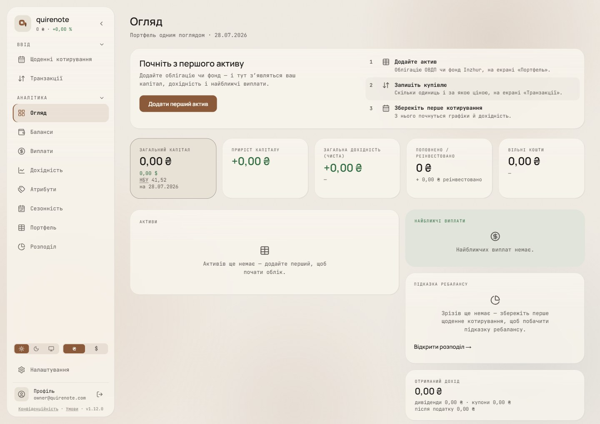

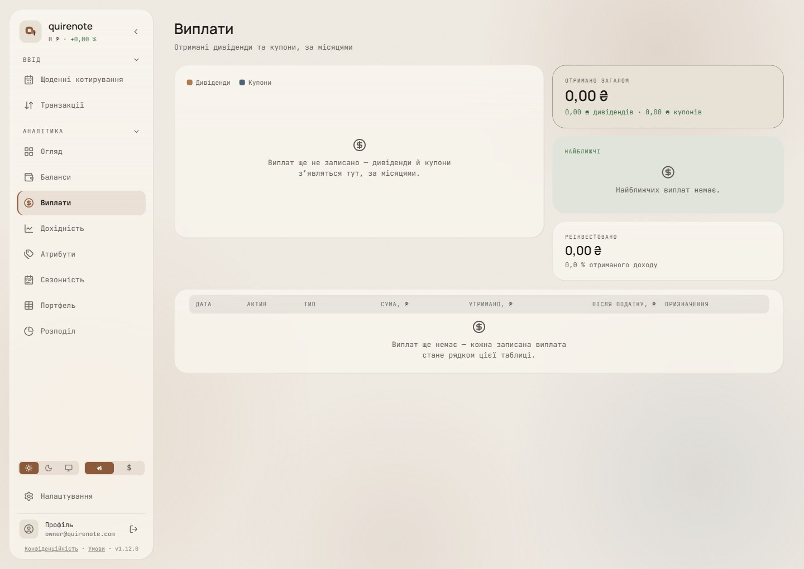

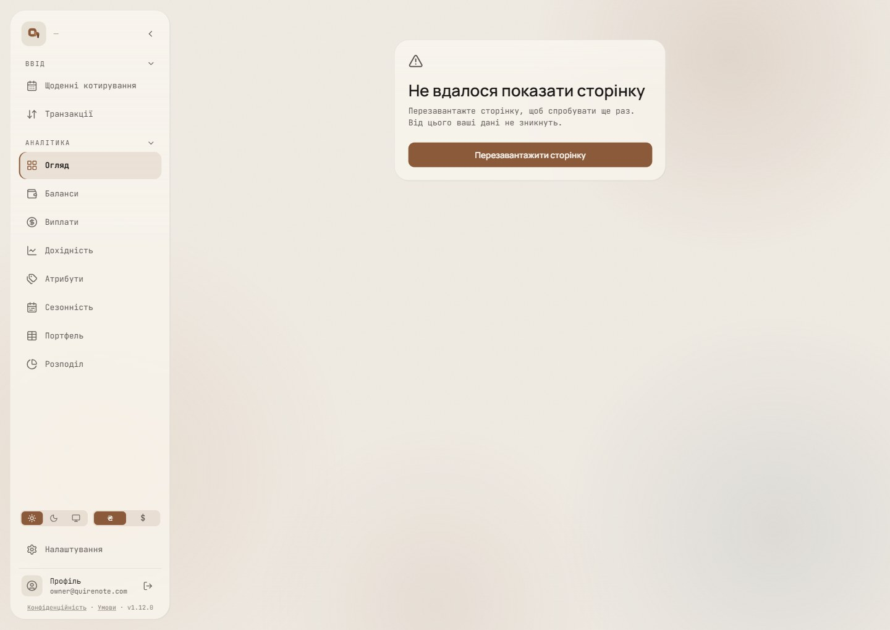

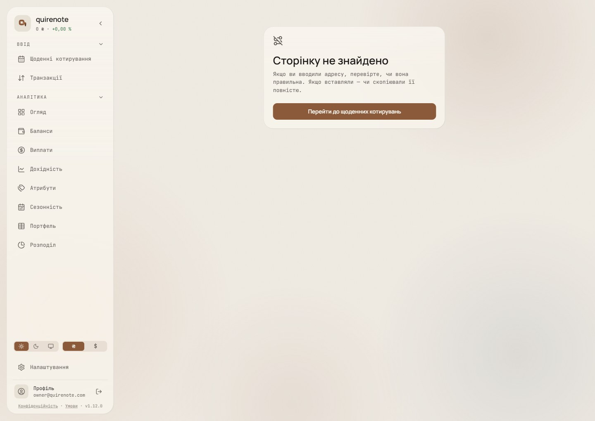

At 360:

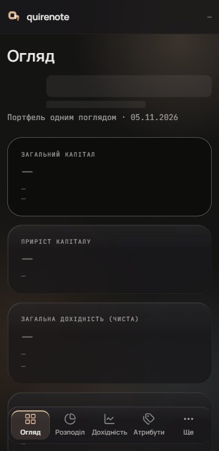

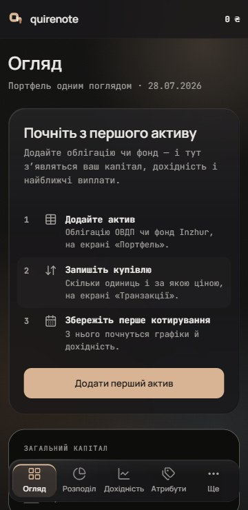

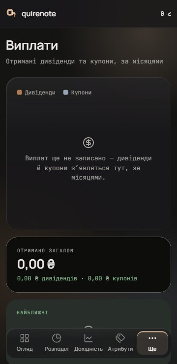

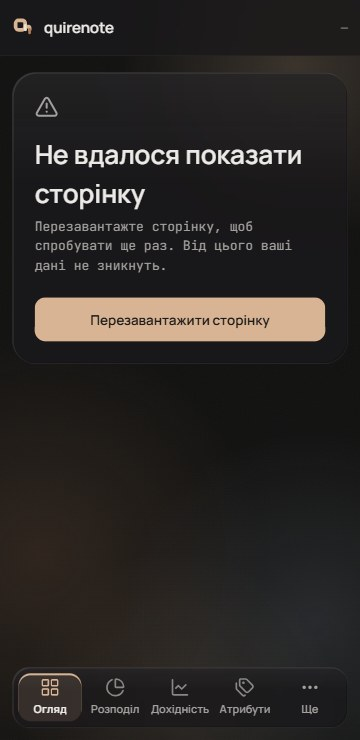

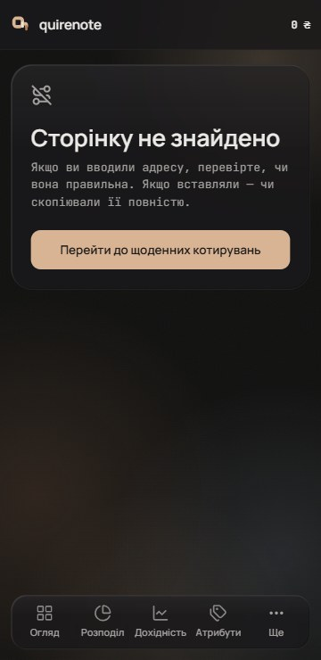

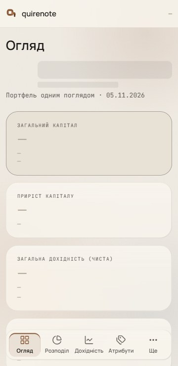

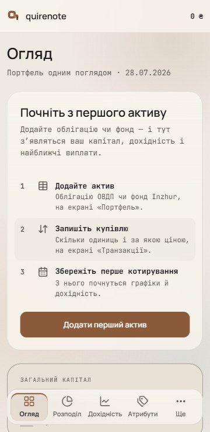

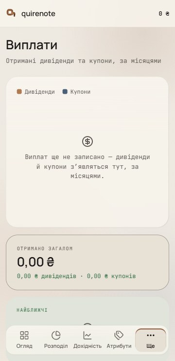

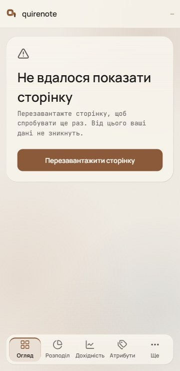

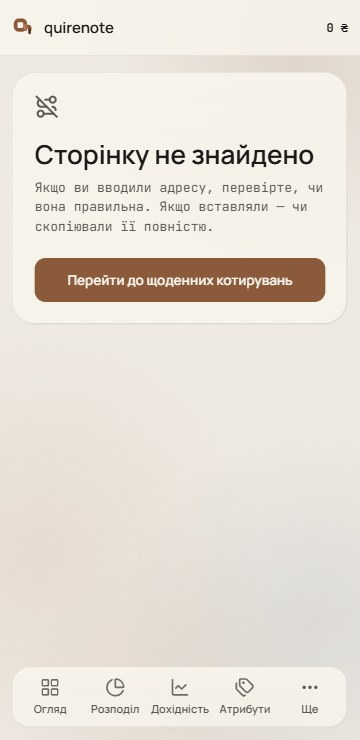

## Signed

- **Empty card (E2).** A 24 px glyph in `muted`: the nav glyph of the card's subject (Портфель, Виплати, Розподіл, Баланси), stroke 2. Then today's sentence, 13 / 1.5 `muted`, centred, ≤ 340 wide. The stack has a 10 gap and keeps the card's own height.
  - Every bare frame gets a line, which is new copy: the Payouts chart and table, and Allocation's «Поточне проти цілі» and «План ребалансу».
  - The Payouts chart: «Виплат ще не записано — дивіденди й купони з’являться тут, за місяцями.»
  - The Payouts table: «Виплат ще немає — кожна записана виплата стане рядком цієї таблиці.»
  - The targets: «Цілей ще немає — їх можна задати, щойно в портфелі з’явиться актив.»
  - The plan: «Плану ще немає — він з’явиться, коли будуть і активи, і цілі.»
  - Overview's «Активи» reuses `assets.empty`, the app's own «Активів ще немає — додайте перший…».
  - No empty card carries an action; the record's one action stays on /portfolio.
  - One `EmptyState` component carries all of it, with the glyph as a prop.
- **First look (F2).** While the account holds no asset, Overview shows a first-run glass card between the header and the KPIs. The E2 cards stay below, so the account sees what will fill. All of its copy is new.
  - Title «Почніть з першого активу», Manrope 20 / 600.
    - *Left open by wave 18: 20 / 600 fits no role in its table ([type.md](type.md#left-open)).*
  - The lead «Додайте облігацію чи фонд — і тут з’являться ваш капітал, дохідність і найближчі виплати.», 13 `muted`.
  - Three numbered steps, each with its screen's nav glyph, in wave 6's zebra rows: add an asset («Портфель»), record the purchase («Транзакції»), save the first quote.
  - One primary action, «Додати перший актив» → /portfolio, at md size (full-width 44 below md).
  - A labelled `<section>`. It goes the moment the first asset exists, stores nothing and is not dismissible.
  - At 1440 the text sits left and the steps right; at 360 they stack.
- **Loading (P2).** Placeholder blocks take `ink` at 7 % instead of `panel`: the wave-6 table band's material, a tint of the text colour, so it follows the glass in both themes. On a tinted surface they keep `card`. Held unchanged from the record:
  - the 300 ms delay and 300 ms hold;
    - *Overturned by wave 19: placeholders appear after 1000 ms (P3) ([motion.md](motion.md#signed)).*
  - the boxes and their sizes;
    - *Overturned by wave 23: each screen's placeholder follows its new layout (L2) ([loading-and-compositions.md](loading-and-compositions.md#signed)).*
  - «—» in `faint`, with the capital «—» in the sidebar and the 360 bar;
  - aria-busy and the status line;
  - the 220 ms fade, the 1.2 s pulse on the blocks only, and the 300 ms landing. Reduced motion stills it all.
    - *Overturned by wave 19: the content lands with the route change's E2 motion (A2) ([motion.md](motion.md#signed)).*
- **Failure and not found.** The boundaries' card takes the wave-4 glass. Held unchanged:
  - ≤ 440 wide, r24, 22 inside;
  - centred across the content column, 64 from the top at md and up, 16 below;
  - the `muted` 24 px glyph, the 26 px title, the lead, and one full-width primary button;
  - the copy, the focus rule, no code and no red.
  - A failed read keeps the route's item active and the capital «—». Not found has no active item, in the sidebar or the dock.
- **New copy:** the four empty lines (Payouts chart, Payouts table, targets, plan) and the first-run card (title, lead, three steps, button), in both languages.

## Rejected

- **E1, bare frames kept (today):** NN/g counts them as "totally empty states" that "cause confusion about how and whether the system is working".
- **E3, glyph, title and lead** (the sentence split at its dash: a 13 px bold title in `ink`, a 12 px lead in `muted`): a bold title in many cards at once on a new account's dashboard reads louder than E2, and one-clause sentences («Найближчих виплат немає») become a title alone.
- **F1, every card in its empty state (today, with E2):** a new account opens on a wall of zeros with no start, and the one card that says where to start sits among the others.
- **F3, the first-run card instead of the cards:** Overview's layout jumps from one card to the full dashboard on the first asset, and the page is mostly empty glow at 1440.
- **P1, `panel` blocks (today):** on dark glass they all but vanish while light shows them, so the two themes disagree.
- **P3, `ink` at 4 % with a hairline edge:** an outlined box reads as a field or a control waiting for input, which the record forbids before the data.

## Settled by research

- **An empty state is a glyph, a heading, a short reason and at most one action.** Atlassian Empty state; Carbon: "Don't cover multiple options in one empty state".
- **No bare frames.** NN/g: "Do not default to totally empty states."
- **A first run says what will appear.** Intuit: "be specific about what info or data will appear after the first use". The first-run card also follows Ghostfolio's welcome, steps and one action.
- **A failed read must never look like data loss** (Primer Degraded experiences).
- **The empty card's anatomy** follows Carbon empty states (text-only on dashboards) and the record’s muted glyph for failures.
- **The placeholder fill stays subtle.** The blocks are decorative and aria-hidden, so 3:1 does not bind them (the record’s loading rule). Atlassian asks that they stay subtle ("so the placeholder reads as loading content instead of a status").

## Implementation checks

- `placeholders.test.tsx` checks the blocks' pulse and aria-hidden, not the fill, so it is unchanged.
- `boundaries.test.ts` and `messages.test.ts` are unchanged.
- Nothing pins `EmptyState`, so new tests come with the glyph and the new lines.
- `navigation-map.md`'s expected values for a new account gain the first-run card and the new empty lines.

## Not drawn

- AppFailure. It is the same stack in wave 9's signed glass card.
- The super-admin's not found, which differs only in its button («Перейти до архіву цін»).
- The other screens' empty states, which take the same E2 anatomy.
