# Forms and dialogs (wave 8)

The shell, cards and tables moved to glass; the forms and dialogs never did. Each form writes its own field classes, a dialog on a phone is still a floating card, and at 360 a toast can land on the new dock. This wave settles the field on glass, the dialog surface, what a dialog becomes on a phone, and the toast.

## Renders

Every frame is the live app's own form or dialog, opened through its real trigger. The toast frames show two real toasts from the app: the success «Зріз збережено», and the error «Не вдалося зв’язатися з Inzhur — перевірте з’єднання.» with its 28 px r7 close box.

At 1440: the transaction form submitted empty, the asset dialog, the delete confirmation and the toasts.

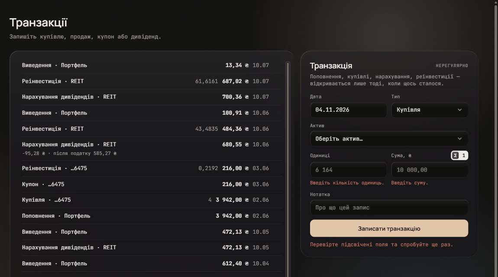

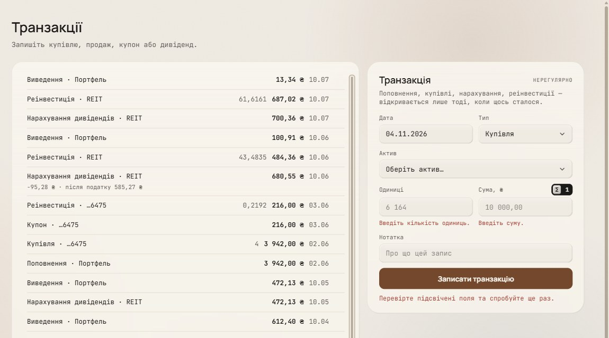

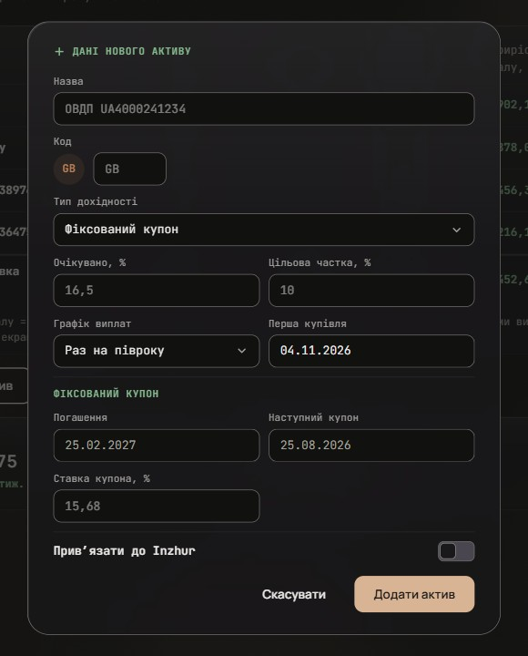

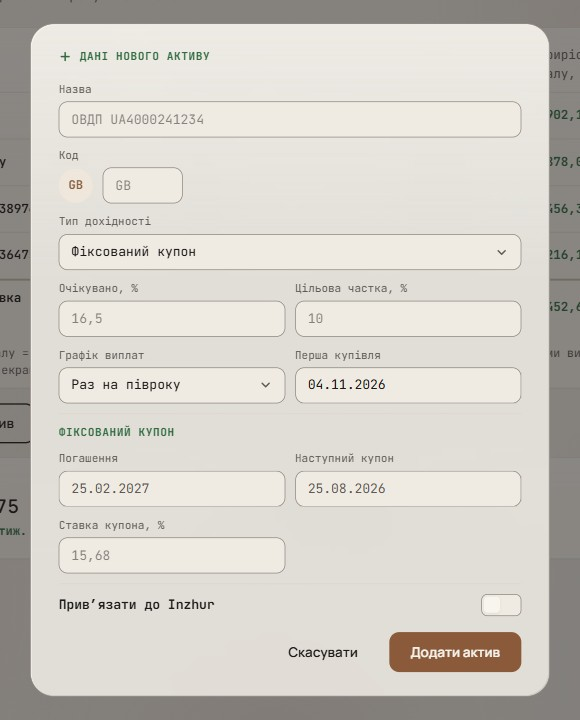

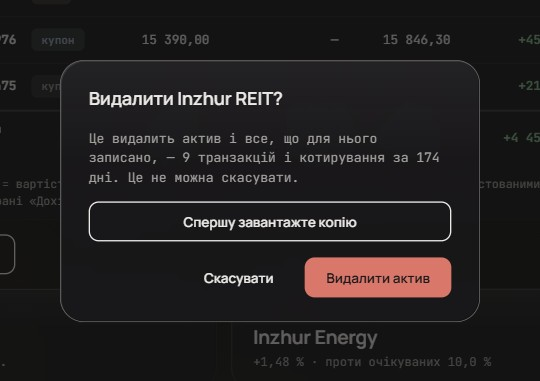

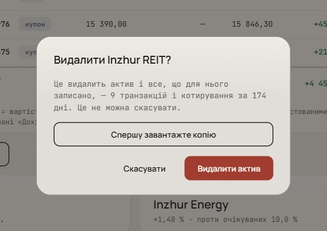

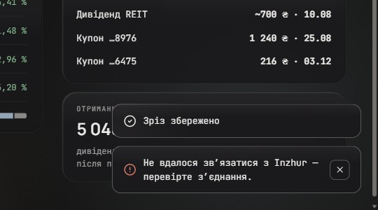

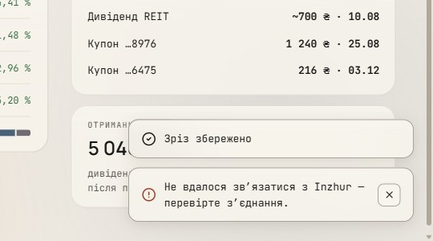

At 360: the form errors, the asset sheet, the delete sheet and the toasts above the dock.

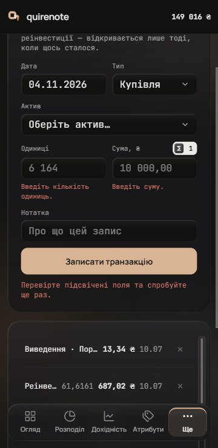

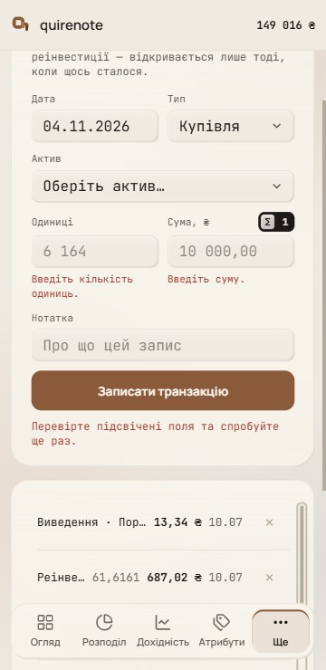

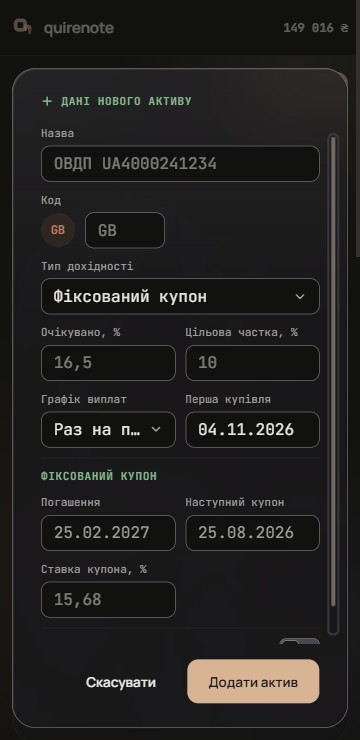

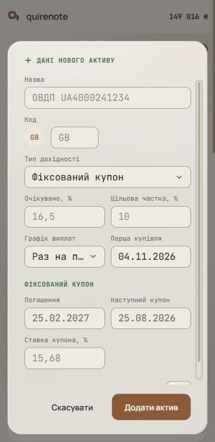

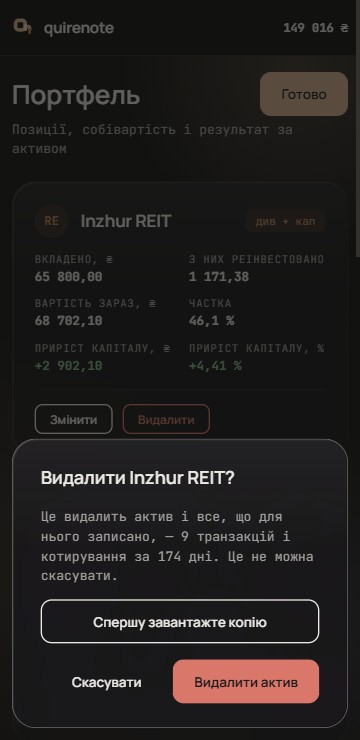

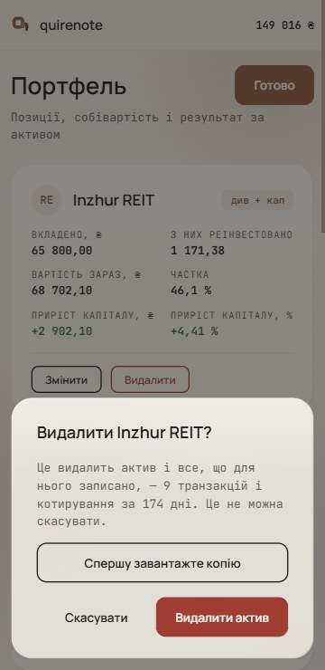

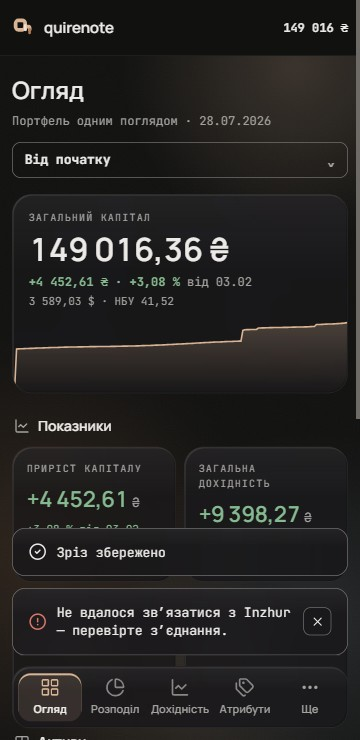

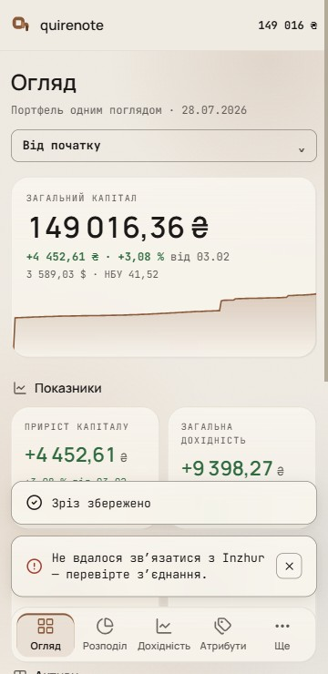

The 360 sheet at real speed: a flip-book of renders, one per 60 Hz frame. The delete sheet rises in 260 ms and leaves in 220 ms on `ease-soft`, and the scrim fades over 220 ms, the «Ще» sheet's own tokens. Under reduced motion the global kill-switch makes it appear at once.

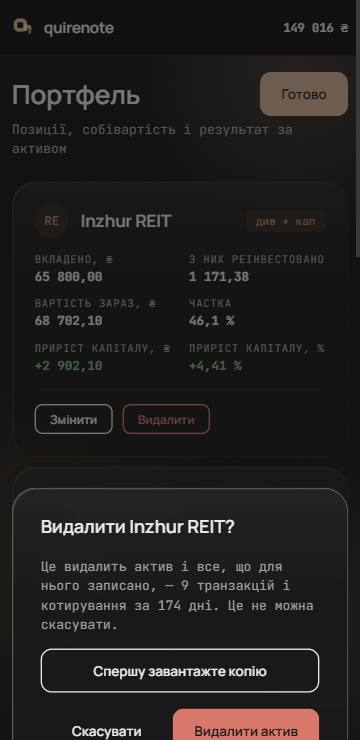

## Signed

- **Held from the record, not re-asked.**
  - A field is 36 px at r9 with a `field-border` edge ≥ 3 : 1, hover to `ink`, invalid `neg`, and the global 2 px focus ring.
    - *Overturned by wave 17: the focus ring is two-tone, a `card` halo inside the `accent` ring (F2) ([controls.md](controls.md#signed)).*
  - 44 is hit area, never geometry.
  - The button variants and their 60/30/10 ration.
    - *Overturned by wave 17: the secondary button is the glass knob (B4) ([controls.md](controls.md#signed)).*
  - Radix's trap, Escape and focus return.
  - "No refusal sentence moves its button".
  - The toast's r13 and its 28 px close box.
- **Field (F2), every form.** Fields take the recessed `page` fill, one step darker than the card in light, so every field reads as a well in the surface. It makes the two forms agree.
  - Held: 36 px at r9, a `field-border` edge, hover to `ink`, invalid `neg`, the global 2 px focus ring, labels above at 11 px `muted`, the 44 hit area below md, 16 px type below md.
    - *Overturned by wave 17: the focus ring is two-tone, a `card` halo inside the `accent` ring (F2) ([controls.md](controls.md#signed)).*
  - Errors: an 11 px `neg` line under the field, and the summary under the submit (as shipped).
  - One shared field recipe replaces the per-surface ones.
- **Dialog at md and up (D2).** The wave-4 glass (`card` 80 % + `blur(30px) saturate(180%)`, bevel and sheen), with the `field-border` edge kept (the record’s floating-edge rule).
  - *Overturned in light by wave 15: the light fill is `card` 70 %, with the lit edge ([glass-light.md](glass-light.md#signed)).*
  - r24, and three bands: the header `pt-6 pb-4`, a scrolling body, the footer `pt-4 pb-6`, all at `px-[28px]`.
  - The secondary action sits left of the primary, and the scrim is held.
  - Over the scrim the page behind is dimmed, so the glass reads mostly through its bevel and sheen.
  - Drawn on the asset dialog («Додати актив», 520) and the delete confirmation (AlertDialog, 420).
- **Dialog below md (M2), an inset sheet like «Ще».**
  - Geometry: 12 px from the sides, `bottom: calc(12px + env(safe-area-inset-bottom))` above the keyboard inset, r24, `max-height: calc(100dvh − 80px)`, with the body scrolling inside.
  - The buttons end up within thumb reach. Fields stay 36 px with the 44 hit area, at the 16 px type the app forces below md.
  - Motion: it rises `translateY(calc(100% + 12px))` → 0 in 260 ms and leaves in 220 ms on `ease-soft`; the scrim fades over 220 ms. Reduced motion uses the global kill-switch.
  - The same sheet serves forms and confirmations; Radix keeps trap, Escape and focus return.
- **Toast (T2 + T3), T2's status glyph in T3's glass.**
  - *Overturned by wave 22: the toast's edge is wave 15's glass edge ([controls-and-overlays.md](controls-and-overlays.md#signed)).*
  - The wave-4 glass, r13, the `field-border` edge, 14/16 padding, 13 px text.
  - A leading 18 px glyph: Lucide circle-check in `ink` for success (`pos` and `neg` are reserved for deltas), circle-alert in `neg` for a failure. The shape says the status, so colour is never alone.
  - A failure keeps its 28 px r7 close box and stays until closed. `role=status`.
  - Placement at md and up: bottom-right, 24 px from the edges.
  - Placement at 360: 12 px from the sides, and the offset adds the dock's height + 12, so the toasts sit above the dock.

## Rejected

- **F1, the card fill** (the transaction form today): on a card-coloured dialog the field is the panel's colour, so in light it reads as a line, not a box.
- **F3, a light ink tint** (`ink` at 4 % over its surface): a translucent fill that shifts with the backdrop over the glass.
- **D1, today's solid card** (r24, the `field-border` edge): no cost was recorded against it; D2 brings the dialog into the glass that waves 2/4 gave every card and the dock.
- **D3, glass with a title band** (the title row on the wave-6 band, `ink` 7 %): the band's height follows each dialog's own title row, so it varies between dialogs.
- **M1, today's floating card** (centred, 100vw − 32 wide, capped at 85 % of the height): the buttons sit mid-screen, away from the thumb.
- **M3, forms full-screen, confirmations stay sheets:** two forms to maintain, the page behind disappears, and the top needs the safe-area inset.
- **T1, today's text toast** (text only, on the opaque card): success and failure differ only by the close box.

## Settled by research

- **Labels sit above fields.** GOV.UK: "align labels above the text input"; NN/g.
- **Errors show on submit and clear as a field is corrected.** GOV.UK: "Do not validate when the user moves away from a field".
- **Confirmations name what happens** (NN/g).
- **Toasts announce politely** (WCAG 4.1.3, `role=status`).
- **At 360 a toast clears the dock.**
- **The footer order**, secondary left of primary, follows Carbon.
- **The inset sheet** reuses the signed «Ще» sheet. Apple HIG: "A sheet helps people perform a scoped task". Its cost is a long form scrolling inside the sheet (Apple: "For complex or prolonged user flows, consider alternatives to sheets").
- **The status glyph** follows WCAG 1.4.1 (not colour alone); Carbon notifications carry a status icon.
- **The glass panel and toast** follow waves 2/4: every floating surface is glass.

## Implementation checks

- The shared field recipe replaces the per-surface ones in `TransactionPanel.tsx`, `AssetForm.tsx` and `sign-in/parts.tsx`.
- `field-border.test.ts`: the shared recipe and the fill.
- `floating-edges.test.ts`: glass panels and toasts keep the edge.
- `toaster-press.test.ts`: the offset gains the dock. Today's offset knows the action bar and the drawer band, not the dock.
- The Dialog's below-md geometry, which no test pins today.
- `transaction-form-reset.test.ts`: the errors are unchanged.

## Left open

Wave 8 left these record conflicts open:

- Stacked button order below md (import: destructive last; re-authentication: action first).
- Dialog r24 vs the record’s r20 for floating edges.
- Field radius 10 (the asset form's record) vs 9.

Wave 16 settles all three ([dialog-buttons-and-radii.md](dialog-buttons-and-radii.md#signed)).

## Findings left to their own issues

- The forms use example placeholders («6 164», «10 000,00», «ОВДП UA4000241234», «16,5»), which GOV.UK rules out "for hints or examples". In the asset form they read as filled values.
- In light theme the placeholder text is under 4.5 : 1. That is Tailwind's default, `currentColor` at 50 %.
- Портфель's edit mode at 1440 runs «Приріст капіталу, %» into «Частка» (wave 6's column gap fixes it).
- At 360 the asset form keeps its field pairs side by side, so «Раз на півроку» truncates. The record says pairs "stack at narrow widths; the form fits 360px unclipped".
- In dark the scrim (the page colour at 64 %) barely dims a dark page.
