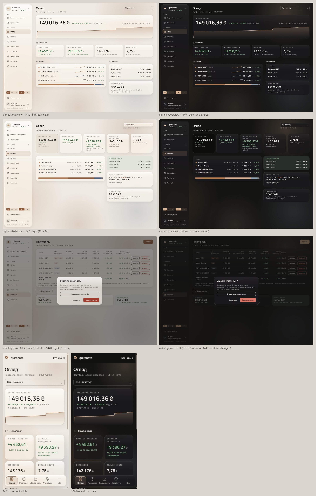

# Glass in the light theme (wave 15)

In light the glass did not show, while dark showed it well. The cause was the light recipe, not transparency. Wave 2 signed the light rim and sheen as `card` over a fill that is itself `card` at 80 %, so they add almost nothing; what stayed visible was the dark border and shade, which read as an outlined card. Little of the glow reached the card either, and waves 2 and 4 had rendered every backdrop study in dark only. This wave re-draws the light edge and the light backdrop. Dark stays exactly as waves 2 and 4 signed it, and so do the glass's scope, the glow's geometry and hues, the fallbacks, and `muted` at AA on the worst backdrop.

It overturns the light values of [glass.md](glass.md#signed): the light fill, the light border, `glass-rim` and `glass-shade` in light, and the light glow.

## Renders

Light (E4 + B3) on the left, dark on the right, with dark untouched: /overview, /balances and a dialog at 1440, then the 360 bar and dock. Nothing scrolls sideways in any frame.

## Signed

Light only; dark is exactly as waves 2 and 4 signed it.

- **Fill.** `card` at 70 % in light (dark stays 80 %). `blur(30px) saturate(180%)` is held in both themes.
- **Edge (E4), a lit top and a shaded bottom.**
  - Stroke: 1 px `ink` 6 % (was 8 %).
  - Top-left inner line: `inset 1px 1px 0` in `glass-rim`, whose light value becomes white (`#ffffff`), at 100 %.
  - Bottom-right inner line: `inset -1px -1px 0` in `glass-shade` = `ink` 16 % (was 10 %).
  - Sheen: `glass-rim` (white) at 60 %, fading to transparent by 38 %.
  - Shadow: `0 8px 24px` `ink` 7 %, in light only.
- **Glow (B3).** The same four spots, geometry and hues. The light peaks become `accent` 19 %, `reit` 25 %, `ovdp8976` 18.5 % and `energy` 19 % (were 14 / 12.6 / 11.2 / 8.4 %). Each is that hue's own cap: the strongest at which `muted` still reads at AA on a bare peak.
- **Scope.** Everything that wears the glass takes these values: the cards, the sidebar, the 360 bar and dock, the tooltip, dialogs, toasts and the sign-in card. Dialogs keep wave 8's `field-border` edge in place of the stroke.
- **Fallbacks.** Held as signed. Under `@supports not` and `prefers-reduced-transparency` the surfaces are wave 1's opaque cards, without this edge or shadow.
- **What it does not do.** Light cards read as lit, edged objects with some warmth coming through. They are not as plainly see-through as dark; that would need an edged backdrop, which was declined twice (waves 2 and 4) and stays out.
- **Costs.** A new light value (white) for the `glass-rim` alias; the two themes' fills differ (70 / 80 %); a shadow on every light glass surface; a warmer light page.
- **New copy.** None.

## Rejected

- **E1, today's light edge** (`card` 90 % rim, `card` 55 % sheen, `ink` 8 % border, `ink` 10 % shade): invisible over its own fill; the card reads as outlined, not glass.
- **E2, a white highlight alone** (the white top line and sheen, border and shade as today): faint without the dark lower edge.
- **E3, WinUI's dark flip alone** (no white; the stroke at `ink` 6 %, the lower edge at `ink` 16 %, the soft shadow): reads as raised paper.
- **B1, the glow as signed** (×0.7, fill 80 %): the glow barely reaches the card.
- **B2, each hue at its cap with the fill at 80 %:** the page warms, the cards barely.

## Settled by research

- **Strokes and gradients carry depth on a plain backdrop.** NN/g: "strokes (borders) and gradients can emphasize depth of glassmorphic elements, especially when these elements are placed on simple or one-color backgrounds".
- **A dark outline on light.** Apple: an element "might need a subtle dark outline to contrast well with a light background"; Liquid Glass reads through "highlights that respond to geometry", and its shadow is lowered "over a solid light background".
- **The 70 % light fill** is WinUI's light card alpha (`CardBackgroundFillColorDefault`, `#B3FFFFFF`). What separates WinUI's equally faint light card is a stroke and an elevation edge flipped dark at the bottom in light (`CardStrokeColorDefault`).
- **E4** is the research synthesis: a white inner top line over a darker bottom edge, wave 2's bevel lit from above in light too.

## Implementation checks

- No test re-points yet, because the glass itself is not in code. These light values ship with the glass implementation.
- The tightest reading is /balances' date range under the period picker, in the accent glow's peak: it passes AA with almost nothing to spare, so an implementation pins it in a test.
- Text on a dialog over its scrim was not checked.
