# Glass and the backdrop (waves 2 and 4)

Wave 2 puts a slightly transparent glass on the cards, the sidebar and the dock. Wave 1 had dropped glass cards only because they were invisible at the glow strength that keeps page text legible, so that rejection is overridden here. The wave-1 design is held. Wave 4 reopens the opacity, which wave 2 had settled by measurement rather than by a pick, and changes one value of the material: it adds `saturate(180%)` to the backdrop filter. Its pick is T2. The material below is as it stands after wave 4.

## Renders

### Wave 2

The wave-1 design with the glass on every card and the sidebar, and on the dock at 360. On / and /balances the glass is applied to the app's own cards. The 360 frames are 360 × 740, and none scrolls sideways.

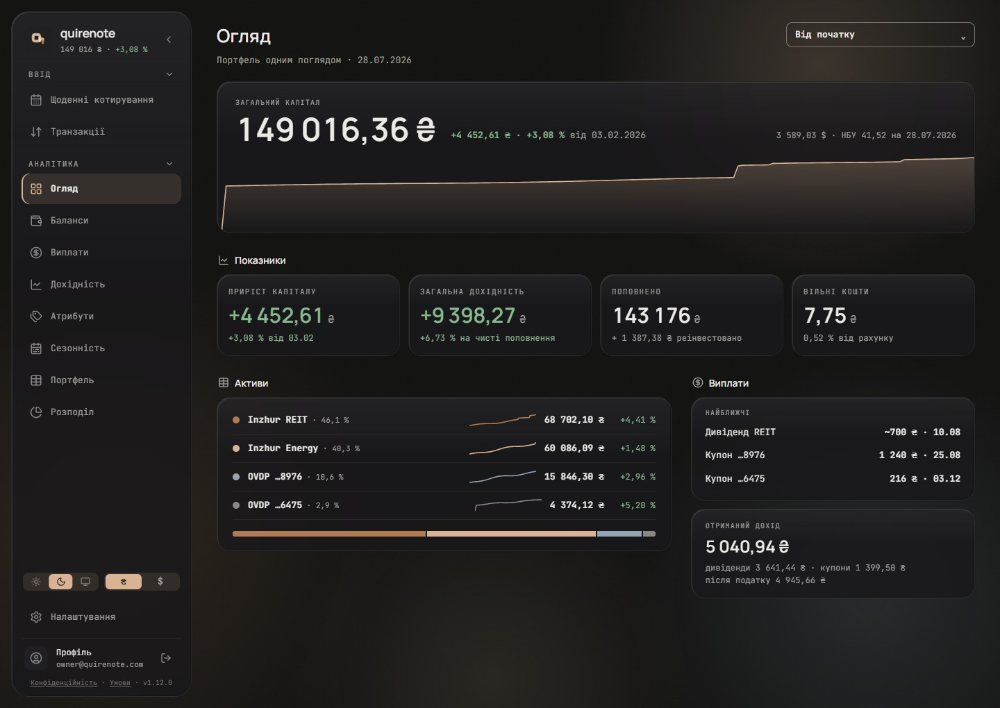

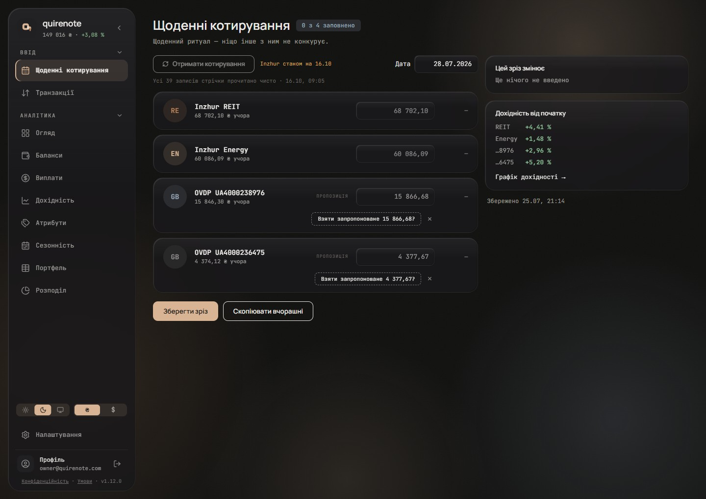

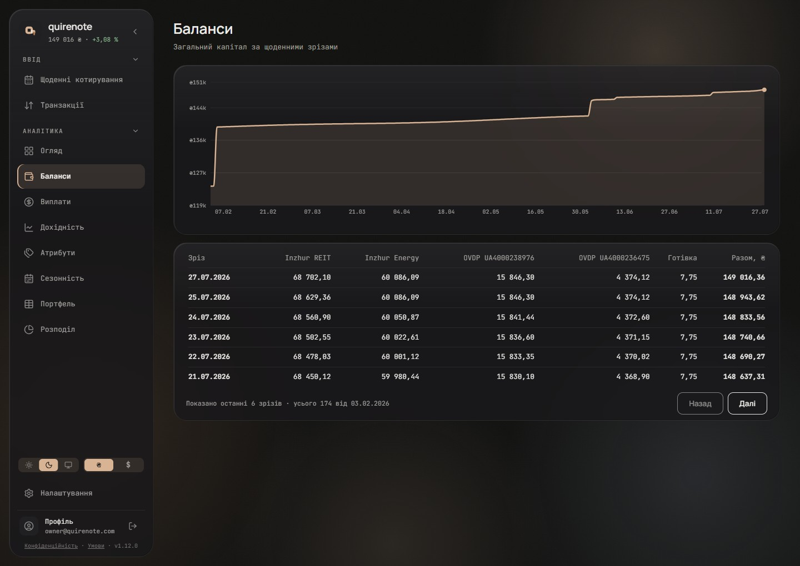

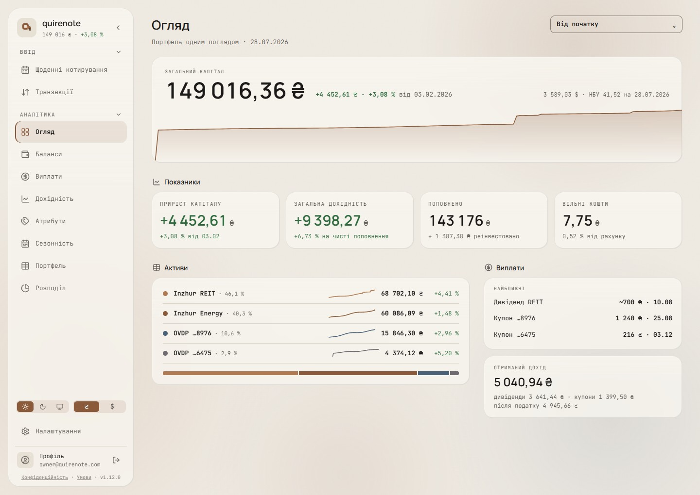

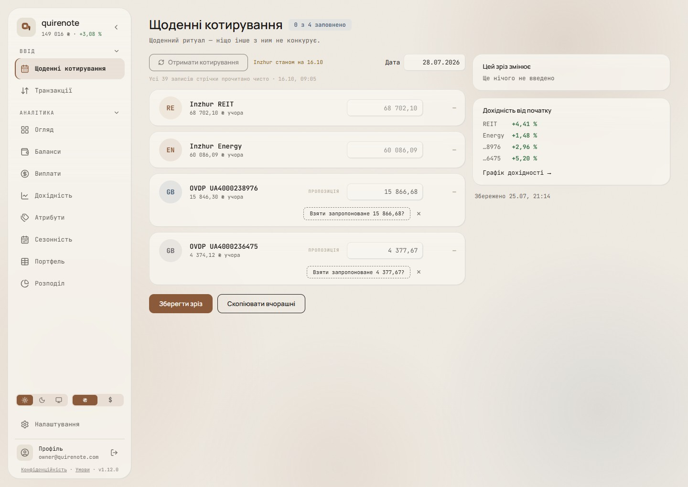

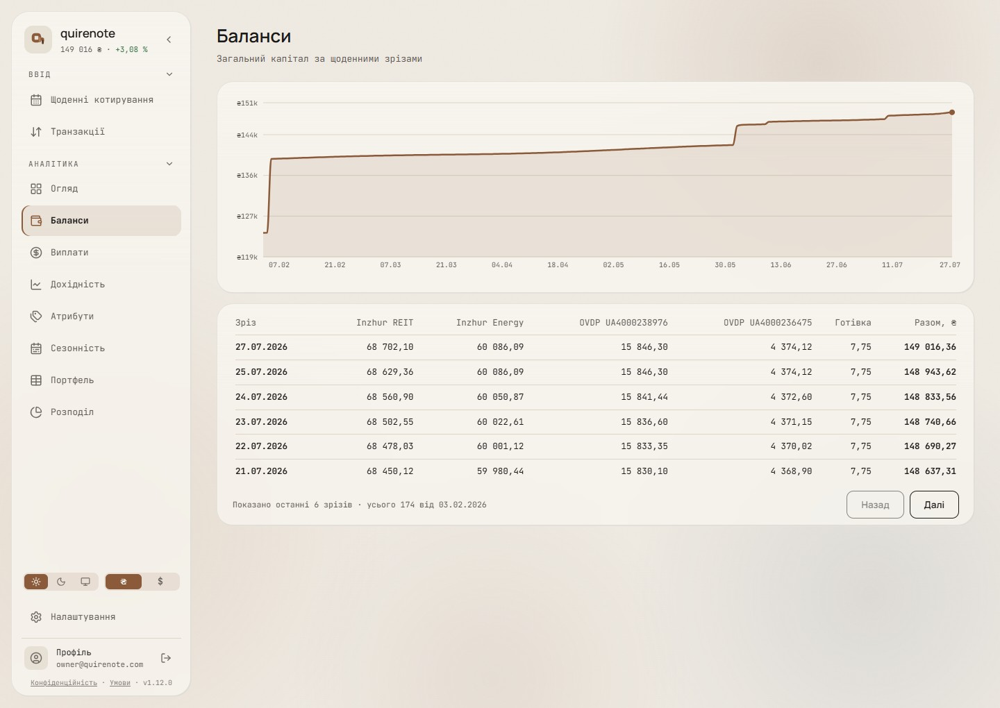

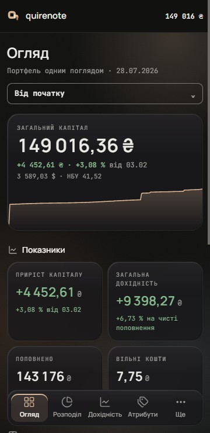

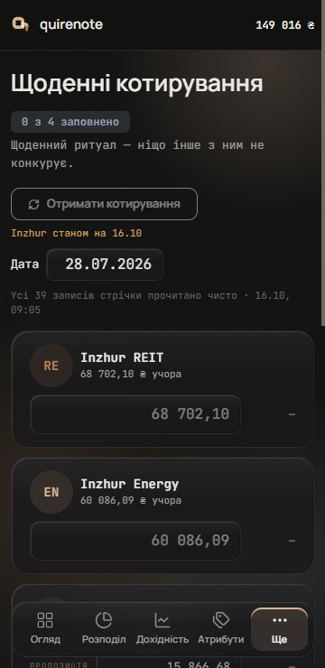

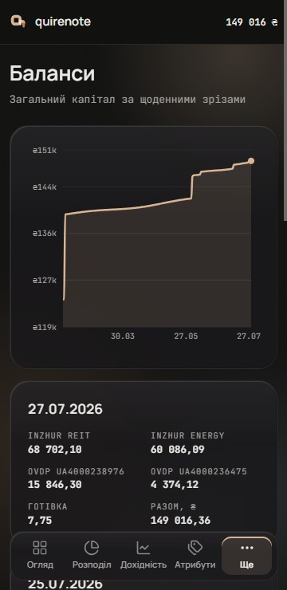

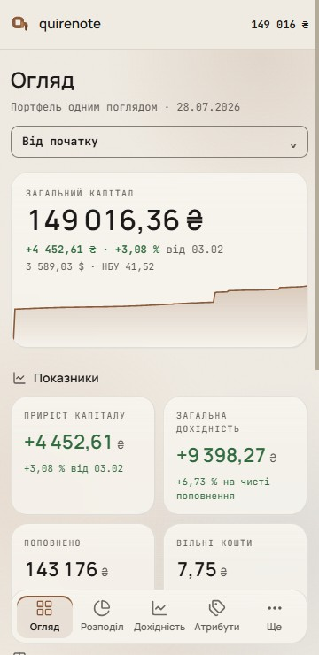

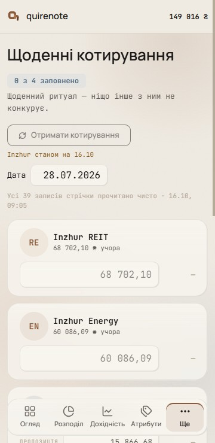

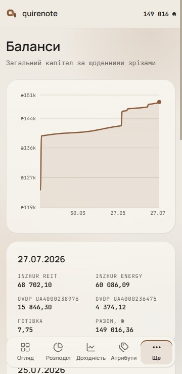

### Wave 4

T2, the signed material with `saturate(180%)`, over the signed backdrop.

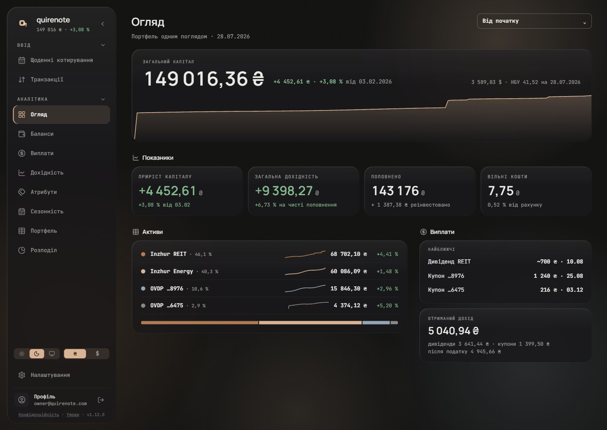

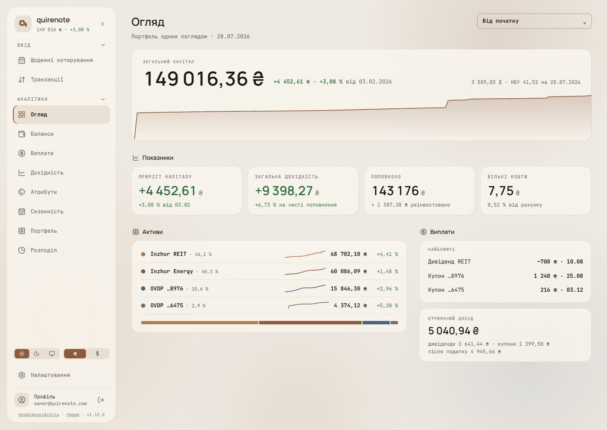

## Signed

- **Material (T2).** `background: color-mix(in srgb, var(--color-card) 80%, transparent)` with `backdrop-filter: blur(30px) saturate(180%)`, and the `-webkit-` twin. Wave 2 signed it with no saturate; wave 4 added `saturate(180%)`. The opacity stays at α 0.80, the thicker material.
  - *Overturned in light by wave 15: the light fill is `card` 70 % ([glass-light.md](glass-light.md#signed)).*
- **Edge (E4).** A 1 px border of `ink` at 6 % (dark) / 8 % (light). A bevel of two insets: `inset 1px 1px 0` RIM and `inset −1px −1px 0` SHADE.
  - *Overturned in light by wave 15: the light stroke is `ink` 6 %, with a soft shadow in light only ([glass-light.md](glass-light.md#signed)).*
- **Sheen (E4).** A first background layer: `linear-gradient(180deg, RIM 0%, transparent 38%)`.
  - *Overturned in light by wave 15: the light sheen is `glass-rim` (white) at 60 % ([glass-light.md](glass-light.md#signed)).*
- **RIM and SHADE.**
  - Dark: rim `ink` 12 % (sheen `ink` 5 %), shade `page` 60 %.
  - Light: rim `card` 90 % (sheen `card` 55 %), shade `ink` 10 %.
    - *Overturned by wave 15: in light, `glass-rim` is white and `glass-shade` is `ink` 16 % ([glass-light.md](glass-light.md#signed)).*
  - Two new alias tokens, aliases and not colours (the `drawer-edge` precedent): `--color-glass-rim` = `ink` (dark) / `card` (light), and `--color-glass-shade` = `page` / `ink`. Without them the light theme's light comes from below.
    - *Overturned by wave 15: the light value of `--color-glass-rim` is white (`#ffffff`) ([glass-light.md](glass-light.md#signed)).*
- **Scope (X3).** Every content card (KPI tiles, hero, tables, lists, the real screens' `Card`), the floating sidebar (it keeps r26) and the 360 dock (it keeps r18). Wave 4 adds the chart tooltip. Not the 360 top bar or the page.
- **Backdrop (W1).** Unchanged: the wave-1 glow (dark 20 / 18 / 16 / 12 %, light ×0.7) + grain at normal blend.
  - *Overturned in light by wave 15: each light glow hue sits at its own cap (B3) ([glass-light.md](glass-light.md#signed)).*
- **Fallbacks.** `@supports not (backdrop-filter: blur(1px))` and `prefers-reduced-transparency: reduce` both give the opaque card with a hairline. That is exactly wave 1's signed frames. Safari doesn't report reduced transparency, so the default stands on its own: it passes contrast.
- **Recorded in wave 4.** Over the signed wave-1 glow, even the strongest recipe gives a tinted card more than a glass one. Glass reads from seeing something blurred behind it, and this backdrop is almost uniform. A clearly glassy look needs a backdrop with edges (wave 2's W3 spheres or W4 bands), and that would reopen wave 2's Step 1 pick.

## Rejected

- **W2, stronger soft spots under the cards (40–50 %):** smooth glows show as halos around the cards.
- **W3, defined spheres, Cirrel-style (45–55 %):** a decorative layer whose placement is per screen, since the spheres must not sit under headings. Only edged backdrops (W3, W4) make the glass read through α 0.80; W1 was picked.
- **W4, sharp light bands behind each card row (50–55 %):** the bands follow the card rows, so the layer is tied to each screen's grid.
- **A soft "aurora"** (long overlapping glows at up to 65 %): it looked the same as W2, so it wasn't shown.
- **Lower opacity (wave 2):** no visible difference over W1.
- **E1, the hairline (wave 1), and E2, a lit top rim only:** E4 was picked. E2's card also loses its outline at the sides and bottom.
- **E3, the bevel without the sheen:** E4 is E3 plus the sheen.
- **X1, every content card without the sidebar:** X3 was picked; X1 is the same without the sidebar.
- **X2, hero + tiles glass, tables and lists solid:** two card materials on one screen, so it needs a rule for which gets which (figures vs. records).
- **T1, opacity alone at α 0.55:** almost no visible change, for the reason recorded above.
- **T3, α 0.55 + saturate(180 %) + brightness(1.1):** lower opacity and vibrancy together; the glow corners tint the cards warmer.
- **T4, T3 over the same glow spread 1.6× wider:** the page reads warmer overall, and it is still a tint more than glass.

## Settled by research

- **The material** follows Microsoft's Acrylic, which uses blur 30, noise 2 % and tint opacity 0.6–0.8 (WinUI AcrylicBrush.h:64-65). α 0.80 is Apple's "thicker material" and inside Microsoft's tint range.
- **The saturation** follows Apple's own sticky navigation: `backdrop-filter: saturate(180%) blur(20px)` over `rgba(22, 22, 23, .8)` in dark and `rgba(250, 250, 252, .8)` in light (apple.com globalheader.css, ac-localnav.built.css). That is the same 80 % as ours; the 180 % saturation turns a faint backdrop into a visible tint.
- **Opacity changes nothing over this glow.** At α 0.80 a card lets about 20 % of what's behind it through, so a smooth glow reads only as halos in the gaps. Glass reads when the backdrop has edges for the blur to soften. With the backdrop this calm, the glass comes from its own surface: the edge and the sheen.
- **The bevel** is the bevelled rim of Apple's and Fluent's glass.
- **The scope** follows Apple HIG, where glass belongs to navigation chrome first; on mobile the dock follows suit.
- **The layer count** is what web.dev's "test it before deploying" applies to, so the scope was checked with a scroll trace.

## Implementation checks

- The two alias tokens, `--color-glass-rim` and `--color-glass-shade`, are new.
- The scroll trace ran under CPU throttling, which doesn't throttle the GPU, where `backdrop-filter` runs. A real low-end phone is the check it couldn't make.
- Not this design: / draws its «Усі … записів…» line and the empty «—» in `text-faint`, an existing contrast shortfall that the glass barely moves. Language, numbers, fonts marks faint as "decorative only, never body text". That is a separate issue to file.

## Not drawn

- The fallbacks: they are wave 1's signed frames (shell.md).
