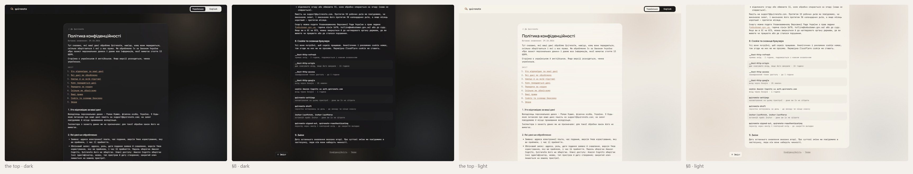
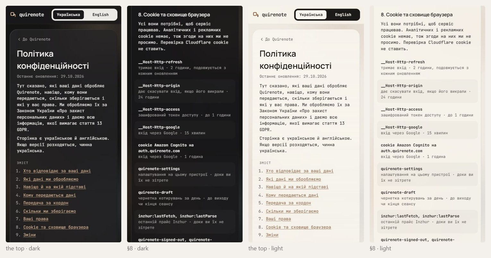
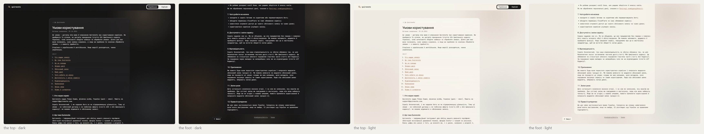
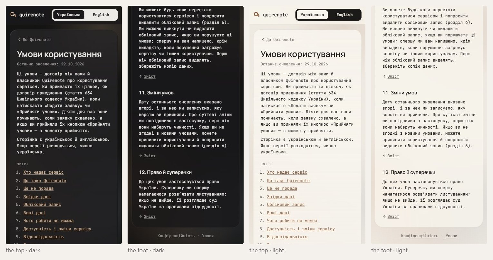

# Privacy and Terms (wave 13)

/privacy and /terms share one frame for every reader: the signed-out shell's wide card (680, about 80 characters a line, WCAG 1.4.8). Wave 9 already signed that shell (glow, glass card, glass bar), so the pages inherit it. Two parts of the document were still solid-card: «Зміст», an inline list, and Privacy §8's storage list, one `panel` box, the fill wave 12 found all but vanishes on dark glass. This wave settles both.

## Renders

The live pages in wave 9's frame, signed out; the page is the same signed in. Nothing scrolls sideways in any frame.

## Signed

- **Frame.** Wave 9's, unchanged: the glow, the glass bar (57, hairline foot) and the glass card. Held from the record:
  - 680 at md and up (about 80 characters, WCAG 1.4.8) and 336 at 360, r24, padding 28 / 22, top-anchored 64 / 16;
  - the order: «До Quirenote», the title, «Останнє оновлення», the intro, «Зміст», the numbered sections;
  - the type, the 16 px landing, and the links under the card.
- **«Зміст» (T2).** The inline numbered list stays where the record has it.
  - At md and up: once that list has scrolled out of view, a «↑ Зміст» link pins to the window's foot, 24 up, in the margin left of the card, with its right edge 16 off it. It is wave-4 glass at r9 (round(34 × 0.26)), padding 8 / 12, a 14 px arrow-up glyph and «Зміст» 13 / 600 in `ink`. It jumps to the list smoothly, and instantly under reduced motion.
  - Below md: each section closes with a static «↑ Зміст»: 12 / 18 `muted`, underlined, a 12 px glyph, 12 above, with a 44 hit area.
    - *Overturned by wave 18: 12 px text takes the small role, 12 / 16 ([type.md](type.md#signed)).*
  - Its copy reuses `privacy.contents`; the glyph is aria-hidden.
- **Storage list (K2).** Privacy §8, «Cookie та сховище браузера», as wave 6's records. Each row is padded 10 / 12 at r11, with even rows on `ink` 3 %, pulled 12 into the card's padding so the text keeps the column's edge.
  - The name is 12 / 18 semibold in `ink`; the use and the duration are 12 / 18 in `muted`, sharing one line.
    - *Overturned by wave 18: 12 px text takes the small role, 12 / 16 ([type.md](type.md#signed)).*
  - No box and no hairlines. It is stacked at every width, as the record rules.
  - Held from the record: every entry and its words, the names being the code's own, and nothing scrolling sideways at 360.
- **Contrast.** The zebra is decorative.
- **New copy:** none.

## Rejected

- **T1, the inline list only (today):** nothing follows the reader down the page, so from §7 the way back to «Зміст» is a long scroll.
- **T3, a sticky rail beside the card** (USWDS in-page navigation, the current section marked): it needs the margin and fits only on wide windows, it repeats the inline list, and it needs a scroll-spy, which the page has none of today.
- **K1, the `panel` box (today)** (r16, rows split by hairlines): `panel` all but vanishes on dark glass, the fill wave 12 replaced, and the hairline rules are wave 6's retired row lines.
- **K3, a table at md and up** («Назва · Призначення · Строк» on wave 6's 7 % band, falling back to K2 at 360): new copy (three column heads), it overturns "stacked at every width" at md and up, and two-part names wrap in the 36 % column.

## Settled by research

- **The contents stay near the top, in the body.** NN/g: "Tables of contents are almost always found near the top of the page"; in the body they are "nonsticky", in a side rail sticky.
- **The way back is a small pinned link.** GOV.UK keeps its contents list in the column and pins only a small "↑ Contents" link at the window's foot on desktop (contents_list_with_body, the back-to-contents link). NN/g on back-to-top links.
- **Each storage entry is a name, what it does and how long it lasts.** GOV.UK Cookies page: "List the cookies individually… the cookie name… what the cookie does… when the cookie will expire".
- **The zebra rows** reuse wave 6's R2 records and the record's stacked rows.

## Implementation checks

- `privacy-ways-in.test.tsx` and `terms-ways-in.test.tsx` collect every `a[href^="#"]` and expect exactly the section ids in order. Two fixes work: point the «↑ Зміст» links at the list (an id such as `#contents`, outside that count), or narrow both queries to the nav.
- The byte-identical signed-in and signed-out check holds.

## Not drawn

- Not redrawn: Butterick advises against monospace for body prose. The house rules JetBrains Mono for body text, and that holds.
- Not redrawn: #575 (the deletion route in the copy) is still open, and is copy, not layout.
