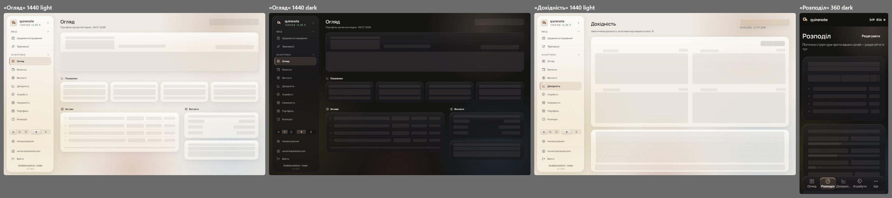
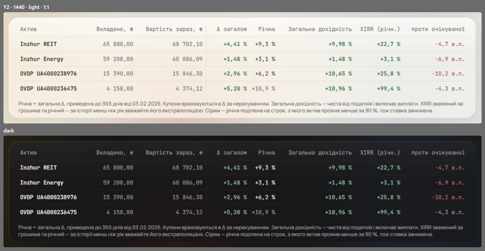
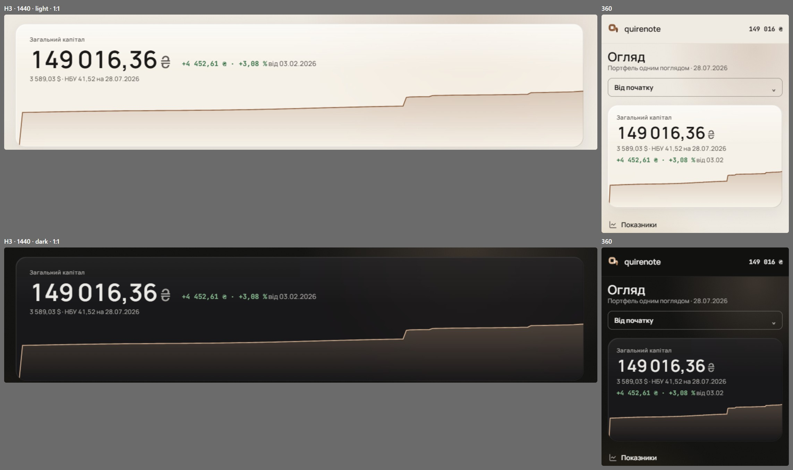
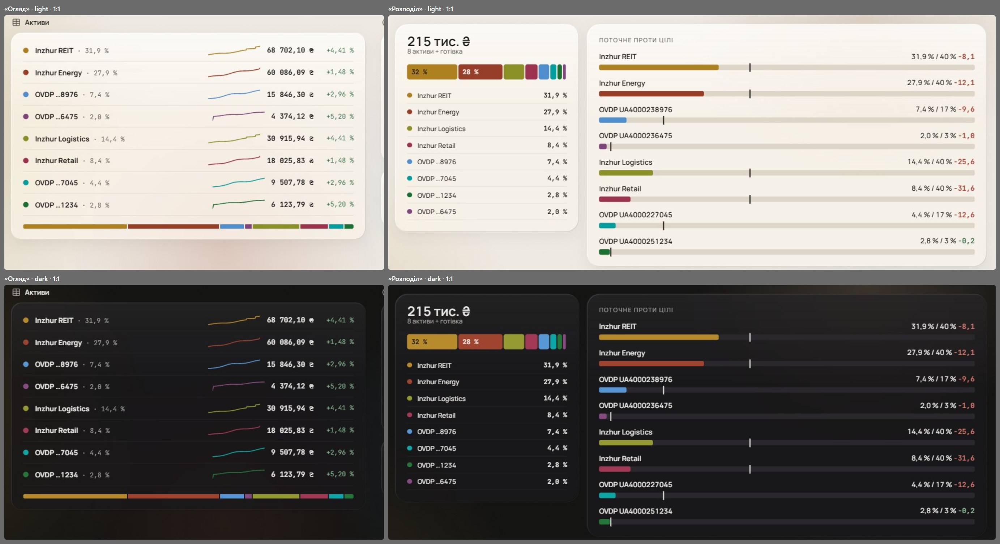

# Loading shapes, compositions and the sweep (wave 23)

The last of the audit's three waves: loading shapes on the refreshed layouts, a few compositions, and the conflicts between later waves and older sheets. Wave 12 fixed the placeholders' fill (`ink` 7 %), but their shapes still followed the old layouts, and wave 19 had to avoid /overview for that reason. Four steps were asked: the placeholders, the /yield table, the hero's rate line, and the palette against `parchment-5h` rule 7. About fifteen smaller items were settled by the brief (listed below). With this wave, every gap and conflict the audit confirmed has a signed answer.

It overturns the placeholder shapes of waves 6 and 12 ([tables.md](tables.md#signed), [empty-loading-error.md](empty-loading-error.md#signed)), wave 1's right-aligned rate line ([shell.md](shell.md#signed)), and `parchment-5h` rule 7. It keeps wave 20's palette as signed ([palette.md](palette.md)).

## Renders

This wave has no «Final» frame of its own; its «Final» shows each pick on its real surface, as drawn in its step.

L2: placeholders as row-level bars inside the glass cards, on «Огляд» at 1440 in both themes, «Дохідність» at 1440 with its small multiples and toggle, and «Розподіл» at 360 with the tall bar.

Y2: «Дохідність»'s table at 1440 in both themes, with the hairline after the basis, the basis muted and XIRR bold-signed.

H3: «Огляд»'s capital card at 1440 and 360, in both themes, with the rate line under the change.

P1: C3 as signed, with eight assets, light over dark.

## Signed

- **Placeholders (L2), row-level bars in glass cards.**
  - Each screen's placeholder is its own composition: the glass cards at their real size.
  - Inside each card, every line of text is a bar of its width at its line height (r4); every chart is a block of its size (r6); dots, avatars and swatches go to the block fill.
  - The fill is wave 12's `ink` 7 %.
  - Controls that arrive with the data (the period select) are blocks; the shell, the screen title and section headings stay.
  - The timing is wave 19's P3: after 1000 ms, held 300 ms ([motion.md](motion.md#signed)).
  - The rule applies to «Огляд», «Дохідність» (small multiples + toggle), «Розподіл» (the tall bar, not the retired ring), «Котирування» (one glass card of rows, wave 6's Q2), and the 360 ledger (two-line rows).
  - The hero's placeholder carries the rate line's bar under the change (H3).
- **The /yield table (Y2).** A 1 px `hairline` after «Вартість зараз», with 8 px either side. Вкладено and Вартість зараз in `muted`. XIRR joins Δ загалом and Загальна дохідність in the bold signed family (`pos` / `neg`); Річна and проти очікуваної stay plain. Rows take wave 17's H2 `ink` 5 % hover.
- **The hero's rate line (H3).** One 12 px `muted` line, «3 589,03 $ · НБУ 41,52 на 28.07.2026», left-aligned under the figure-and-change row at every width. The date is always shown (`rate-attribution` ruling 3, "the date is always true").
- **The palette (P1).** C3 as signed. `parchment-5h` rule 7 ("without green-red associations") retires; asset names everywhere and wave 14's shapes carry identity.
- **Records superseded.**
  - `first-paint` (the shapes), `period-and-analytics` (C1 adopted; the RecordCard fit restated), `rate-attribution` (the layout).
  - `parchment-5h` (rule 7 and the glow's source), `screen-density` and `mobile` (restated).
  - `asset-form`, `auth-surface`, `admin-users`, `sign-out-landing`, `terms-acceptance-step` and `metrics-exposure` (answered by the settled items below).
  - `withholding-and-note` T5's measurements (retired as stale).

## Rejected

- **L1, one block per card:** it says nothing about what each card holds; a card's layout appears all at once with the data.
- **L3, headings only, cards as empty glass:** empty glass reads as "broken" or "nothing here", close to the "frame-display" NN/g warns against, and it competes with wave 12's empty states.
- **Y1, wave 6 as drawn** (eight columns of equal weight): no help separating what went in from what came out, and XIRR, a result, reads plain.
- **Y3, a two-level header** («ОСНОВА» over the basis, «РЕЗУЛЬТАТ» over the results): one more header row and new copy.
- **H1, wave 1's line right-aligned on the figure's row:** at 1440 the dollar figure sits a card-width away from the hryvnia figure it converts.
- **H2, two stacked lines under the figure:** the card grows by two lines at 1440, and at 360 the change is pushed under the conversion.
- **P2, slots 6 and 8 re-derived** (bronze `#825102` / `#8b5703` and indigo `#4357a4` / `#495eab`): three warm browns and two blues sit closer than C3's spread. No source read forbids red and green in a categorical palette, so the case for P2 was inference.

## Settled by research

- **Placeholders mirror the page.** NN/g: "The structure of the gray boxes mimics the structure of the final page with content", against "frame-display" skeletons that "show only a header, footer, and an empty background". Carbon: "Skeleton states are simplified versions of components". L2 goes further than both: it is `first-paint`'s method applied to the new layouts.
- **Red and green carry learned meanings** (Carbon: "red represents danger or error … green represents normal or success"; Datawrapper: "red = attention/stop/bad, green = good"), but no source forbids them in a categorical palette or names finance.

## Settled by the brief

- **Motion:** a first load arrives with E2; a re-read in place moves nothing; a step swap inside a route uses E2; focus goes to the heading on every route change ([motion.md](motion.md)).
- **The Google button** keeps Google Sans Medium (Google's guideline), the one font exception.
- **The glow** takes its own `glow-1…4` tokens at today's hues, so wave 15's caps hold.
- **The 12-month axis** keeps twelve labels at 360.
- **The 360 /portfolio total** is the last record, bold, under a 2 px rule.
- **The rebalance card** joins the Виплати column with a B4 ghost link in a hairline-topped footer.
- **Period hints** show only on clamped rows.
- **A withdrawal** has no asset suffix.
- **«/»** keeps its 944 / 560 composition and hoisted title.
- **The asset form** stacks its pairs at 360.
- **A long 360 `dt`** wraps to two lines, top-aligned.
- **Row hover** on the /yield table is wave 17's H2 (signed above).

## Not drawn

- Migrating the carry-over rules into this spec, retiring the old sheets, and the implementation's issues: epic #611's other sub-issues.

## Перенесено

Rules of the compositions and the period control that no code, test or decision records.

- **The «НБУ» link's underline never thickens on hover;** it takes no press scale, since an inline link takes no transform.
- **Under a window, /yield's Δ column reads «Δ за період» (EN «Δ over period»), and «Вкладено, ₴» takes a header of its own:** the column then holds the value at the window's open plus what was bought inside, not money invested. That header's words are new copy.
- **Below md, /yield's record card keeps Y2's bands as an order:** the result facts first, then the two basis facts (Вкладено, Вартість зараз) with their values in `muted`, and no rule line between them.
- **«Купонний сезон» lists its tail:** the headline stays a sentence, and each other bond becomes a row of its own in the same words. Past the reminder strip's cap the list ends with a «+N» row. With one other bond it reads as a sentence. «Якір доходу» and «Тиха смуга» stay prose, since each names one thing however many assets there are.
- **With something held the day before a window opens and no snapshot on or before that day, the capital-gain and net-return cards read «немає з чим порівняти в цьому періоді»** (EN «no comparison in this period») under a «—» in `muted`, never a zero: a zero claims the window made nothing.
- **The period select's options ease their hover over 150 ms, and the window line under it crossfades its words and its colour over 220 ms** when the period or the clamp changes.
