# The 360 bar, the «Ще» sheet and the docks (wave 5)

Wave 1 put a floating dock at 360 (Огляд · Розподіл · Дохідність · Атрибути · Ще) but left open what «Ще» opens. This wave settles that surface (its form, anatomy, states and motion), the dock for each role, and how the 360 top bar behaves on scroll. Every frame is 360 × 740, over the signed /overview, with the wave-4 glass.

## Renders

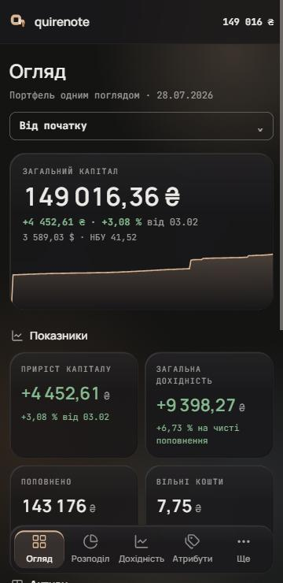
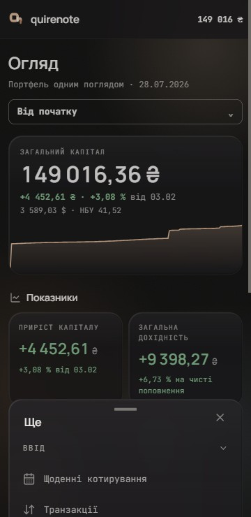
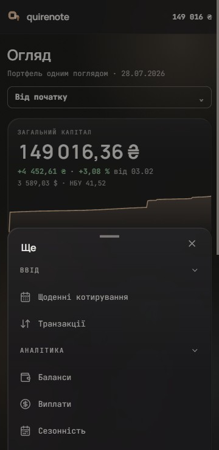

Stills of the sheet's motion: closed, 16 ms and 40 ms into the opening, and open at 260 ms.

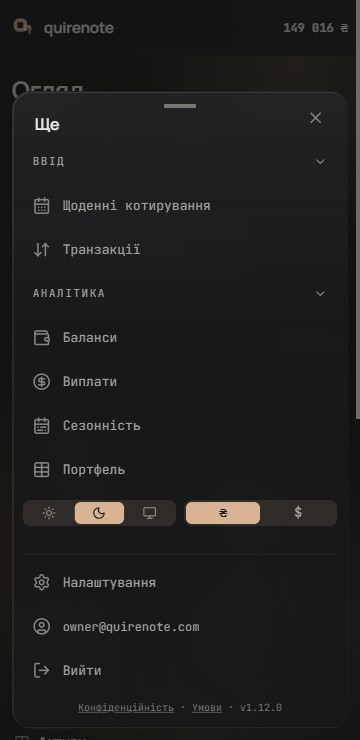
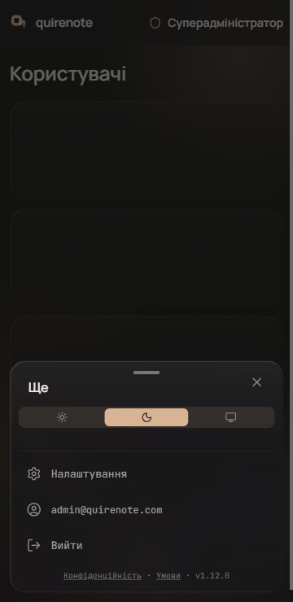
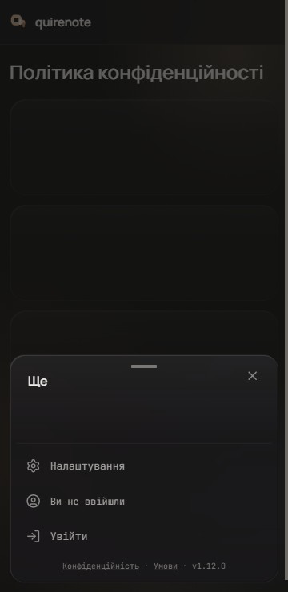
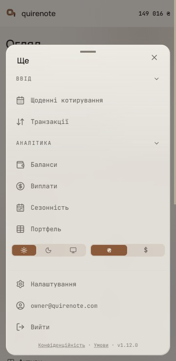
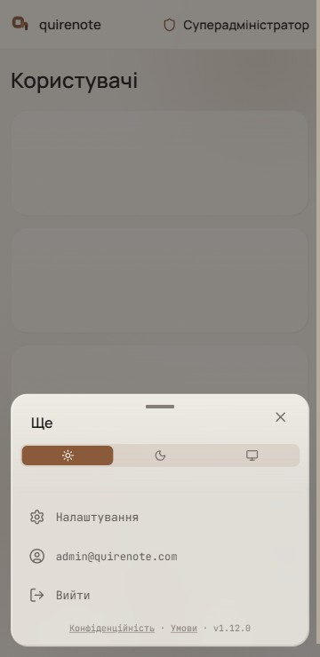
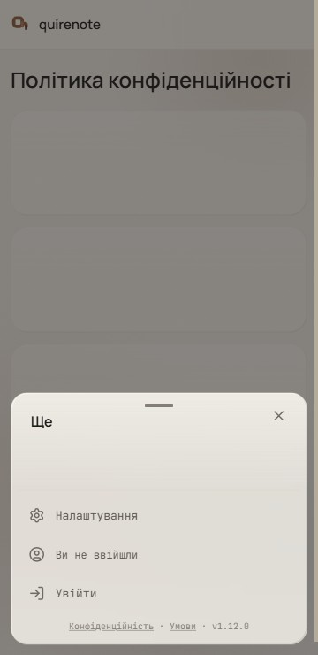

The sheet for a user, the super-admin and a signed-out visitor, dark and light. The pages behind the super-admin («Користувачі», #541) and signed-out frames are stand-ins with their real headers: neither role has a portfolio, and these frames show the shell, not those pages.

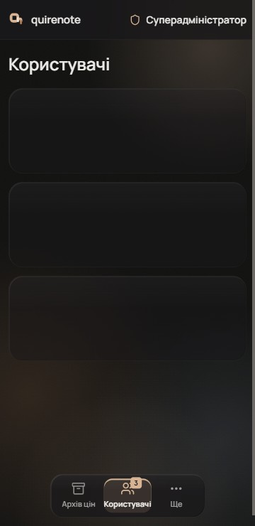
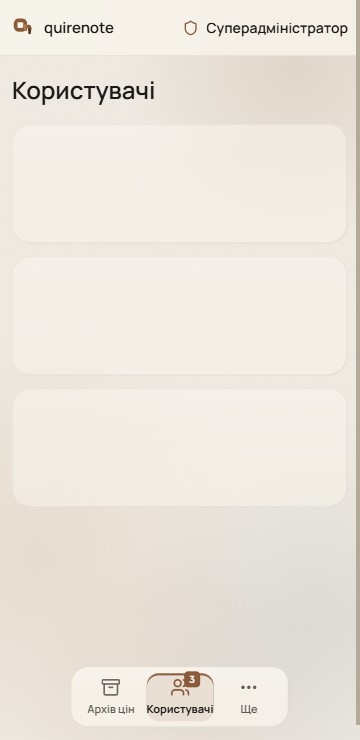
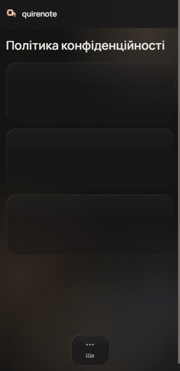
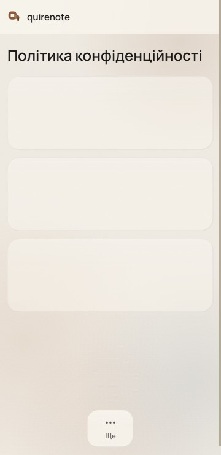

The dock per role: it fits its tabs, is centred, and every tab has one width.

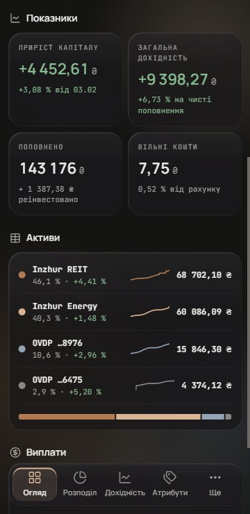
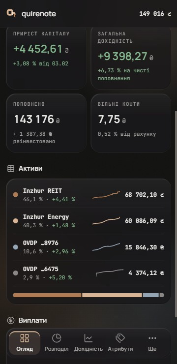
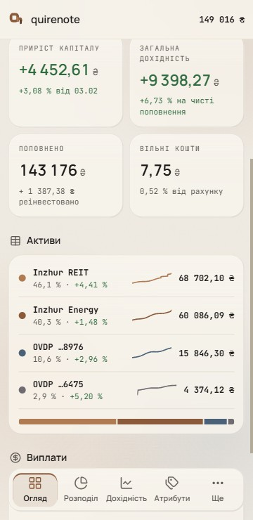

The top bar: scrolling down sends it away; scrolling up brings the glass bar back.

## Signed

- **Form (S1).** An inset modal sheet, a sibling of the dock.
- **Entry and mechanism.** The dock's «Ще» tab is the trigger of Layout's single `RadixDialog.Root`. `NAV_TRIGGER_ID` moves from the burger to that tab, and the burger goes. The sheet keeps everything the drawer has:
  - modal, with a focus trap, Escape, and focus returned to «Ще»;
  - a tap on the scrim closes it;
  - the history marker for Back;
  - it closes on a route change and at the 768 crossing;
  - the sign-out pause and `keepOpenForToasts`;
  - `--drawer-band-h`, if it is still used.
- **Geometry.** Fixed at left/right 12 and bottom `calc(12px + env(safe-area-inset-bottom))`. Radius 19: the rows' r11 plus the sheet's 8 padding. `max-height: calc(100dvh − 80px)`, with the body in `Scroller`. At 360 × 740 nothing overflows. It grows upward from the dock line and covers the dock while open.
- **Material.** The wave-4 glass (card 80 %, `blur(30px) saturate(180%)`, bevel + sheen). The fallbacks are wave 2's opaque cards.
- **Head (44 px).**
  - A grabber, 32 × 4 r1 in `field-border`, decorative. A drag down may close the sheet; the close X is its single-pointer twin (WCAG 2.5.7).
  - The title «Ще» in Manrope 16/600.
  - The close X, 18 px in a 40 box with a `TAP_44` hit area.
- **Body (A3, collapsible),** top to bottom:
  - The sidebar's `NavGroup` «Ввід» (Щоденні котирування, Транзакції) and «Аналітика» (Баланси, Виплати, Сезонність, Портфель). These are the screens not in the dock, with full labels: «Щоденні котирування» is not shortened.
  - Rows are 44 px; every link target is at least 44 px tall.
  - The group labels are the collapse control, in a 44 px box. The collapse state is the one persisted `collapsedNavGroups` set the desktop sidebar uses. The chevron turns −90° when closed. The fold takes 300 ms open and 220 ms closed on `ease-soft`, and an active row stays visible in a collapsed group.
  - The theme + currency row, as in `SidebarPanel`: theme only for the super-admin, held unseen while the role is unknown or signed out.
  - A hairline, then Settings and `AccountRows`, then the legal links and the version.
- **States.** The contents follow `SidebarPanel` role for role.
  - A user gets the full sheet.
  - The super-admin gets the theme control alone (no portfolio, so no currency) and no portfolio screens.
  - Signed out gives no screens and the preferences row held, unseen, at a user's layout, as the drawer does today, then «Ви не ввійшли» and «Увійти».
- **Motion.** The sheet comes in by `translateY(calc(100% + 12px))` → 0 over 260 ms and leaves over 220 ms, both on `ease-soft`. The scrim fades over 220 ms. These are the drawer's own tokens (`--animate-drawer-in/out`). Under `prefers-reduced-motion` the app's global kill-switch applies (DECISIONS, *Interaction rules*), so the sheet and scrim appear and leave in one frame. That corrects the brief, which said "opacity only".
- **Top bar (B2 + B3).** Sticky, 56 px plus the top safe area, square, with a hairline bottom, in the wave-4 glass. It holds the mark and «quirenote»; its right side follows the role.
  - Past its own height, scrolling down slides it to `translateY(-100%)` (220 ms); any scroll up brings it back (260 ms), on `ease-soft`.
  - It always shows within the first 56 px of scroll and while focus is inside it (WCAG 2.4.11). It appears instantly under reduced motion.
  - Right side: the capital for a user; shield + «Суперадміністратор» for the super-admin; nothing while the role is unknown or signed out.
- **Dock per role.** It follows the bar's role rule (`AppHeader.tsx`: "the capital is a user's; the super-admin's bar names the role in its place"). The tabs are the role's own screens, then «Ще», which belongs to every role.
  - A user keeps the full-width dock signed in wave 1: four tabs + «Ще».
  - The super-admin's tabs are «Архів цін», «Користувачі» (with the pending count from `GET /admin/users`, status Заявки) and «Ще».
  - Signed out or a role not yet known, the dock is «Ще» alone.
  - With fewer than five tabs the dock fits its tabs and is centred.
  - All tabs share one width: max(a user tab's width, the widest label). A user tab is 63 px; the super-admin's tabs are 67 px each, so «Користувачі» fills its pill almost to the edge.
  - The count is a 16 px square at r4 (round(16 × 0.26)), in `accent` / `accent-fg`, never a capsule.

## Rejected

- **S2, a full-bleed bottom sheet:** its square top edge, which a full-bleed band takes in this app, reads as a band against the rounded dock and cards; M3's 28 dp rounded top would break the house shape rule.
- **S3, a full-screen «Ще» page:** it needs a new route and a decision about what Back means there, and it loses the dialog's scrim, focus trap and marker.
- **S4, today's left drawer** in the signed sidebar anatomy: it repeats the dock's four screens, it is taller than 740 so the account row needs a scroll, and it opens from the left while its entry, «Ще», sits at the bottom right.
- **A1, grouped rows** (six 44 px rows, each with a chevron): its cost was none new, as the rows reuse the sidebar's row anatomy; A3's groups were picked instead.
- **A2, a 3 × 2 screen grid** (72 px tiles at r11): a second link anatomy alongside the rows, and every label has to fit about 100 px, so it needs «Котирування».
- **B1, the solid bar as signed, and B3 alone:** a solid-only or a hide-only bar.
- **D1, a full-width dock for every role:** a wide bar with one tab at its end.
- **D2, a fitted dock anchored right:** not picked.

## Settled by research

- **The surface is modal:** focus is trapped, Escape closes it and focus returns to «Ще» (WAI-ARIA APG Dialog). The app's existing Radix Dialog already does all three.
- **A visible close control.** A tap on the scrim closes the sheet, and so does Back, through the drawer's existing history marker. Any drag has a single-pointer twin (WCAG 2.2, 2.5.7).
- **No detents:** "People don't generally expect to resize sheets" (Apple HIG, Sheets).
- **The sheet may cover the dock while open** (Apple HIG, Tab bars).
- **The inset sheet** follows M3's modal bottom sheet (scrim, drag down to dismiss) and the dock's own geometry.
- **The groups** are the signed desktop sidebar's group labels.
- **The glass bar** follows Apple's bars and their scroll-edge effect (HIG, Scroll views); **the hiding bar** follows M3's scroll|enterAlways|snap behaviour (TopAppBar.md).

## Implementation checks

- Layout keeps its single `RadixDialog.Root`; the «Ще» tab becomes its trigger, `NAV_TRIGGER_ID` moves to that tab, and the burger goes.
- The sheet's body reuses `NavGroup` from `src/app/Sidebar.tsx` and the persisted `collapsedNavGroups` set; its contents follow `SidebarPanel`.
- The body scrolls through `Scroller`. The close X takes `TAP_44`.
- The super-admin's pending count comes from `GET /admin/users`, status Заявки.
- Tests an implementation re-points: `Layout.test.tsx`, `super-admin-shell.test.tsx`, `sidebar-structure.test.ts`, `sidebar-plane.test.ts`, `toaster-press.test.ts`, `useSignOut.test.tsx`, `privacy-ways-in.test.tsx`, `terms-ways-in.test.tsx`, `profile-ways-in.test.tsx`.

## Not drawn

- The pages behind the super-admin and signed-out frames: «Користувачі» is #541's own brief.
- Not decided here: the screens behind the links, a drag gesture's thresholds, and the implementation.
