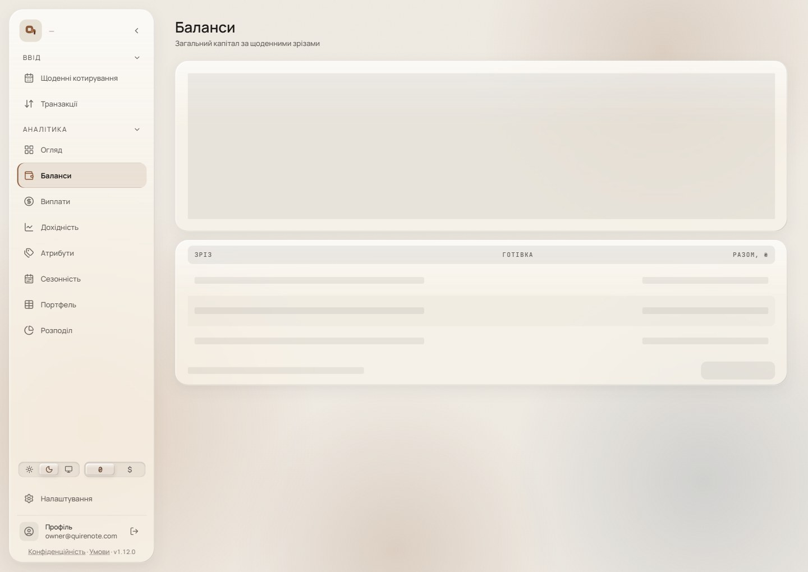
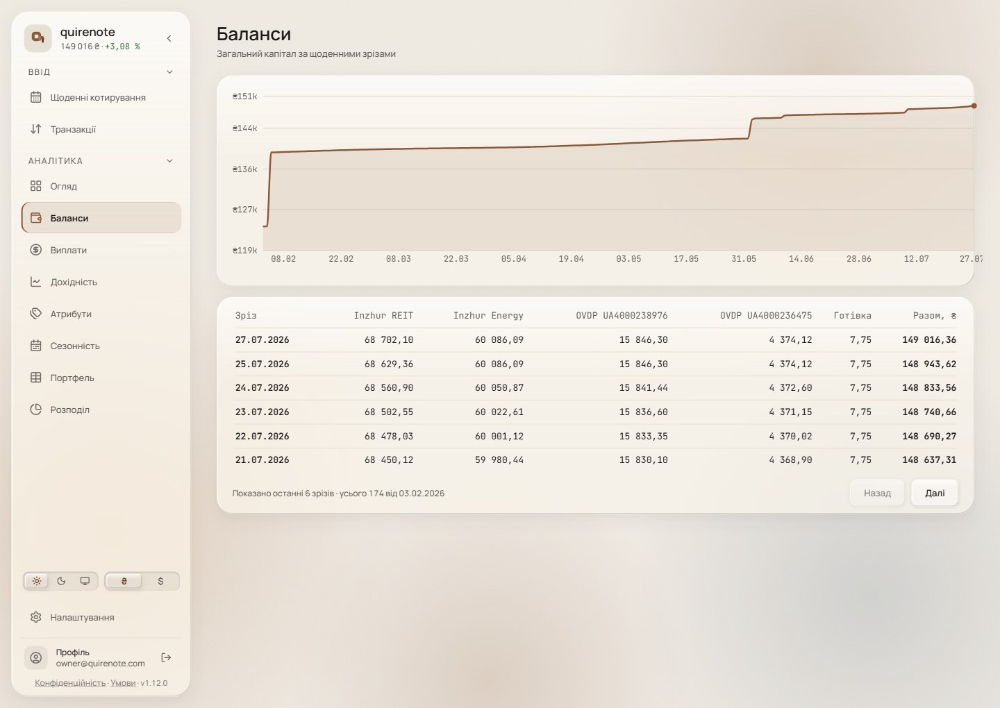
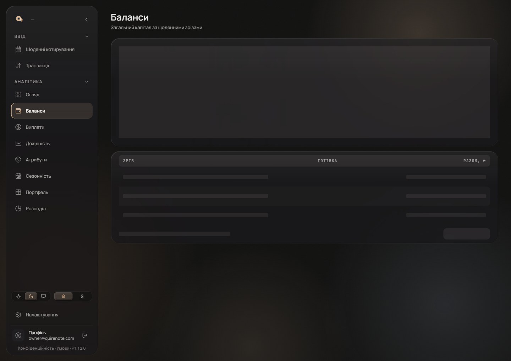
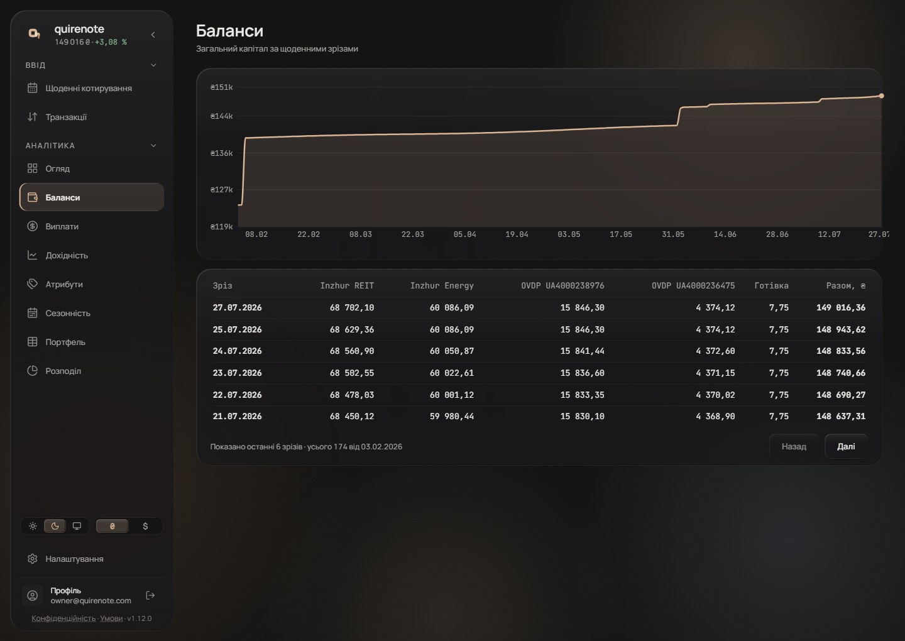
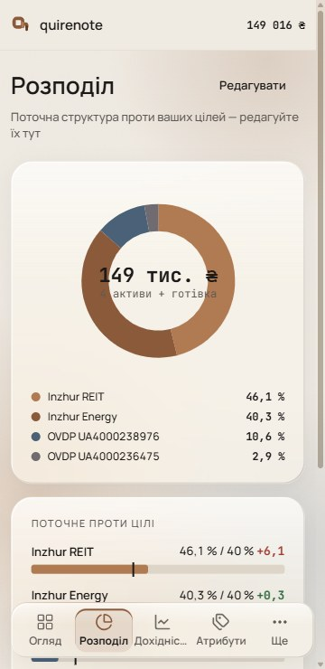
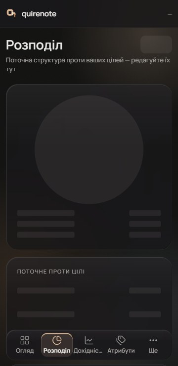
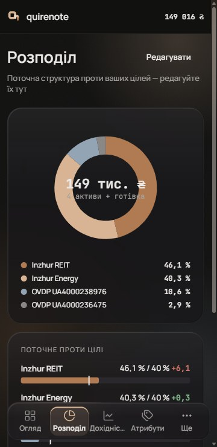

# Page transitions and load motion (wave 19)

Today every route change replays a 300 ms fade-and-rise on the new screen with no exit, the remount replays every card's fade and stagger, a cold load stacks three fades, scroll is never reset and focus never moves. This wave settles the route change, how content arrives after a load, and when placeholders appear.

It overturns the record's 300 ms placeholder delay and re-keyed fade, and it gives wave 12's placeholders ([empty-loading-error.md](empty-loading-error.md#signed)) their timing.

## Renders

The wave was signed on players that run at real speed, so the motion itself is the table below. The frames are the two states a reader lands on: placeholders while a slow read is out (P3), and the screen once it has arrived (E2). «Баланси» at 1440, «Розподіл» at 360, light and dark.

## Signed

| Situation | What moves | Duration | Easing | Delay | Reduced motion |
| --- | --- | --- | --- | --- | --- |
| Route change, exit (E2) | the old content fades out | 90 ms | `cubic-bezier(.4,0,1,1)` | at once | instant swap |
| Route change, entry (E2) | the new screen's top-level blocks, in reading order, rise 8 px and fade in | 300 ms each | `ease-soft` | 0 / 75 / 150 ms; further blocks join the third step | instant swap |
| Content after a load (A2) | the same as a route change: the placeholder leaves as the exit, the content enters as the entry | as E2 | as E2 | as E2 | instant swap |
| Placeholders appear (P3) | the placeholders fade in | 220 ms | `ease-soft` | after 1000 ms of a pending read | appear without a fade |
| Placeholders held | — | at least 300 ms | — | — | held |
| A refetch after a write | no placeholders; the figures tween (held) | — | — | — | — |

- **A route change (E2)** runs on push and on Back / Forward alike, and is done in about 540 ms.
  - *Answered by wave 26: E2 reaches the signed-out pages and every step swap inside a route ([open-values-shell-controls.md](open-values-shell-controls.md#signed)).*
- **The shell never moves:** the sidebar, header, dock and glow stay put, and the active item changes at once.
- **Input is never blocked.** A press during a transition goes through at once, and the next route starts its own E2 from wherever the screen stands.
- **One motion owns entry (A2).** Today's three stacked fades go: the `Layout` wrapper's fade-and-rise, `Loadable`'s wrapper, and every card's own `animate-in` and `STAGGER` on Overview, Settings, Profile, Archive and the rest.
- **Placeholders (P3).** `PLACEHOLDER_AFTER_MS` goes from 300 to 1000; `PLACEHOLDER_HOLD_MS` is kept. Under a second, the content area stays empty with the shell in place. A read just over a second shows placeholders from 1000 ms, and the hold pushes the content to 1300 ms.
- **Scroll** goes to the top on a push and is restored on Back / Forward.
- **Focus** moves to the new screen's heading (`tabIndex=-1`, `preventScroll`) when the route changes, never left on `body`.
- **Reduced motion:** the global kill-switch makes every route change and load an instant swap; placeholders appear and leave without a fade.
- **Mechanism.** The 90 ms exit needs the old screen kept on screen, which a keyed remount cannot do. It takes a View Transition:
  - `::view-transition-old` for the content region fades over 90 ms;
  - `::view-transition-new` takes `animation: none`, so the live new screen runs its own staggered entry;
  - the shell gets its own `view-transition-name` with no animation.

  It is reached through react-router's `viewTransition` (it works in 7.18, and is deprecated on its main branch), or React's `<ViewTransition>` after a move to React 19.3. React skips view transitions on `popstate`, so for Back / Forward to match, the implementation starts one itself. Where the API is missing, the exit is skipped and E2's entry still plays. Support: Chrome 111, Safari 18, Firefox 144.
- **The brief's "never a slide" is lifted for this rise.** The brief ruled route motion opacity-led (M3's fade through between peer destinations). E2's 8 px rise goes against that; it was drawn because the owner asked for the livelier motion of today's route change, and picking it lifts the constraint for this rise.
- **Records superseded.**
  - `first-paint`: the 300 ms, and the re-keyed fade.
  - `docs/DECISIONS.md`: the view-read section (300 → 1000); the rejection of "A placeholder … after a second or two", rewritten to the 1 s rule with NN/g as its source; the *Measurement* note on collapsing the route and Loadable fades for Element Timing, which now collapses the view transition; *Interaction rules*, which gains the route rule.
- **New copy.** None.

## Rejected

- **Round T:** T1 (today) blanks the screen at the click; T2 (fade through) and T3 (cross-fade) were too calm; T4 (an instant swap) has no motion.
- **E1, today's motion:** the blank flash at the click.
- **E3, the stagger without the rise:** less movement than the owner asked for.
- **E4, one scale-in from 96 %:** the most "zoom", the least cascade.
- **A1, today's load:** a blank frame at the swap, and stacked fades.
- **A3, an in-place cross-fade:** calmer than the navigation, so a load and a navigation read differently.
- **P1, after 300 ms (today):** a 600 ms read flashes placeholders that hold the content back to the same 600 ms anyway.
- **P2, after 600 ms:** a midpoint with no source.

## Settled by research

- **No feedback under a second.** NN/g: "If a page takes less than 1 second to load, skeleton screens or spinners aren’t necessary"; "no special feedback is necessary during delays of more than 0.1 but less than 1.0 second".
- **Fade through between peers.** M3 fade through is for "transitions between UI elements that do not have a strong relationship to each other".
- **The View Transitions default** animates the old snapshot from opacity 1 to 0 and the new from 0 to 1; the exit uses it for the content region only.

## Settled with the brief

- The shell never moves.
- Motion never blocks input.
- Reduced motion swaps instantly.
- Focus goes to the new heading.
- Scroll goes to the top on a push and is restored on Back.
- Route motion is opacity-led, never a slide; E2's rise lifts this for itself, as recorded above.

## Implementation checks

- `src/hooks/loading.test.tsx` (the 300 ms) and `Layout.test.tsx` (the keyed wrapper) re-point.
- New tests: focus lands on the heading after a navigation; scroll is 0 after a push and restored after a pop; no `animate-in` on a screen's cards (a census test).

## Not drawn

- /overview: its placeholder followed the old layout while its content is wave 1's canvas, so a transition there would have shown a jump that is not part of the design. Wave 23 redraws the placeholders on the new layouts ([loading-and-compositions.md](loading-and-compositions.md#signed)).

## Перенесено

Rules for measuring motion that no code, test or decision records.

- **Before a colour is read, running transitions are forced to `finish()`.** A 0.01 ms transition does not advance in a tab driven over CDP and returns the colour from before the change, which reads exactly like a rendering bug.
- **To measure, motion is collapsed to 0.01 ms, never with `animation: none`:** Radix unmounts a closing overlay on `animationend`, which `none` never fires, and leaves `body` at `pointer-events: none`.
