# Notices and toasts (wave 11)

The app's notices fall into three families: the reminder strip on / and /overview, the inline status chips, and the toasts. There is no shared notice component. Wave 8 signed the success and error toasts; everything else was still in the pre-glass look, and the status tints barely read as boxes on the glass. This wave moves all three families onto the glass, and settles where a toast goes while the «Ще» sheet is open at 360.

## Renders

At 1440: the «Нагадування» card on /overview, the card and the chips on /, and the toasts (neutral ×2, success, persistent error).

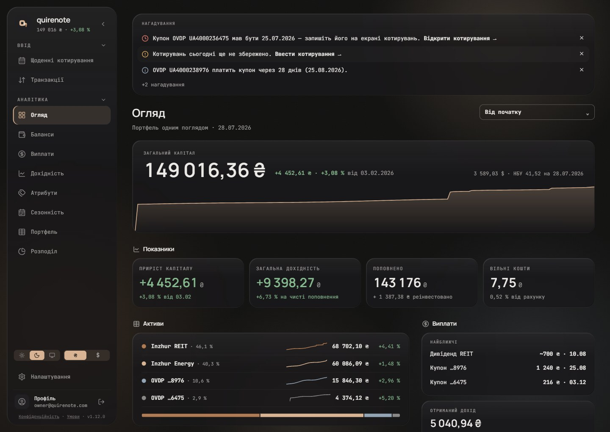

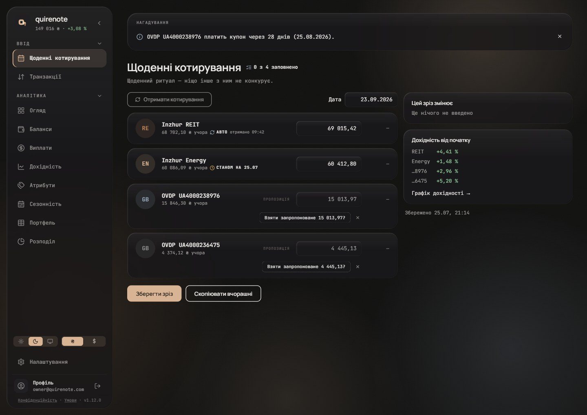

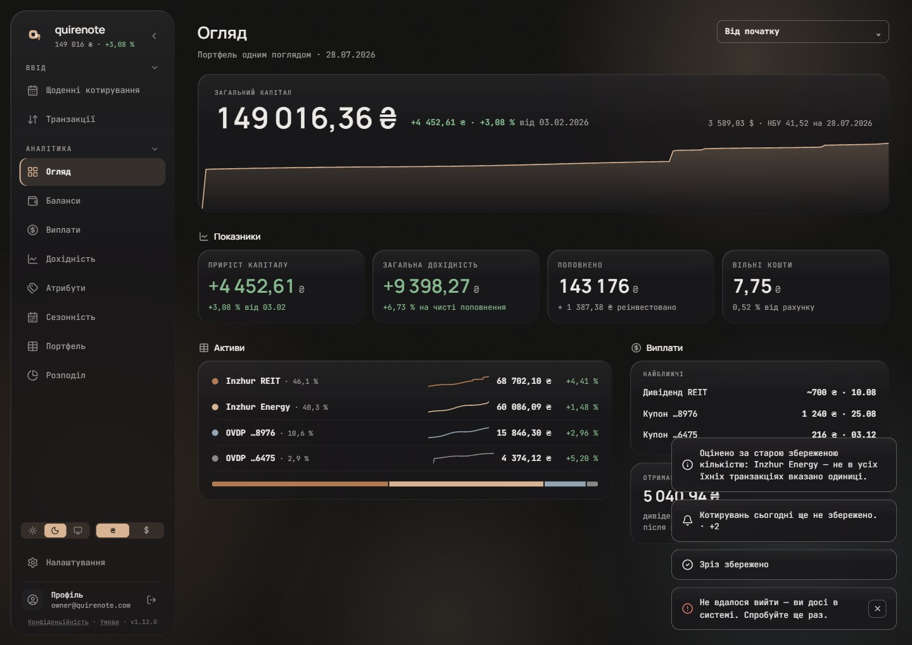

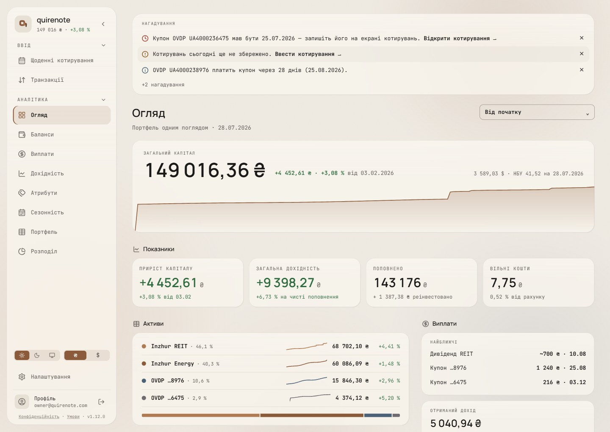

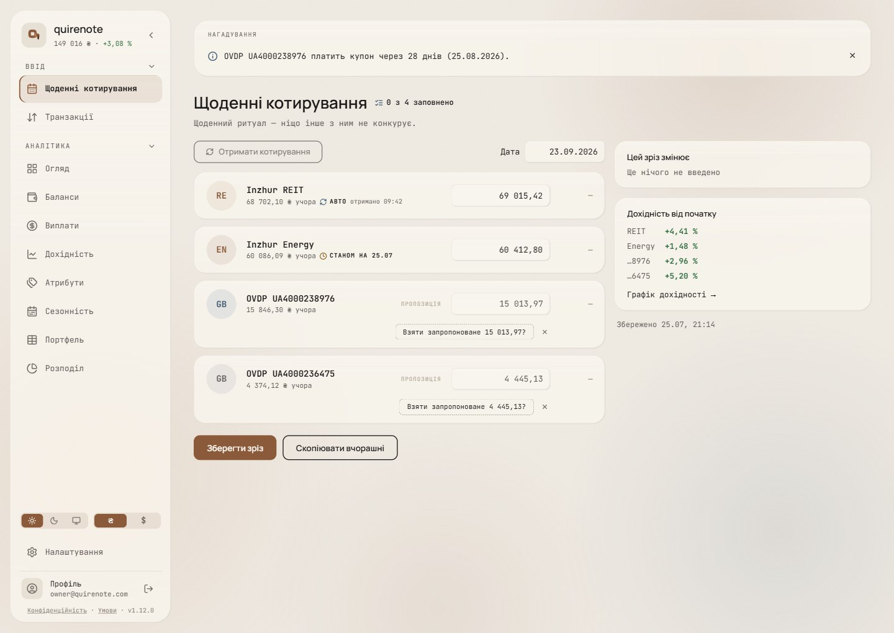

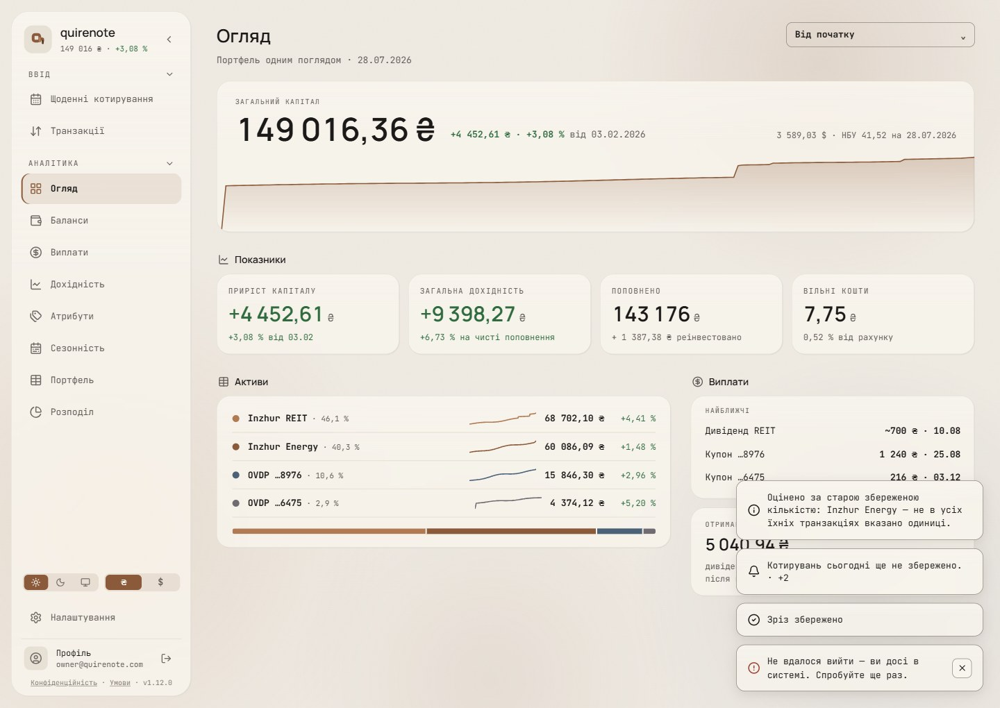

At 360: the same three frames, plus a toast while «Ще» is open, which moves to the top.

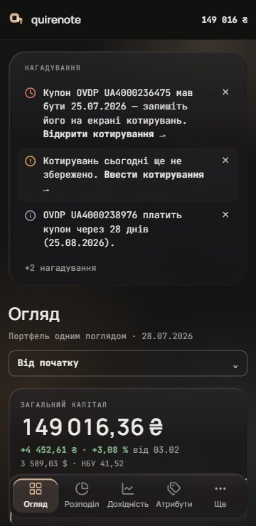

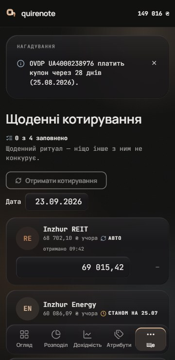

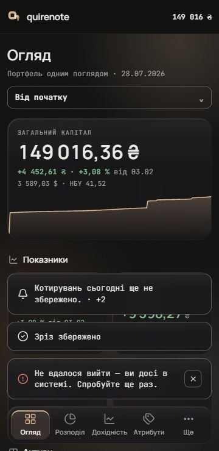

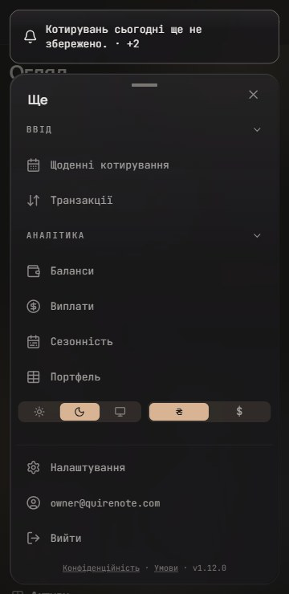

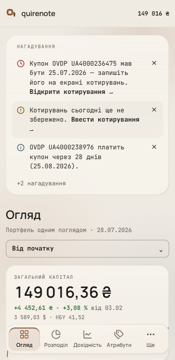

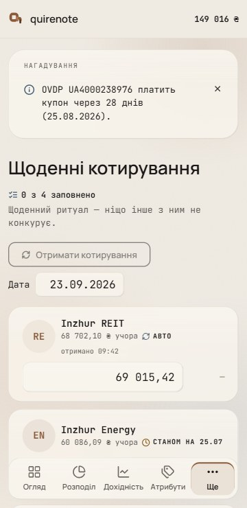

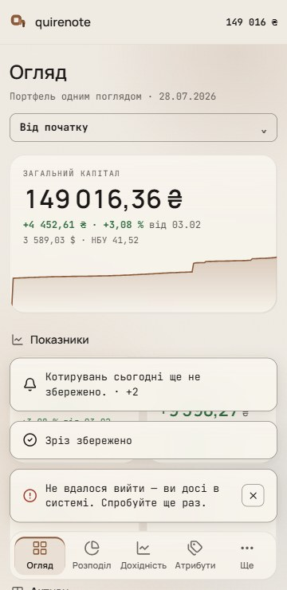

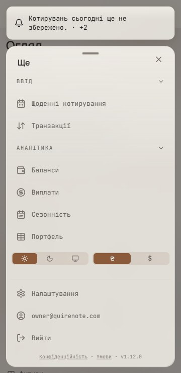

## Signed

- **Reminders (R3).** One glass card (wave-4 glass, r24, padding 16 / 22 / 14). It is a `<section>` labelled by «Нагадування», 10 px caps `muted` (new copy, en "Reminders").
  - *Overturned by wave 18: the label role, 11 px ([type.md](type.md#signed)).*
  - Each row is the glyph at 16 / 2.25 in the tone (Clock `neg` for overdue, CircleAlert `warn`, Info `info`), the sentence 13 / 1.5 in `ink`, the link bold in `ink`, and ✕ 13 at .85.
  - Rows are padded 9 / 10 at r11 and pulled 10 into the card's padding, with zebra on even rows at `ink` 3 %.
  - «+N» is the last line, 12 px `muted`, with no zebra.
  - Held from the record: the order (overdue → warn → info), the cap of 3 then a muted «+N», the stagger in, the 220 ms collapse out and the expand in place. No reminders means no card at all.
  - On /, quote-missing is suppressed and no row carries a link.
  - No live region: the reminders are page content at load.
- **Chips (C2).** Glyph and word, with no fill, padding or edge. Each chip keeps its own type size, weight and caps; the word is in `ink`. The glyph is 12 px on 10 px chips and 14 px on 12 px pills, stroke 2.25, in the tone:
  - *Overturned by wave 18: chips are 11 px, the label size ([type.md](type.md#signed)).*
  - «авто»: RefreshCw `info`, with «отримано HH:MM» after it.
  - «станом на»: Clock `warn`.
  - «вручну»: Pencil `muted`.
  - The progress pill: ListChecks `info`.
  - CashShortChip: TriangleAlert `warn`. It keeps role=status and its sr-only detail.
  - Σ = 100: Check `muted`, which retires its `pos-tint`, as the record asks (information is never `pos`). Σ ≠ 100: TriangleAlert `warn`.
  - AheadChip: CalendarClock `info`.
  - The archive's prodOnly line: Info `info` beside its sentence, with no tint block (role=status kept).
- **Blocks that stay tinted.** The import dialog's `neg-tint` replace banner and `warn-tint` warnings, on the wave-8 glass dialog. With the strip off its tint, `neg-tint` is now reserved for irreversible-harm blocks alone: the import banner and the danger zone.
- **Toasts.** Wave-4 glass, a 1 px `field-border` edge, r13, padding 14 / 16, gap 10, 13 / 1.45, the popover shadow. The glyph is 18 / 2:
  - *Overturned by wave 22: the toast's edge is wave 15's glass edge, and its one action sits under the sentence ([controls-and-overlays.md](controls-and-overlays.md#signed)).*
  - success: circle-check in `ink`;
  - error: circle-alert in `neg`;
  - neutral (N2): bell for the reminder nudge and info for other notices, both in `ink`. A neutral toast has no severity, so it takes no tone.
  - The persistent sign-out error keeps the close button (28 / r7, `field-border`, 44 overlay below md).
- **Placement.**
  - 1440: 356 wide, right 24, bottom 24.
  - 360: 12 a side, 12 above the dock's top edge. Where /'s action bar is taller, the higher of the two decides.
  - With «Ще» open (P1): at the top, 12 from the edges, over the bar. Above the sheet and the top of the screen are the same place. The toast covers the bar for its 4 s, and changes side only while the sheet is open.
    - *Overturned by wave 22: toasts sit at the top while any M2 sheet is open ([controls-and-overlays.md](controls-and-overlays.md#settled-by-the-brief)).*
- **Severity by shape.** The glyph's shape carries the severity everywhere, never the tone alone.
- **Held.** `info`, never `pos`, carries information. A refusal never takes a toast. Toasts keep r13 and their `field-border` edge.
  - *Overturned by wave 22: toasts lose the `field-border` edge ([controls-and-overlays.md](controls-and-overlays.md#signed)).*
- **New copy:** «Нагадування», in both languages.

## Rejected

- **R1, tinted banners (today):** one banner per reminder on its tint, r16. On glass the boxes barely show, and three coloured slabs above the title read as banners, which users learn to skip.
- **R2, glass banners with a tone bar** (r12 = round(45 × 0.26), a 3 px leading bar and the glyph): still three separate boxes above the title, and the bar and the glyph repeat one cue.
- **C1, tint chips (today):** the tints barely show on the glass, and the tones differ by hue only. That is colour alone, which the record forbids.
- **C3, outlined chips** (a 1 px edge in the tone, r5 / r6): on this screen an outlined box with a glyph reads as a button, and the outline button sits right below.
- **N1, a text-only neutral toast (today):** the one toast kind without a glyph, so it reads as unfinished next to the signed two.
- **N3, the neutral glyph in `info`:** a tone on a toast the record says carries none. `info` beside an `ink` check implies a severity scale the app does not have.
- **P2, the toast over the sheet's foot** (at the bottom, 24 up): it covers «Вийти» and the legal links, and a tap meant for «Вийти» lands on the toast.

## Settled by research

- **A tone needs a distinct glyph and words, not hue.** WCAG 1.4.1 counts lightness only at 3:1. Atlassian: "Don't rely on color alone to convey the severity of the message."
- **Banners get missed.** GOV.UK: "Use notification banners sparingly"; NN/g on banner blindness. Primer: "Do not display more than one banner … reduce alert fatigue."
- **Upcoming payments are a section, not an alert.** NAB "Upcoming": "the next three predicted bills". The one card also follows Fluent's one message bar with a count, and wave 6's zebra records.
- **A reminder present at load is page content, not a live region.** WCAG 4.1.3 covers changes.
- **Glyph-and-word chips** follow wave 10's S3 and Carbon's icon indicator.
- **The neutral toast's glyph in `ink`** follows wave 8's anatomy (circle-check in `ink`) and the reminders record: "no severity tint".
- **The top position** follows sonner's top position; Carbon toasts enter top right.

## Implementation checks

- `rows-ahead-mark.test.ts` pins AheadChip's full class list.
- `archive-repairs.test.tsx` keeps the prodOnly role=status.
- `floating-edges.test.ts` (the toast's edge and shadow) and `toaster-press.test.ts` are unchanged, but the offsets gain the dock lift and the sheet's top position.
- No test pins `ReminderStrip`'s classes. The copy in `reminder-labels.test.ts` is unchanged; «Нагадування» is new copy in both languages.
- Outside this wave: AssetForm's stale line holds a hard-coded English «as of» in `AssetForm.tsx`, not i18n.

## Not drawn

- The import dialog. Its blocks are held, on the wave-8 dialog.
- «+N» expanded, and a dismiss mid-collapse. The record's motion is held.
- A toast over /'s action bar.
