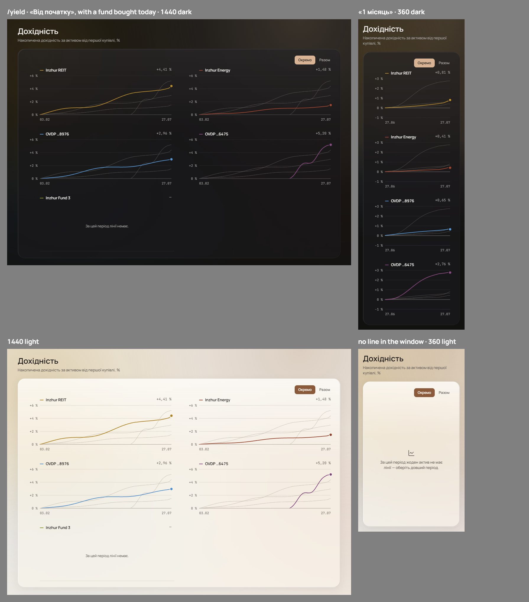
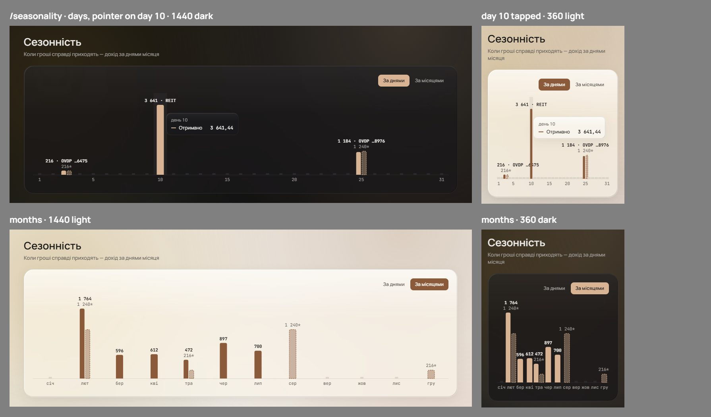
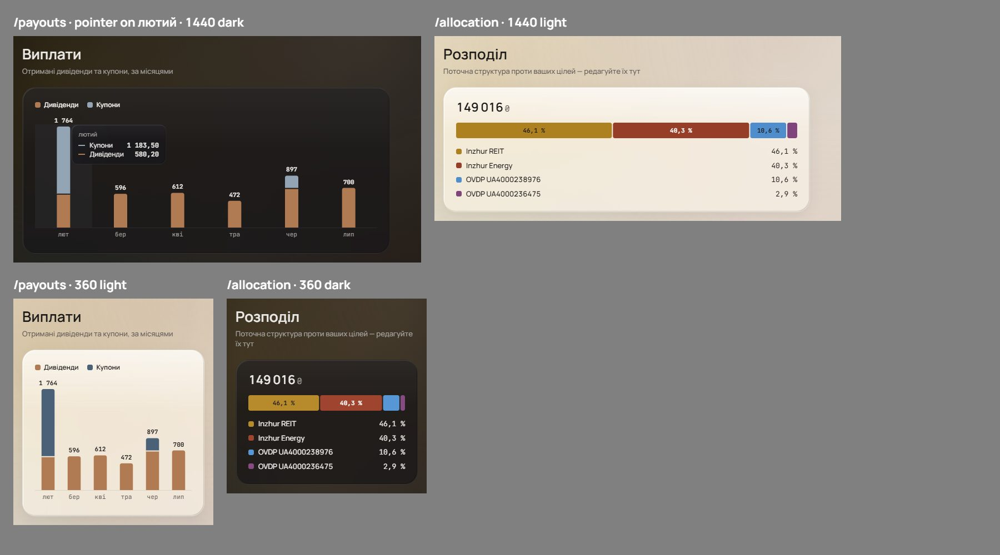
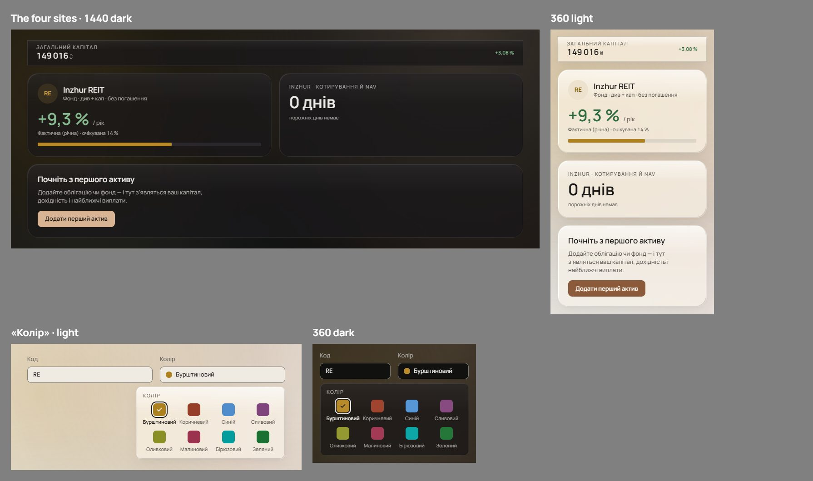
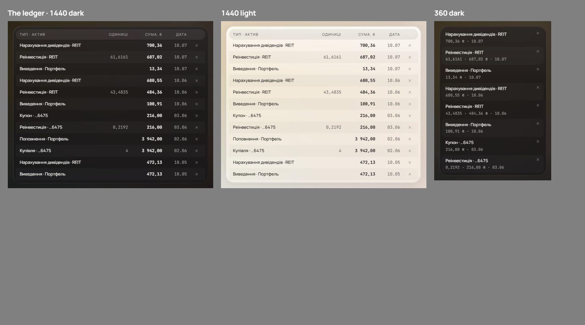

# Open values: charts, tables, type and the palette (wave 25)

Earlier waves left values open, or signed something the code cannot hold, on charts, tables, type and the palette. Brief #683 listed twelve; the owner added two more of the same kind: the collapsed header's capital size (1b) and `#ffffff` against the light `glass-rim` (6b). Five steps answered them, one round each, every variant drawn on the signed surface from the seed's own data. The shell, dialogs, motion, the overview and controls are #684's.

It overturns parts of wave 3's anatomy and forms ([charts.md](charts.md#signed)), wave 14's tooltip edge ([yield-series-shapes.md](yield-series-shapes.md#signed)), wave 20's popover title and its retired-list check ([palette.md](palette.md#signed)), wave 6's ledger header line ([tables.md](tables.md#signed)), and the sizes wave 18 left open ([type.md](type.md#left-open)), with the first-look title they include ([empty-loading-error.md](empty-loading-error.md#signed)). Each of those lines carries a pointer here.

## Renders

The final: every pick together at 1440 and 360 in both themes. Asset hues are wave 20's C3 values, the fifth asset on slot `c5`; payouts keep their own colours.

The rounds the picks were made from, each variant beside the others:

- Step 1, /yield: [the tick rule](renders/w25s1q1.jpeg) and [its axes at 2×](renders/w25s1q1z.jpeg), [a panel with no line](renders/w25s1q2.jpeg), [the toggle's copy](renders/w25s1q3.jpeg), [the 600 px box](renders/w25s1q4.jpeg), [the toggle beside #338's message](renders/w25s1q5.jpeg).
- Step 2, bar charts: [the month label](renders/w25s2q1.jpeg), [/seasonality's pointer](renders/w25s2q2.jpeg), [the Payouts cap](renders/w25s2q3.jpeg), [the hover indicator](renders/w25s2q4.jpeg).
- Step 3, chart surfaces: [the tooltip edge at 2×](renders/w25s3q1.jpeg), [corners](renders/w25s3q2.jpeg) and [the allocation bar at 2×](renders/w25s3q2z.jpeg).
- Step 4, type: [the four sites](renders/w25s4q1.jpeg), [the «Колір» title](renders/w25s4q2.jpeg) and [at 2×](renders/w25s4q2z.jpeg).
- Step 5, palette and table: [the retired list](renders/w25s5q1.jpeg), [the ledger header](renders/w25s5q2.jpeg).

The rounds draw assets in today's hues, except the «Колір» swatches, which are C3; only the final applies C3 throughout. No pick turns on a hue.

## Signed

- **/yield's y ticks (step 1, A; item 2).**
  - The step is 1, 2 or 5 × 10ⁿ: the smallest that spans the shared domain in at most five intervals. The 2.5 step retires: it needs a second decimal.
  - Every label but zero carries the step's decimals («+0,2 %», «+1,0 %»), so no two labels on an axis print the same and the signed labels share one precision.
  - Zero is «0 %», unsigned and with no decimals; every other label is signed.
- **A panel with no line in the window (step 1, A; item 3).**
  - It stays in the grid, in its place, at the panels' size: its title, «—» for the value, and in its plot «За цей період лінії немає.» / "No line in this period.", Manrope 12 `muted`, centred over a 1 px `hairline` baseline.
  - The grid never reshuffles when the period changes.
- **The toggle (step 1, A, A and A; item 10).**
  - «Окремо / Разом» is held. English: "Separate / Combined".
  - Two columns while the card's inner width is ≥ 600 px; one below. The chart measures its own card, as the spec already places the tooltip by the plot's width ([charts.md](charts.md#signed)).
  - Under #338's message the toggle stays and works; both views show the message.
- **/seasonality (step 2, D and A; item 4).**
  - The month axis prints the month's total alone, «1 764», on every month and at every width; a month bar names no asset.
  - The day axis keeps «3 641 · REIT».
  - The pointer is the other charts': hover at md and up, tap-pin below. The labels stay.
- **The Payouts cap (step 2, A; item 5).** The month total is whole, with no ₴: «1 764». The tooltip and the payout table keep cents.
- **The hover indicator on bars (step 2, A; item 8).** Bar charts mark the hovered category with a full-height band in `hairline`. The 1 px `field-border` line stays for line and area charts.
- **The tooltip's edge (step 3, A; item 7).** The chart tooltip wears the glass edge as wave 15 left it: a 1 px `ink` 6 % stroke and the bevel, with wave 15's light rim, shade and shadow. `field-border` is not its edge.
- **Chart marks' corners (step 3, B; item 9).**
  - Chart marks keep a fixed 4 px: every part of the allocation bar on all four corners, and the data end of the Payouts cap.
  - *Shape system* binds controls and surfaces, not data marks (`docs/DECISIONS.md`).
- **The sizes no role held (step 4, B; items 1 and 1b).**
  - The display row gains **hero 36** (the «Атрибути» hero figure and the archive's empty-days figure) and **header capital 18** (the collapsed header). Both are Manrope 600 −.01em; the header capital, the one of them in ₴, takes K2's ₴.
  - The display entry is the collapsed header's capital alone ([rail-and-account-foot.md](rail-and-account-foot.md#signed)); this wave maps no other 18. The 360 frames draw that header's band at 360 as a specimen; below md the bar is wave 5's, unchanged here.
  - The first-look title maps to h3, 17 / 22.
- **The «Колір» title (step 4, A; item 11).** Caps +.12em, the label role.
- **The retired list (step 5, C; items 6 and 6b).**
  - `RETIRED` stays as it is, the record of the parchment migration.
  - A second list records wave 20: the asset values it replaced that no token keeps. Light `#ebe2d9`, `#6f6b70`, `#e8e4e0`, `#686569`; dark `#342e2b`, `#292829`, `#918f8d`.
  - A value that came through under another token is absent, as `RETIRED`'s own rule leaves out values that came through unchanged. The tokens that keep one are `accent`, `info`, `logo-outline`, the payout tokens and the sidebar's. The round's light table leaves out `sb-badge`, which also keeps `#8a5a3a`; the seven are unaffected.
  - `--color-glass-rim` is exempt by name, as Google's buttons are, so its light `#ffffff` stands beside `RETIRED`'s.
- **The ledger's amount (step 5, A; item 12).** One column, «СУМА, ₴», the catalogue's «Сума, ₴». At md and up its cells drop the ₴; below md each two-line row keeps it.
- **Records superseded.** `charts.md`'s tick steps and whole-% labels and its crosshair on bar charts; `yield-series-shapes.md`'s `field-border` edge; `palette.md`'s .14em title and "join the retired list"; `type.md`'s «Left open»; the first-look title's 20 / 600; `tables.md`'s ledger column list.
- **New copy.** «За цей період лінії немає.» / "No line in this period."; "Separate / Combined".

## Rejected

- **Ticks.** B, whole % with no step under 1: a calm window keeps two ticks, which #339 refused. C, 1-2-2.5-5 with trailing zeros dropped: the signed labels of one axis mix precisions («+0,8 %» beside «+1 %»).
- **The empty panel.** B, a title with no plot: a short cell in the grid. C, left out: the asset leaves the chart and only the table names it. D, named in a line under the grid: new copy apart from the panels.
- **The toggle's copy.** «Окремо / Спільний», «Окремо / Накладено», «Панелі / Один графік»: each overturns signed copy for no gain; "overlay" is chart jargon, and «Панелі / Один графік» is tight at 360.
- **The 600 px box on md:** at 768 with the sidebar open the panels are too narrow to read, and a title wraps.
- **The toggle under the message, hidden or disabled:** hidden, the card's top row comes and goes with the period; disabled, a control gives no reason.
- **The month label.** A, the asset on a one-asset month: a served field the core does not have (`SeasonalityMonth` is month, actual and expected). B, the largest asset with «+N», and C, «N активи»: the same field, and the longest labels.
- **/seasonality without a tap-pin** (today's below md), or with no tooltip at all: the one chart a touch reader cannot read exactly, or the cents and the month's full name lost.
- **The Payouts cap in cents** (widest labels, nearly touching at 360) or abbreviated («1,8 тис.», a unit word the app does not use).
- **The bar indicator as a 1 px line** (it runs through the cap label), **as fading the others** (their labels fade too), or **both band and fade** (two signals for one state).
- **The tooltip edge in `field-border`** (a text field's edge on something that isn't one), **or with a shadow in dark too** (no dark glass surface has one; light glass already has wave 15's).
- **Corners.** A, *Shape system* per part: parts of one bar take different radii. C, 2 px. D, the bar rounded only at its ends: the smallest part loses its rounding.
- **The sizes.** A, the nearest roles (display tiles 30, h3 17): four signed sizes overturned and the hero shrinks. C, a new h2 20 / 26 for the title: a ninth role, three px from h3 and two from kpi.
- **The «Колір» title** in sentence case (it reads like a figure label) or kept at .14em (the one caps label off the rule).
- **The retired list.** A, keyed by name alone: a value left behind in a comment goes unguarded, the failure the guard exists for. B, the values appended to `RETIRED` with an allow-list of seventeen names: it grows a list its header calls closed.
- **The ledger header** as «СУМА (₴)» (new copy where the app writes «Сума, ₴») or «СУМА» with ₴ in every cell (overturns "the ledger's cells drop the ₴").

## Settled by research

- **Ticks.** d3's `ticks` steps by 1, 2 and 5 × 10ⁿ, and `precisionFixed` derives a label's decimals from the step; Highcharts adds 2.5 by default; Vega-Lite's `tickMinStep` is the whole-% guard. Carbon: "Never change axis ticks increments to accommodate data availability".
- **Empty states in a chart.** Cloudscape's chart `noData.empty`; Dynatrace's ChartStates fill the chart's own box; Minitab keeps empty groups by default.
- **The toggle.** Datadog's "Split Graph", Splunk's "Overlay fields" / "Split series", Cube's "Split by". MDN: a container query sizes by the container, a media query by the viewport.
- **Pointers and labels.** Apple's HIG Charts: "don't require interaction to reveal critical information"; ONS: start from a view that needs no interaction.
- **Bars.** Recharts draws a band as the BarChart cursor; Highcharts' category crosshair is one category wide; ECharts has a `shadow` pointer; eBay's Playbook fades the others to 30 %. Corners: eBay, "Don't increase corner radii on bar charts"; Polaris Viz `DEFAULT_BORDER_RADIUS = 3`.
- **Rounding.** data.europa.eu: round off insignificant digits; the World Bank style guide abbreviates from 10 000.
- **Tooltip edges.** Cloudscape's popover has a border and a shadow; M3's rich tooltip a shadow only; Carbon's an inverse fill.
- **Type.** Atlassian's `font.metric` and Carbon's display set keep figure sizes apart from headings; M3 fixes its roles and changes their values; Apple's text styles hold headings to one ramp. Caps tracking: Bringhurst §2.1.6, 5–10 %; Butterick, 5–12 %.
- **Deprecation.** W3C DTCG `$deprecated`, Spectrum's `lifecycle.replacedBy` and Carbon's v11 migration key a retired token by name; none keys by value.
- **Units in a header.** GOST 2.105-95 §4.4.12 puts the unit in the column heading after a comma; Trimble Modus puts units in headers, not cells; GOV.UK puts the currency in cells.

## Implementation checks

- #712: a tick test over a calm window and a wide one: labels distinct, one precision across the signed labels, «0 %» unsigned. It rewrites #338 and #339 against these lines. The panel copy joins the catalogue.
- #711: `navigation-map.md`'s /seasonality lines change (the month labels, the tap-pin); `tap-pin.test.tsx` gains /seasonality.
- #710: the cap label is `numWhole`.
- #706: `floating-edges.test.ts` pins the tooltip's `field-border`; it re-points to the glass edge. The bar charts keep `CHART_CURSOR_FILL`.
- #708, #710: the radii are 4 on chart marks.
- #741: the type census reads hero 36 and header capital 18 in the display row, and the first-look title at h3.
- #735: `palette-mirror.test.ts` keeps `RETIRED`, gains the wave-20 list above, and exempts `--color-glass-rim` by name.
- #742: the ledger's header is «Сума, ₴» over bare cells at md and up.

## Not drawn

- In «Колір», the chosen name «Бурштиновий» at 600 is wider than its 72 px cell (#13).
- At 360 the day axis's «216 · OVDP …6475» runs across the day-10 bar, as it already does in wave 3's frame (#711).
