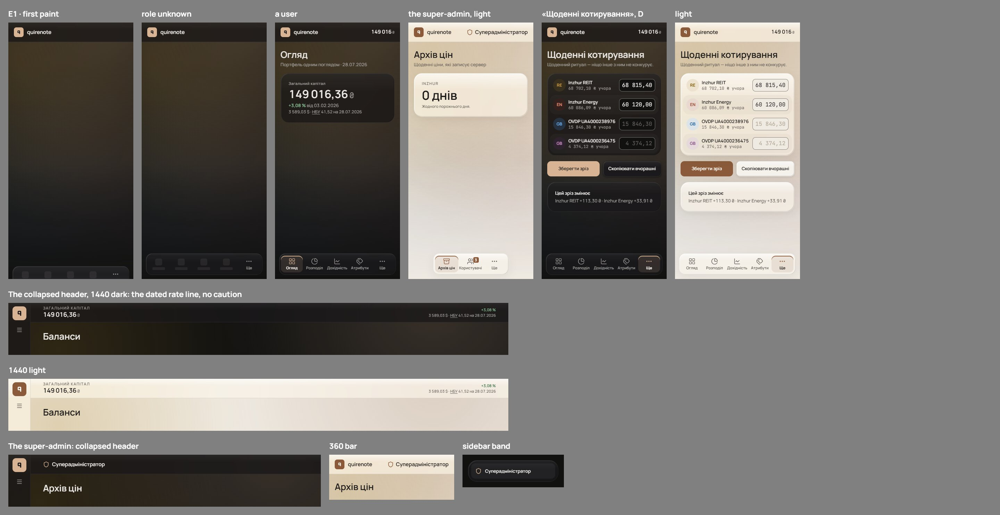
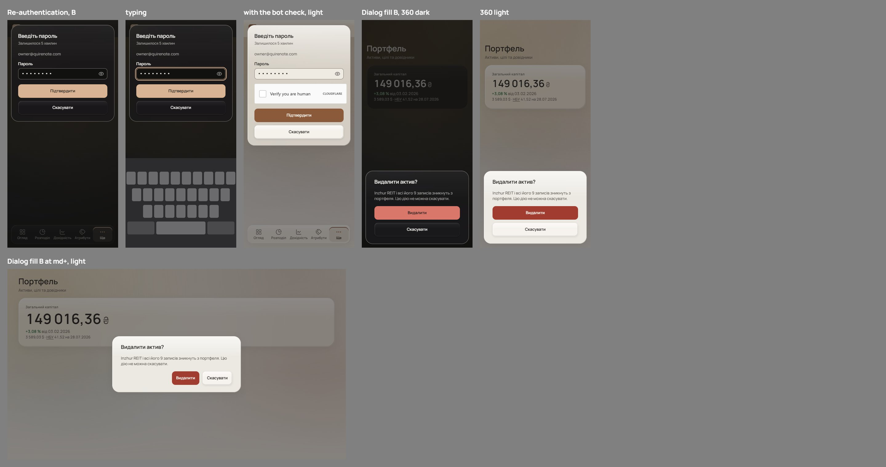
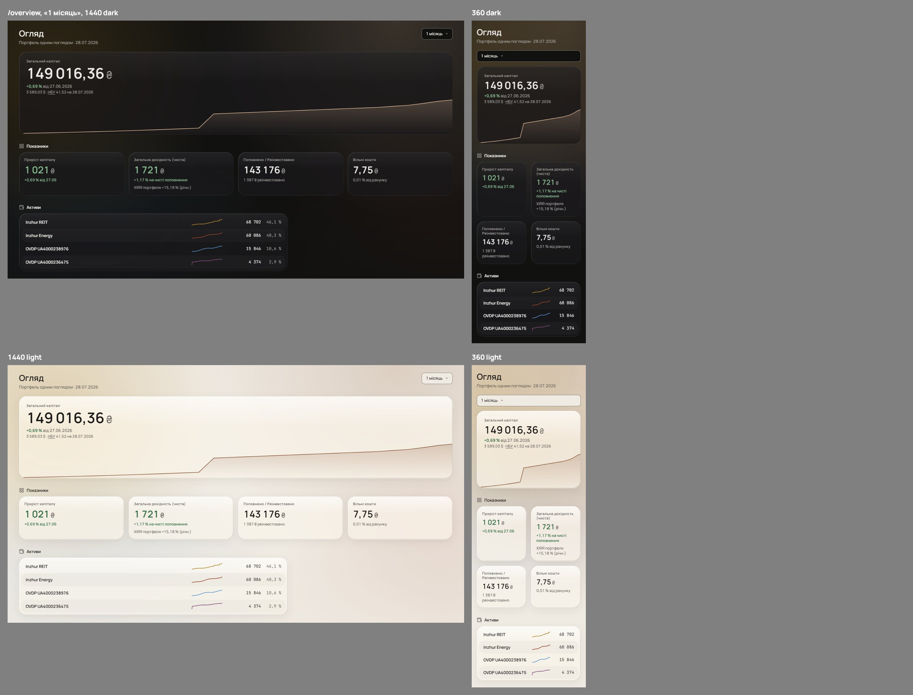
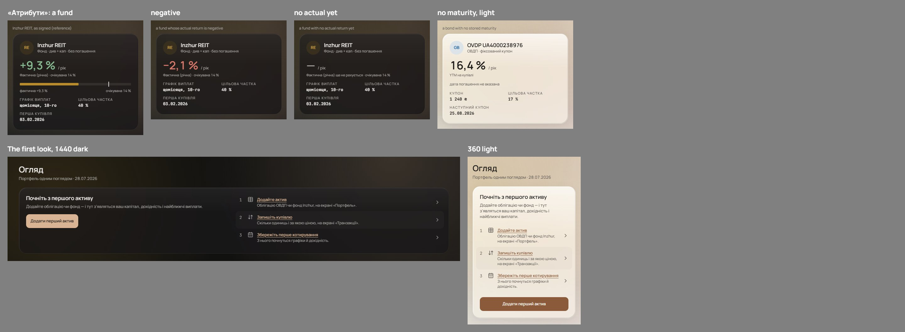
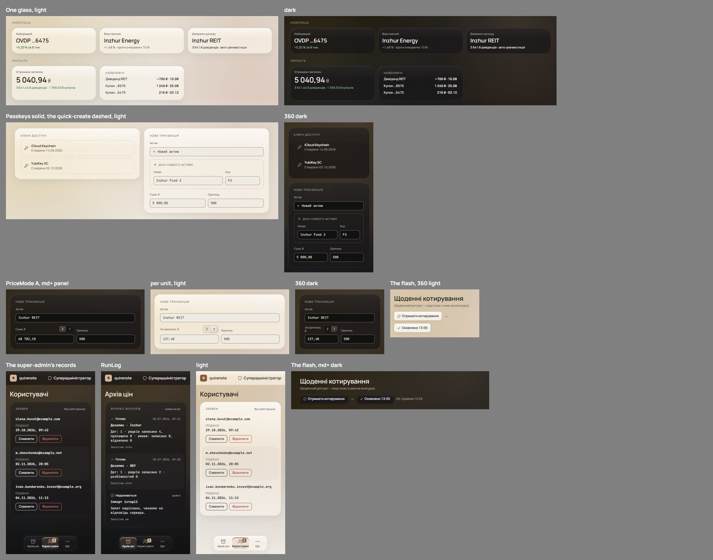
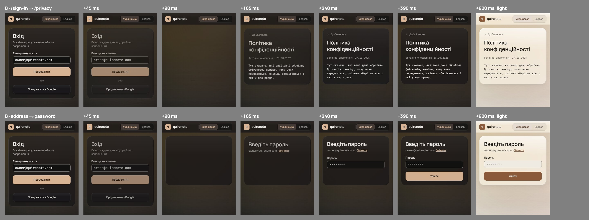

# Open values: the shell, dialogs, motion, the overview and controls (wave 26)

Earlier waves left values open on the shell, dialogs, motion, the overview and controls, or signed something the code does not hold. Brief #684 listed sixteen; the owner added one more of the same kind, the collapsed header's rate line (2b). Five steps answered them, one round each except the dock's, which took a second round (E); item 2 was settled by the record and item 9 by #731. Every variant was drawn on the signed surface from the seed's own data. Charts, tables, type and the palette are wave 25's ([open-values-charts-type.md](open-values-charts-type.md)).

It overturns parts of wave 5's dock ([mobile-bar-and-sheet.md](mobile-bar-and-sheet.md#signed)), wave 21's collapsed header ([rail-and-account-foot.md](rail-and-account-foot.md#signed)), wave 8's dialogs ([forms-and-dialogs.md](forms-and-dialogs.md#signed)) and the dialog fill of wave 15 ([glass-light.md](glass-light.md#signed)) and wave 9 ([signed-out.md](signed-out.md#signed)), wave 1's asset row line ([shell.md](shell.md#page)), wave 22's dashed containers ([controls-and-overlays.md](controls-and-overlays.md#signed)) and its fetch flash ([controls-and-overlays.md](controls-and-overlays.md#settled-by-the-brief)), wave 17's PriceMode ([controls.md](controls.md#signed)) and wave 10's 360 records ([super-admin.md](super-admin.md#signed)). It answers what wave 15 left unchecked ([glass-light.md](glass-light.md#implementation-checks)), and the reach of wave 19's E2 ([motion.md](motion.md#signed), [loading-and-compositions.md](loading-and-compositions.md#settled-by-the-brief)), the hero ([shell.md](shell.md#page)), the «Атрибути» bar ([attributes-item.md](attributes-item.md#signed)), the first look ([empty-loading-error.md](empty-loading-error.md#signed)) and glass's scope ([glass.md](glass.md#signed)). Each of those lines carries a pointer here.

## Renders

The final: every pick together at 1440 and 360 in both themes. Asset hues are wave 20's C3 values; payouts keep their own colours.

The rounds the picks were made from, each variant beside the others:

- Step 1, the shell: [the dock while the role is unknown](renders/w26s1q1.jpeg) and [its round E, the readings of «A + C»](renders/w26s1q1e.jpeg), [the collapsed header's right side](renders/w26s1q2.jpeg), [the super-admin's name](renders/w26s1q3.jpeg), [«Щоденні котирування»'s actions](renders/w26s1q4.jpeg).
- Step 2, dialogs: [re-authentication below md](renders/w26s2q1.jpeg), [the dialog over its scrim](renders/w26s2q2.jpeg).
- Step 3, the overview and «Атрибути»: [the XIRR line and the cash-short chip](renders/w26s3q1.jpeg), [the hero's area and the asset rows' lines](renders/w26s3q2.jpeg), [the bar's unsigned cases](renders/w26s3q3.jpeg), [the first look's steps](renders/w26s3q4.jpeg), [the tones on glass](renders/w26s3q5.jpeg).
- Step 4, controls: [the dashed containers](renders/w26s4q1.jpeg), [PriceMode](renders/w26s4q2.jpeg), [the fetch flash's copy](renders/w26s4q3.jpeg), [the super-admin's records](renders/w26s4q4.jpeg).
- Step 5, motion: [the route change](renders/w26s5q1.jpeg) and [the step swap](renders/w26s5q2.jpeg), as stills; the review page plays them at real speed.

The rounds draw assets in today's hues; only the final applies C3. No pick turns on a hue. The cash-short state, the negative and missing fund returns, the bond with no maturity, the passkeys, the run log and the keyboard are composed: the seed has none of them.

## Signed

- **The dock while the role is unknown (step 1, round E's first reading, E1; item 1).**
  - From the first paint the dock is the user's: «Ще» in its final slot and four placeholder tabs, a 20 px icon block and a 36 × 8 label bar each, in `ink` 7 %.
  - It rises at the first paint with the sheet's motion, `translateY(calc(100% + 12px))` → 0 over 260 ms on `ease-soft`.
  - When the role arrives the role's tabs fade in over the placeholders. The super-admin's dock shrinks to its three tabs at their shared width.
  - The placeholders are the shell's, not the content's, so P3's 1000 ms delay does not apply to them.
  - Signed out, the dock stays «Ще» alone. Under reduced motion it appears at once.
- **No dataset caution (by the record; item 2).** The caution `rail-and-account-foot.md` keeps "as today" was the DEMO badge, removed with the demo dataset (`0b868e29`). Nothing takes its place: [the header's round](renders/w26s1q2.jpeg).
- **The collapsed header's rate line (step 1, A; item 2b).** Under the change, wave 23's H3 line word for word: «3 589,03 $ · НБУ 41,52 на 28.07.2026», 11 px `muted`, «НБУ» its link.
- **The super-admin's name (step 1, A; item 3).** «Суперадміністратор» at every site: the collapsed header, the 360 bar, the sidebar's role band, the rail and /profile's role row. «Суперадмін» is not used.
- **«Щоденні котирування»'s actions (step 1, D; item 4).**
  - While the keyboard is closed, «Зберегти зріз» and «Скопіювати вчорашні» sit inline under the quote list, 44 / r11, gap 10, and the dock stays.
  - While the keyboard is open, wave 22's glass keyboard bar carries them ([controls-and-overlays.md](controls-and-overlays.md#settled-by-the-brief)).
- **Re-authentication below md (step 2, B; item 5).** It stays top-anchored, 16 from the top, with M2's glass, its 12 px side inset and r24; its cap is the viewport less the keyboard less 34. It is the one dialog below md that is not at the bottom: its steps swap and grow, and the top edge holds the title and timer still.
- **The dialog's fill (step 2, B; item 6).** Dialogs, D2 and M2 alike, take `card` at 90 % in light and 92 % in dark. Blur, saturate, bevel, sheen, the `field-border` edge and the scrim are held. Popovers keep `card` 70 % / 80 %: they sit over no scrim.
- **Route motion's reach (step 5, B; item 7).** E2 runs on every route change, the signed-out pages' included, and on every step swap inside a route: sign-in, apply and its answer, and re-authentication. The old step leaves over 90 ms; the new step's blocks rise 8 px in at 0 / 75 / 150 ms, and focus goes to the new step's heading.
- **The /overview hero (step 3, B and A; item 8).**
  - The XIRR line stays the sub of «Загальна дохідність (чиста)», and the cash-short chip the sub of «Вільні кошти», as wave 11's C2. The hero draws neither.
  - The hero's area follows the period: it starts at the window's first snapshot, sliced from the served chart, and stays cropped to its own range.
- **The asset rows' lines (by #731; item 9).** Each asset row's line reads the asset's value series that #731 adds to `GET /view`, not the paged `/view/balances`. The rows draw the same: [the hero's round](renders/w26s3q2.jpeg).
- **The «Атрибути» bar's unsigned cases (step 3, A; item 10).** The bar is drawn only with a value and a range.
  - A fund whose actual return is negative: no bar; the hero prints it in `neg`, and the caption is held.
  - A fund with no actual return yet: no bar; the hero reads «—», and the caption «Фактична (річна) ще не рахується · очікувана {expected} %».
  - A bond with no stored maturity: no bar; one `muted` 12 px line, «дата погашення не вказана».
- **The first look's steps (step 3, B; item 11).** The three steps are signed as drawn in wave 12's frames: a number, the screen's nav glyph, a title and a line, zebra at `ink` 3 %.
  - «Додайте актив» — «Облігацію ОВДП чи фонд Inzhur, на екрані «Портфель».» → /portfolio.
  - «Запишіть купівлю» — «Скільки одиниць і за якою ціною, на екрані «Транзакції».» → /transactions.
  - «Збережіть перше котирування» — «З нього почнуться графіки й дохідність.» → /.
  - Each row is one link with a trailing chevron, its title in `accent`; «Додати перший актив» stays the one primary.
- **Tones on glass (step 3, A; item 12).** One glass for every content card: KpiCard's `tint` and `wall` tones go, and so does /payouts' tinted «Найближчі» card. This confirms #688.
- **Dashed containers (step 4, C; item 13).** The passkey cards are transparent with a 1 px `hairline` edge, r16. The quick-create sub-form keeps its dashed `faint` edge, because its asset does not exist yet.
- **PriceMode (step 4, A; item 14).** The shared D2 segmented control: «Σ» and «1», 24 px segments on the tinted knob, by the shape rule 24 → 6 / 9, a radiogroup with arrow keys and no `TAP_44`. The field label reads «Сума, ₴» or «За одиницю, ₴» as today; at 360 «За одиницю, ₴» wraps onto two lines beside the control, as the final draws it.
- **The fetch flash's copy (step 4, A; item 15).** «Оновлено 13:05» / "Updated 13:05", in `ink`, as wave 22 signed.
- **The super-admin's 360 records (step 4, A; item 16).** R2 for the users and for RunLog: one r24 glass card with 6 px padding, records at r18 with 16 px padding, zebra at `ink` 3 %.
- **New copy.** «Фактична (річна) ще не рахується»; «дата погашення не вказана»; "Updated {time}".

## Rejected

- **The dock.** A as first drawn, the same dock without the rise. B, «Ще» alone and centred, then widening: «Ще» travels from the centre to the end. C, no dock until the role is known: «Ще» and the account cannot be reached during the read. D, «Ще» alone swapped at once: the jump the HIG warns about. Round E's second reading, no dock with its space reserved, and its third, a sink and a rise for the super-admin: the owner read «A + C» as the first.
- **The rate line** undated, as wave 21 drew it (beside a hero that dates the same rate), or the dollar figure alone (the rate it was converted at is lost).
- **«Суперадмін»** in the collapsed header or everywhere: two names for one role, and «адмін» is colloquial.
- **The actions in a bar** stacked over the dock (two fixed bars at the bottom edge), with the dock stepping aside (navigation gone once a quote is typed), or in the dock's place (actions dressed as navigation).
- **Re-authentication as M2** (it travels the keyboard's height when the keyboard opens, and its title moves as the bot check grows), or M2 until a field takes focus (it jumps on the first tap).
- **A stronger scrim** (the light dialog's `muted` text falls further), **both changes** (the darkest veil for no gain over B), or **a stronger edge** (the text stays under AA).
- **Route motion** kept to the shell's screens (two vocabularies), steps on a short y-axis (a third pattern too close to E2), or a 150 ms crossfade (both steps on screen at once).
- **The hero** with XIRR and the chip inside it, or with the chip alone: the chip sits far from the cash it qualifies. **Its area** as full history, marked or not: the change and the chart describe different spans.
- **The bar** as an empty track (it reads as 0 %), or a negative fill left of a zero tick (a second scale rule, and the asset's hue swapped for `neg`).
- **The first look's steps** as a static list (they name screens but do not lead there), or as links with no button (the card loses its one strong action).
- **The tones** kept as a `pos`-tinted glass, as a `pos` label with a glyph, or with the wall as an edged glass: each an exception to one material.
- **Both containers dashed** (saved passkeys look provisional) **or both solid** (the sub-form loses its not-yet cue).
- **PriceMode** as one `aria-pressed` toggle with `TAP_44` (wider than A at every width, and "not pressed" has to mean total), or as 44 px segments below md (a row 20 px taller).
- **The flash** as «Отримано» / "Fetched" (overturns the signed copy) or «Оновлено о 13:05» (longer on a button).
- **The records** at r11 with 12 px padding (not concentric with the r24 card), or with RunLog keeping its hairlines (two list anatomies).

## Settled by research

- **Tab bars.** Apple's HIG: "Don't disable or hide tab bar buttons, even when their content is unavailable", and changing availability makes the interface "appear unstable and unpredictable". web.dev: "layout shifts only occur when existing elements change their start position". Carbon's loading pattern shows the page's structure first.
- **Actions and navigation.** Apple's HIG: "Use a tab bar to support navigation, not to provide actions", and hiding it makes people "forget which area of the app they're in". GOV.UK: "Align the primary action button to the left edge of your form". WCAG 2.4.11 names "sticky footers, sticky headers" as what obscures focus.
- **Rates.** The FCA's Occasional Paper 56: providers "place a time stamp next to the rate so that consumers have a reference time". Lunch Money: converted amounts "display the exchange rate used".
- **Terms.** Microsoft's Windows style: "Inconsistency forces users to figure out whether different words and actions mean the same thing". Горох marks «адмін» *розмовне*.
- **Passwords and keyboards.** Apple's HIG Alerts: "present a secure text field to receive a password". Chrome: `position: fixed` elements "can be obscured by the OSK". MDN's compat data (8.1.9) has `interactive-widget` from iOS Safari 27.3, Chrome Android 108 and Firefox Android 133.
- **Glass and contrast.** WCAG 1.4.11: "choose the least contrasting area". Apple's HIG Materials: "Thicker materials, which are more opaque, can provide better contrast for text"; a dimming layer "of 35% opacity". material-web's dialog scrim is `opacity: 32%`. Acrylic falls back to a solid colour. As signed, the light dialog's `muted` text over the scrim fell under AA's 4.5 : 1, measured on the render and calculated from the tokens.
- **Motion.** React's `<ViewTransition>`: only updates wrapped in a Transition, `<Suspense>` or `useDeferredValue` activate it. Material: "A stepper transitions along the y-axis". MDN: "loss of reading position, focus confusion" when old and new content are both present. Chrome: reduced motion "doesn't mean the user wants no motion".
- **Figures and charts.** Carbon: a status indicator is "placed near these elements for clarity". Apple Stocks: the range sets the chart, with "the price change, and the percentage change". TradingView: with a short history "the chart is built for the available period".
- **Meters.** The APG meter shows a value "within a defined range"; MDN's `<meter>` clamps to "the nearest end of the range" and reads a missing value as 0; ONS uses "0" only for a true zero.
- **Onboarding.** GOV.UK's task list: "The whole row is linked". Polaris' setup guide gives each step an action; Shopify: "a quick start, with discrete steps".
- **Tones.** Apple's HIG: "Apply color sparingly to the Liquid Glass material", for "elements that truly benefit from emphasis". Carbon keeps containers in neutral layers.
- **Dashes.** Salt: "typically used to visually indicate drag/drop targets". Hightouch: "reserved for pending, placeholder, or not-yet-committed" states.
- **Two-option controls.** WCAG 2.5.8: "at least 24 by 24 CSS pixels". The APG button pattern: "the label on a toggle does not change when its state changes"; the APG radio pattern for a choice of one.
- **Copy.** Microsoft's style guide: "Use redraw or update instead" of refresh; Cloudscape: "Last updated".
- **Nesting.** Apple, WWDC25: concentric shapes "calculate their radius by subtracting padding".

## Implementation checks

- #721: the dock's placeholder state while `useRoleGate` is `pending`; a test that the dock is drawn before `/me` answers, and that a signed-out session keeps «Ще» alone. The inline actions replace `DailyQuotes`' fixed bar while the keyboard is closed; `useActionBarHeight` and `--action-bar-h` then serve the keyboard bar only.
- #720: the header reads the NBU rate and its date, as the hero's H3 line does; no caution. `nav.superAdmin` and `profile.superAdmin` both keep «Суперадміністратор».
- #715: `Dialog.tsx`'s top anchor stays for re-authentication alone, in M2's glass; below 768 its width becomes M2's, 100vw − 24, and `navigation-map.md:340` changes with it.
- #716: the dialog fill is its own value, 90 / 92 %; a contrast test pins the light dialog's `muted` text over the scrim.
- #727: the signed-out shell takes E2 on its routes, `GoogleCallback` included, and the steps of `SignIn`, `Apply`, `Answer` and `Reauthentication` take it on their swaps; their keyed `slide-in-from-top-1` entries go, and so does `GoogleCallback`'s own. A step's `setState` runs inside a Transition.
- #732: the hero slices `balances.chart` by the period's window. `Overview.tsx`'s XIRR and chip stay in their tiles.
- #733: the asset rows read the series #731 adds to `GET /view`.
- #696: no bar without a value and a range; the two captions join the catalogue.
- #734: the first look's steps are links, each to its screen.
- #688: KpiCard loses `tint` and `wall`; /payouts' «Найближчі» card loses its `pos-tint`.
- #705: the passkey `<li>` takes the `hairline` edge, not `panel`.
- #701: PriceMode joins the shared segmented control as a radiogroup; its tests move from `aria-pressed` to radios.
- #698: `fetchedAt` reads «Оновлено {time}» / "Updated {time}", in `ink`.
- #694: `AdminUsers`' and `RunLog`'s 360 lists take R2.

## Not drawn

- Placeholder tabs for a role the shell cannot predict: the super-admin sees the user's five shrink to three, once per load.
- The keyboard-open state of «Щоденні котирування», which wave 22 already signs.
- The import drop zone's dash (#644) and the rail's legal line (#627), outside this brief.
