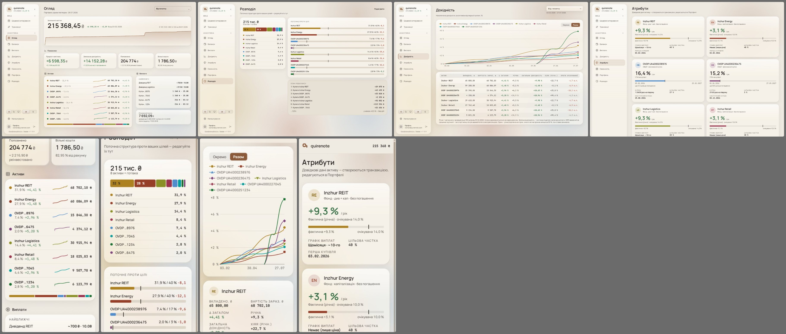
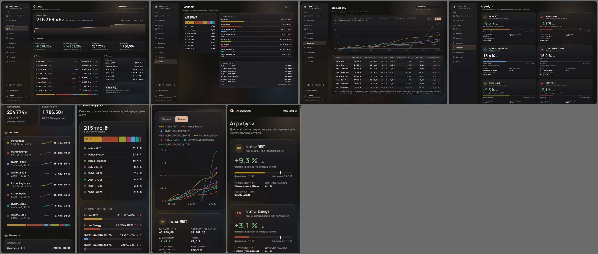
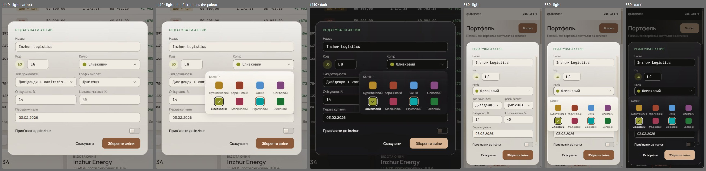
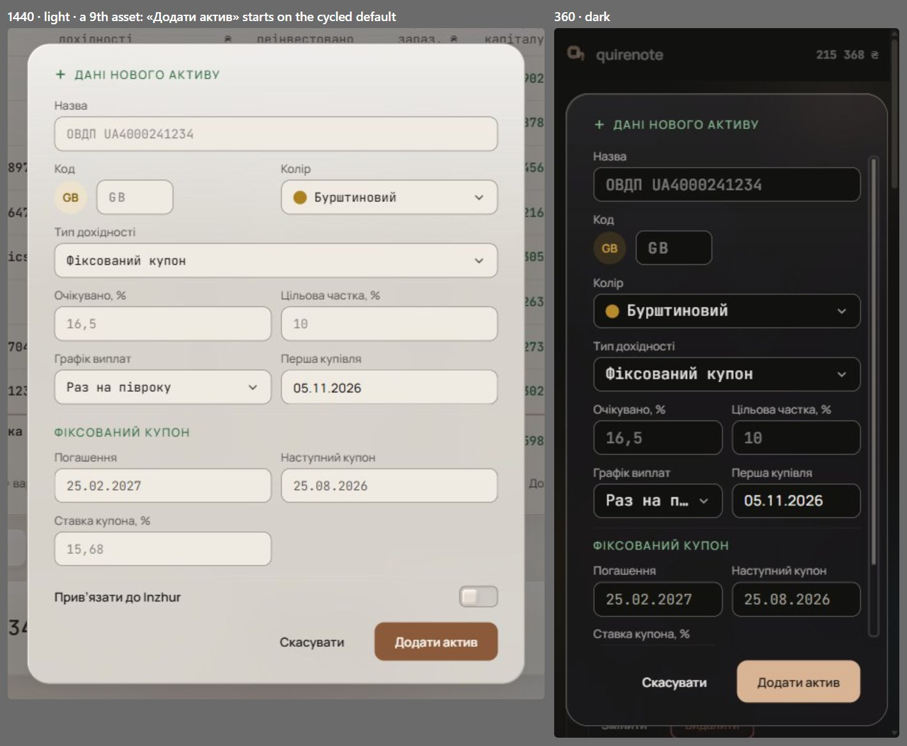

# The asset palette and its selector (wave 20)

Issue #13 asks for a 6th and 7th asset with distinct colours. The four asset hues were never chosen as a categorical palette, which wave 3 worked around with facets and names ([charts.md](charts.md#implementation-checks)). This wave fixes it at the source: eight slots in a fixed order, then a «Колір» field on the asset form that opens a named swatch palette.

It overturns `parchment-5h`'s four asset hues and its reserved `chart-1…6`, and, for three dark slots, wave 3's rule that every series mark clears the non-text contrast floor against the card in both themes, which take the relief rule instead ([charts.md](charts.md#signed)).

## Renders

The palette (C3) with eight assets on «Огляд», «Розподіл», «Дохідність» «Разом» and «Атрибути»: 1440 on top, 360 below.

The selector (D2) on «Змінити»: at rest, open, dark, and at 360.

A new asset: the field starts on the cycled default.

## Signed

- **The palette (C3, continuity).** Eight slots in a fixed order, each a main, a tint and a tint-text per theme. Slots 1–4 keep the families today's four keys already read as; slots 5–8 are new.

  | Slot | Key | Name (uk / en) | Light: main · tint · tint-text | Dark: main · tint · tint-text |
  | --- | --- | --- | --- | --- |
  | 1 | `reit` | Бурштиновий / Amber | `#ad811f` · `#ece2ce` · `#805c03` | `#b78a2c` · `#392f1e` · `#ca9c42` |
  | 2 | `energy` | Коричневий / Brown | `#973e28` · `#e8d8cf` · `#9b4630` | `#9f452f` · `#34211e` · `#e58870` |
  | 3 | `ovdp8976` | Синій / Blue | `#4f8dcc` · `#dde4e9` · `#2766a2` | `#5897d6` · `#263140` · `#6aaaea` |
  | 4 | `ovdp6475` | Сливовий / Plum | `#7f447b` · `#e5d9dc` · `#854a81` | `#874b82` · `#2f222f` · `#cc8bc5` |
  | 5 | `c5` | Оливковий / Olive | `#8b9026` · `#e7e5cf` · `#656902` | `#949932` · `#32321f` · `#a6ac4c` |
  | 6 | `c6` | Малиновий / Crimson | `#9b334e` · `#e9d6d5` · `#9a4156` | `#a33a55` · `#351f26` · `#e48396` |
  | 7 | `c7` | Бірюзовий / Teal | `#049d9d` · `#d1e7e2` · `#036f6f` | `#0da7a7` · `#173536` · `#34baba` |
  | 8 | `c8` | Зелений / Green | `#1a7031` · `#d4e0d1` · `#206f33` | `#247738` · `#1b2b20` · `#6db979` |

- **The gates it passes** (dataviz `validate_palette.js`, adjacent pairs, on `card` `#f8f5ef` / `#19181a`), in both themes: the lightness band, chroma ≥ 0.10, CVD separation and the normal-vision floor. Contrast against the card passes in light. In dark, brown, plum and crimson sit under the non-text contrast floor, which the relief rule covers: every place an asset colour appears also names the asset.
- **Text never takes a series colour.** Avatar text uses each slot's tint-text on its tint, which holds AA for text.
- **Order and the cycle.** `COLOR_KEYS = [reit, energy, ovdp8976, ovdp6475, c5, c6, c7, c8]`. A never-chosen asset takes `COLOR_KEYS[count % 8]`, so a 9th asset shares slot 1's colour. «Разом» still tells them apart by wave 14's shape, assigned by `createdAt`, so a 9th takes the triangle, not slot 1's circle ([yield-series-shapes.md](yield-series-shapes.md)). Every other place names the asset.
- **Keys and tokens.**
  - The four keys keep their spelling; four opaque keys are added, `c5`, `c6`, `c7`, `c8`.
  - The `ColorKey` union widens, and `SERIES` in `packages/core/src/colors.ts` gains four entries.
  - Tokens `--color-c5…c8` with `-tint` and `-tint-text` in both theme blocks, plus their `--color-chart-c5…c8` aliases.
  - The four existing keys take C3's values.
  - The class maps gain the four: `AssetAvatar`, `Tag`, `Allocation`'s bar map, `ColorDot`, `ShareBar`.
- **Decoupled, values kept.** `accent`, the logo and `info` keep their values and stop sharing tokens with assets.
  - `accent` `#8a5a3a` / `#d8b494`; it no longer equals `energy`.
  - `logo-pill-a` `#b07a52`; it no longer equals `reit` (wave 24 later retires it, [brand.md](brand.md#signed)).
  - `info` `#4a6178` with tint `#e3e3e1`; it no longer equals `ovdp8976`.
  - Payout types get `--color-payout-dividend` (today's `reit` values: `#b07a52`, tint `#efe6dc` / `#2e2622`, tint-text `#895f40` / `#bb8157`) and `--color-payout-coupon` (today's `ovdp8976` values: `#4a6178` / `#93a4b5`, tint `#e3e3e1` / `#2a2c30`, tint-text `#4a6178` / `#93a4b5`), with chart aliases. Re-pointed: `Payouts.tsx`'s `typeColorKey` and its tags, `PayoutsBars.tsx`'s fills, and the legend squares in `placeholders.tsx`.
- **The selector (D2), the field opens the palette.**
  - The field: «Колір» in the asset dialog, beside «Код» in a two-column grid at md+, on its own full-width row below md. It is the form's Select trigger anatomy (36 px, r9, F2 `page` fill, `field-border`, chevron), showing a 14 px dot and the colour's name.
  - The palette: a P2 glass popover with the listbox's radius, 8 px below the field and end-aligned to it, flipping above when there is no room. Padding 12 / 14 / 14. A «Колір» title in 11 px caps, tracking .14em, `muted`. A 4 × 2 grid of 72 px cells, gap 12 (rows) / 4 (columns), 328 px wide, so it fits 360 with 12 px margins.
    - *Overturned by wave 25: the title's tracking is +.12em ([open-values-charts-type.md](open-values-charts-type.md#signed)).*
  - A cell is a 28 px r7 swatch over its name (11 / 14 `muted`; the chosen name in `ink` 600). The whole cell is the hit target, at least 44 px. The chosen swatch takes a 2 px `card` halo, a 2 px `ink` ring and a 14 px `card` check.
  - Keyboard: the field is a button (`aria-haspopup="dialog"`, `aria-expanded`). Enter, Space or Down opens it, with focus on the chosen swatch. Inside is a radio group (`aria-label` «Колір», each swatch `role=radio` named by its colour). The arrows move focus and select, per the WAI-ARIA radio group pattern, with the F2 accent ring as focus (offset 6 around the chosen ring). Enter, Escape or a click outside closes it and returns focus to the field; a click on a cell picks and closes.
  - Behaviour: the chosen colour is always named in words, never by colour alone. A pick repaints the avatar at once and is saved with the form. A new asset starts on the cycled default. The inline quick-create in `TransactionPanel` shows no field and takes the cycled default; the colour is changed later in «Змінити» (the owner's ruling at sign-off).
- **New copy.** «Колір» / "Colour", and eight names: Бурштиновий, Коричневий, Синій, Сливовий, Оливковий, Малиновий, Бірюзовий, Зелений / Amber, Brown, Blue, Plum, Olive, Crimson, Teal, Green.
- **Storage.**
  - The DB check `color_slot < 4` widens to `< 8` (`infra/schema/user.ts`), a migration.
  - The backup enum (`packages/core/src/backup/json.ts`) and the CSV `colorKey` column accept the four new keys with no format-version bump, so old backups import unchanged.
- **Records superseded.** `parchment-5h`'s four asset hues and its reserved `chart-1…6` (they fail the validator). The *Design pipeline* colour reference gains this palette for assets.
- **Kept against `parchment-5h` rule 7.** Wave 23 held crimson and green as signed and retired the rule's "without green-red associations" ([loading-and-compositions.md](loading-and-compositions.md#signed)).

## Rejected

- **C1, today's four extended** with `parchment-5h`'s two reserved chart hues, slots 7 and 8 cycling back: it fails every gate.
- **C2, an earthy eight** (terracotta, teal, olive, slate, rose, ochre, plum, moss): it passes every gate, but REIT turns terracotta and Energy teal, the furthest from today's look.
- **C4, the dataviz reference palette** used as is: the narrowest CVD margin, four light slots under the non-text floor, and the least like the app.
- **K1, a dropdown of colours:** the swatches are only 14 px dots, and comparing takes one more press. **K2, a swatch row:** the most space, one more row at md+ and two at 360. **K3 alone, the avatar opens the palette:** hidden until someone finds the avatar.
- **D1, both ways in** (the field opens the list, the avatar opens the palette): two controls for one value. **D3, the avatar opens the list:** hidden, with 14 px dots.

## Settled by research

- **Eight slots in a fixed order** is the dataviz method's cap for a categorical palette.
- **One tab stop, arrows move** (the WAI-ARIA radio group pattern).

## Implementation checks

- `asset-builder.test.ts`: the 5th asset takes `c5`; a 6th and 7th take distinct colours, tested over `COLOR_KEYS`; the 9th wraps to `reit`.
- `palette-mirror.test.ts`: the reit reading; the shared-value equalities (accent = energy, logo = reit, info = ovdp8976) turn into independence checks; today's asset hexes join the retired list.
  - *Overturned by wave 25: `RETIRED` stays closed; a second list holds the values wave 20 replaced that no token keeps, and `--color-glass-rim` is exempt by name ([open-values-charts-type.md](open-values-charts-type.md#signed)).*
- `model-parity.test.ts`.
- New: the validator's gates over the shipped tokens in both themes, and tint-text at AA per slot.
- D2's field opens a grid, not a native Select, so the keyboard is built rather than borrowed.
