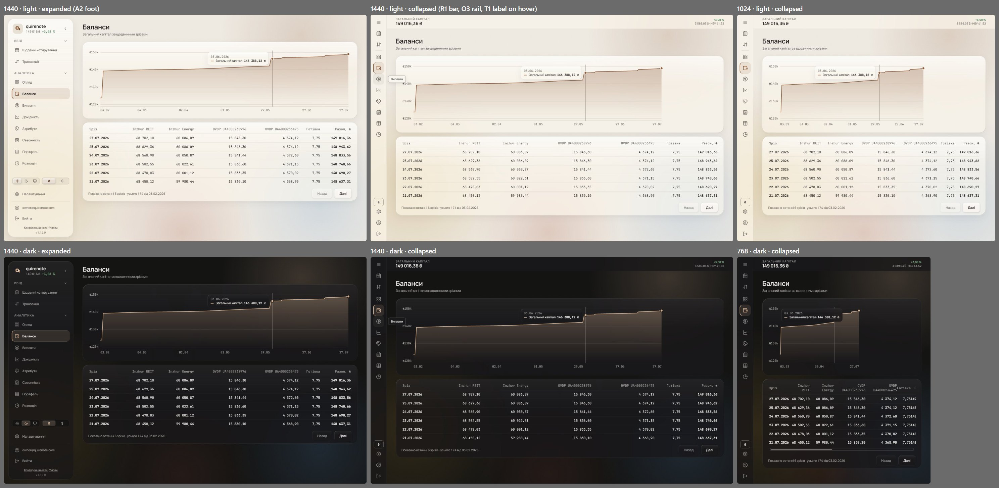
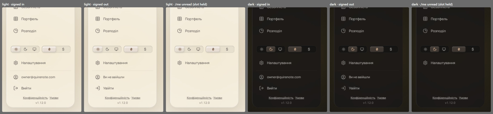
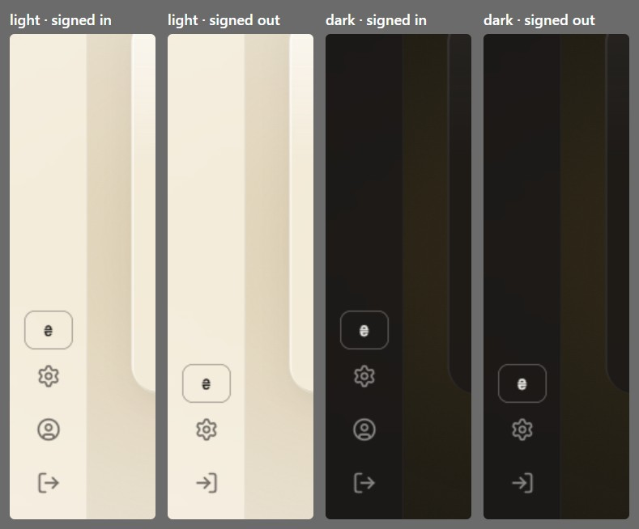
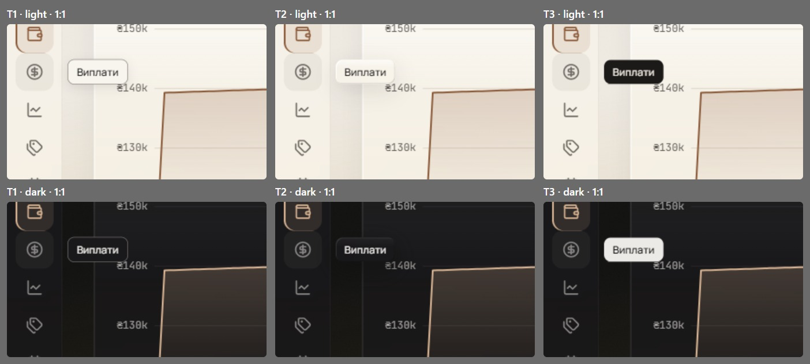
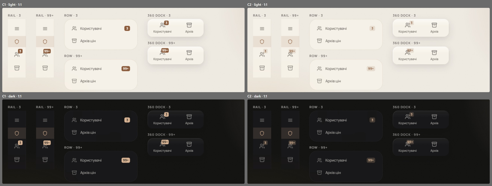
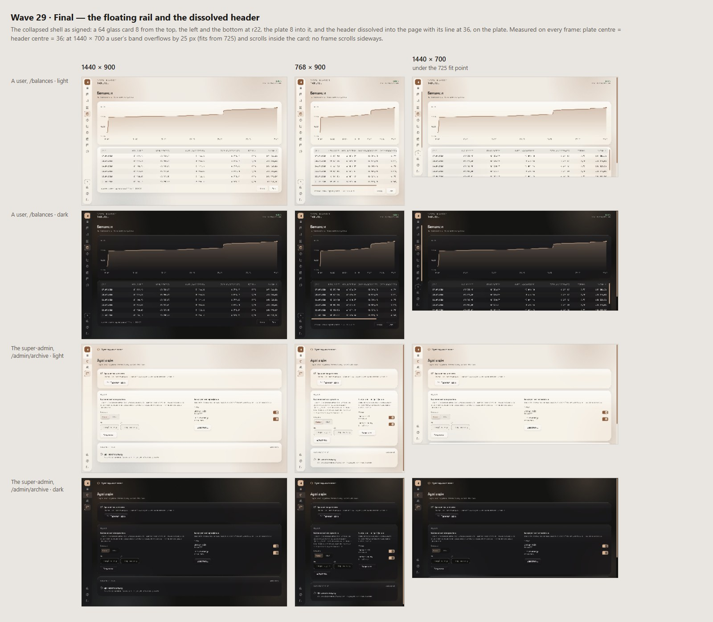
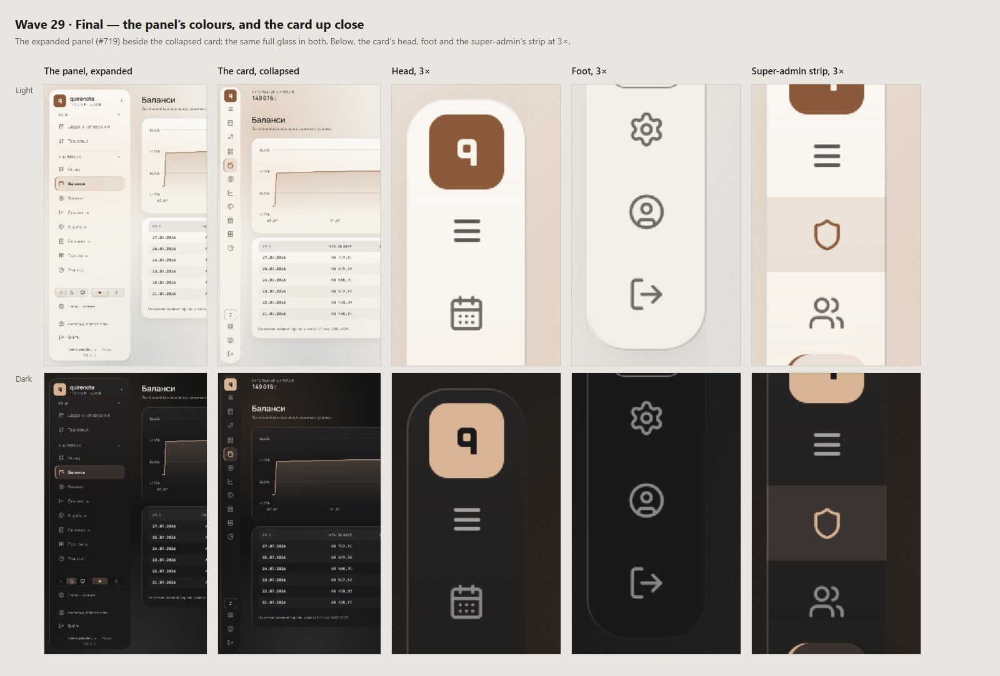
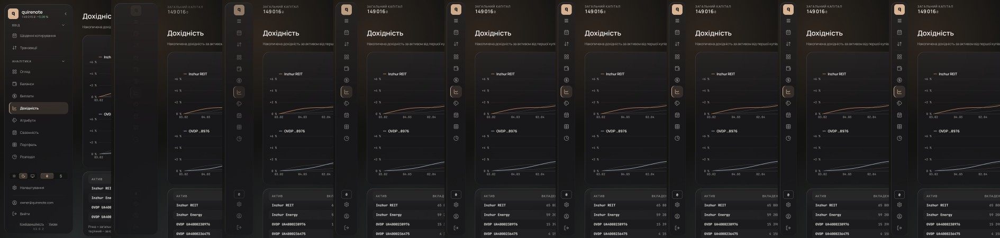
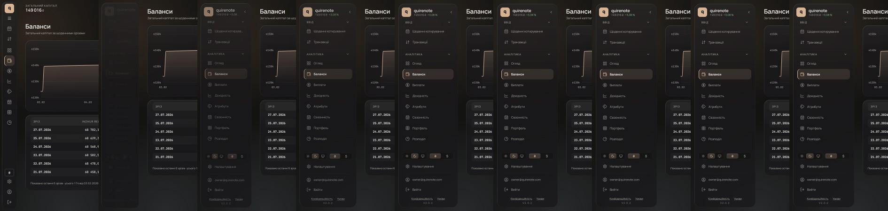

# The rail, the collapsed shell and the account foot (wave 21)

The coverage audit of the old sheets found the shell's collapsed, signed-out and role states undrawn, and the account foot in conflict with the owner's earlier rulings. Wave 1 drew the rail with no capital and no header, and never said so; the code keeps the capital in `AppHeader` while the rail is collapsed (`Layout.tsx`: `showHeader = !desktop || collapsed`), as `parchment-sidebar` T4 ruled. As wave 1 draws it, the rail is too tall for a 13" laptop window. This wave settles where the capital lives, the rail at a short window, the account foot, and the rail's hover label and counts.

It overturns wave 1's foot drawing and its rail foot ([shell.md](shell.md#signed)); wave 1's 64 / 44 r12 rail geometry stands. It also overturns `parchment-5h`'s "badges are accent-tint only".

## Renders

Every pick together, expanded and collapsed, at 1440, 1024 and 768, in both themes.

The expanded panel's foot (A2), signed in, signed out, and while `/me` is unread, in both themes at 1:1.

The collapsed rail's foot: currency, Settings, profile and «Вийти»; signed out, «Увійти» alone.

The hover label on «Виплати», with the item's H2 hover, light over dark: T1 (signed), T2, T3 from the left.

The count at «3» and «99+» on the super-admin's rail with its role strip, in the row and on the 360 role dock, light over dark: C1 (signed) and C2.

## Signed

- **The collapsed shell's header (R1),** at md and up, only while the rail is collapsed; below md it is wave 5's 360 bar.
  - 56 px tall, sticky, the wave 4 / 15 glass (`card` 80 % dark, 70 % light, blur 30, saturate 180), a 1 px hairline under it, square corners (a full-bleed band), padding 0 36.
    - *Overturned by wave 29: the header is dissolved into the page, with no surface, no edge and no stickiness, 8 from the top, its line on the plate's ([Wave 29](#wave-29-the-floating-rail)).*
  - Left: «ЗАГАЛЬНИЙ КАПІТАЛ» in the label role (11 / 14, caps, .12em, `muted`) over the figure (Manrope 18 / 600, `ink`).
    - *Answered by wave 25: header capital 18 joins the display row, with K2 ([open-values-charts-type.md](open-values-charts-type.md#signed)).*
  - Right: the change (11 / 600, `pos` or `neg`) over «$ · НБУ rate» (11, `muted`); the dataset caution sits here as today.
    - *Answered by wave 26: the line is wave 23's dated H3 line, and there is no caution: it was the DEMO badge ([open-values-shell-controls.md](open-values-shell-controls.md#signed)).*
  - The super-admin: the shield (18, `accent`) and «Суперадмін» (Manrope 15 / 600) instead of the figure.
    - *Overturned by wave 26: «Суперадміністратор» at every site ([open-values-shell-controls.md](open-values-shell-controls.md#signed)).*
- **The rail (O3), tighter gaps, scroll below 670 px.**
  - 64 wide, flush left, glass, a 1 px hairline on the right, padding 8 / 0, no gaps; items 44 × 44 at r12, icons 20; group hairlines 28 × 1 with 2 px margins. The hit areas touch without overlapping.
    - *Overturned by wave 29: the rail floats as a 64 glass card 8 from the top, the left and the bottom at r22, on the panel's full glass with no hairline; inside it the rest of this line holds ([Wave 29](#wave-29-the-floating-rail)).*
  - The foot: the currency box (40 × 32, r9, `field-border`), Settings, profile, «Вийти».
  - 669 px tall: it fits from 670; below that it scrolls inside `Scroller` with the overlay thumb (4 px, `ink` 28 %, never a gutter).
    - *Overturned by wave 29: the card fits from 725, and below that the band still scrolls inside it ([Wave 29](#wave-29-the-floating-rail)).*
    - *Overturned by wave 28: the overlay bar is the 8 px `accent` glass thumb on its 4 px `glass-well` rail, still never a gutter ([controls.md](controls.md#wave-28-the-scroll-surface)).*
    - *Overturned by the owner on #527: the thumb is 6 px on a 3 px rail ([controls.md](controls.md#the-thumb-at-6-the-owners-ruling-on-527)).*
  - Signed out, «Увійти» alone replaces profile and «Вийти».
  - The super-admin: a 64 × 40 full-bleed role strip under the menu (`accent-tint`, the shield 18 in `accent`), then «Користувачі» (with the count) and «Архів цін».
    - *Overturned by wave 29: the strip spans the card's inner width and no longer bleeds under the safe area ([Wave 29](#wave-29-the-floating-rail)).*
- **The expanded panel's foot (A2, as shipped).**
  - Settings, a hairline, then the address as the profile link: a 36 px row at r9, the profile glyph 18 in `sb-icon`, the address 12 px in `sb-item`.
  - Then «Вийти» as a full 44 px r12 row in Settings' recipe, last (the owner's ruling).
  - Signed out: «Ви не ввійшли» as a 36 px status row in `muted`, then «Увійти» as the row.
  - While `/me` is unread, the slot is held empty at the signed-in rows' height, so nothing moves when the answer lands.
  - Legal: «Конфіденційність · Умови» (11 / 14.25, links underlined in `sb-item`), the version on a second line 4 px under it in `sb-label`.
    - *Overturned by the owner's ruling on #689: both lines take the label role, 11 / 14 ([type.md](type.md#signed)).*
  - On /profile the address row takes the nav row's active state, in the panel, the «Ще» sheet and the dock.
- **The rail's hover label (T1, as shipped).**
  - `card` fill, a 1 px `field-border` edge, r8, padding 6 / 10, 12 / 16 at 500 in `ink`, and a `0 4px 12px` `ink` 10 % shadow in light only. It is today's `Tooltip.tsx`.
  - Wave 15's glass scope names it as the one solid floating label.
- **The count (C1), solid accent.**
  - `accent` fill, `accent-fg` text, 11 / 700.
  - On the rail and the dock, a 16 px box at r4, 2 px inside the item's corner; in the row, 20 × 18 at r5, right-aligned.
- **Motion.** The collapse keeps today's 260 ms width tween and the header's 220 ms fade with a 4 px rise, on `ease-soft`; reduced motion makes both instant. No new motion was decided.
  - *Overturned by wave 29: one glass card morphs between the panel and the rail, both ways, on the same 260 ms tween; the header's fade holds ([Wave 29](#wave-29-the-floating-rail)).*
- **The `sb-*` tokens.**
  - Kept: `sb-item`, `sb-item-hover`, `sb-icon`, `sb-indicator`, `sb-label`.
  - Retired once the implementation confirms them unused: `sb-bg`, `sb-field`, `sb-footer-bg`, `sb-divider` (the hairline replaces it), `sb-border`, `sb-item-active-bg` (wave 1's `accent-tint` replaces it).
- **Records.**
  - Wave 1's foot drawing (the tile and the glyph-only sign-out) and its rail foot are replaced by A2 and the rail above.
  - `parchment-sidebar` T4 (the capital in the header) is kept by R1; its 56 px rail and its T3 / T7 measurements retire.
  - `sign-out` T7, `own-account`'s address link and `terms-of-use`'s two-line foot are kept.
  - `admin-users` T2's count gains «99+» at wave 5 / 10 geometry.
  - `super-admin-shell`, `sign-in-entry` and `account-way-in-and-out` are answered by the states above.
- **Wave 24 moves the fit point.** The rail head takes the 40 plate over the burger and grows by 18 px, so the 670 px fit point moves to about 688, measured at implementation ([brand.md](brand.md#signed)).
  - *Overturned by wave 29: the card fits from 725 ([Wave 29](#wave-29-the-floating-rail)).*

## Rejected

- **R2, a compact figure in the rail's head** («149 тис.» over «₴ · +3,1 %»): a rounded figure, no dollar figure, and no room for the dataset caution.
- **R3, no capital while collapsed:** on every screen but «Огляд» the figure is a press away.
- **O1, the whole rail scrolls:** no precedent, and the account and sign-out start below the fold on a short window.
- **O2, the foot condenses behind «…»:** Settings, the currency and «Вийти» take two presses wherever the rail is collapsed.
- **A1, wave 1's foot** (a 34 px tile with «Профіль» over the address, a glyph-only «Вийти»): it overturns the owner's rulings in `sign-out`, "the sign-out a pill like its neighbours" and "the sign-out last", and a glyph-only sign-in reads as a puzzle when signed out.
- **A3, wave 1's tile with the rulings on «Вийти»:** its one-line legal overrides `terms-of-use`'s two lines.
- **T2, P2 glass:** over the dark rail the glass nearly vanishes. **T3, an `ink` chip:** a loud new surface for a passing label.
- **C2, `accent` tint:** on the rail and the dock the icon's strokes show through «99+», and the count reads weaker than the glyph it marks.

## Settled by research

- **Where a headline figure goes when a sidebar collapses** is not covered: WinUI's NavigationView, Material's rail and Apple HIG are silent, so R1 is a design choice.
- **A rail is not built to scroll.** Material's rail holds "three to no more than seven app destinations when collapsed", and its scrolling is off by default; WinUI's compact pane says nothing on overflow. No source scrolls a rail, so O3 keeps every item and scrolls only the last pixels at the shortest windows.
- **The 99 cap** is Fluent's `overflowCount = 99`.

## Settled by the brief

- **The hover label's behaviour.** It opens on hover after 300 ms (200 to skip between items) and at once on keyboard focus; it closes on Escape and on pointer-out; it sits 16 px to the item's right, centred on it; its text is the item's accessible name.
- **The count's cap.** Over 99 it reads «99+», named «понад 99» to screen readers, and the box grows to the left (padding 3 on the rail and dock, 5 in the row).
- **No legal line in the rail.** The expanded panel, the signed-out pages and /profile carry it.
- **The super-admin's foot** has the same rows, under wave 10's theme-only control.

## Not drawn

- No new motion: the collapse keeps today's tweens, so none was played.
  - *Overturned by wave 29: the morph is drawn, collapsing and expanding ([Wave 29](#wave-29-the-floating-rail)).*

## Wave 29: the floating rail

Brief #798. The owner's look: the collapsed shell floats as a glass card with the plate, as the expanded panel does (#719), in the panel's colours. Four steps settled it, drawn on the live app over the shipped fake API and seed, each frame restyled in place. Step 3 took two rounds: during its first the owner ruled that the plate sits on the header's line, then asked for the header to be dissolved into the page beside the floating card. During the final the owner ruled that the card morphs on expanding as well as collapsing. Step 4 drew two variants other than the brief's: M1, today's swap at the press, and M2, the one card morphing (the brief's M1). The brief's "the inset and radius change at the end of the width tween" was not drawn, as today's code swaps the two surfaces at the press rather than tweening one.

It overturns O3's flush rail, its band edge and its fit point, R1's band header, the role strip's bleed, and this file's "no new motion" (each line points here). It holds everything inside the rail, the foot, the counts, the hover label, the header's contents, and the expanded panel.

### Renders

The collapsed shell for a user and the super-admin at 1440 × 900, 768 × 900 and 1440 × 700 (under the fit point), in both themes.

The expanded panel beside the collapsed card, and the card's head, foot and the super-admin's strip at 3×.

The morph at 30 fps, collapsing, then expanding, nine stills each: 0, 33, 67, 100, 133 and 167 ms, then the end three times, as `ease-soft` is within a pixel of it from 200 ms on.

The rounds: [step 1, the inset](renders/w29s1.jpeg); [step 2, the radius](renders/w29s2.jpeg); step 3, the header, in [round 1](renders/w29s3a.jpeg) and [round 2, the dissolved header](renders/w29s3b.jpeg); step 4, the motion: [M1, the swap at the press](renders/w29s4.jpeg), beside M2, which is the collapse above.

### Signed

- **The card (step 1, B).**
  - 64 wide, 8 from the top, the left and the bottom, each `max(8px, env(safe-area-inset-…))` on its side, so `100dvh − 16` tall with no inset. The aside is the left inset plus the card, 72 wide with no inset.
  - Inside, as O3 signed it: padded 8 / 0 with no gaps, the 40 plate, the 44 menu, the items, the 28 × 1 rule and the foot. The super-admin's 40-tall `accent-tint` strip spans the card's inner width.
  - **The fit point is 725**: the rail's 709 plus 8 above and 8 below. Below it the middle band scrolls inside the card with the overlay bar, as O3 had it.
- **The radius (step 2): 22**, concentric with the items, 12 + the 10 around them.
- **The surface.** The panel's full `glass`: `glass-fill`, `glass-sheen`, `glass-bevel-top` and `-bottom`, the `ink` 6 % ring, and `shadow-glass` in light, with its opaque `card` and `hairline` fallback under `@supports not (backdrop-filter)` and `prefers-reduced-transparency`. `glass-band` and the right hairline leave the rail. No new token.
- **The header (step 3, round 2, J2), at md and up while collapsed.**
  - Dissolved into the page: no fill, no edge, not sticky. A 56 px row 8 from the top of the content column, padded 0 36, that scrolls with the content.
  - Its contents are R1's as answered by waves 25 and 26: the capital, or the super-admin's shield and «Суперадміністратор», on the left; the change over the dated rate line on the right.
  - Its centre line is 36, the plate's, which stands 8 into the card (the owner's ruling: the plate sits on the header's line). So the header's top offset is the card's, `max(8px, env(safe-area-inset-top))`, in place of its own safe-area padding, and the two lines stay equal under a top inset.
  - Its arrival keeps the 220 ms fade with a 4 px rise on `ease-soft`. Below md, wave 5's 360 bar is unchanged.
- **The motion (step 4, M2), both ways.**
  - One glass card morphs on the 260 ms `ease-soft` tween. Collapsing: inset 16 → 8, width 260 → 64, radius 26 → 22, height `100dvh − 32` → `100dvh − 16`. The aside's width, inset plus card, rides the same tween.
  - The contents cross-fade inside the card: the panel's fade out over the first 45 % of the progress, and the rail's fade in over the rest. Expanding runs the same in reverse (the owner's ruling).
  - Reduced motion makes it instant.

### Rejected

- **Step 1.**
  - A, a 64 card at the panel's 16: fits from 741, so a 1536 × 864 screen's Chrome window starts to scroll the rail.
  - C, a 56 card at 8 in today's 64 column: the items sit 6 from the card's edge, and the active tint all but fills it.
  - D, a 64 card at 12: fits from 733, and a third inset beside the panel's 16 and the 360 sheet's 12.
- **Step 2.** The panel's 26: on a 10 px gap it flares past the items. The standalone 17: it pinches the items' corners.
- **Step 3, round 1.**
  - H1, R1's flush band and hairline, and H3, the band with a fade for its foot: on a band's line at 28 the plate touches the card's top edge with no gap.
  - H2, a floating glass card for the header (J1 in round 2): a second glass card over the content, with content showing in the gaps around it.
- **Step 4.** M1, the held swap at the press: the card's corner jumps 8 up and 8 left as the panel vanishes in one frame.

### Settled by research

- **A sidebar floats inset.** Apple, WWDC25 "Get to know the new design system": "sidebars are now inset and built with Liquid Glass". shadcn/ui's floating sidebar holds one 8 px inset in both states (`sidebar.tsx`, `p-2`).
- **The fit point.** StatCounter's desktop shares put 1536 × 864 second, which is 1920 × 1080 at 125 %. With the roughly 80 px of browser UI that W3C's Reflow Understanding figure shows and a 48 px taskbar, that screen leaves Chrome about 736, inside 725 and outside 741.
- **The radius.** Apple: "concentric shapes calculate their radius by subtracting padding from the parent's", which is *Shape system*'s nested rule.
- **The header.** WinUI keeps the frame flush and lets the header dock to the page; Apple floats toolbars as glass. The dissolved header follows the page, as wave 5's 360 bar already leaves on scroll.
- **The motion.** Material 3's `WideNavigationRail` animates one container's width between its collapsed and expanded rails (`animateDpAsState`), and shadcn/ui transitions its floating sidebar's own width (`transition-[left,right,width]`).
- **Overflow.** Material 3 caps a collapsed rail at seven items, with scrolling off by default, and shadcn/ui clips its icon rail. No source scrolls a whole rail, so O3's inner scroll holds.

### Implementation checks

- #799:
  - One surface for both states, so the morph has one element to tween. Today `Sidebar.tsx` swaps two branches and tweens only the aside.
  - The fit point pinned at 725 (`sidebar-rail.test.ts` pins 709 for the rail inside the card), and the 8 px inset paid outside the card with the safe area.
  - The flush rail's pins (`glass-band`, the right hairline, the strip's bleed) rewritten. R1's band at md and up (`sticky`, `md:glass-band`, the `border-b` hairline and the `bg-page` it shares with the 360 bar) dropped there and pinned, the 360 bar's kept; today only `md:glass-band` is pinned. `glass-band` retires if nothing else wears it.
  - The header's centre line and the plate's are equal, pinned.
  - At 768 the content column narrows by 7 (72 against 65).
  - `docs/DECISIONS.md` (*Two shells, one breakpoint*) and `navigation-map.md` (the shell, the header bar) rewritten to the floating card.
- In the morph's frames the overlay bar stays clear of the card's rounded corners, as it sits in the middle band.

## Перенесено

Rules of the sign-in entry, the sign-out and /profile that no code, test or decision records.

- **Why the entry is «Увійти» and not «Вхід».** «Вхід» is a noun, where the «Вийти» it replaces in the slot is a verb.

The sign-out:

- **No confirmation before signing out.** NN/g: "Do not use confirmation dialogs for routine actions".
- **A failure of the shell's sign-out is a toast, never a sentence under the control.** The rail has no room for one, and one mechanism serves all three shells.
- **The failure toast leaves when it is closed or a retry succeeds,** not at the retry's press.
- **After a Stop the logout is not sent again.** The halt is the user's own act, and the page would leave against it.
- **No timer ends the busy state.** No clock knows whether a redirect is still loading.
- **Back to a restored page does not reload it.** The page restored holds no figures to clear.

/profile:

- **The deletion card's shift is accepted** when the passkey list lands above it: a press in it only opens the confirmation.
- **«Скопійовано» replaces «Копіювати» in place,** with no motion of its own: an exception to *Interaction rules*.
- **No fact names how the current session signed in.** Cognito's ID-token page says its `amr` claim is rolling out gradually and may not be available to a pool, so the page cannot rely on it. The one place the page names the method is the passkey card's note after a Google sign-in (*Auth model*).
- **No «Пошта підтверджена» fact.** OIDC makes `email_verified` optional, and the address is a label (*Auth model*).
