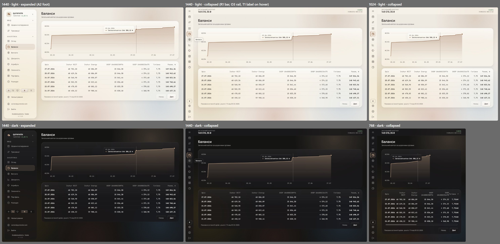
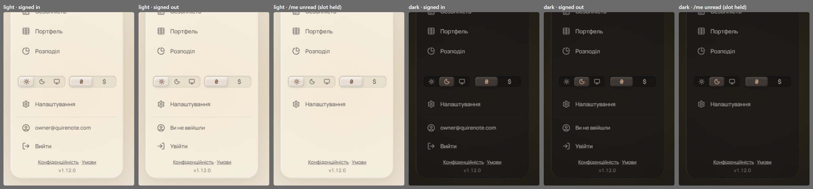
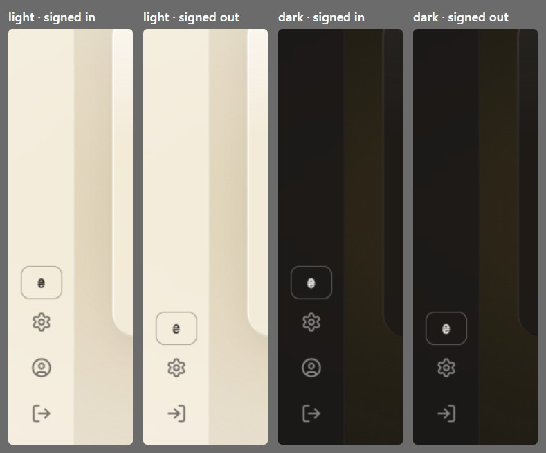
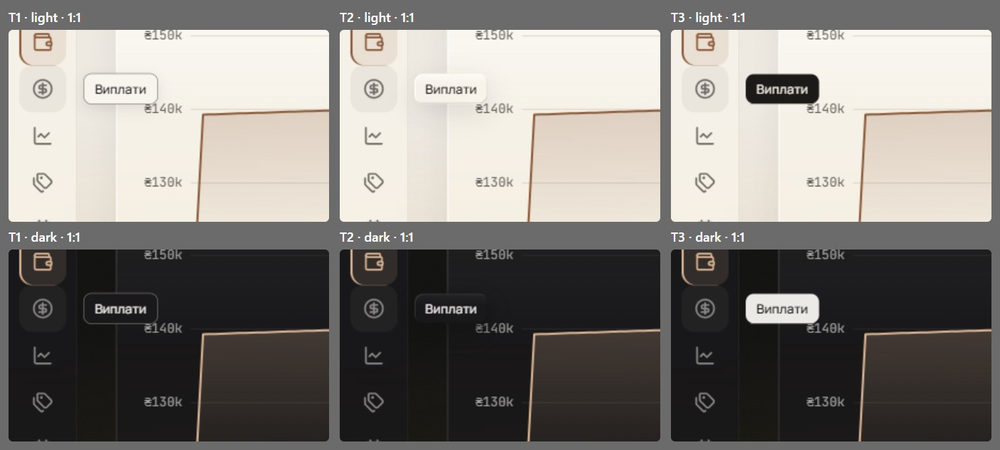
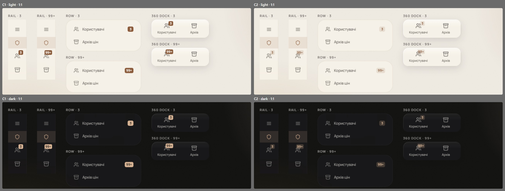

# The rail, the collapsed shell and the account foot (wave 21)

The coverage audit of the old sheets found the shell's collapsed, signed-out and role states undrawn, and the account foot in conflict with the owner's earlier rulings. Wave 1 drew the rail with no capital and no header, and never said so; the code keeps the capital in `AppHeader` while the rail is collapsed (`Layout.tsx`: `showHeader = !desktop || collapsed`), as `parchment-sidebar` T4 ruled. As wave 1 draws it, the rail is too tall for a 13" laptop window. This wave settles where the capital lives, the rail at a short window, the account foot, and the rail's hover label and counts.

It overturns wave 1's foot drawing and its rail foot ([shell.md](shell.md#signed)); wave 1's 64 / 44 r12 rail geometry stands. It also overturns `parchment-5h`'s "badges are accent-tint only".

## Renders

Every pick together, expanded and collapsed, at 1440, 1024 and 768, in both themes.

The expanded panel's foot (A2), signed in, signed out, and while `/me` is unread, in both themes at 1:1.

The collapsed rail's foot: currency, Settings, profile and «Вийти»; signed out, «Увійти» alone.

The hover label on «Виплати», with the item's H2 hover, light over dark: T1 (signed), T2, T3 from the left.

The count at «3» and «99+» on the super-admin's rail with its role strip, in the row and on the 360 role dock, light over dark: C1 (signed) and C2.

## Signed

- **The collapsed shell's header (R1),** at md and up, only while the rail is collapsed; below md it is wave 5's 360 bar.
  - 56 px tall, sticky, the wave 4 / 15 glass (`card` 80 % dark, 70 % light, blur 30, saturate 180), a 1 px hairline under it, square corners (a full-bleed band), padding 0 36.
  - Left: «ЗАГАЛЬНИЙ КАПІТАЛ» in the label role (11 / 14, caps, .12em, `muted`) over the figure (Manrope 18 / 600, `ink`).
    - *Answered by wave 25: header capital 18 joins the display row, with K2 ([open-values-charts-type.md](open-values-charts-type.md#signed)).*
  - Right: the change (11 / 600, `pos` or `neg`) over «$ · НБУ rate» (11, `muted`); the dataset caution sits here as today.
    - *Answered by wave 26: the line is wave 23's dated H3 line, and there is no caution: it was the DEMO badge ([open-values-shell-controls.md](open-values-shell-controls.md#signed)).*
  - The super-admin: the shield (18, `accent`) and «Суперадмін» (Manrope 15 / 600) instead of the figure.
    - *Overturned by wave 26: «Суперадміністратор» at every site ([open-values-shell-controls.md](open-values-shell-controls.md#signed)).*
- **The rail (O3), tighter gaps, scroll below 670 px.**
  - 64 wide, flush left, glass, a 1 px hairline on the right, padding 8 / 0, no gaps; items 44 × 44 at r12, icons 20; group hairlines 28 × 1 with 2 px margins. The hit areas touch without overlapping.
  - The foot: the currency box (40 × 32, r9, `field-border`), Settings, profile, «Вийти».
  - 669 px tall: it fits from 670; below that it scrolls inside `Scroller` with the overlay thumb (4 px, `ink` 28 %, never a gutter).
  - Signed out, «Увійти» alone replaces profile and «Вийти».
  - The super-admin: a 64 × 40 full-bleed role strip under the menu (`accent-tint`, the shield 18 in `accent`), then «Користувачі» (with the count) and «Архів цін».
- **The expanded panel's foot (A2, as shipped).**
  - Settings, a hairline, then the address as the profile link: a 36 px row at r9, the profile glyph 18 in `sb-icon`, the address 12 px in `sb-item`.
  - Then «Вийти» as a full 44 px r12 row in Settings' recipe, last (the owner's ruling).
  - Signed out: «Ви не ввійшли» as a 36 px status row in `muted`, then «Увійти» as the row.
  - While `/me` is unread, the slot is held empty at the signed-in rows' height, so nothing moves when the answer lands.
  - Legal: «Конфіденційність · Умови» (11 / 14.25, links underlined in `sb-item`), the version on a second line 4 px under it in `sb-label`.
  - On /profile the address row takes the nav row's active state, in the panel, the «Ще» sheet and the dock.
- **The rail's hover label (T1, as shipped).**
  - `card` fill, a 1 px `field-border` edge, r8, padding 6 / 10, 12 / 16 at 500 in `ink`, and a `0 4px 12px` `ink` 10 % shadow in light only. It is today's `Tooltip.tsx`.
  - Wave 15's glass scope names it as the one solid floating label.
- **The count (C1), solid accent.**
  - `accent` fill, `accent-fg` text, 11 / 700.
  - On the rail and the dock, a 16 px box at r4, 2 px inside the item's corner; in the row, 20 × 18 at r5, right-aligned.
- **Motion.** The collapse keeps today's 260 ms width tween and the header's 220 ms fade with a 4 px rise, on `ease-soft`; reduced motion makes both instant. No new motion was decided.
- **The `sb-*` tokens.**
  - Kept: `sb-item`, `sb-item-hover`, `sb-icon`, `sb-indicator`, `sb-label`.
  - Retired once the implementation confirms them unused: `sb-bg`, `sb-field`, `sb-footer-bg`, `sb-divider` (the hairline replaces it), `sb-border`, `sb-item-active-bg` (wave 1's `accent-tint` replaces it).
- **Records.**
  - Wave 1's foot drawing (the tile and the glyph-only sign-out) and its rail foot are replaced by A2 and the rail above.
  - `parchment-sidebar` T4 (the capital in the header) is kept by R1; its 56 px rail and its T3 / T7 measurements retire.
  - `sign-out` T7, `own-account`'s address link and `terms-of-use`'s two-line foot are kept.
  - `admin-users` T2's count gains «99+» at wave 5 / 10 geometry.
  - `super-admin-shell`, `sign-in-entry` and `account-way-in-and-out` are answered by the states above.
- **Wave 24 moves the fit point.** The rail head takes the 40 plate over the burger and grows by 18 px, so the 670 px fit point moves to about 688, measured at implementation ([brand.md](brand.md#signed)).

## Rejected

- **R2, a compact figure in the rail's head** («149 тис.» over «₴ · +3,1 %»): a rounded figure, no dollar figure, and no room for the dataset caution.
- **R3, no capital while collapsed:** on every screen but «Огляд» the figure is a press away.
- **O1, the whole rail scrolls:** no precedent, and the account and sign-out start below the fold on a short window.
- **O2, the foot condenses behind «…»:** Settings, the currency and «Вийти» take two presses wherever the rail is collapsed.
- **A1, wave 1's foot** (a 34 px tile with «Профіль» over the address, a glyph-only «Вийти»): it overturns the owner's rulings in `sign-out`, "the sign-out a pill like its neighbours" and "the sign-out last", and a glyph-only sign-in reads as a puzzle when signed out.
- **A3, wave 1's tile with the rulings on «Вийти»:** its one-line legal overrides `terms-of-use`'s two lines.
- **T2, P2 glass:** over the dark rail the glass nearly vanishes. **T3, an `ink` chip:** a loud new surface for a passing label.
- **C2, `accent` tint:** on the rail and the dock the icon's strokes show through «99+», and the count reads weaker than the glyph it marks.

## Settled by research

- **Where a headline figure goes when a sidebar collapses** is not covered: WinUI's NavigationView, Material's rail and Apple HIG are silent, so R1 is a design choice.
- **A rail is not built to scroll.** Material's rail holds "three to no more than seven app destinations when collapsed", and its scrolling is off by default; WinUI's compact pane says nothing on overflow. No source scrolls a rail, so O3 keeps every item and scrolls only the last pixels at the shortest windows.
- **The 99 cap** is Fluent's `overflowCount = 99`.

## Settled by the brief

- **The hover label's behaviour.** It opens on hover after 300 ms (200 to skip between items) and at once on keyboard focus; it closes on Escape and on pointer-out; it sits 16 px to the item's right, centred on it; its text is the item's accessible name.
- **The count's cap.** Over 99 it reads «99+», named «понад 99» to screen readers, and the box grows to the left (padding 3 on the rail and dock, 5 in the row).
- **No legal line in the rail.** The expanded panel, the signed-out pages and /profile carry it.
- **The super-admin's foot** has the same rows, under wave 10's theme-only control.

## Not drawn

- No new motion: the collapse keeps today's tweens, so none was played.

## Перенесено

Rules of the sign-in entry, the sign-out and /profile that no code, test or decision records.

- **Why the entry is «Увійти» and not «Вхід».** «Вхід» is a noun, where the «Вийти» it replaces in the slot is a verb.

The sign-out:

- **No confirmation before signing out.** NN/g: "Do not use confirmation dialogs for routine actions".
- **A failure of the shell's sign-out is a toast, never a sentence under the control.** The rail has no room for one, and one mechanism serves all three shells.
- **The failure toast leaves when it is closed or a retry succeeds,** not at the retry's press.
- **After a Stop the logout is not sent again.** The halt is the user's own act, and the page would leave against it.
- **No timer ends the busy state.** No clock knows whether a redirect is still loading.
- **Back to a restored page does not reload it.** The page restored holds no figures to clear.

/profile:

- **The deletion card's shift is accepted** when the passkey list lands above it: a press in it only opens the confirmation.
- **«Скопійовано» replaces «Копіювати» in place,** with no motion of its own: an exception to *Interaction rules*.
- **No fact names how the current session signed in.** Cognito's ID-token page says its `amr` claim is rolling out gradually and may not be available to a pool, so the page cannot rely on it. The one place the page names the method is the passkey card's note after a Google sign-in (*Auth model*).
- **No «Пошта підтверджена» fact.** OIDC makes `email_verified` optional, and the address is a label (*Auth model*).
