# The shell (wave 1)

Wave 1 sets the app's frame: the expanded and collapsed sidebar at 768 and up, the ambient glow behind the content, the page's header, hero, sections and figures, and the top bar and dock below 768. It was decided in Step 0 (three rounds) and Steps 1, 4 and 5, on /overview, then composed on three test views. Glass on the content cards was rejected here and taken up again in wave 2 (glass.md).

## Renders

/overview is the composed page. On / and /balances the content is the app's own screen inside the new shell, so only the shell, the surface and the card edge change there. The 1440 frames show an earlier grain (overlay blend at 5 %); the signed grain is below. The 360 frames are 360 × 740, and none scrolls sideways.

### 1440, dark

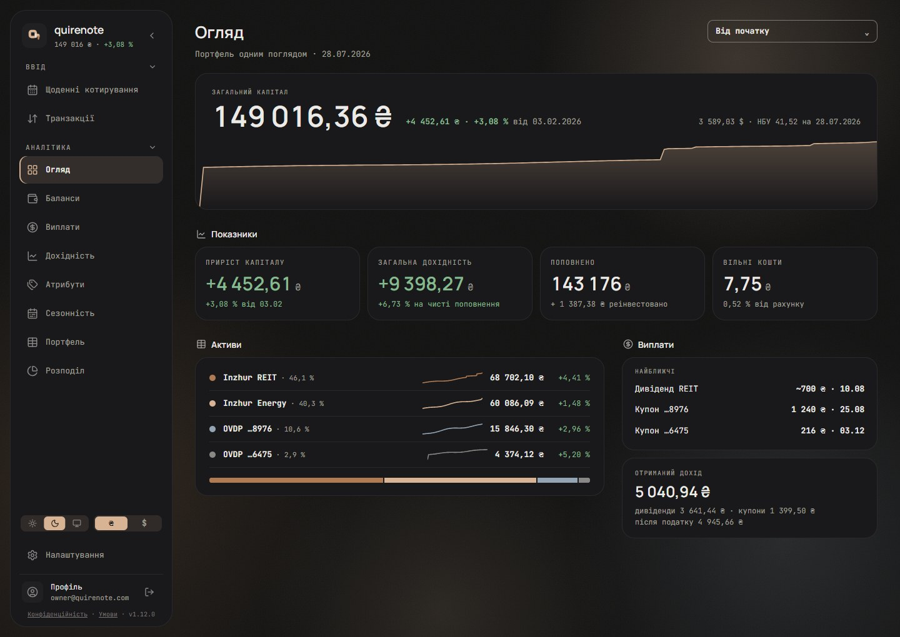

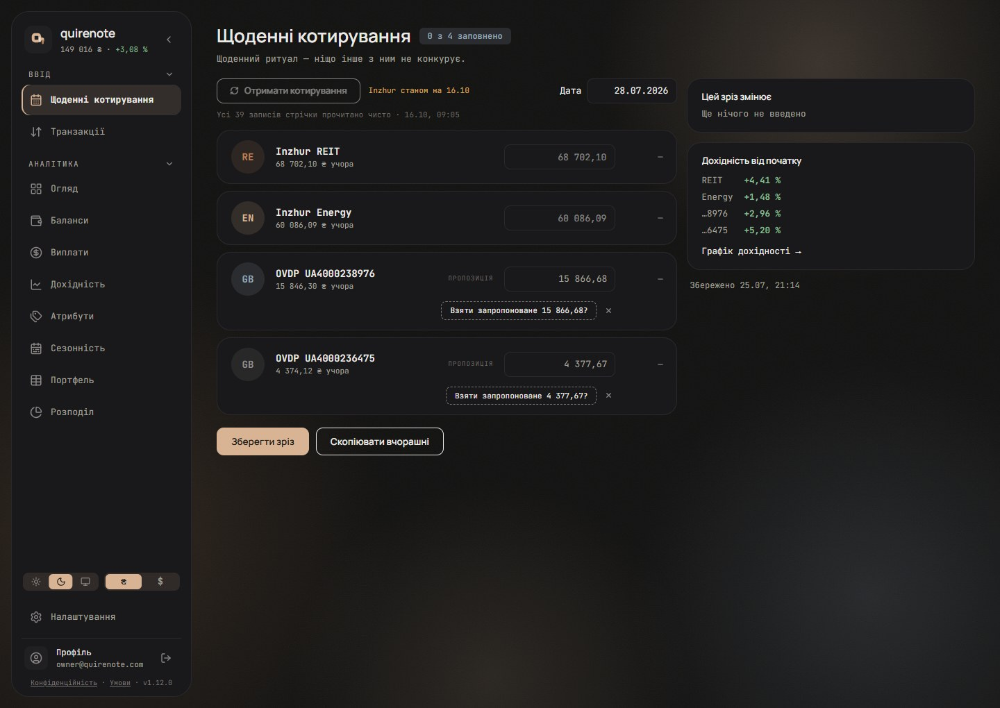

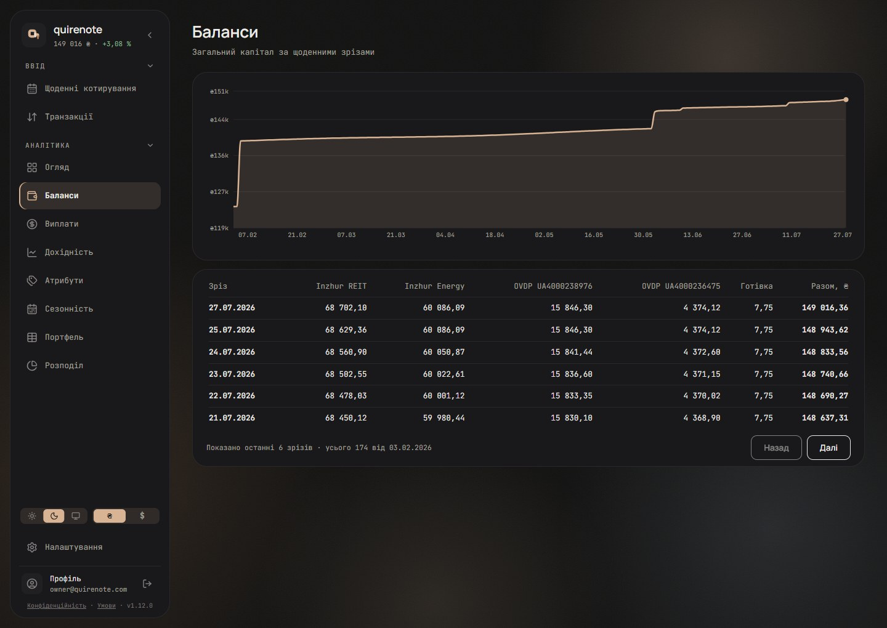

### 1440, light

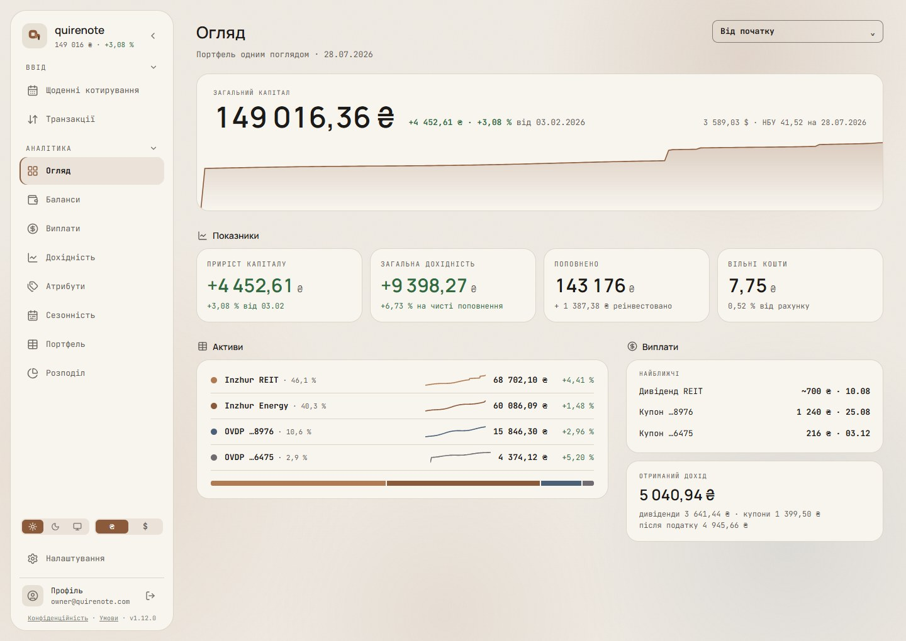

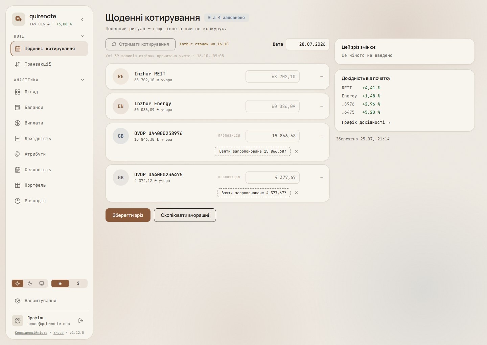

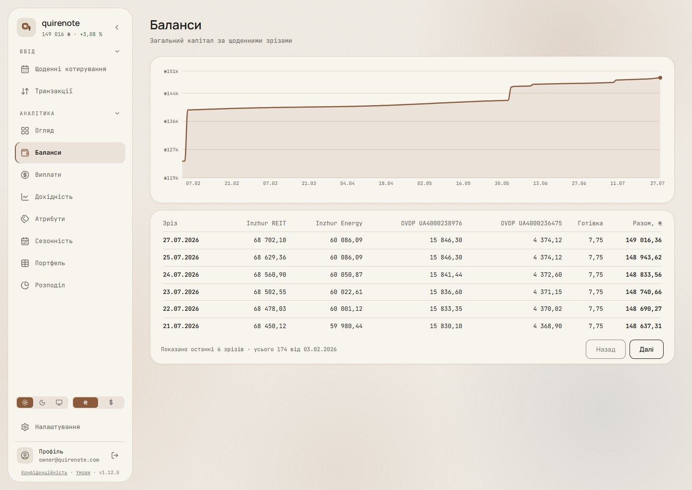

### 360, dark, then light (Огляд · Котирування · Баланси)

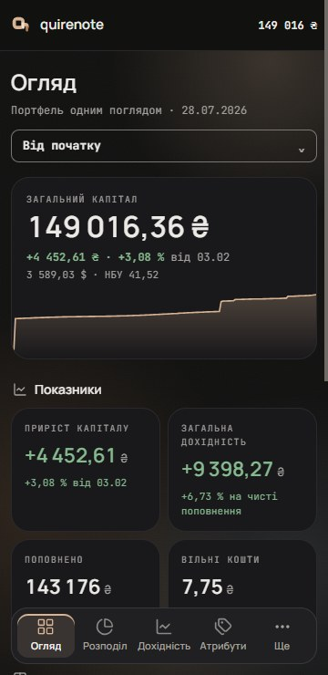

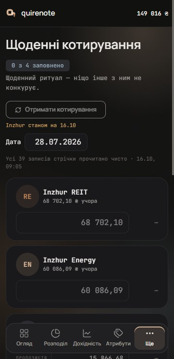

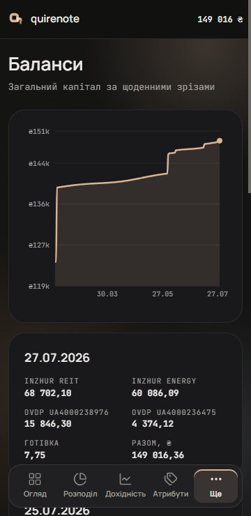

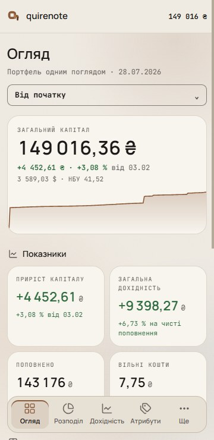

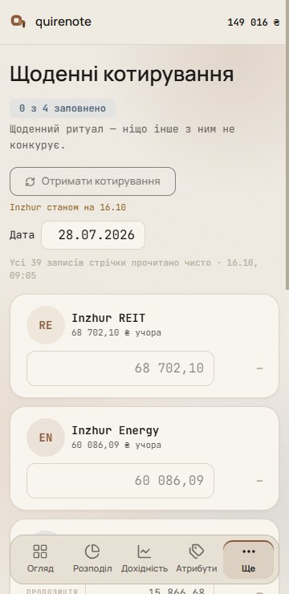

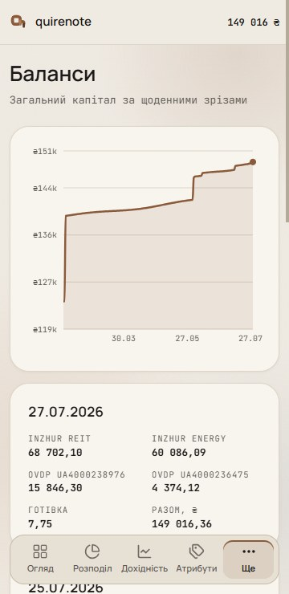

## Signed

Wave 2 later puts glass on the content cards, the sidebar and the dock ([glass.md](glass.md)). The solid fills, edges and "no blur" below are wave 1's, and they stay as the glass's opaque fallback.

- **Direction (Step 0).** Round 1 asked which reference leads; the answer was a mix of B and D. Round 2 picked E3: D's page (26 px title + subtitle, today's period select, a hero capital card with an axis-less area chart, icon + label `<h2>` sections over solid bordered cards) on B's ambient glow + grain. Round 3 gave the sidebar the anatomy of the owner's canvas (logo tile, uppercase groups, 44 px rows at r12, tint + 2 px indicator, account row at the foot) and settled F3, the 64 px icon rail, as the collapsed state. Its expanded form went to Step 1.
- **Picks.** Step 1: G1, a floating card. Step 4: H3, the canvas tile anatomy plus word-sized value lines in the assets table. Step 5: M3, the floating dock with «Огляд · Розподіл · Дохідність · Атрибути · Ще».
- **Steps 2 and 3** (the surface; the header and sections) were settled by those picks: solid cards over the glow, since translucent and frosted cards rendered identical to solid at a safe glow strength.
- **Tokens.** Every colour is an existing token in `src/index.css`. Nothing new is minted except the glow alphas, and those are alphas on existing hues.
- **Held for every variant.** Today's tokens only: a glow is a token through `color-mix` at ≤ 20 %, never a new hue. No capsules: the references' pills are redrawn as rounded rectangles on the 0.26 / nested rule.

### Shell, 768 and up

- **Sidebar, expanded (G1).** 260 wide; margin 16 top, left and bottom (height 100dvh − 32); `card` fill; 1 px hairline; r26 (nested: row r12 + 14 padding); padding 16 14 12; column gap 2. No blur. The glow shows around it.
- **Header.** The 5h mark at 22 px in a 40 × 40 `panel` tile at r12; «quirenote» in Manrope 17/600; an 11 px `muted` subtitle: the capital (whole ₴) · its change in `pos`; a collapse chevron 16 in a 28 box.
  - *Overturned by wave 24: the solid «q» on a 40 plate at r10 ([brand.md](brand.md#signed)).*
- **Group label.** 11 px, uppercase, .14em, `muted`; padding 6 (first) / 14 (next) 10 4; a collapse chevron 14 at `sb-icon`.
  - *Overturned by wave 18: section titles and sidebar groups are uppercase +.12em, 500 (L3) ([type.md](type.md#signed)).*
- **Row.** 44 tall, r12, padding 0 12, gap 12; 13 px `sb-item`; lucide icon 18 in `sb-icon`. Active: `accent-tint` fill + `inset 2px 0 0` `sb-indicator`, label `ink` 700, icon `accent`.
- **Foot.** Today's theme + currency control; «Налаштування» as a row; a hairline rule; the account row (a profile glyph in a 34 `panel` tile at r9, «Профіль» + the address in 11 px `muted`, sign-out 36); legal + version in 10 px `sb-label`.
  - *Overturned by wave 17: the theme and currency sets are the D2 segmented control ([controls.md](controls.md#signed)). By wave 21: the A2 foot, with the legal links and the version on two 11 px lines ([rail-and-account-foot.md](rail-and-account-foot.md#signed)).*
- **Collapsed (F3).** A 64 wide rail flush to the edge, 1 px hairline right, no fill. Menu 44; icons 20 in 44 × 44 at r12; a 28 × 1 hairline between groups; active as the row. The foot holds the currency box (40 × 32, r9, `field-border`), Settings, profile and sign-out. The menu button expands the rail.
  - *Overturned by wave 21: tighter gaps (O3), the foot's rows, and a glass header bar beside the rail for the capital (R1) ([rail-and-account-foot.md](rail-and-account-foot.md#signed)); by wave 24: the 40 plate stands over the menu, so the rail head grows by 18 px ([brand.md](brand.md#signed)).*
- **Content.** Padding 32 36 48. Inside a card, today's components; cards gain a 1 px hairline edge.

### Backdrop

- **Glow.** A fixed layer behind the content: four radial spots, `color-mix(var(--color-HUE) A%, transparent)`, fading to transparent at 68 % of the radius. The hues are `accent`, `reit`, `ovdp8976` and `energy`, at 20 / 18 / 16 / 12 % in dark and the same at ×0.7 (14 / 12.6 / 11.2 / 8.4 %) in light. The spots overlap at 360.
  - *Overturned in light by wave 15: each light glow hue sits at its own cap (B3) ([glass-light.md](glass-light.md#signed)).*
- **Why those caps.** `muted` sitting directly on a spot's peak must keep 4.5 : 1 (WCAG F83). At 20 % the light theme would fail, hence ×0.7.
- **Grain.** SVG `feTurbulence` noise at 3 % opacity, normal blend. An overlay blend left a hard compositing seam across the 360 frame.
- **Reduced transparency.** `prefers-reduced-transparency: reduce` drops the glow and the grain: the plain page. Safari doesn't report the query, so the default is built to pass on its own.

### Page

- **Header.** Unchanged: `ScreenHeader`, 26 px title, 13 px subtitle, the screen's control top-right (the period select on /overview). All six periods stay in one select, which already works at 360.
- **Hero (/overview).** One card: a 10 px label; the capital in Manrope 46/600; the change in `pos` 13 px 700 + «від DD.MM.YYYY» in `muted`; $ at the NBU rate, 12 px `muted`, right-aligned; an axis-less area of the /view/balances totals, 110 tall, full card width, stroke `accent` 1.6, fill `accent` 26 % → 0.
  - *Overturned by wave 23: the rate line sits under the change, left-aligned, at every width (H3) ([loading-and-compositions.md](loading-and-compositions.md#signed)); by wave 18: the label is 11 px and the ₴ steps back to 70 % ([type.md](type.md#signed)).*
- **Sections.** A real `<h2>`: a lucide icon 16 `muted` + the label in Manrope 14/600 `ink`, gap 8, 10 below; section gap 28. On /overview: «Показники» (4 tiles), then «Активи» (1.6fr) | «Виплати» (1fr).
  - *Overturned by wave 18: 14 px maps to the body role, 13 / 18 ([type.md](type.md#signed)).*
- **Tile (H2's anatomy).** Padding 16, stack gap 8; label 11 px uppercase .12em `muted`; value Manrope 30/600 −.02em, with the ₴ split off at 15/500 `muted`; sub 12 px. At 360: 2 columns, value 22, label 10, sub 11.
  - *Overturned by wave 18: the label is 11 px in sentence case, the value takes −.01em, and the ₴ is 70 % `muted` 500 (K2) ([type.md](type.md#signed)).*
- **Asset row line (H3).** 96 × 22 (56 × 20 at 360), axis-less, stroked in the asset's hue at 1.6, no fill, from first purchase. Read from /view/balances. The name stays beside it, so colour is never the only cue. The table stays a table.

### Mobile, below 768

- **Top bar.** 56 sticky, `page` fill, hairline bottom; the mark at 20 + «quirenote» in Manrope 15/600; the capital in whole ₴ at the right. No burger.
  - *Overturned by wave 24: a 28 plate at r7 with the «q» at 15 ([brand.md](brand.md#signed)).*
- **Dock (M3).** Fixed, 12 from the left, right and bottom (+ safe area); `panel` fill, 1 px `panel-border`; padding 6, gap 2; r18 (item r12 + 6). Five items of 48 × flex: lucide 20 + a label in Manrope 11/600. Active: `accent-tint` + `inset 0 2px 0` `sb-indicator`, label `ink` 700, icon `accent`: the horizontal twin of the sidebar's. A route not in the dock marks «Ще».
- **Tabs.** «Огляд · Розподіл · Дохідність · Атрибути · Ще». «Ще» holds Котирування, Транзакції, Баланси, Виплати, Сезонність, Портфель, Налаштування, the account and legal. All five labels fit at 360; with the inset, «Котирування» would truncate there.
- **Scroll.** Content bottom padding 96, plus `scroll-padding-bottom` ≥ the dock's height + 12 + the safe area, so a focused control never sits under the dock (WCAG 2.4.11).

### Contrast

- **Active.** The active label is `ink` on `accent-tint`, in the sidebar and the dock. This repairs today's recorded shortfall, where the active label was `sb-item-active` in light. The active icon in `accent` is non-text and needs 3 : 1.

## Rejected

- **A, Energy (the HA energy dashboard leads):** a new section grid and section headers, and wide tables would have to fit a 320–500 column, so names use the short form.
- **C, Minimal (the HA minimal home leads):** navigation is hidden on desktop by default, which NN/g found halves discoverability, and every tile needs its series from /view/balances.
- **E1, B's header + D's hero:** the tallest page, so the assets fall below a 900 px fold; its period tabs replace the select, and six options fit at 1440, not at 360.
- **E2, B's header + B's KPI row:** no history on the screen, only the KPI row; the same tabs.
- **A greeting header and big period tabs (E1, E2):** six tabs don't fit 360.
- **B's translucent cards (α 0.72),** rendered as a fourth blend in round 2: indistinguishable from solid cards.
- **A frosted F1 and a frosted sidebar:** identical to solid over this backdrop.
- **Glass on content cards:** invisible at a legible glow; Apple HIG and Fluent keep glass to chrome. Overridden by the owner's ask in wave 2.
- **F1, the floating solid card, and F2, the same anatomy on a flush wall,** went on to Step 1 as G1 and G2.
- **G2, the flush wall** (today's placement: full height, the `sb-bg` wall, the r30 outer corner, the `field-border` edge): the least change, since the wall tokens and the corner are today's.
- **G3, inset content** (the sidebar unboxed on the `sb-bg` wall, the content as the raised plane at inset 10 px, r24): the content scrolls inside a framed box, so it needs Scroller there, and the wall becomes the outermost plane, which reverses today's order.
- **H1, today's figures** (`KpiCard` as it is: a 10 px uppercase label, a 22 px value with its ₴ inline, an 11 px sub-line): no change.
- **M1, the drawer (today's model):** NN/g measured hidden navigation cutting discoverability almost in half.
- **M2, a full-bleed bottom bar with 4 + «Ще»:** it needs a «Ще» sheet and scroll padding too, and Apple warns a More tab hides what's in it.
- **Gauges:** Few's bullet-graph spec; NN/g prefers length over angle.
- **A desktop dock, or a rail-only desktop:** WCAG 2.4.11; NN/g on hidden navigation. The rail survives as the collapsed state.
- **From the owner's canvas:** the round avatar (Two shells rejects one; a profile glyph tile instead), pill badges and the pill dock (Shape system: no capsules), the fill-only active row (WCAG 1.4.1, Interaction rules), ⌘K (no search exists), Geist (Language, numbers, fonts), and its r24 card (r26 by the nested rule, 12 + 14).
- **Sparklines on gain, return and deposits:** no served series, and a rebuild from the ledger didn't reproduce the served figures. That needs a core series first.

## Settled by research

- **Glass belongs to floating chrome.** Apple HIG Materials (glass for floating chrome only), Fluent Acrylic, NN/g glassmorphism. At the glow strength that keeps `muted` text ≥ 4.5 : 1, translucent cards show nothing, so content cards stay solid.
- **The glow's cap** is set by WCAG F83: `muted` must keep 4.5 : 1 on a spot's peak.
- **The hero total + chart** follows Ghostfolio, IBKR and Trading 212. D is the research recommendation (hybrid header, sections, solid cards over the glow, Mica's model).
- **The floating sidebar** follows the owner's canvas (its Розподіл/Актив boards), shadcn floating (p-2, rounded-lg border shadow-sm) and Apple HIG: sidebars "can float above content".
- **The rail as the collapsed state only** follows HA's 56 px rail and the M3 rail (≤ 7 destinations collapsed). 10 destinations exceed M3's 7, and NN/g found hidden labels halve discoverability on desktop.
- **The tile anatomy** follows the canvas's «Зараз» tiles and the HA tile card (value + unit). A 30 px value is large text under WCAG 1.4.3; the 11/12 px lines still need 4.5 : 1, and `muted` on `card` clears it.
- **Word-sized lines in the table** follow Tufte, sparklines as "datawords… word-sized"; Few, "no context is more useful than history"; NN/g, tables for comparing records.
- **The floating dock** follows the canvas's Огляд dock and iOS 26's floating tab bar.
- **The 2 px active indicator** stays against the canvas (WCAG 1.4.1; ruled in Interaction rules).

## Implementation checks

- The H2 tile is a `KpiCard` variant.
- Each H3 row reads its column of /view/balances, a paged read the overview doesn't make today.
- The sidebar no longer touches the edge, so the collapse to F3 changes both its width and its inset.
- The `docs/DECISIONS.md` topic an implementation rewrites: Two shells, one breakpoint. Interaction rules' active-route sentence stays true.

## Not drawn

- The content of / and /balances, and the other eight screens. On / and /balances only the shell, surface and card edge change; their content waits for its own pass.
- Not decided here: palette values, the «Ще» sheet's own layout, the drawer's fate below 768 (the dock replaces it), the motion of the dock and the collapse, copy, and implementation order and issues.
