# Sign-in and the signed-out pages (wave 9)

The signed-out pages (/sign-in and its steps, /apply, the refused-caller answers, the app-failure page, and privacy and terms when signed out) are the last surface in the old look: a plain page, a solid bar, a solid card. Almost everything inside the card is already ruled by the record (the sign-in surface, the bot check, password reuse, the sign-out landing and the terms step), so this wave restyles the page around it.

## Renders

These are the real pages. The address step answers a passkey challenge (the OS sheet left pending) or a password challenge, and the application is recorded. In every frame the card keeps its recorded top and nothing scrolls sideways. The bot check is the real Turnstile widget on Cloudflare's test sitekey: its red «Тільки для тестування…» strip is Cloudflare's notice for that key and does not ship.

At 1440, dark: the address step with Google on, the passkey step, the password step, /apply, the recorded application, and the page after a sign-out with Google off.

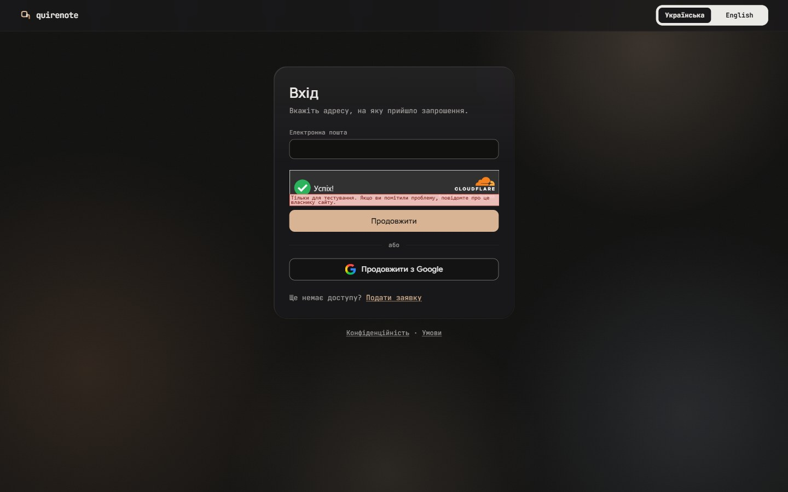

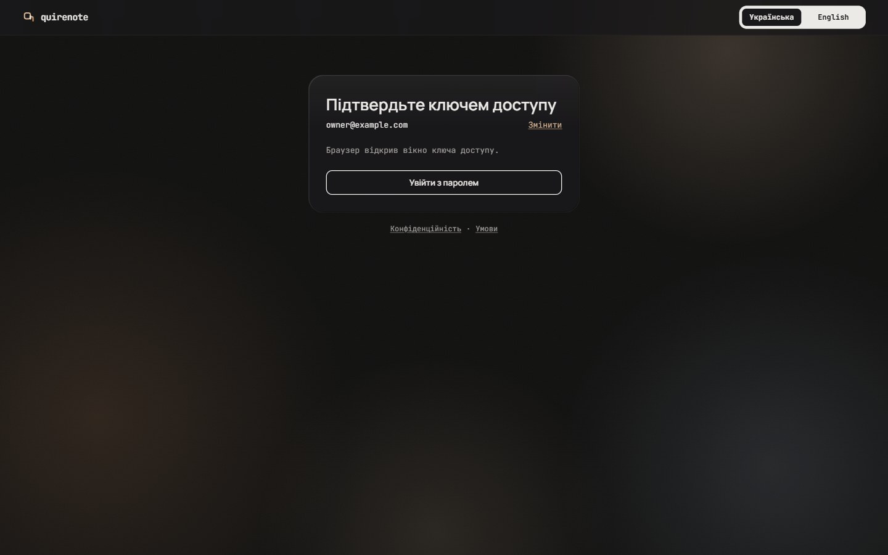

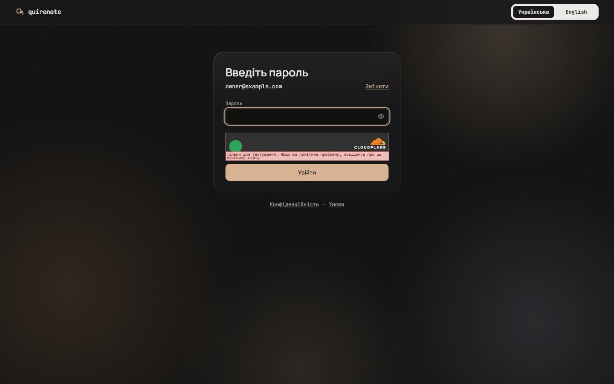

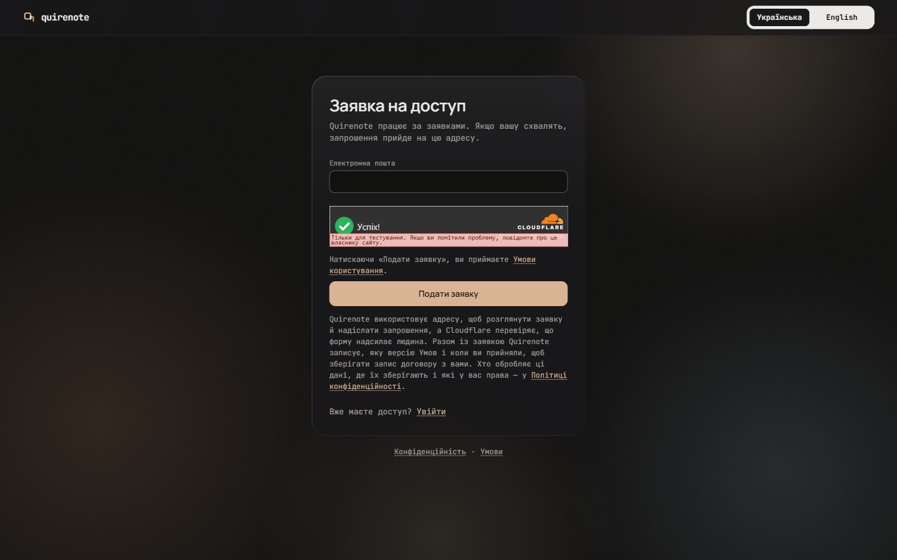

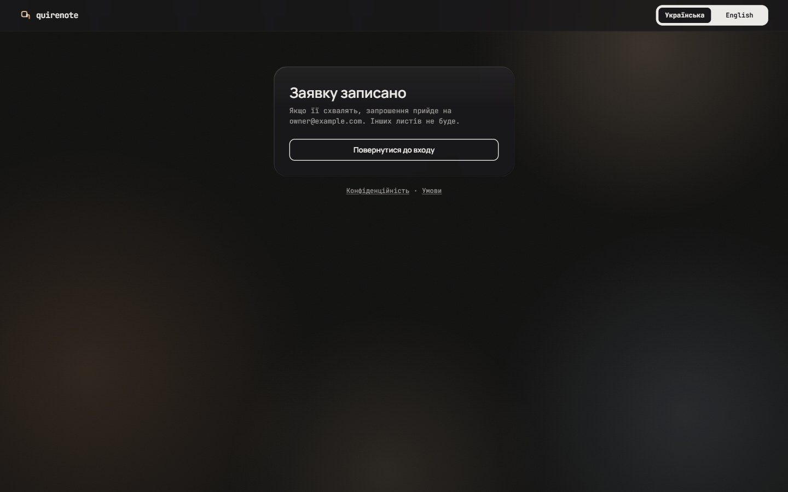

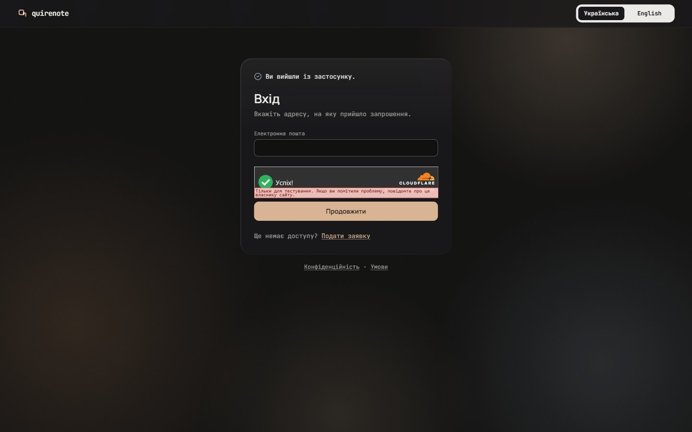

At 1440, light: the same five states.

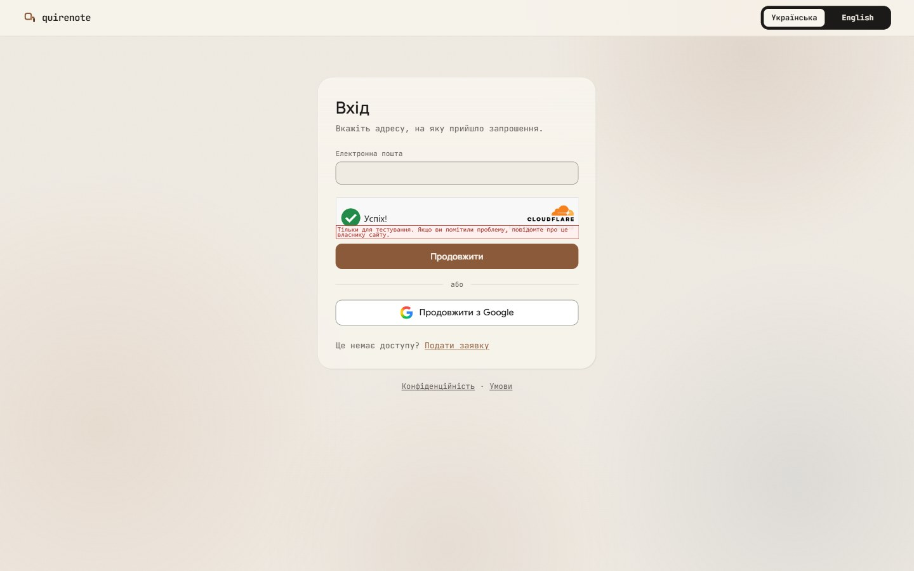

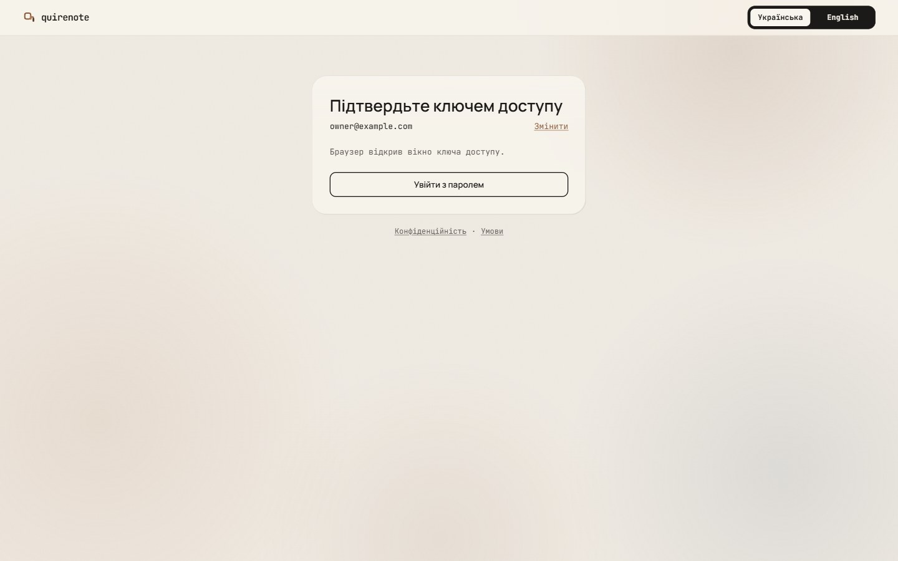

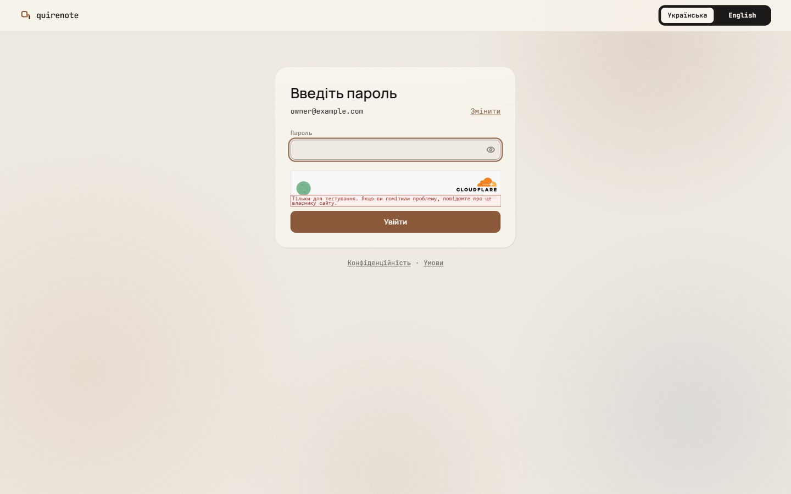

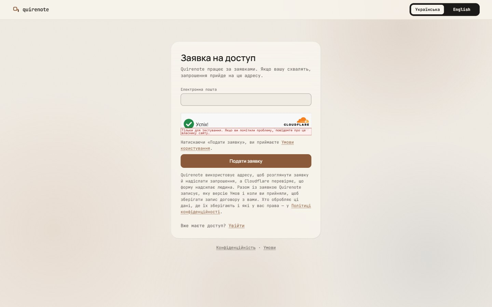

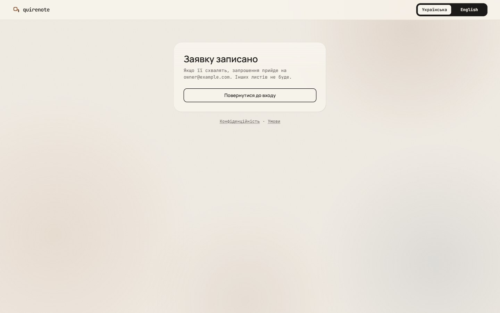

At 360, dark: the same five states and the page after a sign-out with Google off.

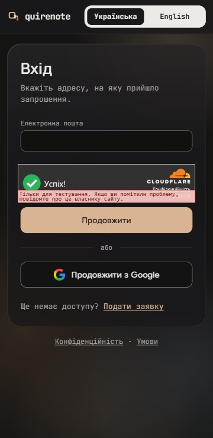

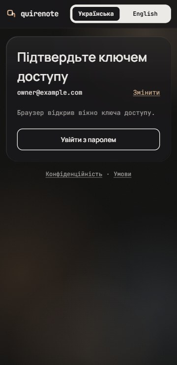

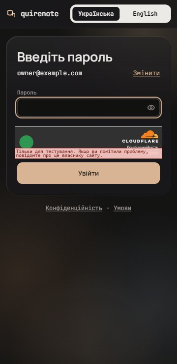

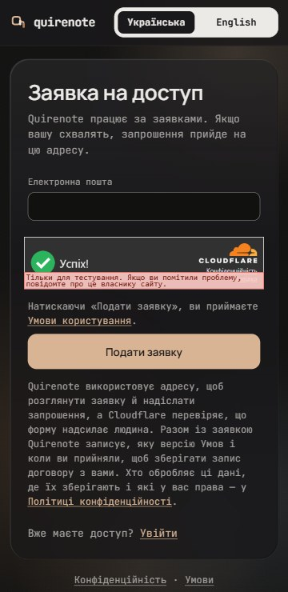

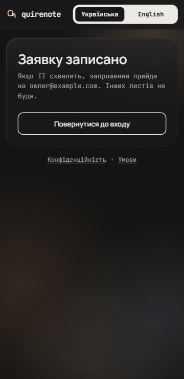

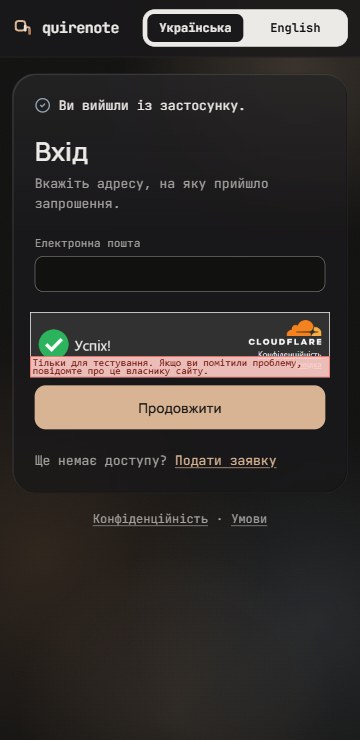

At 360, light: the same five states.

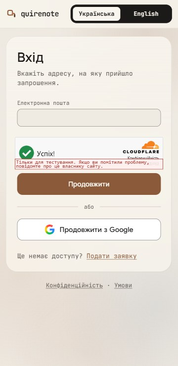

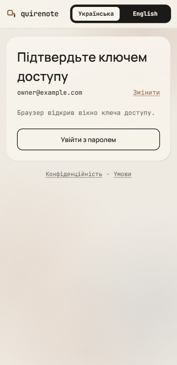

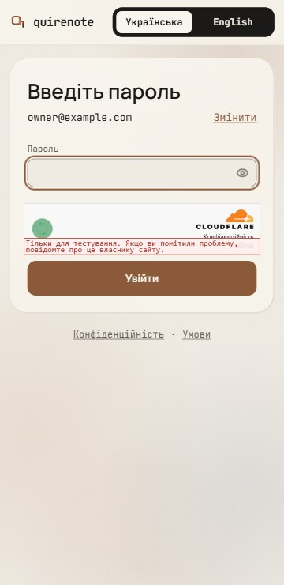

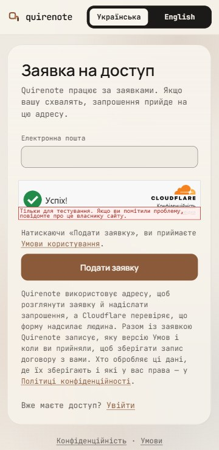

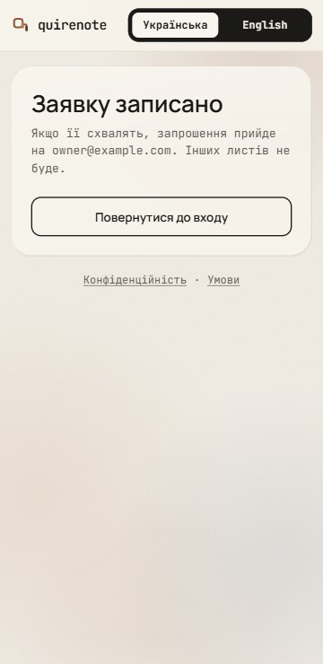

## Signed

- **Held from the record.**
  - A bar with the mark and the language control over one top-anchored card, with the legal links under it.
  - The card at 440 / 336, padding 28 / 22, r24, top 64 / 16.
  - Every step's content and copy.
  - "No refusal sentence moves its button".
  - Google's button in Google's own colours.
  - No theme control on the bar.
- **Page (P2).** The signed wave-1 glow behind everything: the asset hues at their caps (dark ≤ 20 %, light × 0.7), scaled to the viewport, and down at 360. The shell's `bg-page` stays underneath. The first screen anyone sees now matches the app behind it.
  - *Overturned in light by wave 15: each light glow hue sits at its own cap (B3) ([glass-light.md](glass-light.md#signed)).*
- **Card (C2).** The wave-4 glass (`card` 80 % with `blur(30px) saturate(180%)`), with bevel and sheen, as every card, the dock and the dialogs now are.
  - *Overturned in light by wave 15: the light fill is `card` 70 %, with the lit edge ([glass-light.md](glass-light.md#signed)).*
  - *Overturned by wave 26 for dialogs: they take `card` 90 % / 92 % ([open-values-shell-controls.md](open-values-shell-controls.md#signed)).*
  - Held: 440 / 336, padding 28 / 22, r24, top 64 / 16, and the legal links under it.
  - Turnstile and Google's button keep their own opaque fills, in their makers' colours.
  - The glass edge is drawn inset. Drawn as an outer border, it moves «Продовжити» at 360, and the record says the button never moves.
  - Over the calm glow the card reads as a tint more than glass (wave 4's finding).
- **Bar (B2).** 57 px, the wave-4/5 glass (`card` 80 % with `blur(30px) saturate(180%)`) with its hairline bottom, the same material as the portfolio's 360 bar. Its contents are held: the mark 22, «quirenote», the language control; no theme control. Only the fill and the edge change.
  - *Overturned in light by wave 15: the light fill is `card` 70 % ([glass-light.md](glass-light.md#signed)). By wave 24: the mark is a 28 plate at r7 with the «q» at 15 ([brand.md](brand.md#signed)).*
- **Contents.** Unchanged: every step, sentence and slot as the record has them. Fields already take the page fill (wave 8's F2).

## Rejected

- **P1, today's plain page** (the page colour, nothing behind the card): the one screen that does not look like the signed app.
- **P3, a split page with a brand panel** (the mark at 96 px and the wordmark at 44 px in the body face, beside the card): two lockups on one screen, though the record keeps the mark in the bar, and the panel says nothing the bar doesn't.
- **C1, today's solid card:** the one card left outside the glass language.
- **C3, bevel and sheen on an opaque card** (no backdrop filter): a third material, glass-looking but not glass.
- **B1, today's solid bar with a hairline** (the page fill): over the glow it reads as a dark band, a solid band across the top of a glass page.
- **B3, a bare bar** (the mark and the language control on the glow, no fill, no hairline): if the page scrolls (a long apply page at 360), the card slides under bare controls.

## Settled by research

- **A finance app may put everything behind sign-in.** NN/g: "highly personal (such as email or banking apps) are justified in raising login walls".
- **Centred card or split page** is a style choice: no source takes a position on it, and at 360 it is one column either way.
- **The glass bar** follows wave 5 (B2 + B3 for the 360 bar); **the glass card** follows waves 2/4/8; **the glow** is the signed wave-1 backdrop.

## Implementation checks

- `SignedOutShell.tsx` draws today's page, bar and card.
- `boundaries.test.ts`: AppFailure in the signed-out bar.
- `privacy-ways-in` and `terms-ways-in`: the links under the card.
- No test pins the shell's background or the bar's fill today. `language-holders`, `sign-out-landing` and `field-border` are unaffected.

## Not drawn

The same shell serves these, not drawn here:

- the refused-caller answers;
- the app-failure page;
- /auth/callback;
- privacy and terms when signed out.

## Перенесено

Rules of sign-in, the bot check, the first sign-in and the Google callback that no code, test or decision records.

- **The language control has no flags.** Its languages' own names, as on /settings, say what a flag would.
- **One address box for sign-in and application is refused.** It would branch on whether the address has an account and say so to anybody typing one; `/apply`'s constant answer exists to prevent that.
- **No password confirmation field.** The show toggle catches the typo a second field was for.
- **The page never compares the new password with the temporary one.** The pool's password history is the one rule; a second copy in the page could drift from it.
- **A refused new password keeps what was typed.** No refusal clears the field.
- **The app draws no edge around the bot check's frame, and owes none.** The checkbox inside it identifies the control, and WCAG 1.4.11 asks for no boundary around a control whose own content identifies it (Understanding 1.4.11, *Boundaries*).
- **The compact widget is refused.** It breaks the full-width column the fields and buttons share, and stands taller than the flexible one.
- **The card keeps its padding for the widget below md.** A narrower padding would move every auth page to fit one control.
- **No privacy line under the widget on /sign-in.** The widget carries its own «Конфіденційність» link. The privacy first layer under `/apply`'s button is the legal notice (*Legal documents*), not the widget's.
- **The passkey retry's widget slot and link fade in with its sentence,** on StepAlert's 200 ms fade.
- **The sentence on the new password's rule line fades in over 200 ms on `ease-soft`,** as the rule's own refusal does; nothing slides, since the line's height does not change.
- **The busy controls of the way in and out owe no contrast minimum at their 70 % dim.** WCAG 1.4.3 and 1.4.11 set none for an inactive component, and each is aria-disabled or disabled while it is drawn so.
- **/auth/callback is never the bar alone.** It would leave the page blank for seconds on a cold relay, with nothing saying the system is working.
- **On a sign-in's return, /auth/callback never shows the portfolio's placeholder.** A refused return would show the shell to a caller who is not signed in, then drop to /sign-in.
- **No spinner on /auth/callback.** The busy state is a word with an ellipsis.
