# Tables and ledgers (wave 6)

Баланси, Портфель and the payout log are real tables. The Транзакції ledger and the Щоденні котирування rows are lists. This wave settles how all five read in the new shell and glass, at 1440 and 360. It carries two owner rulings: a sticky header on every table, and infinite scroll instead of paging.

## Renders

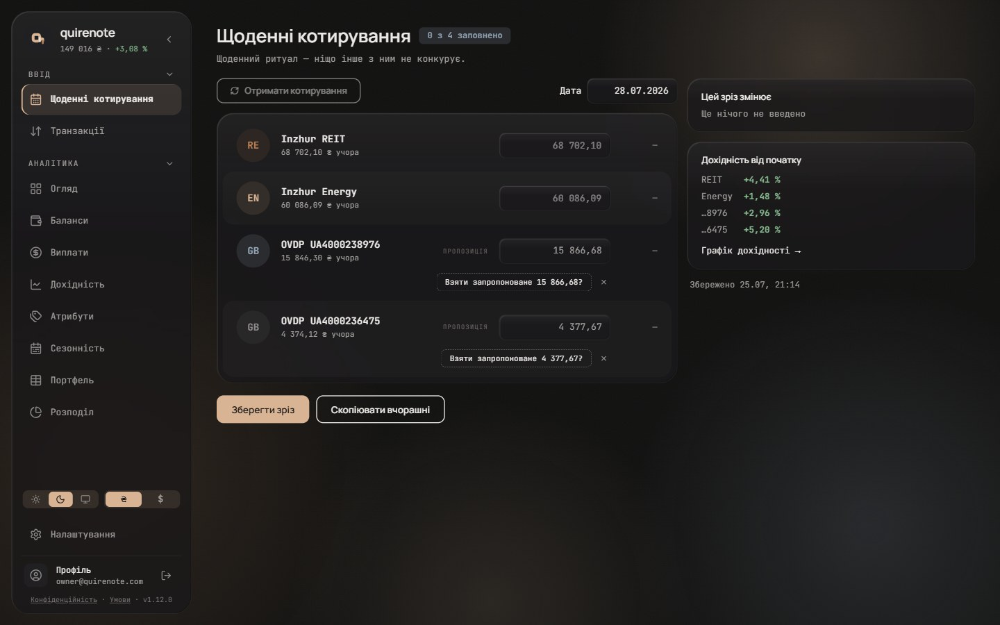
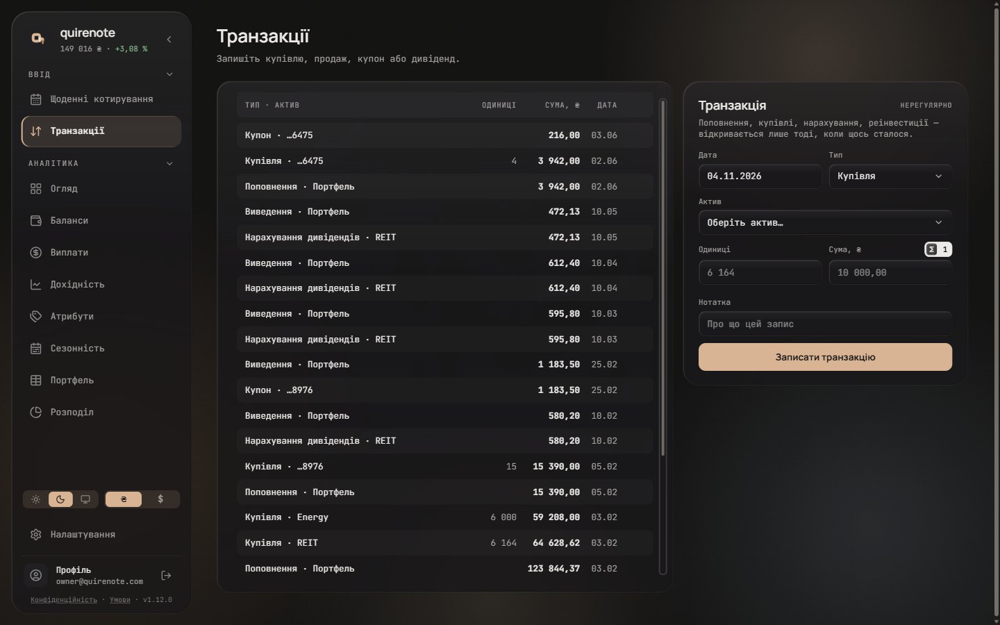
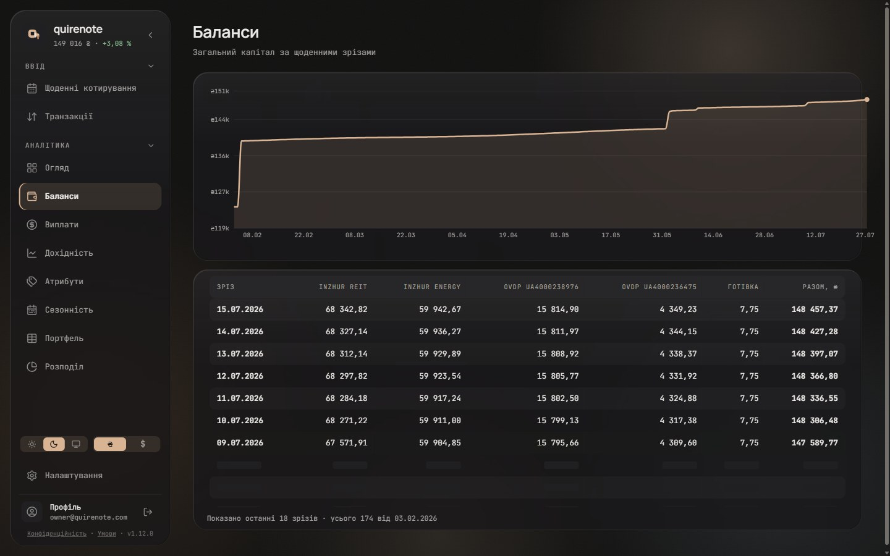
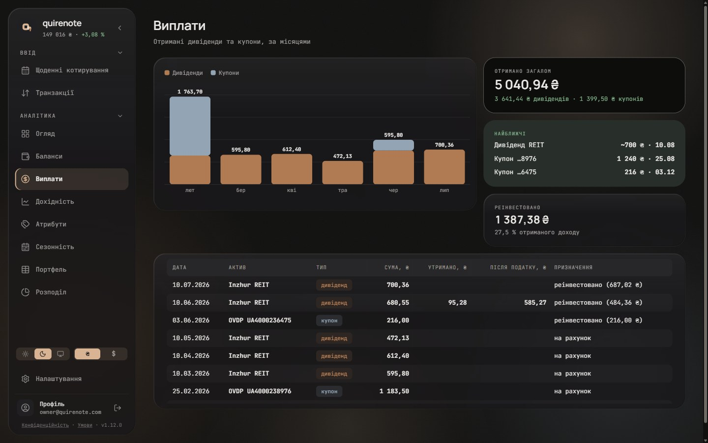
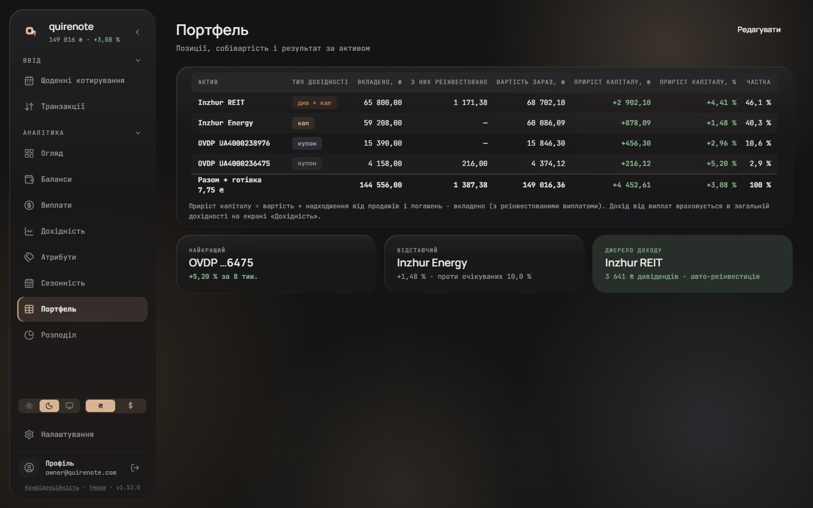
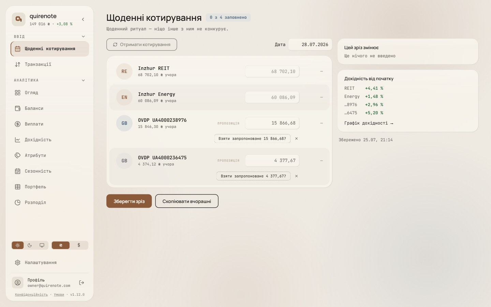
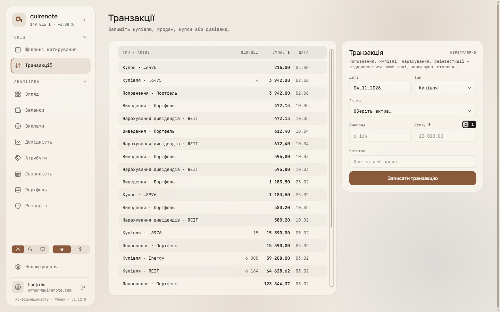
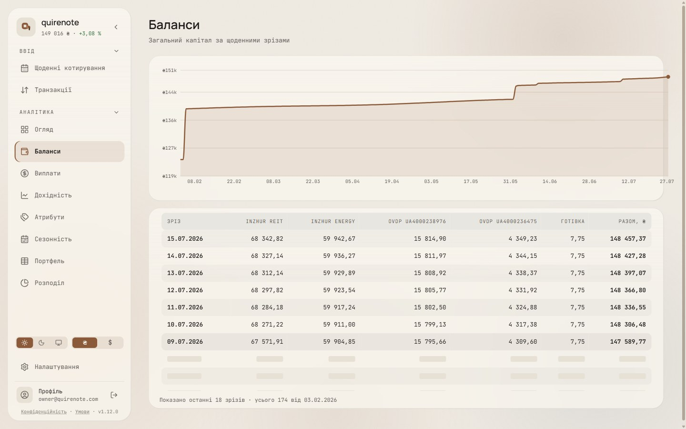
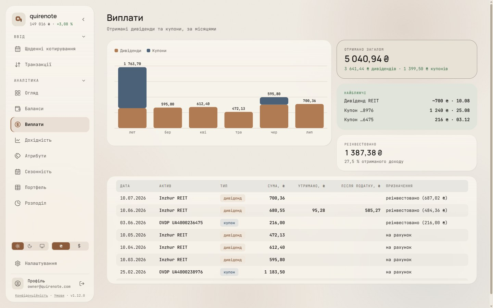
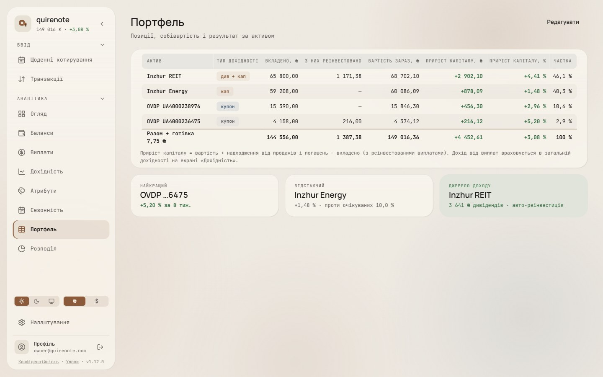

1440, dark and light: the four quote rows in one card, the ledger as a table, and the three tables under the header band.

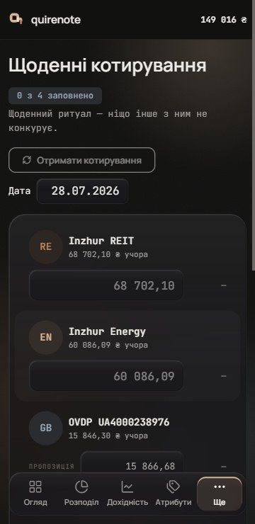
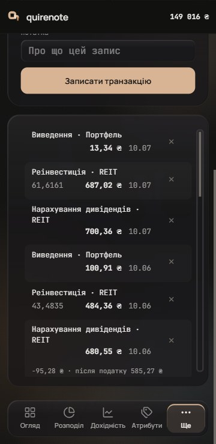
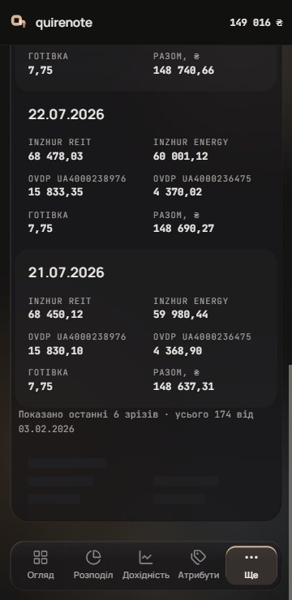
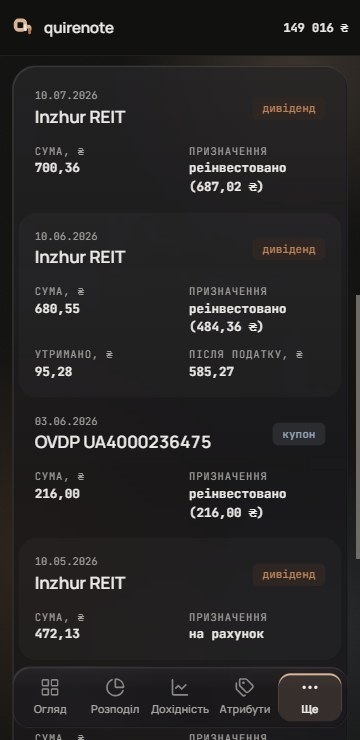
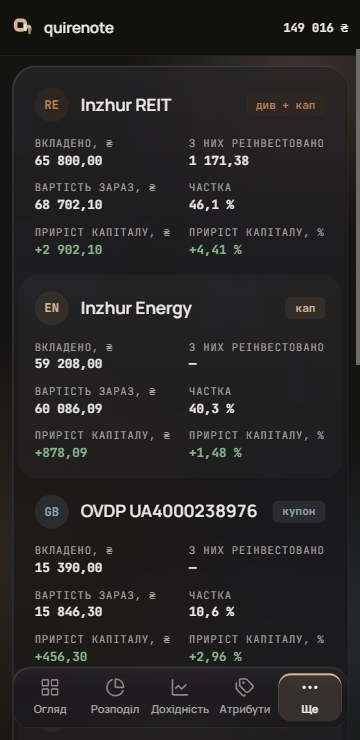
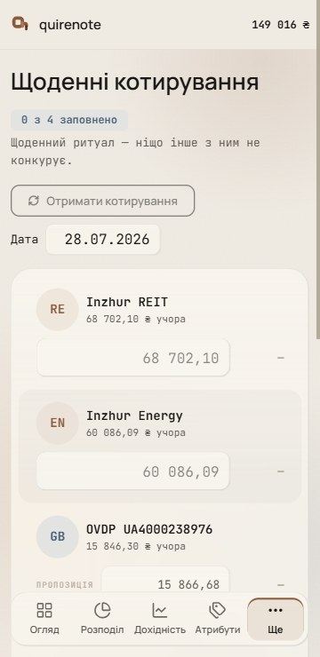
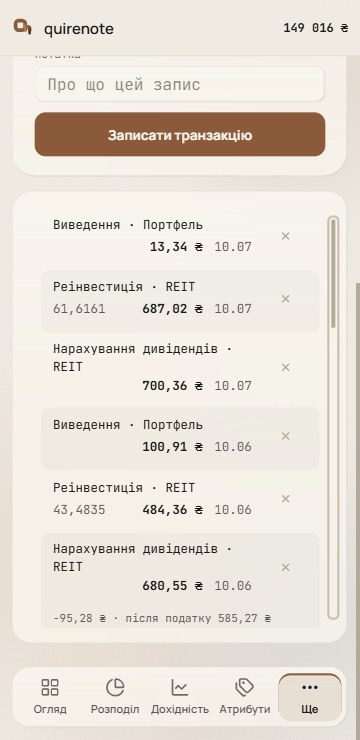
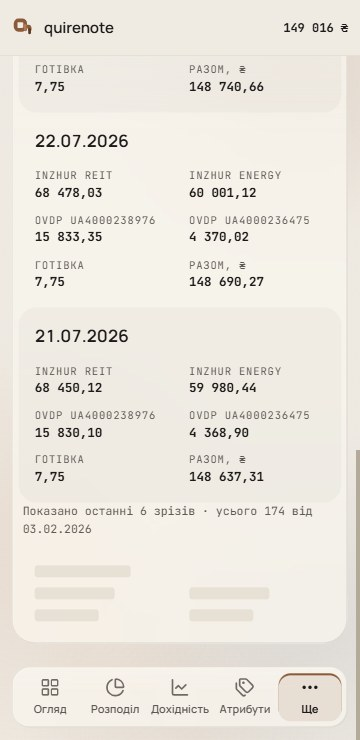
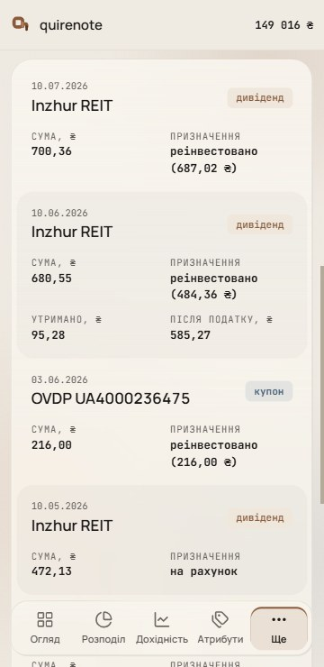
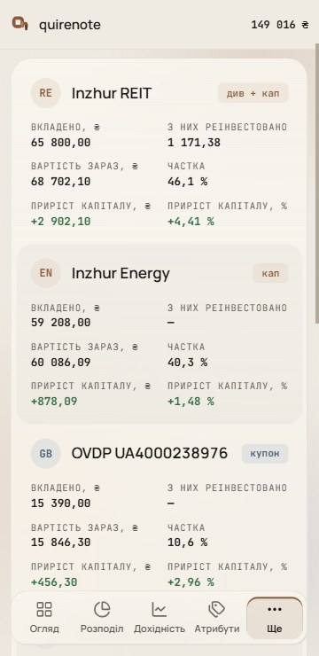

360, dark and light: the records in one glass card, and the ledger in two-line rows. No frame scrolls sideways.

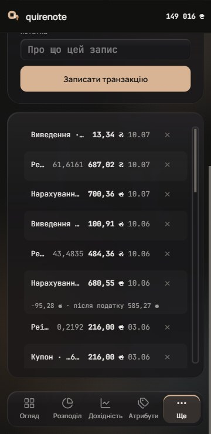

Today's one-line ledger at 360, for comparison: its labels are cut.

## Signed

- **Header (A2 + A3),** on Баланси, Портфель, Виплати and the ledger:
  - 10.5 px uppercase, tracking .08em, `muted`, one line (`white-space: nowrap`);
    - *Overturned by wave 18: the label role, 11 / 14 at +.12em ([type.md](type.md#signed)).*
  - on an `ink` 7 % band at r9, painted once across the row, not per cell, over an opaque `card` base so rows pass under it;
  - it stays at the top of its table's own scroll box.
- **Rows (A4, D2).** 36 px, content centred; a row whose content needs more grows (Портфель's total). No row lines. Every second row is `ink` 3 % at r9, softened from 4 % at the owner's ask; the header band stays at 7 %. 12 px insets at both ends. The total keeps its 2 px `panel-border` rule.
- **Columns.** 8 + 8 px cell padding (none at the outer edges), so at least 16 px between columns. Numeric columns and their headers are right-aligned, with units in the header. The ledger's cells drop the ₴.
- **Sticky header on every table (the owner's ruling).** Every table and the ledger scroll in their own box, through `Scroller` (both axes). The box follows the ledger's rule: it fills the viewport down to 80 px from the bottom, `max(200px, 100dvh − top − 80px)`. The header stays at the box top.
  - A page-level sticky header is impossible while the horizontal `Scroller` wraps the table.
  - The tables need that sideways scroll at narrow desktop widths: Баланси grows one column per asset, and the payout log is 720 px.
- **Infinite scroll instead of paging (the owner's ruling).** It applies to Баланси only, the one paged table; the payout log and the ledger already list every row.
  - «Назад» and «Далі» go. The next page loads as the box nears its end, under three placeholder rows at 36 px (the record’s loading rule).
  - The count line stays.
  - The page size must exceed a box-full of rows. New rows are announced politely, and the box is `aria-busy` while a page is out.
- **Ledger (L3).** At 1440 a table (ТИП · АКТИВ, ОДИНИЦІ, СУМА, ₴, ДАТА, ✕), all existing strings, with columns sized to their widest entry. Sub-lines (tax, note, the rows-ahead chip) stay under their row inside its tint.
- **Ledger at 360 (an open question, settled).** Below md the ledger stays a list, in two-line rows: line 1 is the whole label and the ✕ (44 × 44), line 2 is units · amount · date.
- **Quotes (Q2).** The four rows in one glass card (r24, 8 px padding), rows nested at r16 (24 − 8), every second row at `ink` 3 %. A row's offer line stays inside its tint. Held: the 944 / 560 composition, each row's inner geometry (px-5 py-3.5, avatar 48, input 160 at r9, delta 52), the inputs, the ghost and dashed states, and both buttons. No row wraps.
- **360 records (R2).** Tables stay record cards at 360 and nothing scrolls sideways. One glass card (r24, 6 px padding); records nest at r18 (24 − 6) with 16 px padding, and every second record is `ink` 3 %. The anatomy is held: a title line with the tag, then a 2-column `dl` whose `dt` is the column header verbatim. Баланси's records scroll on the same way, with a placeholder record while loading.
- **Placeholders** follow the new geometry: rows of 36 px, blocks of 12 px at r3 in `panel`.
  - *Overturned by wave 23: row-level bars at each line's width and height, r4, in `ink` 7 % (L2) ([loading-and-compositions.md](loading-and-compositions.md#signed)).*
- **Sign colour.** `pos` / `neg` colour stays on deltas and gains only.
- **Accessibility.**
  - Every `th` gets `scope`.
  - The quotes keep every input in the Tab order.
  - The ✕ keeps its 44 hit area.
  - The `muted` header on the band's opaque base, and body `ink` on a zebra row, keep at least 4.5 : 1.

## Rejected

- **A1, today's anatomy plus the gap** (a plain `muted` header row in body type, a hairline above every row): Портфель's long headers wrap to two lines.
- **D1, 32 px rows** (Carbon "sm"): the 22 px tags nearly fill the row, and a wrapped total grows past the rhythm.
- **D3, 40 px rows** (Carbon "md"): the most open; Баланси and the payout log grow taller than at D2.
- **L1, the ledger as a list** (today's form): units and amounts don't line up from row to row, and a row with units reads as one cluster.
- **L2, aligned columns with no header:** the columns carry no name, so units must be read from context.
- **The L3 table at 360:** it cannot fit 360; its label column collapses and the columns overlap.
- **Today's one-line ledger at 360:** it cuts the labels, and the new insets would cut every one.
- **Q1, a card per quote row** (today, four glass cards at r20, 10 px apart): four separate cards read as four forms, not one ritual.
- **Q3, every quote row a tile** (tinted r16 tiles 4 px apart in the card): tiles inside a card add one more layer of surface; it is closest to today's look.
- **R1, a card per record** (today, r24, 22 px padding, 10 px apart): the most surface per record.
- **R3, compact records** (14/16 padding, 8 px under the title, 6 px between fact rows): the densest; the 17 px titles sit closer to their facts.
- **A page-level sticky header:** impossible inside the horizontal `Scroller`.
- **Paging with «Назад» / «Далі»** on Баланси: replaced by infinite scroll.
- **A sticky-first-column sideways scroll at 360** (NN/g): it would reopen the signed ruling that nothing scrolls sideways at 360.

## Settled by research

- **Numbers are already set correctly and stay that way.** Numeric columns and their headers are right-aligned (GOV.UK Table: "align the numbers to the right"; Analysis Function: "right align the figures and the column headings"). One precision per column ("units sit above units"), units in the header, tabular figures (Butterick), totals at the bottom (Polaris: "Include a summary row").
- **A column gap of at least 16 px.** Today the cells have no horizontal padding, and the payout log's «Після податку, ₴» and «Призначення» touch. The 16 matches the record’s density rule, "A label and its figure are separated by 16 px".
- **360 keeps record cards and nothing scrolls sideways** (the record’s 360 rule, navigation-map). NN/g's sticky-first-column scroll would reopen that signed ruling.
- **The quotes list keeps every input in the Tab order.** That is APG's plain-table model; its data-grid model of arrows and Enter/F2 is for spreadsheet-sized grids.
- **The eyebrow header** takes the app's own Fact labels and the wave-1 canvas tiles' voice. **The header band** follows Carbon's header row and Polaris.
- **Zebra rows** follow Carbon: "alternating colors to make scanning horizontal information easier".
- **36 px rows** follow MDC's `$minimum-row-height: 36px` and the app's 36 control height (DECISIONS: "A CONTROL AT ANY HEIGHT BUT 36…").
- **The ledger's sticky header** follows NN/g: "sticky column headers help users know what they are looking at"; units in the header follow Analysis Function.
- **Infinite scroll meets NN/g's risks.** It "can make it impossible to access the footer": the table scrolls in its own box, so the page footer is reachable. The "illusion of completeness": the count line stays. Keyboard users who "have to tab through content link by link": Баланси's rows hold nothing focusable.
- **R3's compact records** came from Carbon's and Polaris's condensed modes for small screens.

## Implementation checks

- Every table sits in a horizontal `Scroller`: a viewport at `overflow: scroll/hidden` inside a root at `overflow-hidden`. With both, the header cannot stick to the page, so each table gets its own scroll box.
- Paint the header band once across the header row; separately rounded sticky cells rasterise their first cell a shade lighter.
- The ledger list becomes a `<table>`.
- Tests an implementation re-points:
  - `balances-page-size.test.tsx`: paging becomes scrolling, and the page size (today 6) must exceed a box-full of rows;
  - `withholding-read-back.test.ts`: the payout log's `min-w-[720px]` holds; the ledger lines;
  - `ledger-delete.test.ts`: no hairline or `first:border-t-0`; the ledger becomes a table;
  - `rows-ahead-mark.test.ts`, `transactions-layout.test.ts`;
  - `placeholders.test.tsx` (36 px rows), `field-border.test.ts` (QuoteRow's card).

## Not drawn

- Not decided here: sorting, filtering and search; the Користувачі table (#541); the implementation.

## Перенесено

Rules that no code, test or decision records: of the ledger on /transactions with its rows dated ahead and its withholding line, the record card below md, and Щоденні котирування.

- **Rows dated after today take no group heading.** The date order already groups them at the top, and a heading would add a row and a rule to say what the mark says on every row.
- **Refused for the rows-ahead mark:**
  - an asterisk with a footnote, as /balances has: the footnote would sit below a list that scrolls inside its card, or outside the `Scroller`, where it changes the card's height formula; and a footnote is read once, where the mark is on the row;
  - a date such as «з 12.10»: it says from which day the row counts, but leaves the narrowest English label no room at 360;
  - a glyph alone: colour and shape without words, where the owner's words name the state;
  - a hint in the forms: the mark in the list is enough (the owner's ruling).
- **The amount keeps its width when its weight changes.** It is set in the tabular mono, so nothing on the row moves when the day arrives.
- **The rows-ahead mark does not react to hover.**
- **The withholding read-back's refused wordings:** «утримано X ₴ · чистими Y ₴», since «чистими» would be a third word for the sum the dictionary already calls «після податку»; and «утримано X ₴, саме по собі», which drops the net the owner asked for, and stays recorded only as the fallback should a narrower line ever be needed.
- **The Ukrainian line sets the read-back's width; English never does.**
- **The read-back never moves onto line 1:** at 360 line 1 has no room left for it.
- **The read-back adds no motion of its own.**
- **/transactions has no microlabel over its list:** `ScreenHeader`'s title already names it.
- **The record card's footer actions sit at the right,** pushed there by `ml-auto`.
- **Fetch chips survive Save.** They describe the draft, and saving keeps the draft.
- **The accrual ghost and its tag fade out over 150 ms on the first keystroke.**
- **The fetch's motion.** On the success flash the label crossfades over 220 ms, and the microcopy's colour crossfades over 220 ms when it changes. A fetch fill fades in the input's text and zooms the chip in over 200 ms, staggered 50 ms per row. The offer to take the fetched value reveals with its height and a fade over 300 ms, and collapses over 220 ms on accept or dismiss.
- **A coupon card leaves on confirm or skip by collapsing its height with a fade over 300 ms,** and the cards below slide up.
- **With no assets at all, Щоденні котирування has no rail.**
- **The pending change prints no date:** its baseline is per asset, so no single date is true of it.
- **The pending-change figure tweens to its new value over about 300 ms,** as the headline figures on /overview do. Under reduced motion the tween stops and the update stays.
- **Nothing on Щоденні котирування animates when a breakpoint is crossed or the margins change with the window.** A breakpoint animated smears while the window is dragged, and a margin is a consequence of layout, not an event.
- **The rail adds no focusable element beyond the yield link and the coupon cards' buttons.**
