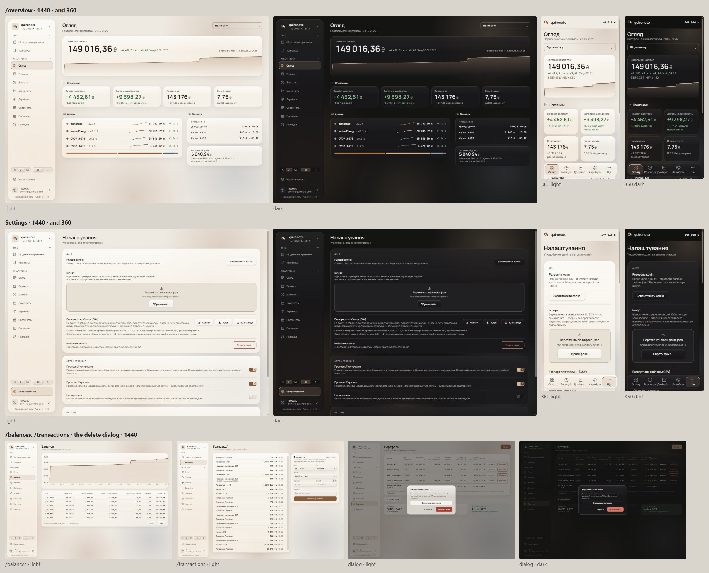

# Typography and numbers (wave 18)

Today the app has 18 arbitrary sizes from 9 to 26 px, 25 line heights, and no scale or floor written down; uppercase labels at four sizes and three trackings; the capital at 600 in the sidebar but 700 in the 360 header; and `font-mono` falling back to the system monospace, because no `--font-mono` is defined. This wave sets the role of each face, a scale with a floor, the small labels, and the KPI figure.

Every size maps to a role, so it overturns the earlier waves' sizes and line heights that fall outside the role table: everything under 11 px, 11.5, 12.5, 14 and 16 px, 12 / 18, and the ₴ of wave 1's tiles (15 / 500). Those lines point here. Two signed sizes fit no role; they are left open below.

## Renders

Every pick together (R2, S3, L3, K2) with wave 17's controls and wave 15's light glass: /overview and Settings at 1440 and 360; /balances, /transactions and the delete dialog at 1440; light and dark. The smallest text is 11 px on every screen, no text box overflows, and nothing scrolls sideways.

## Signed

- **The role table.** Each role is one size and line height; every size in use today maps to one of them.

  | Role | Size / line | Face | Weight, tracking, case | Today's sizes it absorbs |
  | --- | --- | --- | --- | --- |
  | label | 11 / 14 | Manrope | 500 caps +.12em (section titles, sidebar groups, column heads); 600 +.04em sentence case (labels over a figure) | 9, 9.5, 10, 10.5 |
  | small | 12 / 16 | Manrope (prose) · mono (figures) | 400; chart ticks and chips are 11 (label size) | 11, 11.5, 12, `text-xs` |
  | body | 13 / 18 | Manrope (prose, nav, buttons) · mono (fields, figures in rows) | 400 / 600; active nav 700 | 13, 13.5, 14, `text-sm` |
  | table | 13 / 18 | JetBrains Mono | cells 400, dates 600, totals 700 (held) | 12.5 |
  | sub | 15 / 20 | Manrope | 600 | 15, 16, `text-base` (not fields) |
  | h3 | 17 / 22 | Manrope | 600 | 17, 18, `text-lg` |
  | kpi | 22 / 26 | Manrope | 600 −.01em, K2 | 19, 22 |
  | title | 26 / 32 | Manrope | 600 | 26 |
  | display (wave 1, held) | capital 46 (360: 32) · tiles 30 (360: 22) · income 24 | Manrope | 600 −.01em, K2 | the signed canvas |

- **Faces (R2).**
  - Manrope, with `tnum` from `body`'s `tabular-nums`, for headings, prose, subtitles, labels, nav, buttons, footnotes, dialog text, KPI and display figures.
  - JetBrains Mono for data: tables, figures inside rows (amounts, percentages, row dates), fields, chart ticks and IDs.
  - `--font-mono` becomes JetBrains Mono, so the uses of `font-mono` stop falling back to the system monospace.
- **Floor: 11 px** (Apple's iOS minimum; M3 Label S). Nothing renders smaller.
  - Fields stay 16 below md, the iOS zoom fix.
  - The 360 dock's «Дохідність» truncates at 11 px. The implementation must fit it, for example with −.01em on the dock label or a wider tab. No new size.
- **Line heights** are the role's own px values above, never a fixed box height, so WCAG 1.4.12's overrides (1.5 line, 0.12 letter, 0.16 word) only grow the box.
- **Labels (L3).**
  - Uppercase +.12em, 500 for section titles, sidebar groups and column heads.
  - Sentence case +.04em, 600 for a label that names a figure (KPI labels, the capital's label).
  - The other trackings (.08, .06, .02 em) retire.
- **The KPI figure (K2).**
  - The integer and decimals at the role size, Manrope 600, −.01em, the sign colour held.
  - The ₴ at 70 %, `muted`, 500, .18em from the digits.
  - It applies to every `kpi` and `display` figure: the capital in the card and the 360 card, the KPI tiles, «Отриманий дохід». The sidebar's one-line capital is body text and keeps one string.
  - The capital's weight is one: 600.
  - `money.ts` keeps its grammar and gains a way to hand back the unit apart (a parts formatter or a wrapper); tables keep one string.
- **Colours** are unchanged. Muted text at 11–13 px still needs AA, which the tokens give.
- **Records superseded.**
  - `docs/DECISIONS.md` *Language, numbers, fonts*: "JetBrains Mono for body and tables" becomes "for data"; the paragraph gains the role table and the floor.
  - `muted-legibility`: muted renders 11–13 px, no longer 9.5–13.
  - `screen-density`: the 10 px eyebrow becomes 11.
  - `data-portability`: "13px Space Grotesk", a stale face.
- **New copy.** None.

## Rejected

- **R1, today's split** (JetBrains Mono for body, subtitles, labels, nav, tables, fields and chart ticks): long prose reads as code, and no system the research checked sets UI text in mono.
- **R3, Manrope everywhere, mono only for table cells and IDs:** mono nearly disappears, and the app loses its most recognisable trait.
- **S1, today's sizes consolidated** (floor 10, keeping 12.5): a half-pixel size stays, and the floor is below Apple's iOS minimum.
- **S2, desktop-dense on Fluent / M3 steps** (body 14, floor 11): everything grows about 1 px, and dense screens lose rows.
- **L1, every small label uppercase:** fifteen uppercase labels on one screen; GOV.UK warns that block capitals are hard to read.
- **L2, every small label in sentence case:** section titles lose their mark.
- **K1, one string** (the ₴ at full size): at 46 px the ₴ competes with the digits, and wave 1's smaller tile ₴ is undone.
- **K3, K2 plus the decimals at 70 %:** the decimals read as less true, and the visible precision varies by size.

## Settled by research

- **Tabular figures in a proportional face.** Apple (`monospacedDigit()`), Polaris (`numeric`) and GOV.UK (table cells) set figures as tabular in a proportional face. None recommends a monospace face for UI numbers.
- **Product type scales use 8–11 sizes.** S3 follows Apple's macOS styles (body 13, footnote / caption 10–11, title 2 17, title 1 22, large title 26).
- **The label's case.** M2's overline is uppercase and "used sparingly", for introducing a section; M3 dropped it for Label S (11 / 16, no case transform); GOV.UK keeps capitals to short text.

## Settled with the brief

- The two faces, both covering Є І Ї Ґ and ₴.
- `font-mono` fixed to JetBrains Mono.
- `tabular-nums` on `body`.
- Line heights as a ratio per role, surviving WCAG 1.4.12's overrides.
- The number grammar, held.

## Left open

Two sizes signed before this wave fit no role in the table, and are not in the display row (wave 1's canvas). No wave decides them, so the census test below cannot pass until they are mapped or named as display sizes:

- Manrope 36 / 600: the «Атрибути» hero figure (wave 7, [attributes-item.md](attributes-item.md#signed)) and the archive's empty-days figure (wave 10, [super-admin.md](super-admin.md#signed)).
- Manrope 20 / 600: the first-look card's title (wave 12, [empty-loading-error.md](empty-loading-error.md#signed)).

## Implementation checks

- `ui-face.test.ts` holds `tabular-nums` and gains the face split.
- A new census test: no `text-[Npx]`, `leading-[…]` or tracking outside the role table, and no text below 11.
- A KPI test: the ₴ is its own span.
- Manrope's space, which the NBSP group separator also uses, is much narrower than JetBrains Mono's full cell, so «149 016 ₴» groups read tighter in Manrope. The KPI figures already show this today.
