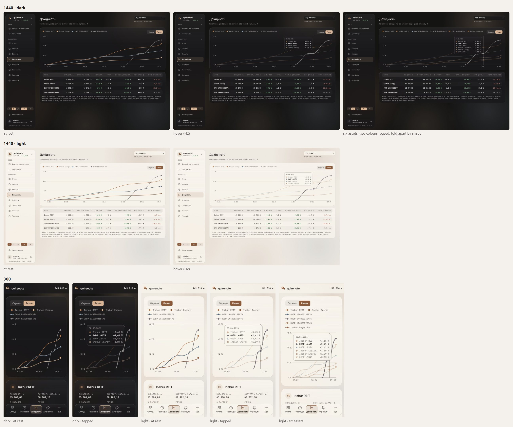

# /yield: telling the lines apart (wave 14)

The «Разом» view of /yield draws every asset's return on one chart. The asset hues alone cannot tell its lines apart, so each line gets a shape as a second cue. Wave 3's small multiples stay the default view, and the «Окремо / Разом» toggle stays as wave 3 signed it. Wave 3 rejected "shapes as identity"; that rejection is overturned for this view only.

## Renders

The six-asset frames add two composed lines to the chart only. They show the case the palette cannot solve: REIT and the fifth asset share a colour, as do Energy and the sixth, and their shapes tell them apart. No frame scrolls sideways, and the tooltip stays inside the plot at both widths.

*Overturned by wave 20: eight slots in a fixed order, so only a 9th asset shares a colour ([palette.md](palette.md#signed)).*

## Signed

- **Shape per asset.** Assigned by the asset's order (`createdAt`), never by its colour slot: circle, square, triangle, diamond, triangle-down, cross, then repeating. A fifth and sixth asset reuse a colour but still differ by shape.
  - *Overturned by wave 20: eight slots in a fixed order, so only a 9th asset reuses a colour ([palette.md](palette.md#signed)).*
- **Glyph (G1).** Filled in the series colour on a 2 px `card` ring (`paint-order: stroke`). 9 px across, 10 at the crosshair, 12 when focused. One drawing serves the end mark, the crosshair marks, the legend key and the tooltip key.
- **At rest (M1).** 2 px lines with round joins and no marks along them; each line ends in its glyph. Wave 3's grid, ticks and 0 % line are held.
- **Legend.** Above the plot, left of the toggle (stacked under it at 360), 11.5 px `muted`. Each key is a 22 px segment in the series colour with the glyph on it, then the name. Only assets with a line in the period are listed.
  - *Overturned by wave 18: 11.5 px maps to the small role, 12 / 16 ([type.md](type.md#signed)).*
- **Hover (H2).** At md and up on pointer move; below md on tap, pinned until a second tap or Escape.
  - The crosshair snaps to the nearest date: 1 px `field-border`, full plot height.
  - Every line shows its glyph at the crosshair.
  - The line nearest the pointer by vertical distance is focused. It draws at 3 px with its glyph at 12 px on top; the others fall to 30 %.
  - The glass tooltip (r12, padding 9 / 12, 12 px, `field-border` edge) shows the date in `muted` 11 px, then one row per series sorted by value, descending.
    - *Overturned by wave 25: the tooltip wears the glass edge ([open-values-charts-type.md](open-values-charts-type.md#signed)).*
  - Each row is the glyph key, the short name and the value in 700. The focused row is bold and the others are at 55 %.
  - The tooltip sits right of the crosshair, left of it past mid-plot, and inside the plot's left edge below 500 px.
- **Keyboard.** The plot is focusable. Arrow keys walk the dates; Up and Down move the focus between lines, nearest first. Escape releases.
- **Motion.** The focus change fades over 150 ms on `ease-soft`, stilled by reduced motion. Wave 3's entry timing is held.
- **Contrast.** Every series line and glyph is at least 3 : 1 on the card. The 30 % fade applies only while hovering, which WCAG 1.4.11 allows.
  - *Overturned by wave 20: in dark, three asset slots sit under the non-text floor and take the relief rule ([palette.md](palette.md#signed)).*
- **Held.** The palette; no dashes for identity (a dash means "expected" in this app); no direct end labels (rejected in wave 3); the tooltip's text stays in `ink`.
- **New copy:** none.

## Rejected

- **M2, a glyph every ~80 px along each line**, offset per series: busy, and busier where the lines bunch near 0 %.
- **M3, a glyph on each month's first day:** every line marks the same x, so the glyphs stack where lines meet, and a one-month window shows only the end.
- **G2, outlined glyphs:** a hollow 9 px shape carries little colour, so on dark the two near-grey bond hues fade further.
- **G3, a bare filled glyph with no ring:** where a glyph lands on another line it merges with it.
- **H1, a keyed tooltip with no focus:** where two lines meet, the reader still has to match overlapping shapes to rows by shape alone.
- **H3, H2 plus legend toggles** (hover dims the others, press isolates a line): the legend becomes a set of toggle buttons with 44 hit areas, a keyboard order and a state that outlives the hover, and it duplicates the «Окремо» view's job.
- **Still out:** dashes for identity, direct end labels (wave 3), hue changes (the palette is held).

## Settled by research

- **A shape per line is the second cue.** W3C technique G111: "marked with a distinctive icon such as a diamond, square, or circle". NN/g: "Shape or clear visual grouping are more reliable signals".
- **The legend mirrors every channel** (Carbon; G111: "The legend uses the same colors and patterns"), so its key is a line segment carrying the glyph.
- **Shape order** follows Highcharts and Vega (circle, square, triangle, diamond, then triangle-down and cross). Datawrapper: "Limit yourself to three or four".
- **Nearest-line focus** follows Observable Plot's `pointerX`, Highcharts' inactive state and Carbon's 30 % dim.
- **The keyboard map** follows Visa's line-chart pattern: arrows walk the dates, Up and Down move between lines.
- **The ringed glyph** reuses wave 3's ringed end marker.

## Implementation checks

- `tooltip-rows.test.ts` forbids a custom `content=`. The keyed, focus-aware tooltip needs one, as wave 3 already noted.
- `YieldLines` has no render test of its own (the screens mock it). The new behaviour needs one: shapes by order, the legend listing only drawn lines, rows sorted by value.
- A `name` on each `<Line>` fixes today's rows, which are ordered by asset id.
- The palette itself stays a separate brief (#13); the shapes carry identity here without it.
