# Email: the shared layout and every message

The design of every message the released app sends, in Ukrainian and English. The brief is a comment on #584; the code that builds from it is #585 (the template package), #587 (the invitation), #589 (passkey added, welcome), #590 (the deletion notices) and #591 (the super-admin's notices), and #592 takes its list of kinds for the legal copy.

It is drawn against the signed layout refresh, `../2026-11-05-layout-refresh/`: the wave-24 «q» plate, wave 18's faces, wave 17's primary button, wave 1's opaque card as the glass's signed fallback. It is not drawn against the app as it ships today. **The email leads with the «q»**: it carries the new mark before the app does, and *Brand* records that exception.

The renders below are the email HTML itself, drawn in the fallback font stack, at 600 and 360 wide, in both palettes. Every frame is Ukrainian; English is in each message's copy table.

## Layout

| Part | Rule |
| --- | --- |
| Width | Fluid up to 600; a fixed 600 table for classic Outlook. The narrow layout below applies under 600 (`max-width: 599px`). |
| Composition | One card holds everything: the header, the message and the footer. On `page`, the card is `card` with a 1 px `hairline` edge and r20, inset 24 from the page. At 360 the card runs full-bleed with square corners (*Shape system*: a full-bleed band is square) and a `hairline` above and below. |
| Padding | 32 inside the card at 600, 16 at 360. 32 between the header and the heading at 600, 24 at 360. |
| Header | The 40 plate (r10, the «q» at 22/40 of the side) and «quirenote» at 17/600, `ink`, 10 apart. In mail the plate is a 2× PNG per theme, with `width`, `height` and `alt="Quirenote"`: the light plate by default, the dark one under `prefers-color-scheme: dark`. Clients that ignore the query (Gmail, classic Outlook) show the light plate. |
| Greeting | «Вітаємо!» / “Hello,” as its own paragraph under the heading. |
| Body | Paragraphs 16 apart. |
| Action | One primary button per message at most: `accent` fill and edge, `accent-fg` label, 44 tall, r11 = round(44 × 0.26), 24 side padding, 8 above. Classic Outlook squares its corners. Under it, always, a `muted` small line: «Або відкрийте:» / “Or open:” and the full URL as an `accent` link. |
| Credential | A `panel` box, r = round(height × 0.26), padding 16 / 20. Each row is a label (label role, 600, +.04em, `muted`) over its value: the address in the body face, the password or code in the mono stack at 22/28, 700, +.08em, `ink`. Live text, never an image. |
| Note | The “if it was not you” block: a `hairline` rule above, 16 padding, the lead in 700 and the rest in the body role. |
| Closing | «З повагою,» / “Best regards,” then «команда Quirenote» / “The Quirenote team”, 24 above, two lines. |
| Footer | Under a `hairline`, in the small role, `muted`: why the reader got the mail, and how to reach support; then «Quirenote · quirenote.com». No unsubscribe line and no postal address: these are transactional messages. |

**Type.** The faces are wave 18's, with a fallback stack that is the main rendering in mail: Manrope, then `-apple-system, 'Segoe UI', Roboto, Helvetica, Arial, sans-serif`; the mono is JetBrains Mono, then `Menlo, Consolas, 'Courier New', monospace`. The sizes are mail's own role table, since mail practice sets the body at 16:

| Role | Size / line | Use |
| --- | --- | --- |
| heading | 26 / 32 (360: 22 / 28), 600 | the message's one `h1` |
| body | 16 / 24 | paragraphs, the note, the closing, the address |
| small | 13 / 18 | the URL line, the footer |
| label | 12 / 16, 600, +.04em | credential labels |
| credential | 22 / 28 mono, 700, +.08em | the password and the code |
| button | 16 / 20, 600 | the button label |

**Colour.** Every colour is a `src/index.css` token in the frame's theme; none is minted here. Light is the default; the dark tokens apply under `prefers-color-scheme: dark` (Apple Mail, Outlook.com, Outlook for iOS, Android and macOS honour it); Gmail and classic Outlook apply their own inversion. The `color-scheme` meta is `light dark`, never `light only`.

| Token | Use |
| --- | --- |
| `page` | around the card |
| `card` | the card; the «q» in the plate |
| `hairline` | the card's edge, the rules above the note and the footer |
| `ink` | the heading, body, values, wordmark, closing |
| `muted` | labels, the URL line, the footer |
| `panel` | the credential box |
| `accent`, `accent-fg` | the button; the URL link |
| `logo-outline` | the plate |

## Markup rules for #585

- `lang` and `dir` on the wrapper, `role="presentation"` on every layout table, a `color-scheme` meta.
- Links are absolute, to the environment's own origin, never built from a request, and never through a tracking redirect.
- The `format-detection` meta and the `x-apple-data-detectors` rule, so the code and the dates are not turned into links.
- A plain-text twin with the same facts for every mail the mail function sends (#588), wrapped at 78 columns, the action's URL on its own line (see the passkey notice's below). Cognito's CustomMessage answers with one HTML `emailMessage` and no text part, so the invitation and the code have none.
- The HTML stays well under Gmail's ~102 KB clip. Both Cognito kinds keep `{####}`, the invitation also `{username}`, and each stays under Cognito's 20,000 characters.
- The invitation's address row reads the account's `email` attribute. Cognito requires `{username}` in the message, but in this pool the username is a UUID and the address reaches the account by alias (`docs/reference/COGNITO-POOL-PARAMS.md`), so #587 places `{username}` where the reader is never asked to use it.

## Voice

Light, pleasant and professional: the reader is looked after, not befriended.

- «Ви» and every form of it are capitalised in mail (Правопис 2019 §60.2; Microsoft's Ukrainian style guide: “capitalized in private letters, emails and email notifications addressed to specific people”); the app's own screens keep lower case.
- «Вітаємо!» / “Hello,”, never «Привіт» (a greeting “з друзями або знайомими”, Горох); «З повагою» closes it.
- No exclamation mark past the greeting (Microsoft: “usually they should not be used in Ukrainian”; Mailchimp: “Never use exclamation points in failure messages or alerts”).
- Warmth is one thank-you where it fits (the invitation, the welcome, and both account-deleted mails), clear help and a named way to support, never chummy phrases (NN/g: “The speech is too chummy … takes away some of the credibility”).
- A security notice says what happened and when (`dd.MM.yyyy HH:mm` Kyiv time), that nothing is needed if it was the reader, and what to do if it was not, with support@ (NIST SP 800-63B-4 Sec. 4.6; Ory Kratos and Keycloak notices).
- Subjects keep their meaning in the first 33 characters and stay under 45; pre-headers stay under 90. The brand is in the From name, `Quirenote <support@quirenote.com>`; only the welcome, whose subject is the name itself, carries it in the subject. #585's tests pin these limits.
- The invitation says what Quirenote is and that it follows an application, and that no one will ask for the password (Postmark: invitations “can be eerily similar to phishing scams”). It names no other company.

## Messages

Each section shows the message at 600 and 360 in both palettes, with its inbox line (From, subject, pre-header) above. The sample values are fixed: the deletion's day is core's `deletionLastDay` for a press at 07.11.2026 14:32 Kyiv.

### Invitation — `invitation`

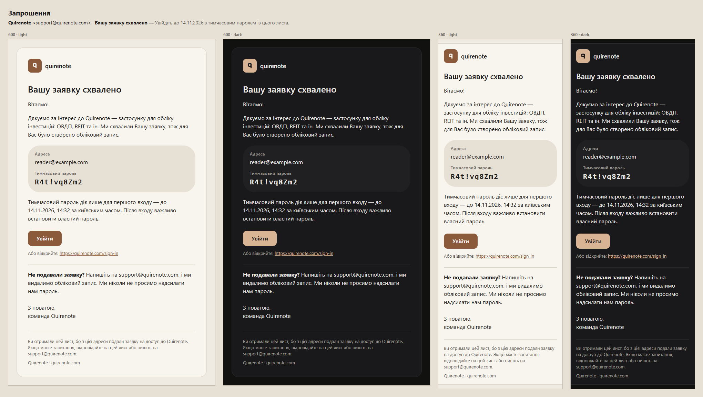

| Part | Українська | English |
| --- | --- | --- |
| Subject | Вашу заявку схвалено | Your application is approved |
| Pre-header | Увійдіть до 14.11.2026 з тимчасовим паролем із цього листа. | Sign in by 14.11.2026 with the temporary password in this email. |
| Body | **Вашу заявку схвалено** | **Your application is approved** |
| Body | Вітаємо! | Hello, |
| Body | Дякуємо за інтерес до Quirenote — застосунку для обліку інвестицій: ОВДП, REIT та ін. Ми схвалили Вашу заявку, тож для Вас було створено обліковий запис. | Thank you for your interest in Quirenote, an app for tracking your investments: Ukrainian government bonds, REITs and more. We’ve approved your application, so an account has been created for you. |
| Body | Адреса: `reader@example.com` · Тимчасовий пароль: `R4t!vq8Zm2` | Address: `reader@example.com` · Temporary password: `R4t!vq8Zm2` |
| Body | Тимчасовий пароль діє лише для першого входу — до 14.11.2026, 14:32 за київським часом. Після входу важливо встановити власний пароль. | The temporary password is valid for your first sign-in only, until 14.11.2026, 14:32 Kyiv time. After signing in, it’s important to set your own password. |
| Body | [Увійти] https://quirenote.com/sign-in | [Sign in] https://quirenote.com/sign-in |
| Body | **Не подавали заявку?** Напишіть на support@quirenote.com, і ми видалимо обліковий запис. Ми ніколи не просимо надсилати нам пароль. | **Didn’t apply?** Write to support@quirenote.com, and we’ll delete the account. We never ask you to send us a password. |
| Closing | З повагою, / команда Quirenote | Best regards, / The Quirenote team |
| Footer | Ви отримали цей лист, бо з цієї адреси подали заявку на доступ до Quirenote. Якщо маєте запитання, відповідайте на цей лист або пишіть на support@quirenote.com. | You’re receiving this email because an application to Quirenote was made with this address. If you have any questions, reply to this email or write to support@quirenote.com. |

### Code (Cognito’s other triggers) — `code`

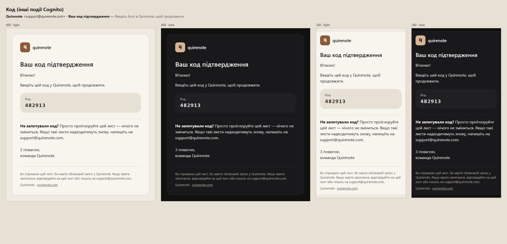

| Part | Українська | English |
| --- | --- | --- |
| Subject | Ваш код підтвердження | Your verification code |
| Pre-header | Введіть його в Quirenote, щоб продовжити. | Enter it in Quirenote to continue. |
| Body | **Ваш код підтвердження** | **Your verification code** |
| Body | Вітаємо! | Hello, |
| Body | Введіть цей код у Quirenote, щоб продовжити. | Enter this code in Quirenote to continue. |
| Body | Код: `482913` | Code: `482913` |
| Body | **Не запитували код?** Просто проігноруйте цей лист — нічого не зміниться. Якщо такі листи надходитимуть знову, напишіть на support@quirenote.com. | **Didn’t request a code?** You can ignore this email; nothing will change. If you keep receiving them, write to support@quirenote.com. |
| Closing | З повагою, / команда Quirenote | Best regards, / The Quirenote team |
| Footer | Ви отримали цей лист, бо маєте обліковий запис у Quirenote. Якщо маєте запитання, відповідайте на цей лист або пишіть на support@quirenote.com. | You’re receiving this email because you have a Quirenote account. If you have any questions, reply to this email or write to support@quirenote.com. |

### Passkey added — `passkey-added`

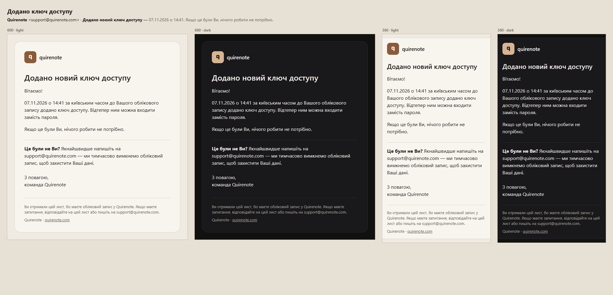

| Part | Українська | English |
| --- | --- | --- |
| Subject | Додано новий ключ доступу | A new passkey was added |
| Pre-header | 07.11.2026 о 14:41. Якщо це були Ви, нічого робити не потрібно. | On 07.11.2026 at 14:41. If this was you, no action is needed. |
| Body | **Додано новий ключ доступу** | **A new passkey was added** |
| Body | Вітаємо! | Hello, |
| Body | 07.11.2026 о 14:41 за київським часом до Вашого облікового запису додано ключ доступу. Відтепер ним можна входити замість пароля. | On 07.11.2026 at 14:41 Kyiv time, a passkey was added to your account. You can now use it to sign in instead of a password. |
| Body | Якщо це були Ви, нічого робити не потрібно. | If this was you, no action is needed. |
| Body | **Це були не Ви?** Якнайшвидше напишіть на support@quirenote.com — ми тимчасово вимкнемо обліковий запис, щоб захистити Ваші дані. | **Wasn’t you?** Write to support@quirenote.com as soon as possible, and we’ll temporarily disable the account to protect your data. |
| Closing | З повагою, / команда Quirenote | Best regards, / The Quirenote team |
| Footer | Ви отримали цей лист, бо маєте обліковий запис у Quirenote. Якщо маєте запитання, відповідайте на цей лист або пишіть на support@quirenote.com. | You’re receiving this email because you have a Quirenote account. If you have any questions, reply to this email or write to support@quirenote.com. |

### Welcome — `welcome`

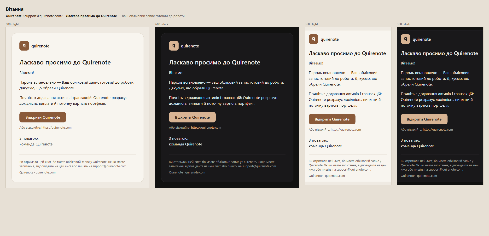

| Part | Українська | English |
| --- | --- | --- |
| Subject | Ласкаво просимо до Quirenote | Welcome to Quirenote |
| Pre-header | Ваш обліковий запис готовий до роботи. | Your account is ready to use. |
| Body | **Ласкаво просимо до Quirenote** | **Welcome to Quirenote** |
| Body | Вітаємо! | Hello, |
| Body | Пароль встановлено — Ваш обліковий запис готовий до роботи. Дякуємо, що обрали Quirenote. | Your password is set, and your account is ready to use. Thank you for choosing Quirenote. |
| Body | Почніть з додавання активів і транзакцій: Quirenote розрахує дохідність, виплати й поточну вартість портфеля. | Start by adding your assets and transactions, and Quirenote will calculate your yield, payouts and current portfolio value. |
| Body | [Відкрити Quirenote] https://quirenote.com | [Open Quirenote] https://quirenote.com |
| Closing | З повагою, / команда Quirenote | Best regards, / The Quirenote team |
| Footer | Ви отримали цей лист, бо маєте обліковий запис у Quirenote. Якщо маєте запитання, відповідайте на цей лист або пишіть на support@quirenote.com. | You’re receiving this email because you have a Quirenote account. If you have any questions, reply to this email or write to support@quirenote.com. |

### Deletion scheduled — `deletion-scheduled`

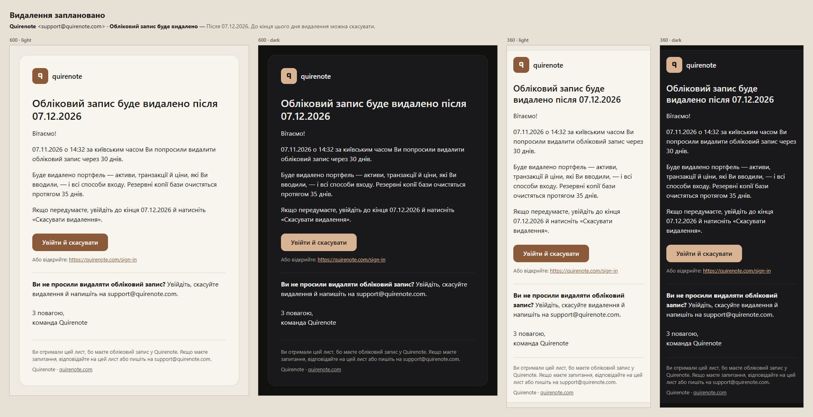

| Part | Українська | English |
| --- | --- | --- |
| Subject | Обліковий запис буде видалено | Your account will be deleted |
| Pre-header | Після 07.12.2026. До кінця цього дня видалення можна скасувати. | After 07.12.2026. You can cancel until the end of that day. |
| Body | **Обліковий запис буде видалено після 07.12.2026** | **Your account will be deleted after 07.12.2026** |
| Body | Вітаємо! | Hello, |
| Body | 07.11.2026 о 14:32 за київським часом Ви попросили видалити обліковий запис через 30 днів. | On 07.11.2026 at 14:32 Kyiv time, you asked for your account to be deleted in 30 days. |
| Body | Буде видалено портфель — активи, транзакції й ціни, які Ви вводили, — і всі способи входу. Резервні копії бази очистяться протягом 35 днів. | This will delete your portfolio — the assets, transactions and prices you entered — and every way to sign in. Database backups are cleared within 35 days. |
| Body | Якщо передумаєте, увійдіть до кінця 07.12.2026 й натисніть «Скасувати видалення». | If you change your mind, sign in by the end of 07.12.2026 and press “Cancel deletion”. |
| Body | [Увійти й скасувати] https://quirenote.com/sign-in | [Sign in to cancel] https://quirenote.com/sign-in |
| Body | **Ви не просили видаляти обліковий запис?** Увійдіть, скасуйте видалення й напишіть на support@quirenote.com. | **Didn’t request this?** Sign in, cancel the deletion and write to support@quirenote.com. |
| Closing | З повагою, / команда Quirenote | Best regards, / The Quirenote team |
| Footer | Ви отримали цей лист, бо маєте обліковий запис у Quirenote. Якщо маєте запитання, відповідайте на цей лист або пишіть на support@quirenote.com. | You’re receiving this email because you have a Quirenote account. If you have any questions, reply to this email or write to support@quirenote.com. |

### Deletion cancelled — `deletion-cancelled`

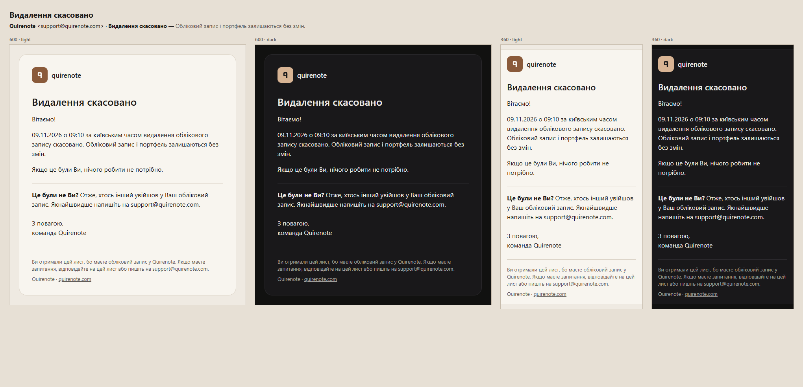

| Part | Українська | English |
| --- | --- | --- |
| Subject | Видалення скасовано | Deletion cancelled |
| Pre-header | Обліковий запис і портфель залишаються без змін. | Your account and portfolio remain unchanged. |
| Body | **Видалення скасовано** | **Deletion cancelled** |
| Body | Вітаємо! | Hello, |
| Body | 09.11.2026 о 09:10 за київським часом видалення облікового запису скасовано. Обліковий запис і портфель залишаються без змін. | On 09.11.2026 at 09:10 Kyiv time, the deletion of your account was cancelled. Your account and portfolio remain unchanged. |
| Body | Якщо це були Ви, нічого робити не потрібно. | If this was you, no action is needed. |
| Body | **Це були не Ви?** Отже, хтось інший увійшов у Ваш обліковий запис. Якнайшвидше напишіть на support@quirenote.com. | **Wasn’t you?** Then someone else has signed in to your account. Write to support@quirenote.com as soon as possible. |
| Closing | З повагою, / команда Quirenote | Best regards, / The Quirenote team |
| Footer | Ви отримали цей лист, бо маєте обліковий запис у Quirenote. Якщо маєте запитання, відповідайте на цей лист або пишіть на support@quirenote.com. | You’re receiving this email because you have a Quirenote account. If you have any questions, reply to this email or write to support@quirenote.com. |

### Account deleted — `account-deleted`

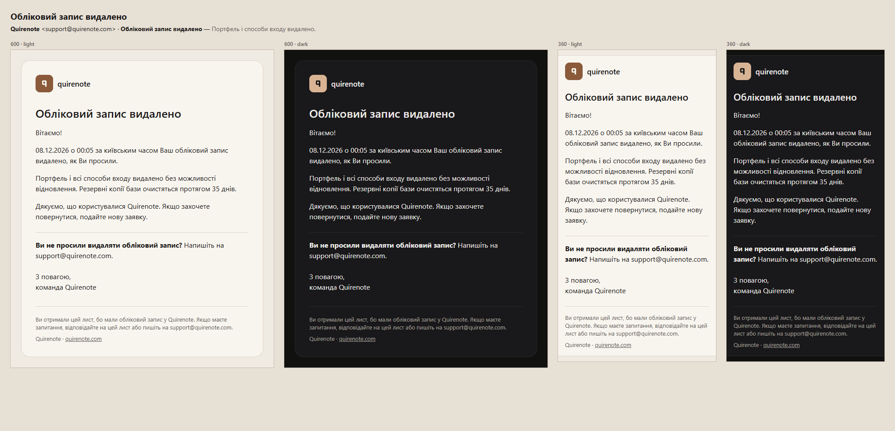

| Part | Українська | English |
| --- | --- | --- |
| Subject | Обліковий запис видалено | Your account has been deleted |
| Pre-header | Портфель і способи входу видалено. | Your portfolio and sign-in methods have been deleted. |
| Body | **Обліковий запис видалено** | **Your account has been deleted** |
| Body | Вітаємо! | Hello, |
| Body | 08.12.2026 о 00:05 за київським часом Ваш обліковий запис видалено, як Ви просили. | On 08.12.2026 at 00:05 Kyiv time, your account was deleted, as you requested. |
| Body | Портфель і всі способи входу видалено без можливості відновлення. Резервні копії бази очистяться протягом 35 днів. | Your portfolio and every way to sign in have been deleted and can’t be restored. Database backups are cleared within 35 days. |
| Body | Дякуємо, що користувалися Quirenote. Якщо захочете повернутися, подайте нову заявку. | Thank you for using Quirenote. If you’d like to return, you’re welcome to apply again. |
| Body | **Ви не просили видаляти обліковий запис?** Напишіть на support@quirenote.com. | **Didn’t request this?** Write to support@quirenote.com. |
| Closing | З повагою, / команда Quirenote | Best regards, / The Quirenote team |
| Footer | Ви отримали цей лист, бо мали обліковий запис у Quirenote. Якщо маєте запитання, відповідайте на цей лист або пишіть на support@quirenote.com. | You’re receiving this email because you had a Quirenote account. If you have any questions, reply to this email or write to support@quirenote.com. |

### Disabled by the super-admin — `account-disabled`

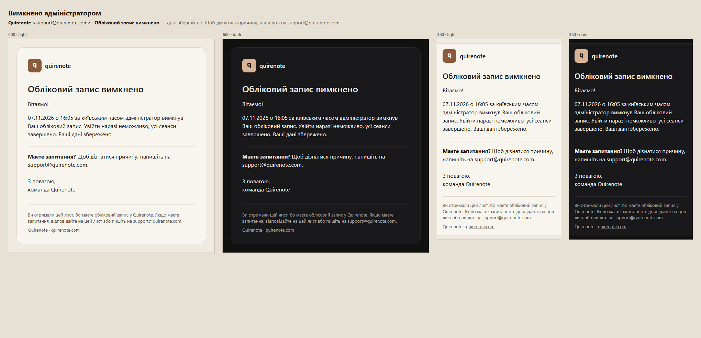

| Part | Українська | English |
| --- | --- | --- |
| Subject | Обліковий запис вимкнено | Your account has been disabled |
| Pre-header | Дані збережено. Щоб дізнатися причину, напишіть на support@quirenote.com. | Your data is kept. To find out why, write to support@quirenote.com. |
| Body | **Обліковий запис вимкнено** | **Your account has been disabled** |
| Body | Вітаємо! | Hello, |
| Body | 07.11.2026 о 16:05 за київським часом адміністратор вимкнув Ваш обліковий запис. Увійти наразі неможливо, усі сеанси завершено. Ваші дані збережено. | On 07.11.2026 at 16:05 Kyiv time, an administrator disabled your account. You can’t sign in for now, and all sessions have ended. Your data is kept. |
| Body | **Маєте запитання?** Щоб дізнатися причину, напишіть на support@quirenote.com. | **Questions?** To find out why, write to support@quirenote.com. |
| Closing | З повагою, / команда Quirenote | Best regards, / The Quirenote team |
| Footer | Ви отримали цей лист, бо маєте обліковий запис у Quirenote. Якщо маєте запитання, відповідайте на цей лист або пишіть на support@quirenote.com. | You’re receiving this email because you have a Quirenote account. If you have any questions, reply to this email or write to support@quirenote.com. |

### Enabled again — `account-enabled`

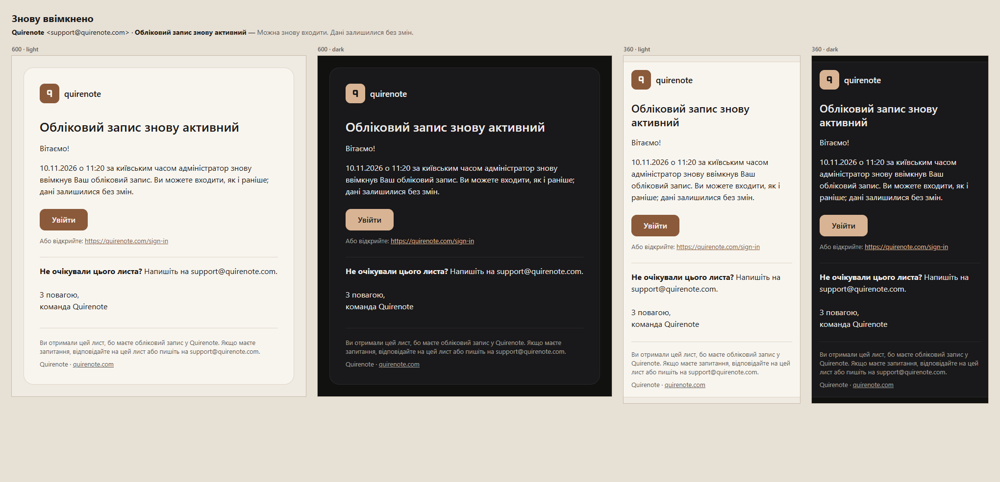

| Part | Українська | English |
| --- | --- | --- |
| Subject | Обліковий запис знову активний | Your account is active again |
| Pre-header | Можна знову входити. Дані залишилися без змін. | You can sign in again. Your data is unchanged. |
| Body | **Обліковий запис знову активний** | **Your account is active again** |
| Body | Вітаємо! | Hello, |
| Body | 10.11.2026 о 11:20 за київським часом адміністратор знову ввімкнув Ваш обліковий запис. Ви можете входити, як і раніше; дані залишилися без змін. | On 10.11.2026 at 11:20 Kyiv time, an administrator enabled your account again. You can sign in as before, and your data is unchanged. |
| Body | [Увійти] https://quirenote.com/sign-in | [Sign in] https://quirenote.com/sign-in |
| Body | **Не очікували цього листа?** Напишіть на support@quirenote.com. | **Weren’t expecting this email?** Write to support@quirenote.com. |
| Closing | З повагою, / команда Quirenote | Best regards, / The Quirenote team |
| Footer | Ви отримали цей лист, бо маєте обліковий запис у Quirenote. Якщо маєте запитання, відповідайте на цей лист або пишіть на support@quirenote.com. | You’re receiving this email because you have a Quirenote account. If you have any questions, reply to this email or write to support@quirenote.com. |

### Deleted by the super-admin — `account-deleted-by-admin`

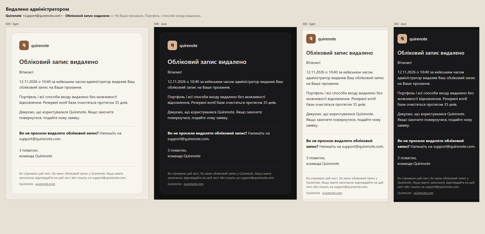

| Part | Українська | English |
| --- | --- | --- |
| Subject | Обліковий запис видалено | Your account has been deleted |
| Pre-header | На Ваше прохання. Портфель і способи входу видалено. | At your request. Your portfolio and sign-in methods have been deleted. |
| Body | **Обліковий запис видалено** | **Your account has been deleted** |
| Body | Вітаємо! | Hello, |
| Body | 12.11.2026 о 10:40 за київським часом адміністратор видалив Ваш обліковий запис на Ваше прохання. | On 12.11.2026 at 10:40 Kyiv time, an administrator deleted your account at your request. |
| Body | Портфель і всі способи входу видалено без можливості відновлення. Резервні копії бази очистяться протягом 35 днів. | Your portfolio and every way to sign in have been deleted and can’t be restored. Database backups are cleared within 35 days. |
| Body | Дякуємо, що користувалися Quirenote. Якщо захочете повернутися, подайте нову заявку. | Thank you for using Quirenote. If you’d like to return, you’re welcome to apply again. |
| Body | **Ви не просили видаляти обліковий запис?** Напишіть на support@quirenote.com. | **Didn’t request this?** Write to support@quirenote.com. |
| Closing | З повагою, / команда Quirenote | Best regards, / The Quirenote team |
| Footer | Ви отримали цей лист, бо мали обліковий запис у Quirenote. Якщо маєте запитання, відповідайте на цей лист або пишіть на support@quirenote.com. | You’re receiving this email because you had a Quirenote account. If you have any questions, reply to this email or write to support@quirenote.com. |

## The plain-text twin

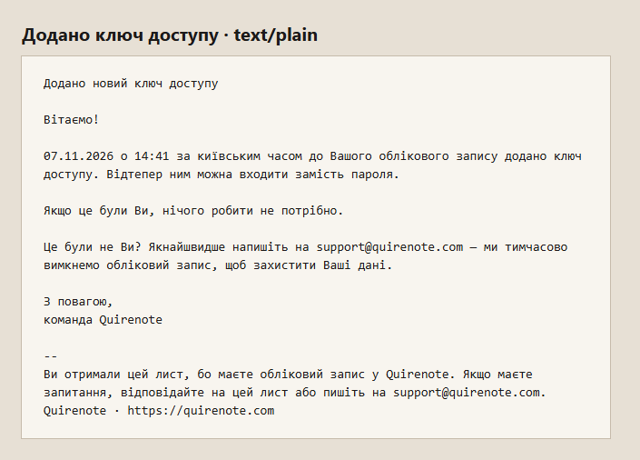

The text part carries the same blocks in the same order: the heading, the greeting, each paragraph wrapped at 78 columns, the action as its label and then the URL on its own line, the note, the closing, then `--` and the footer.

## For the code issues

- **#585** builds the layout and the invitation and code kinds from this page, ships the 40 plate of the «q» as a light and a dark PNG, the mail's own mark, and pins them in `mark.test.ts`. *Brand* already records that the mail's mark leads the app's.
- **#587** renders the invitation for `CustomMessage_AdminCreateUser` and the code message for every other trigger source, in the `locale` attribute's language. The super-admin bootstrap also goes through `AdminCreateUser`, and that reader never applied: #587 gives it copy that does not claim an application.
- **#589**, **#590** and **#591** each add their kinds from the sections above, under the keys the headings name. «На Ваше прохання» in `account-deleted-by-admin` holds only for a deletion on request; #591 sends other copy if the route deletes for any other reason. Every timestamp is the event's own, in Kyiv time; the deletion's day is the one the route stored.
- **#592** names these kinds where the apply page and the privacy notice say which mail comes.

## Rejected

- **Composition:** the letter on `card` with no frame (it loses the app's surface); the header and footer outside the card (at 360 the page bands read as extra chrome).
- **Type:** wave 18's app roles as they are (a 13 px body is under every mail source read); a 15 px midpoint.
- **Header:** the 28 plate of the 56 px bars (the brand then reads mostly from the From name); the plate without the wordmark (a new mark nobody knows yet).
- **Action:** wave 17's secondary flattened (on the card it is almost only an edge); a text link (a 24 px target instead of 44).
- **Credential:** 17 px (a symbol-heavy password is easy to misread); 28 px (a longer password wraps at 360).
- **Voice:** lower-case «ви» in mail; «Привіт!» and a soft, friendly draft («Нічого страшного», «Раді…», exclamations in the body), both read as familiar.

## Sources

- caniemail.com feature tables: `css-at-media-prefers-color-scheme`, `html-meta-color-scheme`, `css-at-font-face`, `image-svg`, `css-border-radius`.
- Mailchimp, “About HTML email” (width) and its Content Style Guide (voice, exclamation points).
- React Email source: `Container` (`maxWidth: '37.5em'`), `Button`, `Html` (`lang`, `dir`).
- GOV.UK Notify email template; GOV.UK Service Manual, “Sending emails and text messages”; NHS service manual, “Writing NHS messages”.
- Postmark, “Transactional email best practices” and its open-source templates.
- Litmus guides to dark mode, bulletproof buttons and preview text; Email on Acid on retina images; goodemailcode.com's template.
- WCAG 2.2 (2.5.5, 1.4.3, 3.1.1); RFC 5322 §2.1.1; SpamAssassin's `MPART_ALT_DIFF`.
- EmailToolTester, subject-line limits by client.
- NIST SP 800-63B-4 Sec. 4.6 and 4.1.2.1; OWASP Multifactor Authentication and Forgot Password cheat sheets.
- Gmail sender FAQ (transactional mail needs no unsubscribe); 16 CFR 316.3; Закон 675-VIII art. 3; Закон 2297-VI art. 21(3).
- Ory Kratos and Keycloak notification templates; Courier's new-device recipe.
- NN/g, “The Four Dimensions of Tone of Voice” and “The Impact of Tone of Voice on Users' Brand Perception”; Microsoft Writing Style Guide; Google developer documentation style guide; Atlassian Design System, voice and tone; Monzo, tone of voice.
- Microsoft Ukrainian Localization Style Guide; Український правопис 2019 §60; Горох and СУМ-11 on «привіт»; ВНТУ, «Ділове електронне листування: нові рекомендації».
